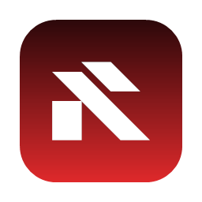
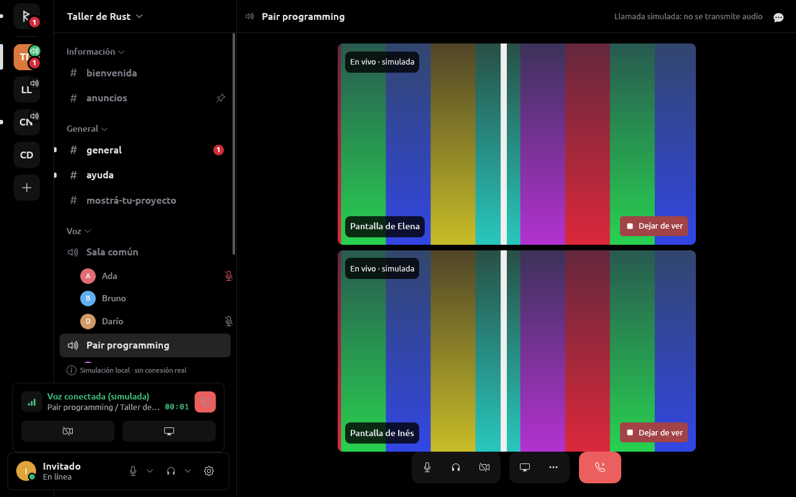
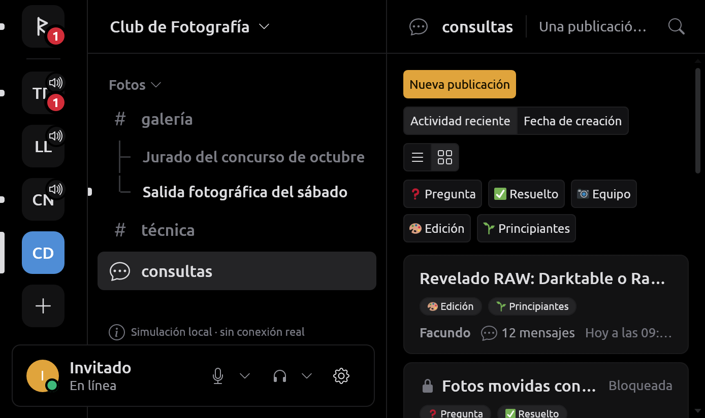
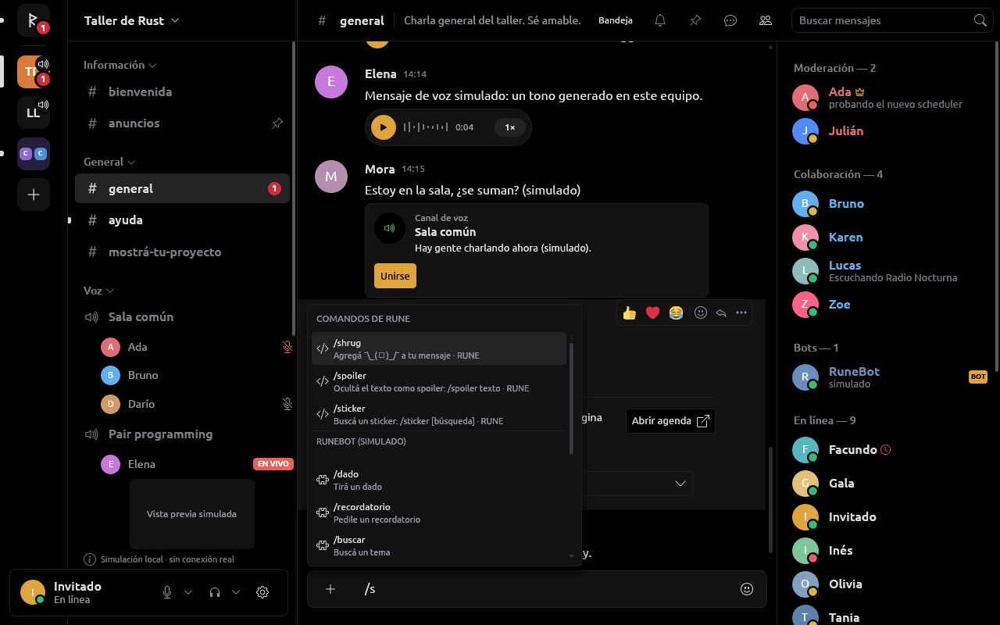
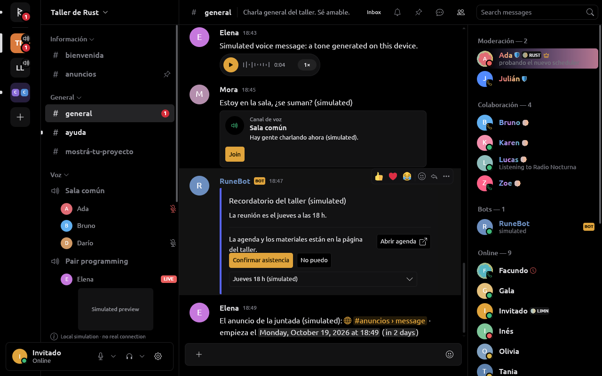
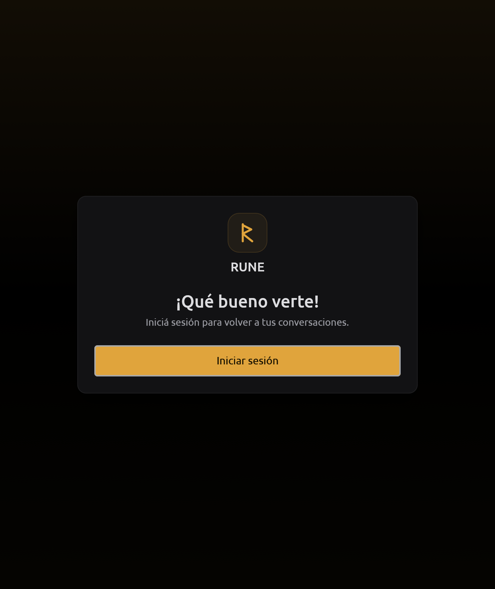

<p align="center">
  
</p>

<h1 align="center">RUNE</h1>

> [!WARNING]
> **RUNE es un cliente no oficial.** No está afiliado a Discord ni aprobado
> por Discord. Su proveedor de **sesión personal** usa tu cuenta de usuario
> fuera de la API documentada: eso va contra los
> [Términos de Servicio de Discord](https://discord.com/terms) y puede
> costarte la cuenta (suspensión o cierre). Usalo bajo tu responsabilidad,
> con una cuenta que aceptes perder. El proveedor **OAuth2
> oficial** sólo autoriza tu identidad y la lista de tus servidores
> (`identify guilds`): no da mensajes ni llamadas. Sin cuenta, RUNE abre una
> **simulación local**, marcada como tal en la interfaz.

**Rust UI, No Electron.** Un cliente de chat de escritorio nativo, escrito
en Rust, con una interfaz propia construida con
[limn](https://github.com/Niiihuel/limn). Pinta con Vulkan a través de wgpu,
sin Electron ni motor web; sólo el inicio de sesión y el hCaptcha que
resuelve la persona usan una WebView temporal, en otro proceso.


## Estado

Desarrollo activo. Linux primero; RUNE también compila para Windows y la
CI lo prueba ahí, pero nada se probó todavía en un Windows real
([docs/PLATFORM.md](docs/PLATFORM.md#windows)). macOS, más adelante.

- **Simulación local** (el proveedor por defecto): todo lo de abajo
  funciona con datos inventados y deterministas, y la interfaz lo dice
  («Simulación local · sin conexión real», «Llamada simulada…»).
- **Sesión personal no oficial** (`discord-session`): casi todo está
  implementado y probado con fixtures en loopback, nunca con cuentas reales
  ni la red real en las pruebas. El dueño la usó contra Discord el
  2026-10-17: el acceso, los servidores, los mensajes, los miembros y los
  perfiles funcionaron; la voz conectó a veces. **El resto no se probó
  contra Discord**: lo que falta probar está en
  [tasks/todo.md](tasks/todo.md) y el detalle de cada función en
  [docs/DISCORD_SESSION.md](docs/DISCORD_SESSION.md).
- **OAuth2 experimental** (`discord`): identidad y servidores; su canje
  público todavía no se validó con una aplicación registrada
  ([docs/DISCORD_OAUTH.md](docs/DISCORD_OAUTH.md)).

## Qué hace

- **Chat**: riel de servidores con carpetas, no leídos y menciones; canales
  por categorías, hilos, foros y anuncios; timeline virtualizado de altura
  variable que carga historial sin saltos; Markdown con código resaltado,
  respuestas, reacciones, menciones, fijados, encuestas, reenvíos, tarjetas
  de enlaces, componentes y comandos de aplicaciones; emoji de servidor en
  la línea; borradores que sobreviven al cierre.
- **Archivos**: subir hasta diez por mensaje con progreso y cancelación,
  pegar del portapapeles, imágenes y GIF animados, audio y video adjuntos
  dentro de RUNE, PDF multipágina con búsqueda, spoilers y «Guardar como…».
- **Voz y video**: llamadas en servidores, privados y grupos, con Opus,
  cifrado DAVE, reducción de ruido, pulsar para hablar, transmitir la
  pantalla (con su sonido) y la cámara, H264 por la GPU, sonidos configurables y
  un panel rápido de voz.
- **Social y cuentas**: amigos, solicitudes, bloqueos y grupos; perfiles
  con actividades, insignias y edición; varias cuentas recordadas en el
  llavero del sistema; búsqueda en el servidor.
- **Administración**: roles con permisos, ícono y degradé, miembros,
  vetos, auditoría, invitaciones, emojis y stickers, webhooks y canales.
- **Escritorio**: bandeja, instancia única, inicio con la sesión, tema y
  fuente del sistema, atajos globales de micrófono, notificaciones,
  interfaz en español e inglés; `discord-ipc` y detección de juegos
  apagados por defecto, cada uno con su interruptor.

| | |
| --- | --- |
|  |  |
|  |  |
|  |  |

Las capturas son de la aplicación con la simulación, tomadas con
`--screenshot`, salvo la pantalla de acceso, que es la de la sesión no
oficial antes de iniciar sesión ([docs/REA.md](docs/REA.md)); ninguna
muestra cuentas ni datos reales.

### Sonidos de la llamada

Los predeterminados son los efectos públicos del cliente de Discord
(autorización del dueño del 2026-10-21; procedencia en
[assets/sounds/discord/SOURCES.md](assets/sounds/discord/SOURCES.md)). En
**Ajustes → Voz y video → Sonidos de la llamada** cada evento tiene su
interruptor y su «Probar», un volumen propio y una **carpeta de sonidos**
que los reemplaza por nombre de evento. Detalle en
[docs/MEDIA.md](docs/MEDIA.md#sonidos).

## Instalar y ejecutar

Requiere Linux, Rust 1.95 o más nuevo (`rustup`) y Nix para las bibliotecas
del sistema (Wayland/X11, Vulkan, PipeWire, GStreamer, nasm, cmake):

```sh
nix-shell                     # o: nix develop
cargo run -p rune-desktop     # abre la ventana con la simulación
```

Proveedores y features:

| Qué | Cómo |
| --- | --- |
| Simulación local | `cargo run -p rune-desktop` (o `-- --provider mock`) |
| OAuth2 experimental | `cargo run -p rune-desktop -- --provider discord --discord-client-id TU_APPLICATION_ID`, con una aplicación pública y el redirect `http://127.0.0.1:48731/oauth/callback` ([guía](docs/DISCORD_OAUTH.md)); sin secreto de aplicación |
| Sesión personal no oficial | `nix-shell --arg withLogin true` (o `nix develop .#session`) y `cargo run -p rune-desktop --features session-login -- --provider discord-session` ([guía](docs/DISCORD_SESSION.md)) |
| Visor de PDF aislado | `nix-shell --arg withLogin true --arg withDocs true` (o `nix develop .#documents`) |

El proveedor elegido en **Ajustes → Conexión** se recuerda para la próxima
vez; `--provider` lo reemplaza. En la sesión personal el login lo hace la
persona en una ventana temporal con sesión web nueva; la credencial queda
dentro de RUNE y en el llavero del sistema, nunca en la terminal, archivos
ni logs. Usá el mismo entorno Nix para ejecutar el binario ya compilado.

Otras órdenes:

```sh
cargo test --workspace                                    # todas las pruebas
cargo run -p rune-desktop -- --language en                # interfaz en inglés
cargo run --release -p rune-desktop -- --bench            # mide el scroll de 5 000 mensajes
cargo run -p rune-desktop -- --screenshot shot.png --channel general --action me:settings
cargo run -p rune-desktop -- --screenshot shot.png --data --latency 8000   # arranque desde caché
cargo run -p rune-media --example devices -- --meter      # audio local
```

`RUNE_GPU=any` desactiva la elección de la GPU integrada. Lo que RUNE
escribe en stderr (diagnóstico de voz y del Gateway, sin secretos) queda
también en `~/.local/state/rune/rune.log`, rotado
([docs/PLATFORM.md](docs/PLATFORM.md#registro-a-archivo)).

Las versiones publicadas se instalan por usuario (en Linux con
`./rune --install`, en Windows con su instalador) y se actualizan solas
desde las GitHub Releases, con un manifiesto firmado;
una marcada como obligatoria se instala antes de abrir
([docs/UPDATES.md](docs/UPDATES.md)).

La CI de cada push a `main` y de cada pull request corre `cargo fmt`,
`cargo clippy -D warnings` con todas las features (también el login de la
sesión no oficial), `cargo test` y `cargo deny` ([deny.toml](deny.toml)) en
Linux y Windows.

## Estructura

```text
apps/desktop                 ventana, bucle de cuadros, métricas, --bench, --screenshot, registro
crates/rune-i18n             idiomas de la interfaz (español e inglés)
crates/rune-model            tipos de dominio
crates/rune-provider         frontera con servicios + proveedor simulado
crates/rune-discord          OAuth2 experimental: identidad y servidores, sin bots
crates/rune-discord-session  sesión personal no oficial: Gateway, REST, voz y video
crates/rune-login            login y hCaptcha en una WebView temporal y aislada
crates/rune-state            estado central incremental
crates/rune-storage          SQLite
crates/rune-core             cliente: runtime, reconexión, historial, archivos, imágenes
crates/rune-media            audio, DSP, códecs, captura y video
crates/rune-platform         servicios del escritorio: portales, bandeja, llavero, atajos
crates/rune-components       piezas de interfaz con limn
crates/rune-ui               la ventana: vista, acciones, atajos
crates/rune-update           actualizaciones: manifiesto firmado, descarga e instalación
tools/rune-release          herramientas del dueño: firmar releases, feed local de prueba
```

Detalle en [docs/ARCHITECTURE.md](docs/ARCHITECTURE.md). Lo que RUNE
necesitaba y limn no tenía se implementó en limn y se envió como pull
request a [Niiihuel/limn](https://github.com/Niiihuel/limn)
([docs/LIMN_INTEGRATION.md](docs/LIMN_INTEGRATION.md)).

## Documentación

| Documento | Contenido |
| --- | --- |
| [tasks/todo.md](tasks/todo.md) | Lo pendiente y lo que falta probar contra el servicio real |
| [ARCHITECTURE](docs/ARCHITECTURE.md) | Crates, flujo de un cuadro, estado, virtualización, idiomas, pruebas |
| [SECURITY](docs/SECURITY.md) | Reglas, autorizaciones del dueño, credenciales, datos locales, licencias |
| [DISCORD_SESSION](docs/DISCORD_SESSION.md) | Proveedor no oficial: qué hace y cómo |
| [DISCORD_OAUTH](docs/DISCORD_OAUTH.md) | Configuración y alcance de OAuth2 |
| [REA](docs/REA.md) | Qué se analizó del cliente oficial y qué se usa |
| [MEDIA](docs/MEDIA.md) · [VIDEO](docs/VIDEO.md) | Audio, voz, pantalla, cámara y video |
| [FILES](docs/FILES.md) · [VISOR](docs/VISOR.md) · [DOCUMENTS](docs/DOCUMENTS.md) | Adjuntos, descargas, visor de imágenes y videos, PDF |
| [ARTWORK](docs/ARTWORK.md) · [FONTS](docs/FONTS.md) | Imágenes, emojis, stickers, GIF y fuentes |
| [PROFILES](docs/PROFILES.md) · [INVITATIONS](docs/INVITATIONS.md) | Perfiles e invitaciones |
| [DISEÑO](docs/DISEÑO.md) · [DISCORD_RESEARCH](docs/DISCORD_RESEARCH.md) | Diseño de la interfaz y valores tomados de Discord |
| [PLATFORM](docs/PLATFORM.md) | Bandeja, instancia única, atajos, temas, registro, Windows |
| [UPDATES](docs/UPDATES.md) | Releases, actualizaciones obligatorias y opcionales, la clave, instalación |
| [PERFORMANCE](docs/PERFORMANCE.md) | Mediciones y cómo repetirlas |
| [LIMN_INTEGRATION](docs/LIMN_INTEGRATION.md) | Qué de limn se usa y los PR enviados |

## Reglas

RUNE no es un administrador de bots. Su arquitectura separa la simulación,
el adaptador OAuth2 y la sesión personal no oficial: nada por encima de
`rune-provider` conoce un servicio concreto. Las credenciales no pasan por
logs, capturas, archivos de configuración ni SQLite; no se importan
sesiones de otros navegadores o clientes, y MFA y CAPTCHA los resuelve
siempre la persona: nunca se automatizan ni se eluden.
Ver [docs/SECURITY.md](docs/SECURITY.md).

La marca, los iconos y los colores de RUNE son propios.

## Licencia

MIT o Apache-2.0, a elección ([LICENSE-MIT](LICENSE-MIT),
[LICENSE-APACHE](LICENSE-APACHE)). Los gráficos de Twemoji incluidos en
`assets/twemoji` son de Twitter, Inc. y colaboradores, con licencia CC BY
4.0: ver [assets/licenses/TWEMOJI.md](assets/licenses/TWEMOJI.md). Las
dependencias conservan sus licencias; `cargo deny` las revisa en la CI.
