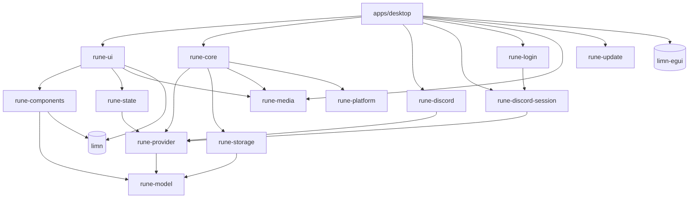

# Arquitectura de RUNE

RUNE (*Rust UI, No Electron*) es un cliente de chat de escritorio nativo. La
interfaz se construye con [limn](https://github.com/Niiihuel/limn) y se pinta
con su backend egui/wgpu. El único uso de un motor web es el login temporal
del proveedor no oficial, opcional y aislado en otro proceso; la interfaz
principal y las conversaciones siguen siendo limn.

Este documento describe las iteraciones implementadas: qué hay, cómo fluye
la información y por qué está dividido así. Lo pendiente está
en [ROADMAP.md](ROADMAP.md); de dónde salió cada idea adoptada de Serein, en
[SEREIN_COMPARISON.md](SEREIN_COMPARISON.md).

## Principio

La interfaz no conoce ningún protocolo. Un **proveedor** traduce un servicio a
los tipos de RUNE (`rune-model`) y declara sus **capacidades**; todo lo que
está por encima trabaja solo con esos tipos. La **simulación local
determinista** (`rune_provider::mock`) sigue siendo la opción predeterminada
y se identifica como "Simulación local · sin conexión real". Existe además
`rune-discord`, un adaptador **OAuth2 experimental** de identidad y listado
básico de servidores. Usa interfaces oficiales y no habilita mensajes ni
voz; el canje HTTP como cliente público todavía requiere validación real
con la aplicación registrada. Las pruebas locales no acreditan ese canje.

`rune-discord-session` añade un experimento de **sesión personal no oficial**,
autorizado por el dueño del proyecto. El dueño confirmó el login y la
identidad por HTTP y, después, la lectura real de servidores, canales e
historial. Gateway y las acciones de chat REST tienen pruebas locales;
envío, edición, borrado y stickers todavía requieren una prueba real
independiente. Se mantiene separado de OAuth2 y su autorización personal no se
presenta como aprobación de Discord.

`apps/desktop` elige e instancia el proveedor
(`--provider mock|discord|discord-session`, o la última elección guardada);
el último requiere la feature `session-login` y Linux. Desde el 2026-10-17
la interfaz pide otro con `Intent::UseProvider` y el host sustituye en
caliente `Client` y `Store`, limpiando la ventana como al cambiar de cuenta
([detalle](DISCORD_SESSION.md#entrada-y-transición-al-workspace)).
`rune-core`, `rune-state` y `rune-ui` reciben únicamente el contrato común.

## Crates

```text
apps/desktop       ventana eframe + bucle de cuadros, elección de GPU, métricas, capturas, benchmark
crates/
  rune-i18n        idioma activo e inglés de cada texto de interfaz, cuya clave es el español
  rune-model       tipos de dominio (ids, User, Server, Channel, Message + Delivery, Presence + Activity, Call, Permissions)
  rune-provider    trait Provider, Command, Event, Failure, Capabilities, EventSink (Envelope, Latest) + proveedor simulado
  rune-discord     OAuth2 experimental: navegador externo, callback local, identidad y servidores de sólo lectura
  rune-discord-session  proveedor no oficial: SessionLogin privado, identidad, Gateway, navegación y chat REST
  rune-login       proceso auxiliar de login temporal; WebKitGTK (Linux) o WebView2 (Windows)
  rune-platform    selectores Linux OpenFile/SaveFile, portapapeles de archivos, notificaciones, atajos globales, llavero, bandeja, instancia única, autostart, tema y fuentes del sistema, Rich Presence local y juegos; carpetas y apertura de enlaces; en Windows, los mismos servicios con la API del sistema
  rune-state       Store: estado central aplicado evento a evento (Timeline coherente, Abilities, llamada)
  rune-storage     SQLite (esquema v4): mensajes, lápidas, ajustes, borradores, marcas de lectura e instantánea de arranque
  rune-core        Client: runtime Tokio propio, sesiones numeradas, plazos, reconexión, historial, hilo de SQLite, actor de adjuntos
  rune-media       captura CPAL/PipeWire en worker, cola acotada, DSP local Sonora, medidores, detección de voz y reproducción de voz, audio y video (Symphonia, lector MP4 propio, OpenH264; H264 por GPU con GStreamer: VA-API, NVENC/NVDEC)
  rune-components  piezas de interfaz con limn (riel, canales, mensajes, composer, miembros…)
  rune-ui          la ventana: Ui (estado de interfaz), view, update/intercept → Intent
  rune-update      actualizaciones propias: manifiesto firmado (Ed25519), descarga reanudable, instalación atómica (docs/UPDATES.md)
```

Dependencias (solo hacia abajo):



Todos dependen además de `rune-i18n`, que no depende de nada (fuera del
diagrama; ver [Idiomas](#idiomas)).

`rune-platform` ya tiene una frontera comprobable del SO: selección asíncrona
de uno a diez archivos mediante portal Linux y apertura del lote en un worker
fijo. `choose_files` entrega todos los descriptores o un error; valida las URIs
completas y los límites individuales/agregados antes de publicar. El servicio
es independiente de cuentas, proveedores y ventana; `rune-core::uploads`
lo consume y el host accede mediante Client. `SelectedFile` transfiere una
única propiedad del descriptor, sin clonación ni serialización; el servicio
de preparación lo conserva fuera de la UI y no reabre la ruta.
`validate_local_paths` valida sólo metadatos; `open_local_files` es una primitiva
bloqueante que el worker fijo de Core usa para rutas entregadas por el SO.
`FileChooser::wait_idle` drena limpieza y resultados anteriores sin conectar
ni renovar el portal. La entrada por rutas no crea una sesión del selector.
La API Core de rutas permanece para una entrada futura con posición/lote
fiables; el host actual rechaza el RawInput legacy y no la invoca desde drop.
Cancelación, descarte del futuro y renovación del portal conservan el mismo
worker y acotan la limpieza. La conexión D-Bus dedicada no se comparte con
otros servicios. La UI principal permanece en limn; el selector es un diálogo
del sistema. [API, verificación y límites](FILES.md#selector-local-linux-prerrequisito-de-07).

`rune_platform::shortcuts::GlobalShortcuts` pide atajos globales al portal
`GlobalShortcuts` en un hilo propio con su runtime y su conexión D-Bus; el
host lo sondea sin bloquear y soltar el handle cierra la sesión. Sólo acepta
señales del dueño único del portal y de su sesión. No hay captura X11 ni
lectura de dispositivos de entrada. Lo usan «Pulsar para hablar» y, desde
P6, silenciar, ensordecer y «pulsar para silenciar», en una sola sesión
([MEDIA.md](MEDIA.md#pulsar-para-hablar-2026-10-16)).

Desde el 2026-10-17 (P6) `rune-platform` tiene también la bandeja
(StatusNotifierItem y dbusmenu sobre zbus), la instancia única y el socket
`discord-ipc-N` (sockets de `$XDG_RUNTIME_DIR` del mismo usuario), el
autostart XDG, el tema del portal `Settings`, las fuentes por fontconfig,
la detección de juegos por `/proc` y el socket de Hyprland; el host
(`apps/desktop/src/desktop.rs`) los maneja según las preferencias y
`rune_ui::desktop` decide qué mostrar y qué publicar
([PLATFORM.md](PLATFORM.md)).

Desde el 2026-10-19 (rama `windows-base`) cada servicio de `rune-platform`
tiene también su versión de Windows en un `windows.rs` propio, detrás de la
misma API: nada por encima de `rune-platform` sabe en qué sistema corre,
salvo `rune-ui`, que pregunta `cfg!(windows)` sólo para decir en Ajustes lo
que en Windows es distinto o todavía no está. Lo que se calcula sin el
sistema (menús, comandos, XML de los toasts, atajos, valores del registro)
se compila también en las pruebas de Linux. `rune_platform::folders` dice
dónde guarda RUNE sus archivos (XDG o las carpetas conocidas de Windows) y
`rune_platform::open` abre enlaces y carpetas con el programa del sistema
([PLATFORM.md](PLATFORM.md#windows-2026-10-19-rama-windows-base)).

`rune_platform::notifications::Notifier` muestra notificaciones por
`org.freedesktop.Notifications` en un hilo propio y devuelve la clave propia
de la que se cliqueó y, si se pulsó uno, el botón (`Click = (clave, botón)`);
`Notifier::withdraw(clave)` retira una. Desde el 2026-10-18 la de una
llamada entrante trae «Aceptar» y «Rechazar» (`call.incoming`, crítica, sin
vencimiento) y se retira al dejar de sonar o al cerrarse RUNE; sólo cuentan
los botones que ofreció y que vienen del dueño actual del servicio, y el
desktop los atiende con `rune_ui::answer_alert`, sólo para la cuenta actual.
`rune_platform::clipboard` lee archivos copiados o una
imagen del portapapeles X11 (bloquea: sólo desde el worker de Core). El
desktop decide con `rune_ui::message_alert` (y, para una llamada privada
entrante, `rune_ui::call_alerts`) y abre con `rune_ui::open_alert`
sólo para la misma cuenta ([FILES.md](FILES.md#notificaciones-del-sistema-2026-10-17)).

`rune-network` todavía no se creó: cada adaptador contiene su propio HTTP.
Las rutas XDG y la apertura de enlaces siguen en el host; el login temporal
conserva su crate específico. El selector SaveFile 08.1 ya está verificado;
su integración Core/UI, avisos y otros servicios de plataforma requieren
incrementos propios.

### Adjuntos de salida: integración local de 07

La interfaz limn y Store conservan sólo `UploadToken`, `PendingAttachment` y
contadores. El host revalida `Store::abilities` antes de usar la fachada de
Client. `rune-core::uploads` conserva una instancia del selector y concentra en
un actor los descriptores, bytes y la construcción de `Command::SendFiles`.
Un worker fijo prepara el lote secuencialmente, con metadatos antes/después de
cada lectura acotada y comprobación de EOF. Reserva todos los bytes y entradas
antes de leer; fallo o cancelación de un archivo descarta el lote completo.
El presupuesto de 32 MiB y diez entradas (ocho hasta el 2026-10-18) acompaña a cada dueño sellado de
`Bytes::from_owner`, incluso a través de clones o slices; no se expulsan
archivos para admitir otros. Core publica metadatos sólo después de validar
todo el vector. La UI conserva el borrador anterior y añade el lote con una
revisión; si rechaza el callback devuelve todos los tokens nuevos.

Cola llena, cancelación, reconexión, permisos y respuestas se correlacionan por
cuenta/canal/generación/petición. Reintentar usa el cuerpo original y el mismo
nonce lógico, con una petición nueva; un archivo ausente nunca se sustituye
por envío sólo de texto. Los fallos ambiguos requieren idempotencia declarada
y una acción explícita. Progreso y confirmación son etapas distintas. El cierre
invalida controles pequeños y entrega el runtime a un hilo de shutdown por
Client; los receivers con payload no se drenan en UI. Una preparación cancelada
se libera al terminar su worker, aunque no se solicite otro archivo.

El recorrido está conectado a composer, mensajes y **simulación local**. Mock
admite hasta diez archivos por mensaje (ocho hasta el 2026-10-18); 07.2 pasó pruebas locales integradas,
con selección y envío nativos de dos fixtures de 48 B confirmados por Mock.
El checkpoint 07.1 ya
verificó un archivo en ventana nativa, conservando borrador y con envío
explícito confirmado por Mock. El prototipo de importación por rutas **07.3.1**
pasó 1098 pruebas con todas las features, seis ignoradas
y 25 suites en 5,47 s, formato, Clippy estricto de todos los targets/features y
release de ocho crates en 51,13 s. El recorrido nativo de importación sigue
**abierto**: la vía RawInput de winit 0.30.13 no produce archivos DnD en Wayland
y X11 no entrega su posición de arrastre. Dos gestos con fixtures propios no
prepararon adjuntos; no hubo envío ni capturas aceptadas.
Pegar archivos y transporte remoto requieren incrementos
propios; los puntos completos 07 y 08 permanecen abiertos.
[Contrato](../tasks/uploads-contract.md),
[flujo/límites](FILES.md#lotes-de-archivos-072) y
[evidencia 07.2](evidence/uploads-multiple-checkpoint-2026-10-15.json).
La política actual **07.3.2** rechaza todo drop legacy: `raw_input_hook` limpia
`dropped_files` y `hovered_files` antes del bridge, incluso si sus rutas caben
en los límites. El fallback de `FilesDropped` también rechaza. La última posición
global de RawInput no está ligada al lote; no autoriza un trabajo de archivos.
El host muestra la indisponibilidad y ofrece usar Adjuntar, sin llamar
`Client::prepare_attachment_paths` ni leer `DroppedFile::bytes`.
Client conserva esa fachada y sus pruebas para una integración futura. Picker y
Paths comparten control, tokens, cancelación y worker. El worker abre, reserva
todas las leases y lee el lote, con publicación completa o error.

La PR #49, incorporada en el pin histórico `1ad33eb224b6b4fb48de9423b23a89d6230e087f`,
entrega archivos después de la entrada ordinaria del cuadro, pero no crea una
posición nativa fiable. El host bloquea `Submitted` del editor ante un drop
rechazado del mismo cuadro: Enter no consume el borrador ni envía texto solo.
Shift+Enter y acciones de otros controles conservan su comportamiento.
Esto es un orden de procesamiento, no una cronología de eventos del SO.
El checkpoint histórico 07.2 conserva `2618b37`; no se atribuye el pin nuevo
a sus capturas o pruebas. [Contrato de rutas y estado](../tasks/uploads-next.md#0731-arrastre-de-archivos-implementado).
El [registro local 07.3.1](evidence/uploads-drop-checkpoint-2026-10-15.json)
separa las pruebas verdes de ese bloqueo. La [API nueva de winit](https://github.com/rust-windowing/winit/pull/4571)
está en 0.31 beta; [la migración de egui/eframe](https://github.com/emilk/egui/pull/7731)
sigue en borrador. No es la única alternativa Wayland: `limn-dnd` ya existe
en esas revisiones. Su nuevo `FileDropReceiver` está implementado en la
[PR #55](https://github.com/Niiihuel/limn/pull/55), Draft abierta, y verificó
metadatos/decisiones/cierre normal en Weston privado. Sigue fuera del pin y
consumidor RUNE; la convivencia SDK/clipboard observada en Hyprland requiere
owner compartido y routing por superficie. [Registro del alcance limitado](evidence/limn-drop-receiver-weston-2026-10-15.json)
y [auditoría estática histórica](evidence/limn-dnd-existing-backend-audit-2026-10-15.json).

La base multiventana posterior se publicó en la
[PR #62 Draft](https://github.com/Niiihuel/limn/pull/62), HEAD
`06a08883634c5e5c2abe5afb4a5d624a68e98aef`, con CI SUCCESS del HEAD exacto a
las 22:06:00 UTC. `WaylandDataOwner` mantiene un owner/worker por display y un
data_device por seat compatible; `FileDropEndpoint` permite retirar una
superficie sin confundir Detached con el join del owner. Sus 142 pruebas DnD
están dentro del workspace limn 1664, no de RUNE. Root verificó sólo presentación
dark/light de la galería sintética, sin attach del owner ni prueba de clipboard.
El modo DnD de PR #62 descarta Selection y no bindea Primary.
[Canónica histórica](evidence/limn-shared-wayland-owner-2026-10-15-v2.json)
y [contrato](../tasks/wayland-data-owner-contract.md).
El opt-in posterior de texto entrante se publicó en la
[PR #63 Draft](https://github.com/Niiihuel/limn/pull/63), HEAD `d2541808`, CI SUCCESS:
reserva/ACK/request públicos, matriz dirigida de 184 pruebas y dos smoke Weston15
privados/Pixman/fake-seat, RAW de 29 B y vacío de 0 B; ver el
[checkpoint actual](evidence/limn-text-clipboard-matrix-2026-10-15.json).
Siguen pendientes backend SDK, operaciones salientes/Primary y consumidor/pin RUNE;
no se adjunta detrás del backend stock. Este opt-in no está probado en Hyprland.
El pin 6ae y el alcance parcial de 07.3 no cambian.

El pin del checkpoint 07.3.2 es `22e0fd93c14b3f3c89375135f83c1e9c41307330`, con la
[PR #50](https://github.com/Niiihuel/limn/pull/50) abierta, incorporada por
cherry-pick en la rama propia de integración. `shrink_height_to_fit()` es un
opt-in de altura separado de la reducción de ancho existente. Los avisos
ocupan flujo sobre el composer, conservan su altura natural si caben y ofrecen
scroll cuando crecen; la lista de adjuntos también acota su altura según la
ventana. Siete pruebas de avisos y ocho de rechazo del host están verdes.

**07.3.2 cierra sólo el rechazo negativo y su pulido visual.** Un arrastre real
desde Dolphin con dos fixtures de 54/55 B a RUNE Mock X11 mostró el aviso
completo sobre el editor y el borrador conservado, sin adjuntos ni Enter. La
ausencia de envío automático la prueban las regresiones del host, no la imagen.
El workspace pasó **1120 pruebas**, seis ignoradas, 25 suites en 5,50 s;
formato, Clippy estricto y release de seis crates en 49,56 s correctos.
[Checkpoint](evidence/uploads-drop-rejected-checkpoint-2026-10-15.json),
[auditoría completa](evidence/uploads-drop-rejected-audit-2026-10-15.json) y
[captura negativa](img/uploads-drop-native-rejected-2026-10-15.png).
Los checkpoints 07.3.1 y SaveFile 08.1 conservan su pin `1ad33eb` y sus
resultados de 1098/1112 pruebas. La importación nativa funcional sigue pendiente.

### Host ordenado y foco: porción 07.3 verificada

El pin actual es `6ae42859f86f5d255e107a23142aca3c19c86590`, rama propia publicada
`rune/ordered-input-integration`: merge de `22e0fd93` y `b52284a0` que conserva Composer/Column y
adopta la entrada indexada. El antiguo orden artificial de archivos después del
input queda sustituido por derivados None en el prefijo de compatibilidad. No
les atribuye cronología nativa; el host sigue rechazándolos antes del bridge.

Desktop normaliza y recorre todos los índices del snapshot/viewport, sin retener
un guard Context mientras ejecuta efectos. Cada tecla de host usa sus modifiers;
Intents/layout/foco se resuelven antes del siguiente índice. Si el foco solicitado
no existe limpia el anterior. WindowFocused se aplica en su posición incluso
closing; input.focused cubre frames sin callback. Reabrir el switcher vacía
modelo y campo retenido con SetInput antes de Focus, mediante un helper compartido.

Pasaron 1128 pruebas RUNE, seis ignoradas, 25 suites/5,77 s sumadas; fmt, Clippy
estricto all-targets/all-features y build desktop correctos. Los ocho tests App
están incluidos; limn integración1595 es una verificación separada. La QA Mock
real en Xvfb privado conservó borradores A/B y switcher limpio, con cierre y
cleanup propios 0. Un primer run parcial por query obsoleta y sus cinco PNG se
retienen junto a cinco finales verificados; no incrementan las 18 capturas Mock
históricas. Secuencias con pausas no acreditan batching del SO ni clipboard,
owner/ACK, cuenta real o DnD. El [checkpoint](evidence/rune-indexed-input-host-2026-10-15.json)
conserva límites REA: muestreo no exhaustivo, FS/network desconocidos. Esta porción
orden/foco/query está cerrada; 07.3 sigue abierto por owner/ACK/pegado y DnD.

### SaveFile: plataforma 08.1 verificada

`FileChooser::save_file` recibe `SaveRequest` y devuelve `SaveDestination`, una
selección privada sin Clone/Serialize, no un descriptor ni permiso de overwrite.
Reutiliza el runner, conexión, limpieza y worker del selector. Valida una URI
local sin abrir, crear o truncar el destino. Pasaron 64 pruebas unitarias y un
doctest; el ejemplo nativo confirmó el destino exacto de un fixture, que siguió
ausente, con el archivo existente intacto. La cancelación produjo terminal
Cancelled, pero su observador tardío no acredita haber visto la ventana.
[Registro 08.1](evidence/save-file-picker-checkpoint-2026-10-15.json).

**08.1 está completo en plataforma; 08.2 se implementó el 2026-10-17**: el
actor de adjuntos, dueño único del selector, abre también SaveFile (uno a la
vez) y `core::files` descarga al nombre exacto con hard link, sin sobrescribir
([FILES.md](FILES.md#guardar-como-082-2026-10-17)). No se extrajo un
`SharedNativeDialogs` aparte.
La publicación CreateNewOnly de 08.2 y el reemplazo autorizado 08.3
(2026-10-18: con la palabra de la persona y `rename(2)`,
[FILES.md](FILES.md#reemplazar-en-guardar-como-083-2026-10-18)) no se
acreditan al elegir una ruta. [Contrato](../tasks/save-as-contract.md). Los puntos generales 07/08
siguen abiertos.

## Flujo de un cuadro

`apps/desktop/src/main.rs`, `App::ui`:

```mermaid
sequenceDiagram
    participant P as Proveedor (runtime rune-core)
    participant C as Client
    participant S as Store
    participant U as rune-ui
    participant T as limn UiTree
    P->>C: Event (cola acotada 1024, despierta la UI)
    C->>S: Update::Provider / Update::Cached (≤256 por cuadro)
    S-->>U: Applied → on_applied → Intent
    U->>T: view(Ui, Store) → Element; layout
    T-->>U: UiEvent → intercept / handle_event → UiAction → update → Intent
    U->>C: Intent::Command / LoadOlder / Send…
    U->>T: view; layout; after_layout (cargar historial, marcar leído); paint
```

0. **Antes del primer cuadro, con la simulación**, se aplican la instantánea guardada
   (`Client::cached_snapshot` → `Store::apply_cached_snapshot`) y los
   borradores, si la clave de su cuenta llegó del llavero (sin llavero no
   hay nada guardado: queda en memoria): la ventana abre con servidores, canales y mensajes de la
   sesión anterior mientras el proveedor conecta, y lo dice ("Conectando… Se
   muestra lo guardado en este equipo."). Con el proveedor simulado, lo
   guardado de corridas anteriores puede verse fuera de orden por hora
   antes de conectar: sus ids se reinician en cada corrida, cosa que un
   servicio real no hace. Al conectar, la página nueva reemplaza ese rango.
   El adaptador OAuth2 de Discord arranca sin caché ni restauración de
   datos. El no oficial nombra su cuenta al verificarla
   (`Event::StorageIdentity`): cuando la clave de esa cuenta llega del
   llavero, el cliente entrega lo guardado (`Update::Restored`: instantánea,
   borradores y marcas) y el host lo aplica igual, como caché, si la sesión
   todavía no está lista. Ninguno restaura la caché del proveedor simulado.
   Todos restauran los ajustes (ver Estado).
1. **Drenar** hasta 256 actualizaciones del cliente y aplicarlas al `Store`,
   más los últimos valores pendientes (presencia, quién habla). Si quedaban
   más, se pide otro cuadro de inmediato: una ráfaga nunca bloquea un cuadro.
2. **Layout previo**: la entrada se resuelve contra lo que está en pantalla.
   Si no llegó nada y no hubo entrada, se reutiliza el layout anterior.
3. **Entrada**: primero el host (`App::host_keys`: Pulsar para hablar y el
   grabador; `apps/desktop/src/shortcuts.rs`: historial, canales, regiones,
   lista de atajos y métricas), luego `rune_ui::intercept` (atajos que la
   ventana toma antes que el árbol: selector rápido, búsqueda, formato, editar
   el último, enviar y línea nueva cuando no son los de limn, autocompletado,
   Esc en cascada), luego el árbol de limn, cuyas acciones van a
   `rune_ui::update`. Las teclas de todos esos atajos salen de una sola tabla,
   `rune_ui::keybinds` (ver [Atajos editables](#atajos-editables)).
4. **Vista y layout** del estado nuevo; el foco pedido se aplica después de
   un layout que ya contiene el control (limn solo enfoca controles maquetados).
5. **after_layout**: pide la página anterior cuando la primera fila visible
   está a ≤5 del principio. Sólo una ventana activa, en recientes y sin diálogo,
   recordatorio manual ni salto pendiente puede marcar leído al ver el final.
   Un scroll pedido en ese layout se aplica antes de evaluar lectura en otro.
6. **Pintado** con `limn_egui::paint_at` y repintado solo si algo va a
   cambiar (animación, escritura que caduca, avisos, medidor, el próximo
   plazo de una petición: `Client::next_deadline`).

Todo lo que la interfaz quiere hacer fuera de sí misma es un `Intent` que el
host ejecuta. Por eso `rune-ui` se prueba entero sin ventana ni red
(`crates/rune-ui/src/tests.rs` hace de host).

## Estado

- **`rune_state::Store`** (dominio): servidores, canales, usuarios, miembros,
  presencia, voz, estados de lectura y un `Timeline` por conversación. Cada
  evento toca solo lo que nombra. Un `Timeline` guarda
  `Arc<Vec<Arc<Message>>>`: la vista lo clona (punteros) sin copiar mensajes;
  un cambio copia la lista de punteros solo si un cuadro anterior aún la
  retiene, nunca los mensajes.
- **`rune_ui::Ui`** (interfaz): qué está abierto o seleccionado, borradores,
  respuesta o edición en curso, menús, ajustes. Se persiste lo necesario
  (`settings_to_keep`) en SQLite, con cualquier proveedor (desde el
  2026-10-17): los del equipo bajo su clave, y los de la cuenta
  (`rune_ui::ACCOUNT_SETTINGS`: lugar, favoritos y fijados, notificaciones,
  canales ocultos y categorías, temporizadores de estado) bajo
  `account:{proveedor}:{id}:{clave}`. El host (`apps/desktop/src/kept.rs`)
  lee todos al arrancar y, cuando entra otra cuenta, le devuelve los suyos
  (`Ui::restore_account`) antes de que se abra nada; los de la simulación
  de antes, guardados como del equipo, pasan a su cuenta la primera vez.
- **El aspecto** (desde el 2026-10-19, rama `temas-propios`): la vista
  nunca lee `Theme::look()` directo, sino `Ui::look()` (el tema integrado o
  el propio en uso, `rune_components::theme::CustomTheme`, teñido con el
  color principal elegido) y, para el riel, las columnas y la
  conversación, `Ui::panes_look()`: con la ventana transparente, ese
  aspecto no pinta sus tres superficies y la raíz pinta el fondo con alfa
  una sola vez. Los temas propios son datos (JSON validado en
  `rune-components::theme`); importarlos y exportarlos pasa por el portal
  en `rune-core::theme_files`. Ver
  [PLATFORM.md](PLATFORM.md#temas-propios-color-principal-y-transparencia-2026-10-19).
- **IDs estables**: cada control y cada lista tienen ID derivado del ID del
  dominio (`channel:{id}`, `msg:{id}:reply`, `timeline:{canal}`,
  `composer:{canal}`). limn guarda foco, scroll y texto por ID, así que cada
  conversación conserva su posición de scroll y su borrador.
- **Memoria acotada**: al abrir una conversación las demás se recortan a sus
  150 mensajes más recientes (`KEPT_WHEN_CLOSED`); vuelven del proveedor o de
  la caché al reabrirlas.
- **Prioridad del historial confirmado**: la caché solo llena un timeline
  vacío que todavía espera su página más reciente. Si el proveedor ya
  confirmó una conversación vacía, una lectura tardía de SQLite no puede
  volver a llenarla.

## Atajos editables

`rune_ui::keybinds` (2026-10-19, rama `atajos-y-navegacion`) es la tabla de
los atajos, como `keybinds.rs` de Serein: cada `Action` (navegación,
mensajes, formato y voz) tiene su `Chord` por defecto, la persona lo cambia en
Ajustes › Sistema › Atajos de teclado (clic en la caja de teclas y pulsar la
combinación; «Restablecer» vuelve al de siempre) y se rechaza, con el motivo
en la fila, una combinación que ya usa otra acción, Tab, Shift+F10, las de
edición de texto (Ctrl+A/C/V/X/Z/Y) o una tecla que sola escribe o mueve el
cursor. Los atajos de voz siguen guardados donde estaban (`push_to_talk_key`,
`mute_key`…: el host los sostiene y el portal los registra); el resto guarda
sólo lo que difiere del defecto en el ajuste `shortcuts`
(`back=F9;send=Ctrl+Enter`). La lista de Ctrl+/, la sección de ajustes, las
pistas de la cabecera y el despacho del host y de `intercept` leen la misma
tabla. Una tecla de puntuación o un dígito coincide con o sin Shift (`/` es
Shift+7 en distribuciones españolas y alemanas): Ctrl+/ no depende de la
distribución. Enviar y línea nueva dejan Enter y Shift+Enter al compositor de
limn; si Enviar pasa a otra combinación, Enter escribe una línea nueva.

## Idiomas

Desde el 2026-10-17 la interfaz está en español y en inglés (Ajustes ›
Idioma y hora: Sistema, Español o English). El crate `rune-i18n`, sin
dependencias y debajo de todos, tiene el idioma activo y el inglés de cada
texto:

- **El texto en español es la clave.** El código sigue escribiendo español
  donde lo usa; `t("Guardar")` lo devuelve en el idioma activo, `tr!("{n}
  mensajes", n)` hace lo mismo con valores (con nombre, para que el inglés
  pueda cambiar el orden) y `es("…")` marca un texto que se traduce después,
  donde se muestra: una tabla `const`, o un texto que una capa de abajo
  entrega y la interfaz guarda (nombre y aviso del proveedor, etiquetas de
  `LoginError`). El inglés está en `crates/rune-i18n/src/en/`, un archivo
  por zona. Se eligió así, y no Fluent (Serein usa `fluent-templates` con 13
  catálogos y claves con nombre), porque con dos idiomas que comparten la
  regla del plural alcanza una tabla y un rellenador de `{lugares}`, sin
  dependencias, y porque cada texto queda legible donde se usa y los tests
  en español siguen igual.
- **Plurales**: español e inglés dicen «uno» sólo para 1, así que el código
  elige la forma (`if n == 1`) y cada forma es una clave. **Fechas**: meses,
  días, «hace 5 minutos», «Hoy a las…», el orden de la fecha corta
  (`%d/%m/%Y` → `%m/%d/%Y`) y a. m./p. m. son claves (`rune-components/src/time.rs`);
  el reloj de 12 o 24 h sigue siendo su propio ajuste.
- **Qué idioma**: el del proceso (`rune_i18n::set`), salvo que un hilo
  elija el suyo (`set_thread`). La vista fija el del hilo de la ventana en
  cada cuadro desde `Ui::language()` (lo elegido o, con «Sistema», el que el
  host leyó de `LANGUAGE`, `LC_ALL`, `LC_MESSAGES` o `LANG`; español si no
  es ninguno de los dos), así que el cambio se ve en el mismo cuadro y un
  test que dibuja en inglés no cambia a los demás. El host copia ese idioma
  al proceso en cada cuadro para lo que escriben otros hilos (core,
  proveedores, bandeja), y el proceso auxiliar del login y del captcha lo
  recibe en `RUNE_LANGUAGE` (su página del captcha es una plantilla que
  Rust llena con los textos escapados; la CSP no cambia). Los textos
  propios de limn (`limn::set_labels`: menú de un campo, visor de imágenes,
  botones de un selector) siguen al idioma en cada cuadro, y la bandeja lo
  recibe en `TrayState::language`, que la hace volver a publicar menú y
  tooltip. Es un ajuste del equipo (`language`), no de la cuenta.
  `--language es|en` lo fija para una ejecución (capturas).
- **Capas**: cada capa traduce donde arma el texto, con el idioma del hilo
  que lo arma. `rune-ui` y `rune-components` no conocen proveedores: sólo
  piden textos a `rune-i18n`, que no conoce a nadie. Lo que una capa de
  abajo arma una vez y la interfaz muestra mucho tiempo viaja como clave
  (`es`) y se traduce al mostrarse, para que un cambio en vivo lo alcance:
  nombre y aviso del proveedor, motivos de desconexión, opciones de
  proveedor y problemas del escritorio que arma el host, y las etiquetas de
  los errores con texto fijo (`LoginError`, errores REST, de voz, del
  llavero, de atajos, de captura, de almacenamiento), que se traducen en su
  `Display`. También los nombres de reserva que un proveedor pone a falta
  del suyo: `Channel::UNNAMED` («Conversación») y `Server::UNNAMED`
  («Servidor no disponible») se guardan en español y se traducen en
  `Store::channel_title` (fuera de servidores) y `Server::shown_name`
  (en las vistas que muestran el nombre de un servidor), como el plan y los
  paquetes de stickers de la simulación donde se muestran. Un motivo o un
  aviso pasajero se arma ya traducido, y queda en el idioma de ese
  momento.
- **Qué no se traduce**: el contenido (mensajes, nombres de personas,
  servidores, canales y roles, comandos y componentes de bots, también los
  de la simulación), ids, claves de ajustes, la sintaxis de búsqueda (que
  acepta `from:`/`de:`, `has:`/`tiene:`, `in:`/`en:`), protocolo,
  registros de diagnóstico y el panel de métricas de desarrollo.
- **Pruebas**: `crates/rune-i18n/tests/catalog.rs` lee los fuentes del
  workspace y falla si un texto marcado no tiene inglés, si un inglés no
  tiene texto, si los `{lugares}` no coinciden, si una clave tiene dos
  ingleses o si el inglés conserva letras del español; también fija los
  textos con dos sentidos («Hilo bloqueado» y «Bloqueado», «Activar el
  sonido» y «Activar sonido», «Todo el mundo» y «Todos»): cada lugar dice
  el suyo y cada uno tiene su inglés.
  `rune-ui/src/tests/english.rs` recorre la interfaz simulada en inglés
  (39 pantallas: cada página de ajustes y de ajustes del servidor, ajustes
  de canal, menús, perfil, emoji, bandeja de entrada, hilos, voz, búsqueda,
  inicio, invitación) y falla si un texto pintado o una etiqueta de
  accesibilidad parece español y no es contenido de la simulación (lo que
  traen su instantánea y su historial, más una lista explícita); otro test
  cambia el idioma en vivo y vuelve. Los demás tests corren en español,
  sea cual sea el idioma de la máquina.

## Búsqueda y contexto de mensajes

`rune-ui::search` distingue «Cargados» de «En este equipo». La consulta es
literal, sin distinguir mayúsculas, sobre el contenido del mensaje y, desde
el 2026-10-17, el texto de sus tarjetas y del mensaje que reenvía
(`rune_model::card_words`; un mensaje sin texto se cita con esas palabras,
también en el extracto de una respuesta); no interpreta operadores ni busca
dentro de adjuntos. Texto, autor, archivos,
fijados y fechas se combinan con AND. Los límites de fecha usan el día local
de creación, desde medianoche inclusive hasta la medianoche siguiente
exclusiva; no filtran por la fecha de edición. Los stickers no son archivos.
Ctrl+F abre el diálogo; Ctrl+K conserva la navegación entre conversaciones.

El alcance cargado consulta el snapshot del timeline y sólo recalcula si
cambia su contenido o la consulta. El alcance del equipo usa `SearchQuery`
y `SearchHit` del modelo: consultas de hasta 256 caracteres/1024 bytes,
20 resultados por página y snippets de hasta 160 caracteres. La UI conserva
como máximo cinco páginas ligeras, sin duplicar mensajes completos, y navega
hacia atrás sobre ese buffer. «Actualizar» vuelve al principio. No presenta
los mensajes retenidos en SQLite como todo el historial del proveedor.

`rune-core::local_history` conserva una lectura activa y una intención más
reciente si el worker responde Busy. `rune-core::storage::local_reads` reserva
el crédito de respuesta antes de admitirla: 64 KiB para búsqueda y 2 MiB para
contexto, dentro del presupuesto compartido de 8 MiB. Las respuestas locales
terminales son fiables; una cola llena no las convierte en resultados vacíos.
Los previews opcionales de arranque liberan sus slots aunque los eventos del
proveedor hayan consumido el cupo del cuadro. Las lecturas de búsqueda
recorren hasta 32 filas por paso, cierran el SELECT antes de intercalar una
escritura y usan keyset sobre los dos rangos de IDs unsigned almacenados como
i64. El scratch adicional está limitado por una fila JSON de hasta 1 MiB.
No se usa SQL LOWER para sustituir la semántica Unicode del modelo.

El cursor se liga a consulta, canal, época y revisión de datos. Cambios en
mensajes invalidan resultados y cursores; la UI vacía la lista y permite
actualizar explícitamente, sin ciclos automáticos de búsqueda. Cierre,
cambio de canal/cuenta y cancelación descartan respuestas anteriores. El
host vuelve a comprobar canal y permisos; no confía en la disponibilidad
que mostraba un control cuando se pulsó. La persistencia real sigue apagada:
«En este equipo» sólo aparece disponible si el cliente tiene un almacén
habilitado para su identidad.

`open_message` y `rune-ui::context` comparten la navegación por ID con búsqueda
y fijados. Si falta el ID se solicita `CachedContext` o `Command::LoadContext`
según su origen. Un contexto local exige el ancla exacta y admite hasta 25
vecinos a cada lado; se recortan los vecinos más alejados si exceden el
presupuesto. Ausencia local no significa borrado remoto. La capacidad
`message_context` permite al proveedor entregar una ventana alrededor del ID;
la UI usa hasta 51 mensajes y la distingue de una página de historial.

Client, adaptador y Store correlacionan la petición y descartan instantáneas
que quedaron atrasadas por mutaciones del mismo canal. Client hace esta
comprobación antes de persistir y el adaptador antes de repoblar su caché de
autoría. Los mensajes de contexto se guardan como Upsert individuales, nunca
como un rango autoritativo. Store conserva envíos pendientes, lápidas,
versiones confirmadas y la reversión de cambios optimistas.

El timeline de contexto tiene cobertura desconocida: `latest=false` y no
anuncia inicio/final del historial ni marca mensajes como leídos. El ancla
se resuelve por ID, se desplaza y resalta sin tocar el borrador. «Ir a lo más
reciente» pide una página nueva y reemplaza la ventana parcial antes de
volver a permitir la lectura automática. Carga, error, reintento y cancelación
son estados visibles.

Desde el 2026-10-17 (P2) un tercer alcance, «Todo el historial», busca en
el proveedor con la capacidad `message_search` (`Command::SearchMessages`,
`rune_model::RemoteSearch`): el texto acepta filtros (`from:`, `mentions:`,
`has:`, `in:`, `before:`, `after:`, `during:`, `pinned:`, `author_type:`
y, desde el 2026-10-18, `has:poll` y `link_from:`, también en castellano y
con `_` o sin él como `authorType:`) que el campo sugiere mientras se
escriben (`rune-ui::search::filters`). Al escribir se ven los mensajes
cargados que coinciden; Enter pide una página de 25, que
`rune-ui::search::remote` combina con lo cargado sin duplicar y marca el
origen de cada resultado. Ordenada por relevancia (`RemoteOrder`), la
página conserva el orden del proveedor y lo cargado sólo se suma, al final,
a una página que llega hasta el último resultado (`offset` más sus mensajes
alcanza `total`, y no está llena).
Un índice en preparación se vuelve a pedir una vez, solo, por `rune_ui::tick`.
Los mensajes encontrados no entran en ningún timeline ni en SQLite; un
resultado de otro canal se abre por ID con el mismo contexto. Escribir
`@nombre` en un servidor busca miembros en el proveedor
(`member_search`, `Command::SearchMembers` → `Event::MembersFound`), que se
suman a los conocidos.

## Contratos entre proveedor, núcleo y estado

Lo que un proveedor promete y lo que el resto puede suponer. Todo es
independiente del servicio: cada adaptador traduce a estos tipos y declara
su origen mediante `ProviderKind::{Simulated, Official, Unofficial}`.

- **Autorización explícita** (`Capabilities::authentication`,
  `Command::{BeginSignIn, CancelSignIn, SignOut}` y
  `Event::Authentication`). `AuthenticationState` distingue `Unavailable`,
  `SignedOut`, `AwaitingBrowser { url }`, `AwaitingExternal`, `Exchanging`,
  `SignedIn { scopes }` y `Failed { reason }`. Sus eventos no llevan tokens.
  `SignedOut` y `Failed` limpian el dominio completo conservando la
  descripción del proveedor; el núcleo descarta solicitudes pendientes y
  `rune-ui` limpia borradores, navegación, búsquedas y menús de la cuenta.
  Las preferencias visuales locales se conservan.
- **Listado de servidores de cuenta** (`Capabilities::account_servers`).
  Es independiente de chat y administración: permite mostrar la lista básica
  obtenida mediante OAuth2. Cuando es falso, la UI informa que no se consultó
  la lista en vez de afirmar que la cuenta tiene cero servidores. Los scopes
  sólo se muestran cuando el proveedor entrega una lista no vacía; una sesión
  personal no se presenta como una concesión de permisos OAuth2.
- **Sesiones numeradas** (`Envelope { generation, event }`). Cada sesión del
  proveedor tiene un número; el núcleo descarta lo que llega de una sesión
  anterior a la vigente, así un evento tardío de una conexión muerta no
  pisa el estado nuevo.
- **Últimos valores** (`Latest::{Presence, Speaking}`, `LatestValues`).
  Presencia e indicador de voz no se encolan: el `EventSink` guarda solo el
  más nuevo por clave (`send_latest`) y el núcleo los drena por cuadro. Una
  tormenta de presencias no puede llenar la cola ni retrasar mensajes.
- **Fallos con nombre** (`Failure::{Send, Edit, Delete, React, History,
  Voice, Status, Other}`, `Event::Failed { failure, reason, ambiguous }`).
  `ambiguous` distingue "no se hizo" de "no sé si se hizo" (se cortó la
  conexión con el envío en vuelo).
- **Entrega** (`rune_model::Delivery::{Sent, Sending, Failed, Unknown}`). Un
  mensaje propio sin confirmar dice en qué está; `Failed` y `Unknown` ofrecen
  Reintentar y Descartar. Reintentar reutiliza el mismo nonce cuando el
  proveedor declara `Capabilities::idempotent_send` (el servicio deduplica);
  si no, uno nuevo. Los cambios rechazados (edición, reacción) se revierten
  a como estaban (`before_change`).
- **Actualizaciones parciales** (`MessagePatch`, `Event::MessagePatched`).
  Un campo ausente conserva su valor; una colección vacía o nullable presente
  lo limpia, sin retroceder una edición confirmada. Autor sólo afirma la
  identidad existente. Contenido y referencias cambian juntos. Store aplica
  sobre el baseline confirmado más reciente, preserva diferencias optimistas
  ajenas y actualiza su reversión; no crea un mensaje a partir de un patch.
  Fijados distingue refrescar metadatos de cambiar pertenencia. Un patch sin
  baseline durante su lectura exige reintento antes de publicar datos viejos.
  `MessageMutation::Patch` actualiza sólo una fila existente de la cuenta en
  SQLite y respeta lápidas, orden y el presupuesto del worker. Desde el
  2026-10-18 las reacciones, súper reacciones y votos en vivo
  (`rune_model::Tally`) llegan igual, como `MessageMutation::Tally`, e
  invalidan una carga de contexto del canal como un patch.
- **Plazos** (`ClientConfig::deadlines`: historial 20 s, envío 30 s, que
  desde el 2026-10-18 vale también para un voto). Una petición sin respuesta
  en plazo produce un fallo sintético (`Unknown` para envíos, dudoso para un
  voto); también la cola llena y la conexión caída.
- **Timeline coherente** (`rune_state::timeline`). Una página del proveedor
  es la verdad de su rango: lo que el rango tenía y la página no, se borró
  mientras nadie miraba. Una página de lo más nuevo que no alcanza lo
  guardado reinicia la lista en vez de dejar un hueco. Los borrados
  recientes se recuerdan (256) para que una página vieja no los resucite, y
  una edición más vieja no pisa a una más nueva.
- **Habilidades** (`Store::abilities(channel) -> Abilities`). Para cada
  acción (escribir, reaccionar, editar/borrar propios, borrar de otros,
  adjuntar, unirse a voz) un `Permit::{Allowed, Denied(motivo)}` que junta lo
  que el proveedor puede hacer y lo que la conversación permite. La UI no
  decide por su cuenta: deshabilita y explica con el mismo motivo.
- **Lecturas** (`rune-state::reads`, `rune-core::read_states`). La posición local
  y el recordatorio manual son independientes del cursor confirmado y su
  versión de proveedor. `mark_unread_command` conserva el ID exacto y siempre
  es local. `mark_read_command` marca hasta el último ID conocido;
  `retry_read_command` sólo confirma el avance local que ya existía, sin
  consumir mensajes o recordatorios posteriores. La simulación y, desde el
  2026-10-17, la sesión no oficial devuelven confirmaciones por cuenta,
  canal y petición, con versiones positivas. Con `remote_unread` un
  recordatorio también va al proveedor (`Command::MarkUnread`) y los de
  otros dispositivos llegan como `Event::MarkedUnread`; con `server_read`
  un servidor entero se marca con un comando; `Event::LatestMessages` marca
  no leído lo que el proveedor sólo resume (servidores pasivos). El núcleo conserva hasta 256
  peticiones admitidas; cola llena no sustituye una espera anterior. Pérdida
  de sesión, revocación, cancelación y plazo terminan la espera, sin afirmar
  que el efecto remoto fue revertido. El estado rechaza versiones incompatibles
  y termina un ACK correlacionado inválido con fallo explícito.
- **Marcas persistidas** (`ReadMark`, SQLite `read_marks`). Guardan `through`,
  `unread_from` y revisión local por identidad de cuenta/canal, separados del
  snapshot del proveedor. La restauración tiene límite de 65 536 filas y
  crédito previo de 4 MiB dentro del presupuesto compartido de la cola. Un
  fallo no se trata como una cuenta vacía: las nuevas marcas quedan en RAM
  con aviso. Las elecciones y su reloj se retienen opacos si desaparece un
  canal, sin exponerlo en la UI. Las revisiones saturan y se compara la elección
  completa al confirmar guardado o reconciliar una lectura en vuelo; un ACK
  viejo no limpia una elección distinta. La cola fiable y la barrera de cierre
  incluyen las marcas. Borrar datos locales descarta cambios sucios anteriores.
- **Bandeja** (`rune-ui::inbox`, limn). Una fila por conversación visible con
  permiso de historial, filtros de no leídos/menciones conocidas y proyección
  de hasta 1000 canales recientes, virtualizada. No es un índice completo de
  todas las menciones. Abre por ID real mediante contexto de mensajes y
  conserva el borrador. La apertura normal también revela el primer no leído
  explícito del proveedor; sin él indica el primer disponible entre filas
  cargadas. Nunca suma o resta IDs. Una ancla automática borrada se recalcula;
  un recordatorio manual borrado conserva su identidad y permite salir del
  error. Las cargas detrás de un diálogo esperan para no robar foco.
- **Llamada** (`rune_model::Call { channel, phase, muted, deafened, quality }`,
  `CallPhase::{Joining, Securing, Connected, Waiting, Reconnecting, Failed}`;
  `Waiting` es conectada y sola en el canal, y `CallPhase::is_connected`
  cuenta las dos). La sesión de voz
  propia es una máquina de estados; `CallQuality` lleva RTT y pérdida cuando
  el proveedor los conoce. Se une con `Command::JoinVoice` y termina con
  `Event::CallEnded`. `Event::VoiceStartTimes { server, times, whole }`
  (2026-10-18) dice desde cuándo cada sala de voz tiene gente (`whole`
  reemplaza las del servidor); `Store::voice_started` sólo la da mientras
  alguien sigue en la sala, la borra cuando se vacía y la vacía en cada
  `READY`, y la columna de canales la muestra en la fila de la sala.
  `Command::WatchServer` le dice al proveedor qué servidor muestra la
  columna, para que la pida. Desde el 2026-10-17 (capacidad `private_calls`) un
  privado o grupo también tiene llamada: `JoinVoice` la empieza o la
  atiende, `Command::RingCall` y `StopRinging` hacen sonar, dejan de sonar
  o rechazan, y `Event::PrivateCall { channel, ringing }` /
  `PrivateCallEnded` dicen qué conversaciones tienen llamada y a quién
  suena; `Store::call_status` dice cómo va para la cuenta e
  `incoming_calls` cuáles la llaman
  ([detalle](DISCORD_SESSION.md#llamadas-privadas-2026-10-17-rama-llamadas-privadas)).
  Desde el 2026-10-18, con la capacidad `call_check`, una llamada 1:1 se
  pregunta antes con `Command::CheckCall`: `Event::CallChecked { ringable }`
  la empieza (suena sólo si `ringable`) y `Failure::CallCheck { refused }`
  la deja sin hacer, con el diálogo de «no son amigos» sólo si el servicio
  la rechazó.
- **Cuenta sincronizada** (`rune_model::account`, 2026-10-17). Lo que la
  cuenta guarda con el proveedor además del perfil: notificaciones por
  servidor y canal, carpetas del riel, privacidad de mensajería y notas.
  Cada cosa tiene su capacidad (`synced_notifications`, `server_folders`,
  `messaging_privacy`, `notes`) y `Store::account_abilities`; con
  `synced_notifications` la interfaz lee las notificaciones de `Store` en
  vez de las de este equipo, y `Store::rail` ordena el riel. Nada cambia
  antes de que el proveedor responda.
- **Riel y notificaciones** (2026-10-18). `Event::VoiceActivity` trae las
  apps lanzadas en canales de voz (`Store::voice_activities`, para el
  tooltip del riel); `Message::mention_roles` y `mention_everyone` dicen a
  quién avisa un mensaje además de los nombres, y
  `Store::counts_as_mention` los cuenta salvo que la cuenta los silencie
  (`suppresses_roles`, `suppresses_everyone`). Un servidor sin nivel propio
  toma el suyo (`ServerOptions::mentions_only`)
  ([detalle](DISCORD_SESSION.md#riel-y-notificaciones-2026-10-18-rama-riel-y-notificaciones)).
- **Presencia rica e identidad** (P5, `rune_model::identity`). Hasta cuatro
  actividades con imágenes y tiempos y la plataforma de cada presencia;
  marcas de la cuenta y del miembro (`Store::identity_in`), estilo de rol
  (`Store::role_mark`), insignias, conexiones y efecto del perfil; lo que
  permite el plan (`Event::Perks`, `Store::emoji_perk`/`sticker_perk`),
  paquetes de stickers (`sticker_packs`) y GIF del proveedor
  (`gif_search`). Ver [PROFILES.md](PROFILES.md#presencia-rica-e-identidad-visual-2026-10-17-p5).
- **Presencia** (`Status::Invisible`, `Activity { kind, name, detail, … }`).
  El estado personalizado se pide con `Command::SetCustomStatus` (si el
  proveedor declara `Capabilities::custom_status`) y vuelve como
  `PresenceChanged`. Un estado elegido «durante 1 hora» o un estado
  personalizado que se borra solo son temporizadores del cliente
  (`rune_ui::tick`), guardados entre ejecuciones: al vencer, se pide el
  estado anterior.

## Adaptador OAuth2 experimental

`rune-discord` contiene un flujo de autorización con PKCE S256, scopes
`identify guilds`, navegador externo y callback limitado a
`http://127.0.0.1:48731/oauth/callback`. El application ID es configuración
pública; no se solicita un client secret ni un token personal. El host lo
recibe mediante `--discord-client-id` o `RUNE_DISCORD_CLIENT_ID` y valida la
configuración antes de abrir la ventana. La aplicación debe registrar el
redirect exacto. La disponibilidad del canje público para esa aplicación
sigue pendiente de verificación contra Discord.

El proveedor empieza en `SignedOut`. **Iniciar sesión** prepara una tentativa
y **Abrir navegador** solicita `Intent::OpenUrl`; no se abre automáticamente.
El listener local, los plazos y el HTTP se ejecutan en el runtime del núcleo.
Cancelar descarta la operación pendiente, cierra el listener y evita aplicar
una respuesta tardía. Una denegación se informa como `Failed`, permaneciendo
disponible un nuevo intento explícito; no dispara el backoff de reconexión.

Después del intercambio se validan aplicación, permisos y caducidad antes
de obtener la identidad y el listado paginado de servidores. Un `Ready`
contiene el usuario y los datos básicos de servidores, sin inventar canales,
mensajes, miembros ni presencia. Sólo `Capabilities::authentication` y
`account_servers` están habilitadas. La UI muestra identidad y servidores de sólo
lectura: tener cero conversaciones ya no implica mostrar "Conectando…".

El access token vive únicamente en la sesión del adaptador en RAM. No se
guarda en SQLite ni se incorpora a eventos, errores o diagnósticos; el
refresh token recibido se ignora y al vencer se requiere otra autorización.
El host desactiva toda persistencia para este proveedor, incluso con
`--data`. El contrato de almacenamiento exige una identidad estable de
proveedor y cuenta, y este adaptador no opta por ese contrato: con OAuth2 el
archivo guarda sólo ajustes. El proveedor no oficial sí la usa desde el
2026-10-18, cifrada por cuenta ([caché cifrada](#caché-cifrada-por-cuenta-2026-10-18)).

Cerrar sesión limpia inmediatamente el estado local e intenta la revocación
remota. Si ésta no se confirma, la UI lo avisa: no afirma que la autorización
remota fue retirada. El motivo de caducidad permanece en la página de inicio
de sesión. Las pruebas usan HTTP local y eventos controlados; no sustituyen
una autorización y un intercambio reales con Discord.

## Sesión personal no oficial (experimental)

El dueño autorizó el 2026-10-14 una excepción limitada: login temporal en
una WebView propia y aislada, conservando limn para la aplicación principal.
La feature `session-login` activa `rune-discord-session` y `rune-login` en
Linux y, desde el 2026-10-19 (rama `windows-login`), en Windows; el motor
web es WebKitGTK en Linux (el entorno opcional añade GTK/WebKit) y WebView2,
el del sistema, en Windows. La compilación predeterminada mantiene la
simulación y OAuth2 sin ese motor web.

El host inyecta `SessionLogin` en `DiscordSessionProvider`. Este contrato
obtiene un `SessionSecret` privado al adaptador; comandos, eventos, `Store`
y `rune-ui` nunca reciben la credencial. `rune-login` ejecuta un auxiliar con
sesión web efímera, sin importar perfiles existentes. El resultado circula
por pipes privados acotados, no por argumentos, configuración o logs. La
persona completa el login y sus desafíos; no se imita otro cliente ni se
eluden controles de autenticación o antiabuso.

El flujo es `SignedOut` → `AwaitingExternal` → `Exchanging` → `SignedIn`.
El proveedor verifica la identidad por HTTP antes de anunciar `SignedIn` y
abrir Gateway. `SignedIn` lleva scopes vacíos y permite entrar a la interfaz
nativa; no equivale todavía a sincronización. `READY` se traduce después a
`Snapshot`, con servidores, canales y conversaciones privadas existentes.
El adaptador pagina historial mediante REST y traduce eventos incrementales
de mensajes, navegación y permisos. Heartbeat, reanudación, límites y
cancelación quedan dentro del adaptador, no en `rune-ui`.

Empezó declarando autenticación, listado de servidores, conversaciones
privadas, historial, envío, edición, borrado y stickers, y después sumó,
entre otras, lista de miembros, presencia, voz y video, archivos, hilos y
escenarios, y administración: la lista al día es su `Capabilities` en
`crates/rune-discord-session/src/provider.rs`. Cada acción requiere además
`Store::abilities` y se revalida en el proveedor antes de hacer la petición. La
interfaz identifica el proveedor como no oficial en Ajustes → Conexión.
La credencial personal puede tener un alcance mayor que lo implementado:
no es un token OAuth2 limitado a `identify guilds`.

La credencial vive en memoria y, desde el 2026-10-16, también en el llavero
del sistema (Secret Service en Linux), una entrada por cuenta recordada,
para restaurar la sesión al arrancar; nunca en SQLite. Cancelar invalida el
intento; cerrar sesión descarta credencial y dominio locales y borra la
entrada de esa cuenta del llavero, sin afirmar revocación remota. El
proveedor OAuth2 tiene la persistencia de la cuenta desactivada (no declara
identidad) y SQLite guarda con él sólo ajustes; el no oficial, desde el
2026-10-18, usa la caché cifrada por cuenta una vez verificada
([caché cifrada](#caché-cifrada-por-cuenta-2026-10-18),
[SECURITY.md](SECURITY.md#datos-locales)). El dueño confirmó login, navegación y lectura; las operaciones de
escritura sólo están verificadas con fixtures locales. Ver
[DISCORD_SESSION.md](DISCORD_SESSION.md).

## Expresiones y referencias de texto

`rune-model` incorpora `CustomEmoji`, `Sticker` y `TextReference`, sin tipos
del protocolo. Un custom emoji lleva identidad, servidor, nombre,
disponibilidad, roles y una inserción opaca que decide el proveedor. Un
sticker lleva identidad, nombre, disponibilidad y una referencia opcional de
imagen. Los campos añadidos a servidores y mensajes usan `serde(default)`
para conservar la lectura de snapshots anteriores.

`rune-components::emoji` construye las pestañas y tarjetas con props;
`rune-ui::expressions` decide la inserción y la selección pendiente.
Seleccionar custom sólo modifica el borrador. `composer_selection` conserva
el rango Unicode de limn junto al canal y al texto fuente; inserta Unicode,
custom y enlaces GIF en el cursor o reemplaza esa selección. Si el canal o
el texto ya no coinciden, inserta al final. La captura se actualiza tras
layout y antes de cada evento del host, sin volver a clonar un texto
inalterado. `Intent::FocusInput` enfoca de inmediato un campo ya existente y
aplica después su cursor, de modo que el siguiente evento del mismo cuadro
escriba allí. Sólo difiere ambos pasos si falta el campo en el layout.
El límite de 2000 unidades UTF-16 se
comprueba sobre el borrador resultante; el texto fuera del rango se conserva.
Seleccionar sticker guarda
`(ChannelId, StickerId)` en la UI; el botón de envío vuelve a comprobar el
catálogo y la capacidad, emite `Intent::SendSticker` y conserva el texto.
Cambiar de conversación descarta esa selección. Se admiten stickers
PNG/APNG y GIF disponibles del servidor actual, con preview estática
(primer cuadro para GIF). La selección conserva la carga de su miniatura
aunque se cierre el picker; ver [EXPRESSIONS.md](EXPRESSIONS.md).

El picker presenta hasta 72 resultados e informa el límite; busca sobre un
catálogo máximo de 500. Las filas custom aún no están virtualizadas junto
con las categorías Unicode. La pestaña GIF conserva la entrada manual de
URLs HTTPS y doce enlaces manuales recientes en RAM. El buscador opcional
GIPHY usa una clave de aplicación propia: una petición cancelable, veinte
resultados por página, miniaturas acotadas y atribución visible. Los resultados
de búsqueda se descartan al cerrar o cambiar el contexto y no entran en los
recientes ni en la caché general. Seleccionar solo inserta un enlace en el
borrador; no envía automáticamente. Ver [EXPRESSIONS.md](EXPRESSIONS.md).

El adaptador traduce menciones, canales, roles y emojis recibidos a
`TextReference`. El render resuelve nombres desde `Store`; cuando no conoce
una identidad conserva su referencia legible. Un emoji de servidor
(`TextTarget::Emoji`) lleva la imagen que da el proveedor y se dibuja en la
línea (`TextSpan::image` de limn, o la superficie de su animación mientras
se mueve), con `:nombre:` mientras carga o si falla; `:nombre:` es lo que
se copia y lo que lee la accesibilidad. Un mensaje que es sólo emoji los
muestra a 48 px (`text::only_emoji`, 2026-10-17). La biografía, el estado
personalizado y el tema del canal llevan los suyos aparte
(`UserProfile.pictures`, `Presence.custom_emoji`, `Channel.topic_pictures`).
El texto fuente
se conserva para edición; mostrar un alias no implica una notificación ni
una mención saliente autorizada. No se implementa aquí un editor de objetos
inline. Los patrones estudiados y los siguientes pasos están en
[SEREIN_ANALYSIS.md](SEREIN_ANALYSIS.md#continuidad-composer-expresiones-e-imágenes-2026-10-14).

## Administración: servidores, canales, roles y permisos

Agregado en la tercera iteración, igual de independiente del proveedor.

- **Permisos** (`rune_model::permissions`). 32 bits (`Permissions`), de ver y
  escribir a gestionar canales, roles y servidor, expulsar, vetar y
  administrador. Las reglas son las habituales de los servidores con roles:
  `@everyone` (el rol cuyo id es el del servidor) más los roles de la
  persona; quien es dueño y quien administra tienen todo; en un canal se
  aplican las sobrescrituras (`Overwrite { target, allow, deny }`) de
  `@everyone`, después las de sus roles y por último la propia; sin ver el
  canal no se puede nada en él. `in_server` e `in_channel` son funciones
  puras con tests. Un proveedor puede calcular los permisos él mismo y
  mandarlos en `Channel::permissions`; la simulación usa esas funciones.
- **Comandos y eventos** (`rune_provider`). Crear, editar, borrar o
  abandonar servidores; crear, editar y borrar canales y categorías y sus
  sobrescrituras; crear, editar, reordenar y borrar roles; dar roles,
  apodos, expulsar, vetar y levantar vetos; editar el perfil; cargar vetos y
  registro de auditoría. Los cambios llegan como `ServerChanged`,
  `ChannelChanged`, `MemberChanged`, `UserChanged`… y un `Created { request }`
  dice qué se creó, para abrirlo. Nada de esto es optimista: la interfaz
  espera la confirmación, y un rechazo llega como `Failed` con el motivo.
- **Habilidades por servidor** (`Store::server_abilities`). Como las de canal:
  cada acción (gestionar servidor, canales, roles, expulsar, vetar, apodos,
  borrar, abandonar, ver auditoría) es un `Permit` con el motivo cuando no.
  La jerarquía de roles (`my_rank`, `rank_of`) deja fuera de alcance los
  roles a la altura propia o por encima.
- **Visibilidad**. Un canal sin permiso de ver no aparece en las listas
  (`Store::visible`); si era el abierto, se abre otro.
- **Simulación**. La cuenta es dueña de "Laboratorio limn" (puede todo) y
  miembro común en los demás servidores (todo deshabilitado con motivo). La
  simulación valida permisos y jerarquía como lo haría un servicio, vuelve a
  calcular los permisos de la cuenta en cada canal cuando cambian roles o
  sobrescrituras, y anota cada cambio en el registro de auditoría con los
  nombres que tenían.
- **Administración avanzada** (recorrido 19, 2026-10-17). Cada familia es
  una capacidad propia: aislar (`timeouts`), crear invitaciones con su
  enlace (`create_invites`, `invite_links`), subir emojis y stickers
  (`upload_expressions`), miembros de a páginas (`member_pages`), podar
  (`prune`), webhooks e integraciones (`webhooks`, `integrations`) y GIF
  favoritos guardados por el proveedor (`synced_gif_favorites`).
  `rune-state::admin` fusiona las páginas con lo conocido sin duplicar ante
  eventos en vivo y muestra antes de la respuesta los borrados y los
  favoritos, que vuelven si el proveedor rechaza. La imagen de una
  expresión se prepara en `rune-core::expression_images`, fuera del hilo de
  UI y fuera de la cola de adjuntos de mensajes. Sin la capacidad
  sincronizada, los favoritos quedan en los ajustes locales y la pestaña
  GIF lo dice. `rune-discord-session` hace todo esto y la administración
  anterior por rutas de Serein, documentadas o del cliente oficial, sólo
  con fixtures ([detalle](DISCORD_SESSION.md#administración-del-servidor-2026-10-17)).
- **Resto de la administración** (P7, 2026-10-17). El servidor lleva sus
  opciones (`ServerOptions`: canal y mensajes del sistema, notificaciones
  por defecto, inactividad, verificación, filtro, invitaciones pausadas,
  rasgos y lo que su plan desbloquea para los roles); `ServerEdit`,
  `RoleEdit` y `ChannelEdit` cambian ícono y rasgos, seguridad, invitaciones,
  ícono, emoji y degradé de rol y los ajustes de un foro; `ReorderChannels`
  mueve canales en lote; `LoadRoleCounts` cuenta miembros por rol y
  `LoadMembers` lleva orden y filtro (`MemberQuery`). Cada familia es una
  capacidad y un `Permit` de `Store::server_abilities` (el foro, de
  `Store::abilities`). En la interfaz, páginas «Seguridad y participación»,
  «Canales» y «Foro» (`server_settings::rest`, `channel_settings::forum`);
  la sesión no oficial lo hace por las rutas de Serein, sólo con fixtures
  ([detalle](DISCORD_SESSION.md#resto-de-la-administración-p7-2026-10-17-rama-administracion-2)).

- **Reglas y onboarding** (2026-10-18). `rune_model::onboarding` modela
  las reglas de un servidor (campos y respuestas) y su onboarding
  (preguntas, opciones con roles y canales, canales por defecto, modo).
  `Store::join_steps` dice qué debe la cuenta; las reglas pendientes
  cierran el compositor con su motivo. `rune_ui::onboarding` es el
  diálogo al entrar (y la barra sobre el compositor) y
  `server_settings::onboarding` la página «Incorporación»; cada parte es
  una capacidad (`server_rules`, `onboarding`, `manage_onboarding`)
  ([detalle](INVITATIONS.md#reglas-y-onboarding-al-entrar-2026-10-18)).
- **AutoMod** (2026-10-19). `rune_model::automod` modela las reglas
  (disparadores de palabras, spam, listas, menciones y perfiles; acciones
  de bloquear con mensaje propio, alertar, aislar y bloquear la
  participación; exenciones) con sus límites y `AutoModRule::problem`,
  que parsea las expresiones regulares con `regex-syntax` antes de
  mandarlas. `Command::{LoadAutoModRules, SaveAutoModRule,
  SetAutoModRuleEnabled, DeleteAutoModRule}`, la capacidad `automod` y
  `ServerAbilities::manage_automod` (`MANAGE_GUILD`); `rune-state::automod`
  guarda las reglas leídas y lo último que hizo AutoMod
  (`Event::AutoModExecuted`), sin mostrar nada antes de la respuesta, y
  `server_settings::automod` es la página «AutoMod». Un envío que AutoMod
  rechaza llega como `Event::AutoModBlocked { failure, notice }` y
  `rune-core::automod` lo convierte en el `Event::Failed` de su comando
  con el motivo escrito para la persona, así la línea de fallo del
  mensaje lo dice sin tocar el compositor
  ([detalle](DISCORD_SESSION.md#automod-2026-10-19-rama-automod)).

- **Eventos programados** (2026-10-19, rama `eventos-programados`).
  `rune_model::scheduled_events` modela un evento (nombre, descripción,
  inicio y fin, lugar: escenario, canal de voz u otro lugar escrito,
  estado, portada, quién lo creó, cuántos interesados y si le interesa a
  la cuenta) y el borrador que se escribe (`EventDraft::problem` dice qué
  falta). Comandos `LoadScheduledEvents`, `LoadEventInterested`,
  `SetEventInterest`, `CreateScheduledEvent`, `EditScheduledEvent`,
  `SetScheduledEventStatus` y `DeleteScheduledEvent`; eventos
  `ScheduledEvents`, `ScheduledEventChanged`, `ScheduledEventDeleted`,
  `EventInterest` y `EventInterested`; capacidades `scheduled_events` y
  `manage_scheduled_events`; permisos `CREATE_EVENTS` y `MANAGE_EVENTS`.
  `rune_state::events` guarda la lista de cada servidor una vez leída en
  la sesión, la mantiene con lo que se informa (un cambio informado no
  pisa cuántos interesados había; el interés propio cuenta una vez, llegue
  antes la respuesta o el Gateway) y responde `Store::event_abilities` y
  `Store::may_change_event` (lo de cualquiera con «Gestionar eventos»; lo
  propio con «Crear eventos»; nada de lo que terminó). `rune_ui::events`
  es la entrada «Eventos» arriba de los canales (pide la lista una vez por
  sesión) y el diálogo con la lista, el detalle, el formulario con el
  `DateTimePicker` de limn y la pregunta antes de borrar; nada se muestra
  antes de la respuesta
  ([detalle](DISCORD_SESSION.md#eventos-programados-2026-10-19-rama-eventos-programados)).

Los borradores y confirmaciones se validan de nuevo contra `Store` antes de
emitir un comando. Una revocación o descenso de rol mientras un diálogo está
abierto impide guardar, borrar roles o moderar con permisos antiguos. Cada
paso de una reordenación vuelve a comprobar la jerarquía; las recargas de
vetos y auditoría también comprueban permisos actuales. El proveedor sigue
siendo la autoridad final. Estas guardas no habilitan capacidades remotas
que un proveedor no declare.

La interfaz de esto (menú del servidor, ajustes del servidor y del canal,
menús contextuales de la lista de canales) se diseñó a partir de capturas del
Discord oficial tomadas en un servidor de prueba propio: se reprodujeron
estructura, medidas y flujos con código y recursos propios, sin copiar
archivos, estilos, íconos ni textos largos de Discord.

## Timeline virtualizado

El timeline usa `ScrollArea::measured_list`, que añadimos a limn
([PR #25](https://github.com/Niiihuel/limn/pull/25)): solo se construyen las
filas visibles, cada una se mide al construirse, y la clave de cada fila (el
id del mensaje) mantiene su altura y **ancla** la fila superior visible cuando
se insertan mensajes antiguos arriba o una fila cambia de altura (una
reacción). `follow_end(true)` mantiene el final a la vista mientras se está
abajo. Cada fila se construye desde un contexto compartido `Arc<Rows>`
(`crates/rune-ui/src/timeline.rs`): agrupación por autor (misma persona, mismo
día, sin respuesta, <7 min desde el primero del grupo), separadores de día y
de "Nuevos", respuesta citada, mención resaltada.

La agrupación se calcula por fila caminando hacia atrás solo la racha del
mismo autor (`group_starts_at`), coste lineal en la racha. Una versión
recursiva anterior era exponencial: el layout del timeline pasó de 15 s a
1,4 ms al corregirlo (ver [PERFORMANCE.md](PERFORMANCE.md)).

## Servicios (`rune-core`)

- **Runtime propio** de 2 hilos (`rune-core`), separado del hilo de UI.
  `enable_all()` habilita temporizadores e I/O para el callback y el HTTP
  asíncrono de los adaptadores y la comunicación con el auxiliar de login.
- **Supervisor**: ejecuta sesiones del proveedor; ante `ProviderError::Transient`
  reintenta con backoff exponencial (0,5 s → 30 s) con ±20 % de jitter; una
  sesión que duró >20 s reinicia la cuenta. `Fatal` deja de reintentar. La UI
  muestra el estado ("Reintentando (intento 2) en 1,0 s…").
- **Generación**: cada sesión tiene número y lo que llega de una anterior se
  descarta; al llegar un `Ready`, el cliente descarta peticiones de la
  sesión anterior, guarda una instantánea para el próximo arranque, y las
  conversaciones se marcan como no actualizadas y se vuelven a pedir al
  abrirse.
- **Historial**: una petición en vuelo por conversación; pedir lo mismo dos
  veces no duplica; al cambiar de conversación se cancelan las demás
  (`Command::Cancel`), y una respuesta que nadie espera se descarta.
- **Envío optimista**: el mensaje aparece al instante como `Sending` con id
  `u64::MAX - nonce`; la confirmación del proveedor trae el nonce y lo
  reemplaza; un fallo lo deja `Failed` o `Unknown` (ver "Contratos").
- **Lectura de fijados**: el host registra `Store::begin_pins` antes de
  enviar el comando. Store conserva una sola lectura por canal/petición y un
  delta de hasta 256 IDs/estados, sin duplicar contenido en ese delta. La
  instantánea se reconcilia con borrados/desfijados concurrentes y ediciones
  retenidas; una lápida nunca se restaura. La entrada provisional no equivale
  a una lista vacía ya cargada. Overflow impide publicar la respuesta y exige
  reintento explícito cuando termina la lectura. Client admite sólo la
  respuesta exacta, usa el plazo de historial y termina al desconectar. Cerrar,
  reemplazar o perder permiso cancela la lectura local aunque la cola esté
  llena. La UI separa loading, resultado y fallo; estas guardas no habilitan
  fijados en un proveedor que no declare soporte.
- **SQLite en su propio hilo** (`StorageWorker`): cola acotada de 1 024 trabajos,
  16 respuestas de caché y 8 MiB de datos retenidos compartidos entre ambas.
  Las escrituras de runtime usan `try_send`: devuelven propiedad del lote
  rechazado al emisor, sin esperar capacidad. El núcleo retiene un único lote
  fiable y deja de consumir eventos fiables del proveedor hasta aceptarlo;
  sus plazos de historial, fijados y envío descuentan esa pausa. Al abrir se muestra
  lo guardado mientras llega la página nueva. Límite de 500 mensajes por
  conversación y 128 MiB en disco; la poda corre cuando la aplicación lleva
  3 s en reposo, como mucho cada 10 min, no al arrancar. Esquema versionado
  (v3: lápidas persistentes; v4: marcas de lectura; v5: sellado por cuenta y
  lo que encontró una búsqueda) con migración en una transacción; una base
  de una versión más nueva se rechaza en vez de tocarse. Ver
  [SECURITY.md](SECURITY.md).

### Coherencia y cierre de caché (revisión 2026-10-15)

`MessageMutation` conserva el orden de creación, edición, página y borrado
en una transacción. Una edición vieja no sustituye una más reciente. Una
página autoritativa retira lo ausente sólo de su rango, con los mismos
límites del `Timeline`; no crea lápidas para ausencias implícitas. Un borrado
explícito crea una lápida persistente, acotada a las últimas 256 por cuenta y
canal, para que una página tardía no lo resucite. La poda identifica filas por
cuenta, canal e id. Los mensajes optimistas no se guardan como confirmados.
La escritura de snapshots excluye presencias/voz sin alterar el evento vivo;
la migración v2→v3 retira también esos campos efímeros ya guardados.

La identidad de la caché es opt-in: proveedor estable más cuenta, nunca
el nombre visible. El namespace incluye la longitud del proveedor para evitar
ambigüedad de separadores. El simulado la declara al arrancar
(`Provider::storage_identity`); el no oficial, al verificar la cuenta
(`Event::StorageIdentity`, después del `Ready` pelado de un inicio nuevo y en
lugar de él al restaurar una sesión recordada), y vale hasta que la sesión
termina (`SignedOut`/`Failed`). Sin identidad el archivo se abre igual, pero
sólo para ajustes (ni mensajes, ni borradores, ni instantánea, ni marcas, y
«Borrar datos locales» no tiene nada que borrar). Su namespace antiguo
se migra transaccionalmente cuando la instantánea acredita la misma cuenta;
los valores y borrados más recientes del destino prevalecen. Un `Ready` de
otra cuenta deshabilita la caché. Las respuestas se ligan a época, petición y
canal; cerrar sesión, reconectar, cancelar o recibir otro `Ready` invalida
lecturas anteriores, incluso dentro de una misma generación del proveedor.

Un ticket se confirma después de ejecutar correctamente su trabajo. Un fallo
de SQLite conserva el trabajo en cabeza y reintenta sin adelantar la marca de
confirmación. El host conserva los borradores sucios por revisión y los
ajustes pendientes; al cerrar cancela el cierre inicial, procesa la entrada
ya recibida, envía los últimos valores y espera una barrera confirmada. Esc
cancela esa espera. «Borrar datos locales» anuncia éxito sólo después de su
confirmación. Las lecturas bloqueantes se reservan al arranque, con plazo.

Un lote individual superior a 8 MiB nunca cabría: se informa que la sesión
continúa en memoria, se invalidan sus lecturas de caché y se siguen procesando
eventos. Los trabajos ya aceptados siguen hasta su confirmación.

### Caché cifrada por cuenta (2026-10-18)

`rune-storage` sella cada valor de una cuenta (mensajes, lo que encontró una
búsqueda, borradores, instantánea, marcas) con la `Key` de esa cuenta; sin
`Storage::unlock` no escribe ni lee nada de ella (`Error::Locked`). La clave
la guarda el núcleo en el llavero (`keys.rs`, servicio `rune-cache`, por
`ClientConfig::keyring`), nunca en el archivo, y la pide fuera del hilo de la
interfaz. Al tomar una identidad, el núcleo bloquea el trabajador
(`Job::Lock`), pide la clave y, cuando llega, encola `Job::Unlock`; detrás,
en orden, van las escrituras de esa cuenta. La caché queda activa recién
entonces, y sólo si ningún `Ready` de otra cuenta llegó antes; un `Ready` de
la misma cuenta que llegó antes que la clave se guarda al llegar ésta. Si la
identidad llegó por evento, el desbloqueo devuelve lo guardado como
`Update::Restored`, pagado al encolarlo (una ranura de respuesta y un
crédito para las marcas y borradores de una cuenta corriente): lo que no
entra toma lugar si lo hay; si no, se deja afuera la instantánea, después los
borradores y, en el peor caso, las marcas vuelven como error, con aviso:
nunca se pierden sin decirlo. La instantánea se lee sólo si la sesión todavía
no está lista. `Client::start` nunca espera al llavero; sólo
el arranque de la ventana llama `Client::wait_for_key` (hasta 2 s) antes de
sus lecturas de arranque. Al cambiar de proveedor la clave llega por `poll`
y lo guardado como `Update::Restored`. Las operaciones del llavero corren de
a una, en orden, así una clave no se crea dos veces ni sobrevive a su
borrado. Si el llavero no tiene la clave (o la que tiene no se lee), se crea
una nueva y `Storage::unlock_new` borra lo sellado con la perdida, que no
abriría nunca. Sin llavero, o si falla, la cuenta queda en memoria con aviso,
y «Borrar datos locales» igual borra sus filas (`Job::ForgetAccount`, sin
clave). `Event::ForgetStorage` borra las filas de esa cuenta
(`Job::ForgetAccount`, fiable como un lote) y su clave, ésta aunque la base
no haya abierto. Lo que trae `Event::SearchResults` se guarda como
`MessageMutation::Found`, en la tabla `found`: la búsqueda local lo lee, pero
`recent`, la reconciliación de páginas y el contexto no, así que nunca se
toma por vecino de una página; una página que lo trae lo pasa a la
historia, una que cubre su id y no lo trae lo borra, y una lápida o una
edición lo alcanzan igual.

### Imágenes en disco (2026-10-18, rama `imagenes-y-lectura`)

`rune-core::images::disk` guarda entre ejecuciones los bytes que bajó el
servicio de imágenes, en `ClientConfig::image_cache`
(`$XDG_CACHE_HOME/rune`), con el diseño de Serein reimplementado: dos
partes acotadas (medios y arte compartido, por `ImageKind`), escritura
atómica (`tempfile` en la misma carpeta, 0600, y `persist`), LRU por
`mtime` con poda hasta el 90 % y retención. Cada archivo se nombra con
`Key::file_name` (HMAC-SHA-256 de la URL con una subclave de la cuenta) y
va sellado con la misma `Key` (`Key::seal_file`/`open_file`, dato asociado
`4:file:…`, que ningún lugar de la base usa), así que la caché de imágenes
sigue a la cifrada: `unlock` la adjunta, `adopt` la suelta,
`forget_account` borra su carpeta (cerrando antes, bajo su candado, cada
disco que una descarga todavía tenga) y `forget_local_data` vacía sus
partes; si se borra mientras el disco abre, esa apertura se descarta y se
repite después. `Client::load_images` pone `DiskCache::trusted` en
`storage_active`: una sesión que la base no verificó (el Ready de otra
cuenta, el corte por `TooLarge`) no lee ni escribe en disco. `DiskCache`
corre abrir, límites, borrar y olvidar en orden en el runtime del núcleo
y no abre nada hasta que el host da los límites que eligió la persona
(`Client::set_image_cache_limits`: en `App::new` en cuanto llega la clave,
al cambiar de proveedor y en cada cuadro por si cambian; los que cambian
mientras abre le llegan al terminar). Mientras abre, `Images::load` no
lanza descargas, así lo que guardó no se vuelve a bajar en el primer
cuadro; una descarga lee el disco antes de pedir la red y escribe sólo lo
que se decodificó como imagen. El host muestra `Client::image_cache_usage`
y traduce `Intent::ClearImageCache`.

Los ajustes de lectura que no son de un componente se aplican en el host
o en la vista: `handle_ui_event` escala con `scaled_scroll` los deltas de
la rueda y del trackpad antes del árbol; cada cuadro,
`animations::now_playing` deja animar, con «Animar GIF» apagado, sólo lo
que se ve bajo el puntero (`animations::under` respeta los recortes y lo
opaco pintado encima); y `view.rs` usa `members_narrow` para bajar la
conversación a 280 px antes de esconder la lista de miembros.
`hide_media_links` llega a `MessageStyle`.

## Elección de GPU (`apps/desktop/src/gpu.rs`)

En portátiles con GPU integrada y discreta, el cargador Vulkan abre todos
los drivers para enumerar adaptadores, y abrir el de la discreta la despierta
(~0,9 s y consumo mientras RUNE corre). Antes de abrir la ventana, RUNE limita
el cargador al driver de la integrada que maneja la pantalla, salvo que la
persona haya elegido otra en Ajustes › Sistema › Gráficos («Dibujar con»,
guardado en `~/.config/rune/gpu`) o que el entorno ya haya elegido
(`CHOSEN_BY_PERSON`, que manda sobre los Ajustes); si la ventana no abre
así, se vuelve a ejecutar sin filtro (`RUNE_GPU=fallback`) y la página lo
dice. La decisión es una función pura sobre lo leído de sysfs, con tests.
Números en [PERFORMANCE.md](PERFORMANCE.md), la página en
[PLATFORM.md](PLATFORM.md#ventana-y-gráficos-2026-10-18).

## Medios (`rune-media`)

Fase 1: lista de micrófonos y salidas (cpal con backend PipeWire en Linux) y
medidor de nivel. El callback de audio solo hace aritmética y un
`AtomicU32::store`: sin locks, sin asignaciones, sin canales. La UI lee el
nivel cada 80 ms. Durante una llamada (simulada) el nivel del micrófono real
pasa por `VoiceActivity` (histéresis: se activa en 0,55, se apaga bajo 0,45,
y se sostiene 350 ms) para encender el indicador de "hablando" propio. La conexión con llamadas reales depende de un proveedor
autorizado; ver [MEDIA.md](MEDIA.md).

`rune_media::Clip` reproduce un mensaje de voz, un audio o un video en hilos
propios; `rune-core` depende de `rune-media` sólo para decodificar el MP4
de un GIF de tarjeta en cuadros de animación
([MEDIA.md](MEDIA.md#implementado-reproducir-audio-y-video-adjuntos-y-gif-de-tarjetas-2026-10-17)).

## Pruebas

| Crate | Qué cubre |
| --- | --- |
| rune-i18n | lugares con nombre en cualquier orden, idioma por hilo y del proceso, idioma del sistema desde el entorno, catálogo completo en los dos sentidos |
| rune-model | reacciones, iniciales, permisos, filas viejas sin `delivery` leídas como enviadas |
| rune-provider | determinismo, paginación hasta el primer mensaje, agrupación, ediciones/borrados solo propios, sesión (historial, envío, cancelación), desconexión transitoria, envío idempotente por nonce, fallos y silencios simulados, fases de llamada, últimos valores |
| rune-discord | PKCE y callback local, errores sin secretos, validación de aplicación/scopes/caducidad, mapeo de identidad, paginación básica de servidores, cancelación y cierre de sesión contra HTTP local |
| rune-state | páginas que mandan en su rango, lápidas, edición más nueva, entrega y reintento, reversión, escritura acotada, llamada, habilidades, instantánea sin presencias |
| rune-storage | ida y vuelta, poda, ajustes, migración v1→v2→v3, esquema más nuevo rechazado, permisos de archivo, borradores, instantánea, lápidas/rangos, migración de namespaces y olvido transaccional |
| rune-core | backoff, petición única y cancelación, reconexión, generaciones viejas descartadas, plazos, fallos sintéticos, caché en el siguiente arranque |
| rune-media | RMS/dBFS y suelos, histéresis de voz |
| rune-components | riel, canales, composer, menciones, escritura, emoji, tarjeta de perfil, popout propio y menú de estados, menús de dispositivos, diálogo de estado, editor de perfil, agrupación lineal, línea de entrega, panel de voz |
| rune-ui | la ventana completa sobre el mundo simulado: abrir, leer, historial anclado, Enter, editar con ↑, Esc, @menciones, reacciones, Ctrl+K, Alt+↑↓, solo lectura, anchos, simulación etiquetada, 5 000 mensajes, envío rechazado con Reintentar/Descartar, llamada, borradores, lista de miembros virtualizada con actividad, popout de perfil y estado (con duración que vence), estado personalizado, editor de perfil, menús de dispositivos, tarjeta del autor de un mensaje; autorización mediante eventos controlados, identidad sin conversaciones, limpieza de UI, servidores de sólo lectura, avisos de caducidad/revocación, y la interfaz en inglés sin restos de español y el cambio de idioma en vivo |
| apps/desktop | lectura de /proc, métricas, elección de GPU, selección explícita de proveedor y validación de argumentos de autorización |

`cargo test --workspace` no requiere acceso a Discord: las pruebas de red
de los adaptadores usan servidores HTTP locales y datos de prueba. La
validación del auxiliar GTK/WebKit requiere además el entorno y la feature
`session-login`; las pruebas controladas no acreditan un login real. Los
resultados de esta nueva ruta se registran por separado de OAuth2 en
[DISCORD_SESSION.md](DISCORD_SESSION.md).
