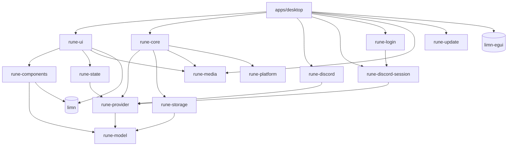

# Arquitectura de RUNE

RUNE (*Rust UI, No Electron*) es un cliente de chat de escritorio nativo. La
interfaz se construye con [limn](https://github.com/Niiihuel/limn) y se pinta
con su backend egui/wgpu. Los únicos usos de un motor web son el login
temporal del proveedor no oficial y la ventana donde la persona resuelve un
hCaptcha, aislados en otro proceso.

Este documento describe qué hay, cómo fluye la información y por qué está
dividido así. Lo pendiente está en [tasks/todo.md](../tasks/todo.md).

## Principio

La interfaz no conoce ningún protocolo. Un **proveedor** traduce un servicio a
los tipos de RUNE (`rune-model`) y declara sus **capacidades**; todo lo que
está por encima trabaja sólo con esos tipos. Hay tres (simulado, oficial y no
oficial, `ProviderKind`), descritos en [DISCORD.md](DISCORD.md).

`apps/desktop` elige e instancia el proveedor
(`--provider mock|discord|discord-session`, o la última elección guardada);
el no oficial requiere la feature `session-login`. La interfaz pide otro con
`Intent::UseProvider` y el host sustituye en caliente `Client` y `Store`,
limpiando la ventana como al cambiar de cuenta.

## Crates

```text
apps/desktop       ventana eframe + bucle de cuadros, elección de GPU, métricas, capturas, benchmark, registro
crates/
  rune-i18n        idioma activo e inglés de cada texto de interfaz, cuya clave es el español
  rune-model       tipos de dominio (ids, User, Server, Channel, Message, Presence, Call, Permissions)
  rune-provider    trait Provider, Command, Event, Failure, Capabilities, EventSink + proveedor simulado
  rune-discord     OAuth2 oficial: identidad y servidores de sólo lectura
  rune-discord-session  proveedor no oficial: Gateway, REST, voz y video
  rune-login       proceso auxiliar de login y captcha (WebKitGTK en Linux, WebView2 en Windows)
  rune-platform    servicios del sistema: diálogos, portapapeles, notificaciones, atajos globales, llavero, bandeja, instancia única, autostart, tema, fuentes, Rich Presence, juegos (Linux y Windows)
  rune-state       Store: estado central aplicado evento a evento
  rune-storage     SQLite: mensajes, ajustes, borradores, marcas de lectura e instantánea, sellados por cuenta
  rune-core        Client: runtime Tokio propio, sesiones, plazos, reconexión, historial, SQLite, adjuntos, imágenes
  rune-media       audio, DSP, Opus, captura y video
  rune-components  piezas de interfaz con limn, funciones puras de props a Element
  rune-ui          la ventana: Ui (estado de interfaz), view, update/intercept → Intent
  rune-update      actualizaciones: manifiesto firmado, descarga, instalación (UPDATES.md)
tools/
  rune-release     herramientas del dueño: firmar releases, feed local de prueba
  rune-icons       generador del set de íconos de assets/glyphs
```

Dependencias (sólo hacia abajo):



Todos dependen además de `rune-i18n`, que no depende de nada. Cada
adaptador tiene su propio HTTP.

`rune-platform` es la frontera con el sistema operativo: cada servicio tiene
su versión de Windows en un `windows.rs` propio detrás de la misma API, y lo
que se calcula sin el sistema se compila también en las pruebas de Linux.
Sólo `rune-ui` pregunta `cfg!(windows)`, para decir en Ajustes lo que es
distinto.

## Flujo de un cuadro

`apps/desktop/src/main.rs`, `App::ui`:

```mermaid
sequenceDiagram
    participant P as Proveedor (runtime rune-core)
    participant C as Client
    participant S as Store
    participant U as rune-ui
    participant T as limn UiTree
    P->>C: Event (cola acotada 1024, despierta la UI)
    C->>S: Update::Provider / Update::Cached (≤256 por cuadro)
    S-->>U: Applied → on_applied → Intent
    U->>T: view(Ui, Store) → Element; layout
    T-->>U: UiEvent → intercept / handle_event → UiAction → update → Intent
    U->>C: Intent::Command / LoadOlder / Send…
    U->>T: view; layout; after_layout (cargar historial, marcar leído); paint
```

0. **Antes del primer cuadro** se aplican la instantánea guardada y los
   borradores si la clave de la cuenta llegó del llavero: la ventana abre
   con lo de la sesión anterior mientras el proveedor conecta, y lo dice.
1. **Drenar** hasta 256 actualizaciones del cliente y aplicarlas al `Store`,
   más los últimos valores pendientes (presencia, quién habla). Una ráfaga
   nunca bloquea un cuadro.
2. **Entrada**, en orden: primero el host (Pulsar para hablar, grabador,
   atajos de `apps/desktop/src/shortcuts.rs`), luego `rune_ui::intercept`,
   luego el árbol de limn, cuyas acciones van a `rune_ui::update`. Todas las
   teclas salen de una sola tabla editable, `rune_ui::keybinds`.
3. **Vista y layout** del estado nuevo; el foco pedido se aplica después de
   un layout que ya contiene el control.
4. **after_layout**: pide la página anterior del historial cerca del
   principio y marca leído al ver el final.
5. **Pintado** con `limn_egui::paint_at`, y repintado sólo si algo va a
   cambiar.

Todo lo que la interfaz quiere hacer fuera de sí misma es un `Intent` que el
host ejecuta. Por eso `rune-ui` se prueba entero sin ventana ni red
(`crates/rune-ui/src/tests.rs` hace de host).

## Estado

- **`rune_state::Store`** (dominio): servidores, canales, usuarios, miembros,
  presencia, voz, lecturas y un `Timeline` por conversación
  (`Arc<Vec<Arc<Message>>>`: la vista clona punteros, no mensajes).
- **`rune_ui::Ui`** (interfaz): qué está abierto, borradores, menús,
  ajustes. Los ajustes se guardan en SQLite: los del equipo bajo su clave y
  los de la cuenta (`rune_ui::ACCOUNT_SETTINGS`) bajo
  `account:{proveedor}:{id}:{clave}`. Lo que se lee antes de abrir la base
  (proveedor, barra de título, GPU, transparencia, búsqueda de
  actualizaciones) son archivos de una línea en `~/.config/rune/`.
- **IDs estables** derivados del dominio (`channel:{id}`, `msg:{id}:reply`,
  `timeline:{canal}`, `composer:{canal}`): limn guarda foco, scroll y texto
  por ID.
- **Memoria acotada**: al abrir una conversación las demás se recortan a sus
  150 mensajes más recientes.

## Contratos entre proveedor, núcleo y estado

- **Autorización explícita**: `AuthenticationState` (`SignedOut`,
  `AwaitingBrowser`, `AwaitingExternal`, `Exchanging`, `SignedIn`,
  `Failed`…); sus eventos no llevan tokens. `SignedOut` y `Failed` limpian
  el dominio.
- **Sesiones numeradas** (`Envelope { generation, event }`): el núcleo
  descarta lo que llega de una sesión anterior.
- **Últimos valores** (`Latest::{Presence, Speaking}`): presencia e
  indicador de voz no se encolan; se guarda sólo el más nuevo por clave.
- **Fallos con nombre** (`Event::Failed { failure, reason, ambiguous }`):
  `ambiguous` distingue «no se hizo» de «no sé si se hizo».
- **Entrega** (`Delivery::{Sent, Sending, Failed, Unknown}`): un mensaje
  propio sin confirmar dice en qué está; reintentar reutiliza el nonce si el
  proveedor declara `idempotent_send`.
- **Timeline coherente**: una página del proveedor es la verdad de su rango;
  los borrados recientes se recuerdan para que una página vieja no los
  resucite.
- **Habilidades** (`Store::abilities`, `server_abilities`…): un
  `Permit::{Allowed, Denied(motivo)}` por acción, que junta capacidades del
  proveedor y permisos de la conversación. La UI no decide por su cuenta:
  deshabilita y explica con el mismo motivo. El proveedor revalida.
- Nada de administración es optimista: la interfaz espera la confirmación.

## Servicios (`rune-core`)

- **Runtime propio** de 2 hilos, separado del de la UI. Ante un error
  transitorio reintenta con backoff exponencial (0,5 s → 30 s, con jitter).
- **Lecturas antes de conectar** (`connecting.rs`): se guardan y salen al
  conectar, en vez de fallar.
- **Historial**: una petición en vuelo por conversación; cambiar de
  conversación cancela las demás.
- **SQLite en su hilo** (`StorageWorker`): colas acotadas (1 024 trabajos,
  8 MiB retenidos), 500 mensajes por conversación y 128 MiB en disco, poda
  en reposo. Esquema versionado (`SCHEMA` en `rune-storage`) con migración
  en una transacción; una base más nueva se rechaza.
- **Caché cifrada por cuenta**: cada valor de una cuenta va sellado con su
  clave, guardada en el llavero; sin llavero, la cuenta queda en memoria.
  Las imágenes descargadas se guardan en disco selladas con la misma clave.
  Detalle y amenazas en [SECURITY.md](SECURITY.md#datos-locales).

## Timeline

`ScrollArea::measured_list` de limn: sólo se construyen las filas visibles,
cada una se mide al construirse y la clave de cada fila (el id del mensaje)
**ancla** la superior visible cuando llega historial arriba. La agrupación
por autor (misma persona, mismo día, sin respuesta, menos de 7 min desde el
primero del grupo: `GROUP_MINUTES`, valor de diseño de RUNE; Discord no
publica el suyo) camina sólo la racha del autor.

## Medios (`rune-media`)

- **Nada bloquea en los callbacks de audio**: sin locks, asignaciones, E/S ni
  `panic`; sólo `rtrb`, atómicos y aritmética. Cada controlador (`Capture`,
  `Playback`, `CallMedia`, `Clip`, `Video`) tiene su hilo; la UI lee
  instantáneas y nunca espera a un dispositivo.
- **Audio**: `cpal` con el backend PipeWire en Linux (WASAPI en Windows).
  Cadena del micrófono: volumen → AEC3 → NS → RNNoise → AGC2 → compuerta de
  voz (Sonora y `nnnoiseless`, Rust puro). La referencia del eco es lo que
  sonó en RUNE o, con «sonido de la PC», el loopback de la salida. Opus mono
  a 48 kHz.
- **Video**: sólo H264. OpenH264 compilado desde la fuente (feature
  `source`, decisión del dueño del 2026-10-16); en Linux, VA-API o NVENC por
  GStreamer cuando hay GPU. La licencia de patentes de Cisco cubre sólo sus
  binarios, no esta compilación: distribuir RUNE con H264 exige revisarlo.
  Calidades hasta 1080p60 **sin tope por Nitro** (decisión del dueño del
  2026-10-16), con las tasas del cliente oficial. DAVE siempre: nada sale sin
  grupo listo.
- **Pantalla y cámara**: portales ScreenCast y Camera más PipeWire en Linux
  (nunca `/dev/video*`); Windows.Graphics.Capture, Media Foundation y el
  loopback de WASAPI en Windows.
- **Sonidos**: los predeterminados son los efectos públicos de Discord
  (`assets/sounds/discord`, autorizados el 2026-10-21); una carpeta propia
  los reemplaza por nombre de evento.

## Diseño

La estructura, las medidas, los textos y el comportamiento siguen al cliente
oficial de Discord, sacados por REA de su bundle web público: el dueño lo
pidió el 2026-10-31 (mosaicos de llamada, menús, perfil, tarjetas de
actividad, «Activo ahora»), y antes ya se hacía por zonas («como Discord»).
Hasta entonces la regla era un lenguaje propio con Discord y Serein sólo
como referencia de comportamiento (2026-10-14). Los colores siguen siendo
los de RUNE (`rune-components::look`, acento ámbar); la densidad de los
menús contextuales es `look::MENU_METRICS`. Las medidas de columnas y filas
salen de capturas del cliente oficial (tema Ónix, zoom 67 %) y las conservan
las pruebas de `crates/rune-ui/src/tests/layout.rs`. No se agrega un control
sólo porque aparece en la referencia: su acción tiene que existir y respetar
las capacidades.

## Idiomas

Español e inglés (Ajustes › Idioma y hora). El crate `rune-i18n`, sin
dependencias y debajo de todos, tiene el idioma activo y el inglés de cada
texto:

- **El texto en español es la clave.** `t("Guardar")` lo devuelve en el
  idioma activo, `tr!("{n} mensajes", n)` hace lo mismo con valores (con
  nombre) y `es("…")` marca un texto que se traduce donde se muestra (una
  tabla `const`, o lo que una capa de abajo entrega). El inglés está en
  `crates/rune-i18n/src/en/`, un archivo por zona.
- **Plurales**: el código elige la forma (`if n == 1`) y cada forma es una
  clave. Fechas y horas son claves en `rune-components/src/time.rs`.
- **Qué idioma**: el del proceso (`rune_i18n::set`), salvo que un hilo
  elija el suyo (`set_thread`); la vista fija el de la ventana en cada
  cuadro. El auxiliar del login lo recibe en `RUNE_LANGUAGE`.
  `--language es|en` lo fija para una ejecución.
- **Qué no se traduce**: el contenido (mensajes, nombres), ids, claves de
  ajustes, protocolo y registros de diagnóstico.
- **Pruebas**: `crates/rune-i18n/tests/catalog.rs` falla si un texto no
  tiene inglés o al revés, o si los `{lugares}` no coinciden;
  `rune-ui/src/tests/english.rs` recorre la interfaz en inglés buscando
  español.

## Rendimiento

| Qué | Cómo |
| --- | --- |
| Panel en vivo | F12 o Ajustes → Apariencia → Mostrar métricas |
| Scroll continuo (GPU real) | `cargo run --release -p rune-desktop -- --bench` |
| Coste de layout sin GPU | `cargo test -p rune-ui five_thousand -- --nocapture` |
| Audio sintético, sin dispositivos | `cargo run --release -p rune-media --example processing` |
| Supresión de ruido | `cargo test --release -p rune-media suppression_table -- --ignored --nocapture` |
| Eco | `cargo test --release -p rune-media echo_table -- --ignored --nocapture` |
| Codificar video | `cargo run --release -p rune-media --example encode_bench -- [alto] [fps] [segundos] [kbit/s] [--hw\|--va\|--nvidia]` |

El layout depende de lo visible, no del total de mensajes.

**Elección de GPU** (`apps/desktop/src/gpu.rs`): en portátiles con GPU
integrada y discreta, el cargador Vulkan abre todos los drivers y despierta
la discreta (~0,9 s y consumo). Antes de abrir la ventana RUNE limita el
cargador al driver de la integrada que maneja la pantalla
(`VK_LOADER_DRIVERS_SELECT`), salvo que la persona elija otra en Ajustes ›
Sistema › Gráficos o que el entorno ya haya elegido (`CHOSEN_BY_PERSON`,
también `RUNE_GPU`). Si la ventana no abre así, se vuelve a ejecutar sin
filtro (`RUNE_GPU=fallback`).

## Windows desde Linux

La CI compila y prueba Windows con el target MSVC. Desde NixOS se comprueba
con el target GNU:

```sh
nix-shell --arg withWindows true
cargo clippy --target x86_64-pc-windows-gnu --workspace --all-targets --all-features -- -D warnings
cargo build  --target x86_64-pc-windows-gnu -p rune-desktop
cargo test   --target x86_64-pc-windows-gnu --workspace            # bajo Wine
```

Con el target GNU, `rune.exe` con `session-login` necesita
`WebView2Loader.dll` al lado (está en `target/…/build/webview2-com-sys-*/out/x64/`);
con MSVC el cargador va enlazado.

## Pruebas

`cargo test --workspace` no requiere acceso a Discord: los adaptadores se
prueban con servidores HTTP, WebSocket y UDP locales y datos sintéticos;
`rune-ui` sin ventana sobre el mundo simulado; `rune-components`, con
props. Las pruebas del auxiliar de login necesitan
`nix-shell --arg withLogin true` y la feature `session-login`. Capturas
reproducibles: `cargo run -p rune-desktop -- --screenshot shot.png
--channel general [--action …]`.
