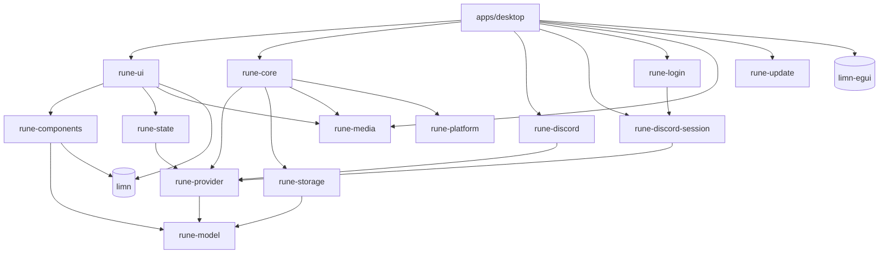
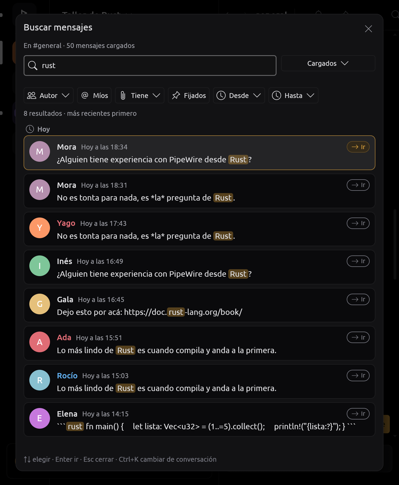
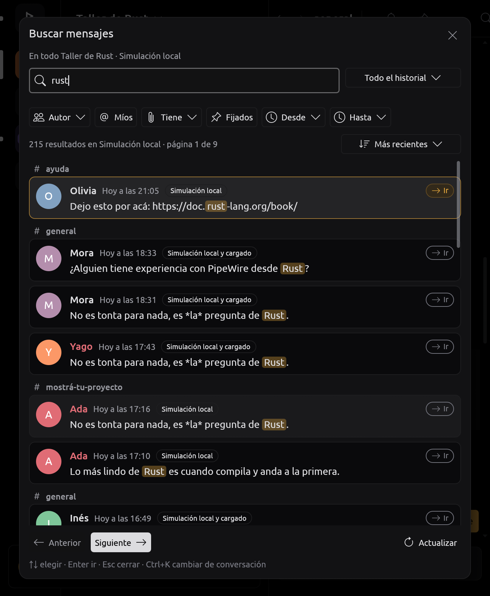

# Arquitectura de RUNE

RUNE (*Rust UI, No Electron*) es un cliente de chat de escritorio nativo. La
interfaz se construye con [limn](https://github.com/Niiihuel/limn) y se pinta
con su backend egui/wgpu. Los únicos usos de un motor web son el login
temporal del proveedor no oficial y la ventana donde la persona resuelve un
hCaptcha, opcionales y aislados en otro proceso; la interfaz principal y las
conversaciones son limn.

Este documento describe qué hay, cómo fluye la información y por qué está
dividido así. Lo pendiente está en [tasks/todo.md](../tasks/todo.md).

## Principio

La interfaz no conoce ningún protocolo. Un **proveedor** traduce un servicio a
los tipos de RUNE (`rune-model`) y declara sus **capacidades**; todo lo que
está por encima trabaja sólo con esos tipos. Hay tres, distinguidos por
`ProviderKind::{Simulated, Official, Unofficial}`:

- **Simulación local determinista** (`rune_provider::mock`), la opción
  predeterminada, identificada como «Simulación local · sin conexión real».
- **`rune-discord`**: adaptador OAuth2 experimental de identidad y listado
  básico de servidores por interfaces oficiales; no habilita mensajes ni voz.
  El canje real con la aplicación registrada no está verificado
  ([DISCORD_OAUTH.md](DISCORD_OAUTH.md)).
- **`rune-discord-session`**: sesión personal **no oficial**, autorizada por
  el dueño. Login, identidad y lectura están confirmados por el dueño contra
  Discord; el resto está probado con fixtures locales. Se mantiene separado de
  OAuth2 y su autorización personal no se presenta como aprobación de Discord
  ([DISCORD_SESSION.md](DISCORD_SESSION.md)).

`apps/desktop` elige e instancia el proveedor
(`--provider mock|discord|discord-session`, o la última elección guardada);
el no oficial requiere la feature `session-login`. La interfaz pide otro con
`Intent::UseProvider` y el host sustituye en caliente `Client` y `Store`,
limpiando la ventana como al cambiar de cuenta. `rune-core`, `rune-state` y
`rune-ui` reciben únicamente el contrato común.

## Crates

```text
apps/desktop       ventana eframe + bucle de cuadros, elección de GPU, métricas, capturas, benchmark
crates/
  rune-i18n        idioma activo e inglés de cada texto de interfaz, cuya clave es el español
  rune-model       tipos de dominio (ids, User, Server, Channel, Message + Delivery, Presence + Activity, Call, Permissions)
  rune-provider    trait Provider, Command, Event, Failure, Capabilities, EventSink (Envelope, Latest) + proveedor simulado
  rune-discord     OAuth2 experimental: navegador externo, callback local, identidad y servidores de sólo lectura
  rune-discord-session  proveedor no oficial: SessionLogin privado, identidad, Gateway, REST, voz y video
  rune-login       proceso auxiliar de login y captcha; WebKitGTK (Linux) o WebView2 (Windows)
  rune-platform    selectores de archivos, portapapeles, notificaciones, atajos globales, llavero, bandeja, instancia única, autostart, tema y fuentes del sistema, Rich Presence local, juegos, carpetas y apertura de enlaces (Linux y Windows)
  rune-state       Store: estado central aplicado evento a evento (Timeline coherente, Abilities, llamada)
  rune-storage     SQLite: mensajes, lápidas, ajustes, borradores, marcas de lectura e instantánea de arranque, sellados por cuenta
  rune-core        Client: runtime Tokio propio, sesiones numeradas, plazos, reconexión, historial, hilo de SQLite, actor de adjuntos, imágenes
  rune-media       captura y reproducción de audio, DSP local, Opus, video (OpenH264; H264 por GPU con GStreamer), reproducción de adjuntos
  rune-components  piezas de interfaz con limn (riel, canales, mensajes, composer, miembros…)
  rune-ui          la ventana: Ui (estado de interfaz), view, update/intercept → Intent
  rune-update      actualizaciones propias: manifiesto firmado, descarga reanudable, instalación atómica (UPDATES.md)
tools/
  rune-release     herramientas del dueño, fuera de la app: rune-release (clave, tag, manifiesto, firma) y rune-test-feed (feed local)
```

Dependencias (sólo hacia abajo):



Todos dependen además de `rune-i18n`, que no depende de nada (ver
[Idiomas](#idiomas)). `rune-network` no existe: cada adaptador tiene su
propio HTTP.

### Plataforma

`rune-platform` es la frontera con el sistema operativo; nada por encima sabe
en qué sistema corre, salvo `rune-ui`, que pregunta `cfg!(windows)` sólo para
decir en Ajustes lo que en Windows es distinto. Cada servicio tiene su
versión de Windows en un `windows.rs` propio detrás de la misma API; lo que
se calcula sin el sistema (menús, comandos, XML de los toasts, atajos,
valores del registro) se compila también en las pruebas de Linux. Detalle en
[PLATFORM.md](PLATFORM.md).

- **Selectores de archivos** (portal OpenFile/SaveFile): selección asíncrona
  de uno a diez archivos, abiertos en un worker fijo. `choose_files` entrega
  todos los descriptores o un error; valida URIs y límites antes de
  publicar. `SelectedFile` transfiere una única propiedad del descriptor, sin
  clonación ni serialización, y no se reabre la ruta. `save_file` devuelve un
  `SaveDestination` privado, no un permiso de sobrescribir. La conexión D-Bus
  es dedicada; cancelar o renovar el portal conserva el worker
  ([FILES.md](FILES.md)).
- **Atajos globales** (`shortcuts::GlobalShortcuts`, portal
  `GlobalShortcuts`): hilo propio, el host sondea sin bloquear y soltar el
  handle cierra la sesión. Sólo acepta señales del dueño del portal y de su
  sesión; no hay captura X11 ni lectura de dispositivos de entrada. Lo usan
  Pulsar para hablar, silenciar, ensordecer y pulsar para silenciar
  ([MEDIA.md](MEDIA.md)).
- **Notificaciones** (`notifications::Notifier`): devuelve la clave de la que
  se cliqueó y el botón (`Click = (clave, botón)`); `withdraw(clave)` retira
  una. La de una llamada entrante trae «Aceptar» y «Rechazar», es crítica y
  se retira al dejar de sonar o al cerrarse RUNE; sólo cuentan botones que
  ofreció y que vienen del dueño actual del servicio. El desktop decide con
  `rune_ui::message_alert` y `rune_ui::call_alerts`, y abre con
  `rune_ui::open_alert` sólo para la misma cuenta.
- **Portapapeles** (`clipboard`): lee archivos copiados o una imagen;
  bloquea, así que sólo desde el worker de Core.
- **Escritorio**: bandeja (StatusNotifierItem y dbusmenu), instancia única y
  socket `discord-ipc-N`, autostart, tema del portal `Settings`, fuentes por
  fontconfig, detección de juegos por `/proc` y socket de Hyprland. El host
  (`apps/desktop/src/desktop.rs`) los maneja según las preferencias y
  `rune_ui::desktop` decide qué mostrar y qué publicar.
- **Carpetas y enlaces**: `folders` dice dónde guarda RUNE sus archivos (XDG
  o las carpetas conocidas de Windows) y `open` abre enlaces y carpetas con
  el programa del sistema.

### Adjuntos de salida

La interfaz y Store conservan sólo `UploadToken`, `PendingAttachment` y
contadores. El host revalida `Store::abilities` antes de usar Client.
`rune-core::uploads` conserva una instancia del selector y concentra en un
actor los descriptores, los bytes y la construcción de `Command::SendFiles`.
Un worker fijo prepara el lote secuencialmente, con metadatos antes y después
de cada lectura acotada y comprobación de EOF. Reserva todos los bytes y
entradas antes de leer; el fallo o la cancelación de un archivo descarta el
lote entero. El presupuesto de 32 MiB y diez entradas acompaña a cada dueño
sellado de `Bytes::from_owner`, incluso a través de clones o slices; no se
expulsan archivos para admitir otros. La UI conserva el borrador y añade el
lote con una revisión; si rechaza el callback devuelve todos los tokens.

Cola llena, cancelación, reconexión, permisos y respuestas se correlacionan
por cuenta, canal, generación y petición. Reintentar usa el cuerpo original y
el mismo nonce lógico con una petición nueva; un archivo ausente nunca se
sustituye por un envío sólo de texto. Los fallos ambiguos requieren
idempotencia declarada y una acción explícita. Progreso y confirmación son
etapas distintas.

**Arrastrar archivos no funciona todavía.** eframe/egui dependen de winit
0.30, cuya vía RawInput no produce eventos de archivos en Wayland y, en X11,
no liga la posición del puntero al lote. Por eso `apps/desktop/src/uploads.rs`
(`reject_legacy_drop`) limpia `dropped_files` y `hovered_files` antes de que
lleguen a limn, rechaza todo drop con un aviso que ofrece Adjuntar y bloquea
el `Submitted` del editor en ese cuadro, para que Enter no envíe el texto
solo. `Client::prepare_attachment_paths` existe y está probado para cuando
haya una entrada con posición fiable (migrar a winit 0.31 o el receptor
Wayland de `limn-dnd`); ver [tasks/todo.md](../tasks/todo.md).

## Flujo de un cuadro

`apps/desktop/src/main.rs`, `App::ui`:

```mermaid
sequenceDiagram
    participant P as Proveedor (runtime rune-core)
    participant C as Client
    participant S as Store
    participant U as rune-ui
    participant T as limn UiTree
    P->>C: Event (cola acotada 1024, despierta la UI)
    C->>S: Update::Provider / Update::Cached (≤256 por cuadro)
    S-->>U: Applied → on_applied → Intent
    U->>T: view(Ui, Store) → Element; layout
    T-->>U: UiEvent → intercept / handle_event → UiAction → update → Intent
    U->>C: Intent::Command / LoadOlder / Send…
    U->>T: view; layout; after_layout (cargar historial, marcar leído); paint
```

0. **Antes del primer cuadro** se aplican la instantánea guardada
   (`Client::cached_snapshot` → `Store::apply_cached_snapshot`) y los
   borradores, si la clave de su cuenta llegó del llavero: la ventana abre
   con lo de la sesión anterior mientras el proveedor conecta, y lo dice
   («Conectando… Se muestra lo guardado en este equipo.»). El proveedor no
   oficial nombra su cuenta al verificarla (`Event::StorageIdentity`); cuando
   llega la clave, el cliente entrega lo guardado (`Update::Restored`) y el
   host lo aplica como caché si la sesión todavía no está lista. OAuth2
   arranca sin caché. Todos restauran los ajustes. Con la simulación, lo
   guardado puede verse fuera de orden antes de conectar porque sus ids se
   reinician en cada corrida.
1. **Drenar** hasta 256 actualizaciones del cliente y aplicarlas al `Store`,
   más los últimos valores pendientes (presencia, quién habla). Si quedaban
   más, se pide otro cuadro: una ráfaga nunca bloquea un cuadro.
2. **Layout previo**: la entrada se resuelve contra lo que está en pantalla.
   Si no llegó nada y no hubo entrada, se reutiliza el layout anterior.
3. **Entrada**, en el orden en que llegó dentro del cuadro: primero el host
   (`App::host_keys`: Pulsar para hablar y el grabador;
   `apps/desktop/src/shortcuts.rs`: historial, canales, regiones, lista de
   atajos y métricas), luego `rune_ui::intercept` (selector rápido, búsqueda,
   formato, editar el último, enviar y línea nueva cuando no son los de
   limn, autocompletado, Esc en cascada), luego el árbol de limn, cuyas
   acciones van a `rune_ui::update`. Cada evento usa sus modificadores, y los
   Intents, el layout y el foco se resuelven antes del siguiente. Las teclas
   salen de una sola tabla, `rune_ui::keybinds` ([Atajos
   editables](#atajos-editables)).
4. **Vista y layout** del estado nuevo; el foco pedido se aplica después de
   un layout que ya contiene el control (limn sólo enfoca controles
   maquetados).
5. **after_layout**: pide la página anterior cuando la primera fila visible
   está a ≤5 del principio. Sólo una ventana activa, en recientes y sin
   diálogo, recordatorio manual ni salto pendiente puede marcar leído al ver
   el final.
6. **Pintado** con `limn_egui::paint_at` y repintado sólo si algo va a
   cambiar (animación, escritura que caduca, avisos, medidor, el próximo
   plazo de una petición: `Client::next_deadline`).

Todo lo que la interfaz quiere hacer fuera de sí misma es un `Intent` que el
host ejecuta. Por eso `rune-ui` se prueba entero sin ventana ni red
(`crates/rune-ui/src/tests.rs` hace de host).

## Estado

- **`rune_state::Store`** (dominio): servidores, canales, usuarios, miembros,
  presencia, voz, estados de lectura y un `Timeline` por conversación. Cada
  evento toca sólo lo que nombra. Un `Timeline` guarda
  `Arc<Vec<Arc<Message>>>`: la vista lo clona (punteros) sin copiar mensajes;
  un cambio copia la lista de punteros sólo si un cuadro anterior aún la
  retiene.
- **`rune_ui::Ui`** (interfaz): qué está abierto o seleccionado, borradores,
  respuesta o edición en curso, menús, ajustes. Se persiste lo necesario
  (`settings_to_keep`) en SQLite: los del equipo bajo su clave, y los de la
  cuenta (`rune_ui::ACCOUNT_SETTINGS`: lugar, favoritos y fijados,
  notificaciones, canales ocultos y categorías, temporizadores de estado)
  bajo `account:{proveedor}:{id}:{clave}`. El host
  (`apps/desktop/src/kept.rs`) los lee al arrancar y, cuando entra otra
  cuenta, le devuelve los suyos (`Ui::restore_account`) antes de abrir nada.
- **El aspecto**: la vista nunca lee `Theme::look()` directo, sino
  `Ui::look()` (el tema integrado o uno propio,
  `rune_components::theme::CustomTheme`, teñido con el color principal) y,
  para el riel, las columnas y la conversación, `Ui::panes_look()`: con la
  ventana transparente esas superficies no se pintan y la raíz pinta el
  fondo con alfa una sola vez. Los temas propios son JSON validado en
  `rune-components::theme`; importarlos y exportarlos pasa por el portal en
  `rune-core::theme_files` ([PLATFORM.md](PLATFORM.md)).
- **IDs estables**: cada control y cada lista tienen ID derivado del ID del
  dominio (`channel:{id}`, `msg:{id}:reply`, `timeline:{canal}`,
  `composer:{canal}`). limn guarda foco, scroll y texto por ID, así que cada
  conversación conserva su posición y su borrador.
- **Memoria acotada**: al abrir una conversación las demás se recortan a sus
  150 mensajes más recientes (`KEPT_WHEN_CLOSED`); vuelven del proveedor o de
  la caché al reabrirlas.
- **Prioridad del historial confirmado**: la caché sólo llena un timeline
  vacío que todavía espera su página más reciente. Si el proveedor ya
  confirmó una conversación vacía, una lectura tardía de SQLite no la llena.

## Atajos editables

`rune_ui::keybinds` es la tabla de atajos: cada `Action` (navegación,
mensajes, formato y voz) tiene su `Chord` por defecto, que la persona cambia
en Ajustes › Sistema › Atajos de teclado («Restablecer» vuelve al de
siempre). Se rechaza, con el motivo en la fila, una combinación que ya usa
otra acción, Tab, Shift+F10, las de edición de texto (Ctrl+A/C/V/X/Z/Y) o una
tecla que sola escribe o mueve el cursor. Los atajos de voz se guardan en sus
claves (`push_to_talk_key`, `mute_key`…: el host los sostiene y el portal los
registra); el resto guarda sólo lo que difiere del defecto en `shortcuts`
(`back=F9;send=Ctrl+Enter`). La lista de Ctrl+/, los ajustes, las pistas de
la cabecera y el despacho del host y de `intercept` leen la misma tabla. Una
tecla de puntuación o un dígito coincide con o sin Shift (`/` es Shift+7 en
distribuciones españolas y alemanas). Enviar y línea nueva dejan Enter y
Shift+Enter al compositor de limn; si Enviar pasa a otra combinación, Enter
escribe una línea nueva. Un atajo actúa una vez por pulsación, nunca por la
repetición de una tecla sostenida.

## Idiomas

La interfaz está en español y en inglés (Ajustes › Idioma y hora: Sistema,
Español o English). El crate `rune-i18n`, sin dependencias y debajo de
todos, tiene el idioma activo y el inglés de cada texto:

- **El texto en español es la clave.** El código escribe español donde lo
  usa; `t("Guardar")` lo devuelve en el idioma activo, `tr!("{n} mensajes",
  n)` hace lo mismo con valores (con nombre, para que el inglés pueda cambiar
  el orden) y `es("…")` marca un texto que se traduce después, donde se
  muestra: una tabla `const`, o un texto que una capa de abajo entrega y la
  interfaz guarda (nombre y aviso del proveedor, etiquetas de `LoginError`).
  El inglés está en `crates/rune-i18n/src/en/`, un archivo por zona. No se
  usó Fluent (Serein usa `fluent-templates`) porque con dos idiomas que
  comparten la regla del plural alcanza una tabla y un rellenador de
  `{lugares}`, sin dependencias, y cada texto queda legible donde se usa.
- **Plurales**: español e inglés dicen «uno» sólo para 1, así que el código
  elige la forma (`if n == 1`) y cada forma es una clave. **Fechas**: meses,
  días, «hace 5 minutos», «Hoy a las…», el orden de la fecha corta y a. m./
  p. m. son claves (`rune-components/src/time.rs`); el reloj de 12 o 24 h es
  su propio ajuste.
- **Qué idioma**: el del proceso (`rune_i18n::set`), salvo que un hilo elija
  el suyo (`set_thread`). La vista fija el del hilo de la ventana en cada
  cuadro desde `Ui::language()` (lo elegido o, con «Sistema», el que el host
  leyó de `LANGUAGE`, `LC_ALL`, `LC_MESSAGES` o `LANG`; español si no es
  ninguno de los dos), así que el cambio se ve en el mismo cuadro y un test
  que dibuja en inglés no cambia a los demás. El host copia ese idioma al
  proceso en cada cuadro para lo que escriben otros hilos (core, proveedores,
  bandeja), y el auxiliar del login y del captcha lo recibe en
  `RUNE_LANGUAGE` (la página del captcha es una plantilla que Rust llena con
  los textos escapados; la CSP no cambia). Los textos de limn
  (`limn::set_labels`) siguen al idioma en cada cuadro, y la bandeja lo
  recibe en `TrayState::language`. Es un ajuste del equipo (`language`), no
  de la cuenta. `--language es|en` lo fija para una ejecución (capturas).
- **Capas**: cada capa traduce donde arma el texto, con el idioma del hilo
  que lo arma. `rune-ui` y `rune-components` no conocen proveedores: sólo
  piden textos a `rune-i18n`. Lo que una capa de abajo arma una vez y la
  interfaz muestra mucho tiempo viaja como clave (`es`) y se traduce al
  mostrarse, para que un cambio en vivo lo alcance: nombre y aviso del
  proveedor, motivos de desconexión, opciones de proveedor, problemas del
  escritorio, y las etiquetas de los errores con texto fijo (`LoginError`,
  REST, voz, llavero, atajos, captura, almacenamiento), que se traducen en su
  `Display`. También los nombres de reserva: `Channel::UNNAMED`
  («Conversación») y `Server::UNNAMED` («Servidor no disponible») se guardan
  en español y se traducen en `Store::channel_title` y `Server::shown_name`.
  Un aviso pasajero se arma ya traducido y queda en el idioma de ese momento.
- **Qué no se traduce**: el contenido (mensajes, nombres de personas,
  servidores, canales y roles, comandos y componentes de bots, también los de
  la simulación), ids, claves de ajustes, la sintaxis de búsqueda (que acepta
  `from:`/`de:`, `has:`/`tiene:`, `in:`/`en:`), protocolo, registros de
  diagnóstico y el panel de métricas.
- **Pruebas**: `crates/rune-i18n/tests/catalog.rs` lee los fuentes del
  workspace y falla si un texto marcado no tiene inglés, si un inglés no
  tiene texto, si los `{lugares}` no coinciden, si una clave tiene dos
  ingleses o si el inglés conserva letras del español; también fija los
  textos con dos sentidos («Hilo bloqueado» y «Bloqueado», «Todo el mundo» y
  «Todos»). `rune-ui/src/tests/english.rs` recorre la interfaz simulada en
  inglés (cada página de ajustes, menús, perfil, emoji, bandeja, hilos, voz,
  búsqueda, inicio, invitación) y falla si un texto pintado o una etiqueta de
  accesibilidad parece español y no es contenido de la simulación; otro test
  cambia el idioma en vivo y vuelve. Los demás tests corren en español, sea
  cual sea el idioma de la máquina.

## Búsqueda y contexto de mensajes

`rune-ui::search` tiene tres alcances:

- **Cargados**: consulta literal, sin distinguir mayúsculas, sobre el
  contenido del mensaje, el texto de sus tarjetas y del mensaje que reenvía
  (`rune_model::card_words`). Texto, autor, archivos, fijados y fechas se
  combinan con AND; las fechas usan el día local de creación. Sólo recalcula
  si cambian el contenido o la consulta.
- **En este equipo**: `SearchQuery` y `SearchHit` sobre SQLite: consultas de
  hasta 256 caracteres/1024 bytes, 20 resultados por página, snippets de
  hasta 160 caracteres; la UI conserva como máximo cinco páginas ligeras.
  `rune-core::storage::local_reads` reserva el crédito de respuesta antes de
  admitirla (64 KiB para búsqueda, 2 MiB para contexto, dentro del
  presupuesto compartido de 8 MiB); las lecturas recorren hasta 32 filas por
  paso, cierran el SELECT antes de intercalar una escritura y usan keyset. No
  se usa SQL LOWER para sustituir la semántica Unicode del modelo. Sólo
  aparece si el cliente tiene un almacén habilitado para la identidad, y no
  presenta lo retenido como todo el historial del proveedor.
- **Todo el historial**: busca en el proveedor con la capacidad
  `message_search` (`Command::SearchMessages`, `rune_model::RemoteSearch`).
  El texto acepta filtros (`from:`, `mentions:`, `has:`, `in:`, `before:`,
  `after:`, `during:`, `pinned:`, `author_type:`, `has:poll`, `link_from:`,
  también en castellano) que el campo sugiere mientras se escriben
  (`rune-ui::search::filters`). Enter pide una página de 25 que
  `search::remote` combina con lo cargado sin duplicar, marcando el origen.
  Ordenada por relevancia, conserva el orden del proveedor. Un índice en
  preparación se vuelve a pedir una vez por `rune_ui::tick`. Lo encontrado no
  entra en ningún timeline (en SQLite va a la tabla `found`, ver [Caché
  cifrada por cuenta](#caché-cifrada-por-cuenta)). `@nombre` en un servidor
  busca miembros en el proveedor (`member_search`).

El diálogo (2026-10-19, pedido del dueño; referencias: el panel de
resultados del cliente oficial y el de Serein, reimplementados):

- Arriba, el campo y el alcance; debajo, los filtros como pastillas con su
  estado a la vista: autor (buscador de personas con cara y color de rol),
  «Míos», «Tiene» (archivo, enlace, imagen, video, sonido, tarjeta,
  sticker, encuesta; «En este equipo» sólo archivo), «Fijados», «Desde» y
  «Hasta» (`DatePicker`), y «Quitar filtros» cuando hay alguno. En «Todo el
  historial» el orden va sobre los resultados y los filtros también se
  escriben en el campo, con sugerencias.
- Cada resultado es una tarjeta (`rune_components::search::card`): cara,
  nombre con el color de su rol, fecha y hora, de dónde vino cuando se
  mezclan fuentes, el texto con lo buscado resaltado (`marked`, sin
  distinguir mayúsculas), miniaturas de sus imágenes (las de spoiler o
  explícitas sólo se nombran) y «Ir». Se agrupan por canal si abarcan
  varios y por día si no (salvo ordenados por relevancia). La lista es una
  `measured_list`: sólo construye lo visible, y `images::wanted_images` pide
  las caras y miniaturas de esas filas.
- Sin nada escrito, buscando, sin resultados o con un error, el área de
  resultados muestra un estado propio (`Empty`). La línea de ayuda corta
  queda al pie, con el paginado de lo guardado y del historial.
- Todo bajo la cabecera va en el pie del `Modal`, que no se desplaza: el
  diálogo toma el alto de la ventana y la lista, lo que queda.




Más capturas: [filtro «Tiene»](img/busqueda-filtros-2026-10-19.png),
[autor](img/busqueda-autor-2026-10-19.png),
[vacía](img/busqueda-vacia-2026-10-19.png); antes del rediseño:
[cargados](img/busqueda-antes-cargados-2026-10-19.png) y
[todo el historial](img/busqueda-antes-remoto-2026-10-19.png).

El cursor se liga a consulta, canal, época y revisión de datos: un cambio en
los mensajes invalida resultados y cursores, y la UI permite actualizar
explícitamente, sin ciclos automáticos. Cierre, cambio de canal o cuenta y
cancelación descartan respuestas anteriores. El host vuelve a comprobar canal
y permisos al abrir un resultado. Ctrl+F abre el diálogo; Ctrl+K es la
navegación entre conversaciones.

`open_message` y `rune-ui::context` comparten la navegación por ID con
búsqueda, fijados y bandeja. Si falta el ID se pide `CachedContext` o
`Command::LoadContext` (capacidad `message_context`). Un contexto local exige
el ancla exacta y admite hasta 25 vecinos a cada lado; la UI usa hasta 51
mensajes. Ausencia local no significa borrado remoto. Los mensajes de
contexto se guardan como Upsert individuales, nunca como un rango
autoritativo, y una instantánea atrasada por mutaciones del mismo canal se
descarta. El timeline de contexto tiene cobertura desconocida
(`latest=false`): no anuncia inicio ni final ni marca leído. El ancla se
desplaza y resalta sin tocar el borrador; «Ir a lo más reciente» pide una
página nueva y reemplaza la ventana parcial.

## Contratos entre proveedor, núcleo y estado

Lo que un proveedor promete y lo que el resto puede suponer. Todo es
independiente del servicio.

- **Autorización explícita** (`Capabilities::authentication`,
  `Command::{BeginSignIn, CancelSignIn, SignOut}`, `Event::Authentication`).
  `AuthenticationState` distingue `Unavailable`, `SignedOut`,
  `AwaitingBrowser { url }`, `AwaitingExternal`, `Exchanging`,
  `SignedIn { scopes }` y `Failed { reason }`; sus eventos no llevan tokens.
  `SignedOut` y `Failed` limpian el dominio conservando la descripción del
  proveedor; el núcleo descarta solicitudes pendientes y `rune-ui` limpia
  borradores, navegación, búsquedas y menús de la cuenta.
- **Listado de servidores de cuenta** (`Capabilities::account_servers`):
  independiente de chat y administración. Cuando es falso, la UI dice que no
  se consultó la lista en vez de afirmar que hay cero servidores. Una sesión
  personal no se presenta como una concesión de permisos OAuth2.
- **Sesiones numeradas** (`Envelope { generation, event }`): el núcleo
  descarta lo que llega de una sesión anterior a la vigente.
- **Últimos valores** (`Latest::{Presence, Speaking}`): presencia e
  indicador de voz no se encolan; el `EventSink` guarda sólo el más nuevo por
  clave y el núcleo los drena por cuadro. Una tormenta de presencias no puede
  llenar la cola ni retrasar mensajes.
- **Fallos con nombre** (`Failure::{Send, Edit, Delete, React, History,
  Voice, Status, …}`, `Event::Failed { failure, reason, ambiguous }`):
  `ambiguous` distingue «no se hizo» de «no sé si se hizo».
- **Entrega** (`Delivery::{Sent, Sending, Failed, Unknown}`): un mensaje
  propio sin confirmar dice en qué está; `Failed` y `Unknown` ofrecen
  Reintentar y Descartar. Reintentar reutiliza el nonce si el proveedor
  declara `idempotent_send`. Los cambios rechazados (edición, reacción) se
  revierten (`before_change`).
- **Actualizaciones parciales** (`MessagePatch`, `Event::MessagePatched`): un
  campo ausente conserva su valor; una colección presente vacía lo limpia,
  sin retroceder una edición confirmada. Store aplica sobre el baseline
  confirmado más reciente, preserva diferencias optimistas ajenas y no crea
  un mensaje a partir de un patch. Reacciones, súper reacciones y votos en
  vivo (`rune_model::Tally`) llegan igual, como `MessageMutation::Tally`.
- **Plazos** (`ClientConfig::deadlines`: historial 20 s, envío y voto 30 s):
  una petición sin respuesta produce un fallo sintético (`Unknown` para
  envíos); también la cola llena y la conexión caída.
- **Timeline coherente** (`rune_state::timeline`): una página del proveedor
  es la verdad de su rango; lo que el rango tenía y la página no, se borró.
  Una página de lo más nuevo que no alcanza lo guardado reinicia la lista en
  vez de dejar un hueco. Los borrados recientes se recuerdan (256) para que
  una página vieja no los resucite, y una edición más vieja no pisa a una
  más nueva.
- **Habilidades** (`Store::abilities(channel) -> Abilities`): para cada
  acción un `Permit::{Allowed, Denied(motivo)}` que junta lo que el proveedor
  puede hacer y lo que la conversación permite. La UI no decide por su
  cuenta: deshabilita y explica con el mismo motivo. Hay equivalentes por
  servidor (`server_abilities`), cuenta (`account_abilities`), eventos e
  interacciones.
- **Lecturas** (`rune-state::reads`, `rune-core::read_states`): la posición
  local y el recordatorio manual son independientes del cursor confirmado.
  `mark_unread_command` conserva el ID exacto; `mark_read_command` marca
  hasta el último ID conocido; `retry_read_command` sólo confirma el avance
  local que ya existía. Las confirmaciones van por cuenta, canal y petición,
  con versiones positivas. Con `remote_unread` un recordatorio también va al
  proveedor y los de otros dispositivos llegan como `Event::MarkedUnread`;
  con `server_read` un servidor entero se marca con un comando;
  `Event::LatestMessages` marca no leído lo que el proveedor sólo resume. El
  núcleo conserva hasta 256 peticiones admitidas; pérdida de sesión,
  cancelación y plazo terminan la espera sin afirmar que el efecto remoto se
  revirtió.
- **Marcas persistidas** (`ReadMark`, tabla `read_marks`): `through`,
  `unread_from` y revisión local por cuenta y canal, separados de la
  instantánea. La restauración tiene límite de 65 536 filas y crédito previo
  de 4 MiB. Un fallo no se trata como una cuenta vacía: las marcas nuevas
  quedan en RAM con aviso. Un ACK viejo no limpia una elección distinta.
- **Bandeja** (`rune-ui::inbox`): una fila por conversación visible con
  permiso de historial, filtros de no leídos y menciones conocidas, hasta
  1000 canales recientes, virtualizada. No es un índice completo de
  menciones. Abre por ID real mediante contexto y conserva el borrador; nunca
  suma o resta IDs.
- **Llamada** (`rune_model::Call { channel, phase, muted, deafened, quality }`,
  `CallPhase::{Joining, Securing, Connected, Waiting, Reconnecting, Failed}`;
  `Waiting` es conectada y sola). Se une con `Command::JoinVoice` y termina
  con `Event::CallEnded`; `CallQuality` lleva RTT y pérdida cuando se
  conocen. `Event::VoiceStartTimes` dice desde cuándo cada sala tiene gente
  (`Store::voice_started`). `Command::WatchServer` dice al proveedor qué
  servidor muestra la columna. Con `private_calls` un privado o grupo
  también tiene llamada: `JoinVoice` la empieza o la atiende, `RingCall` y
  `StopRinging` hacen sonar o rechazan, y `Event::PrivateCall` /
  `PrivateCallEnded` dicen quién tiene llamada y a quién suena
  (`Store::call_status`, `incoming_calls`). Con `call_check`, una llamada 1:1
  se pregunta antes (`Command::CheckCall` → `Event::CallChecked { ringable }`
  o `Failure::CallCheck { refused }`).
- **Cuenta sincronizada** (`rune_model::account`): notificaciones por
  servidor y canal, carpetas del riel, privacidad de mensajería y notas, cada
  una con su capacidad (`synced_notifications`, `server_folders`,
  `messaging_privacy`, `notes`). Con `synced_notifications` la interfaz lee
  las notificaciones de `Store` en vez de las del equipo; `Store::rail`
  ordena el riel. Nada cambia antes de que el proveedor responda.
- **Riel y notificaciones**: `Event::VoiceActivity` trae las apps lanzadas
  en canales de voz; `Message::mention_roles` y `mention_everyone` dicen a
  quién avisa un mensaje, y `Store::counts_as_mention` los cuenta salvo que
  la cuenta los silencie. Un servidor sin nivel propio toma el suyo
  (`ServerOptions::mentions_only`).
- **Presencia rica e identidad** (`rune_model::identity`): hasta cuatro
  actividades con imágenes y tiempos, plataforma de cada presencia, marcas de
  cuenta y miembro (`Store::identity_in`), estilo de rol, insignias,
  conexiones, efectos de perfil, lo que permite el plan (`Event::Perks`),
  paquetes de stickers y GIF del proveedor ([PROFILES.md](PROFILES.md)).
- **Presencia**: el estado personalizado se pide con
  `Command::SetCustomStatus` (`custom_status`) y vuelve como
  `PresenceChanged`. Un estado «durante 1 hora» o un estado personalizado que
  se borra solo son temporizadores del cliente (`rune_ui::tick`), guardados
  entre ejecuciones.

## Proveedores de Discord

**OAuth2** (`rune-discord`): PKCE S256, scopes `identify guilds`, navegador
externo y callback limitado a `http://127.0.0.1:48731/oauth/callback`. El
application ID es configuración pública (`--discord-client-id` o
`RUNE_DISCORD_CLIENT_ID`); no se pide client secret. «Abrir navegador»
produce `Intent::OpenUrl`; listener, plazos y HTTP corren en el runtime del
núcleo; cancelar cierra el listener y descarta respuestas tardías. Sólo
`authentication` y `account_servers` están habilitadas: la UI muestra
identidad y servidores de sólo lectura, sin inventar canales ni presencia. El
access token vive sólo en RAM y el refresh token se ignora. Este proveedor no
declara identidad de almacenamiento, así que SQLite guarda con él sólo
ajustes. Cerrar sesión limpia lo local e intenta revocar; si no se confirma,
la UI lo avisa.

**Sesión no oficial** (`rune-discord-session`, feature `session-login`,
Linux y Windows): el host inyecta `SessionLogin` en
`DiscordSessionProvider`, que obtiene un `SessionSecret` privado al
adaptador; comandos, eventos, `Store` y `rune-ui` nunca reciben la
credencial. `rune-login` ejecuta un auxiliar con sesión web efímera
(WebKitGTK o WebView2), sin importar perfiles; el resultado circula por pipes
privados acotados, no por argumentos, configuración o logs. La persona
completa el login y sus desafíos. El flujo es `SignedOut` →
`AwaitingExternal` → `Exchanging` → `SignedIn`; el proveedor verifica la
identidad por HTTP antes de anunciar `SignedIn` y abrir Gateway. `READY` se
traduce a `Snapshot`; historial, eventos, heartbeat, reanudación, límites y
cancelación quedan dentro del adaptador. Sus capacidades al día son las de
`crates/rune-discord-session/src/provider.rs`; cada acción requiere además
`Store::abilities` y se revalida en el proveedor. La credencial vive en
memoria y en el llavero del sistema (una entrada por cuenta recordada), nunca
en SQLite; cerrar sesión la borra del llavero, sin afirmar revocación remota.
Detalle, alcance y riesgos en [DISCORD_SESSION.md](DISCORD_SESSION.md) y
[SECURITY.md](SECURITY.md).

## Expresiones y referencias de texto

`rune-model` tiene `CustomEmoji`, `Sticker` y `TextReference`, sin tipos del
protocolo. `rune-components::emoji` construye pestañas y tarjetas con props;
`rune-ui::expressions` decide la inserción y la selección pendiente.
`composer_selection` conserva el rango Unicode de limn junto al canal y al
texto fuente; inserta Unicode, emoji propios y enlaces GIF en el cursor o
reemplaza la selección; si el canal o el texto ya no coinciden, inserta al
final. `Intent::FocusInput` enfoca un campo existente y aplica después su
cursor, de modo que el siguiente evento del mismo cuadro escriba allí. El
límite de 2000 unidades UTF-16 se comprueba sobre el borrador resultante.
Seleccionar un sticker guarda `(ChannelId, StickerId)`; el envío vuelve a
comprobar catálogo y capacidad y emite `Intent::SendSticker`. Picker, GIF y
límites en [ARTWORK.md](ARTWORK.md).

El adaptador traduce menciones, canales, roles y emojis a `TextReference`. El
render resuelve nombres desde `Store`; sin identidad conocida conserva la
referencia legible. Un emoji de servidor se dibuja en la línea
(`TextSpan::image`, o su superficie mientras se anima), con `:nombre:`
mientras carga o si falla; `:nombre:` es lo que se copia y lo que lee la
accesibilidad. Un mensaje que es sólo emoji los muestra a 48 px. Mostrar un
alias no implica una mención saliente.

## Administración: servidores, canales, roles y permisos

- **Permisos** (`rune_model::permissions`): `@everyone` (el rol cuyo id es el
  del servidor) más los roles de la persona; dueño y administrador tienen
  todo; en un canal se aplican las sobrescrituras de `@everyone`, de sus
  roles y la propia; sin ver el canal no se puede nada en él. `in_server` e
  `in_channel` son funciones puras con tests. Un proveedor puede mandar los
  permisos calculados en `Channel::permissions`; la simulación usa esas
  funciones.
- **Comandos y eventos**: crear, editar, borrar o abandonar servidores;
  canales, categorías y sobrescrituras; roles; dar roles, apodos, expulsar,
  vetar; perfil; vetos y auditoría. Los cambios llegan como `ServerChanged`,
  `ChannelChanged`, `MemberChanged`… y `Created { request }` dice qué se creó.
  Nada de esto es optimista: la interfaz espera la confirmación.
- **Habilidades por servidor** (`Store::server_abilities`): un `Permit` por
  acción. La jerarquía de roles (`my_rank`, `rank_of`) deja fuera de alcance
  los roles a la altura propia o por encima. Un canal sin permiso de ver no
  aparece (`Store::visible`).
- **Familias con capacidad propia**: aislar (`timeouts`), invitaciones
  (`create_invites`, `invite_links`), subir emojis y stickers
  (`upload_expressions`), miembros por páginas (`member_pages`), podar
  (`prune`), webhooks e integraciones, GIF favoritos sincronizados, opciones
  del servidor (`ServerOptions`), reordenar canales en lote, conteos por rol,
  ajustes de foro. `rune-state::admin` fusiona páginas con lo conocido sin
  duplicar. La imagen de una expresión se prepara en
  `rune-core::expression_images`, fuera del hilo de UI.
- **Reglas y onboarding** (`rune_model::onboarding`): `Store::join_steps`
  dice qué debe la cuenta; las reglas pendientes cierran el compositor con su
  motivo ([INVITATIONS.md](INVITATIONS.md)).
- **AutoMod** (`rune_model::automod`): reglas con sus límites;
  `AutoModRule::problem` parsea las expresiones regulares con `regex-syntax`
  antes de mandarlas. Un envío rechazado llega como `Event::AutoModBlocked` y
  `rune-core::automod` lo convierte en el `Event::Failed` de su comando con
  el motivo escrito para la persona.
- **Eventos programados** (`rune_model::scheduled_events`,
  `rune_state::events`, `rune_ui::events`): lista por servidor leída una vez
  por sesión y mantenida con lo informado; `Store::may_change_event` (lo de
  cualquiera con «Gestionar eventos», lo propio con «Crear eventos», nada de
  lo que terminó).
- **Simulación**: la cuenta es dueña de «Laboratorio limn» y miembro común en
  los demás; valida permisos y jerarquía como un servicio y anota cada cambio
  en la auditoría.

Borradores y confirmaciones se validan de nuevo contra `Store` antes de
emitir un comando: una revocación o descenso de rol con un diálogo abierto
impide guardar o moderar con permisos antiguos. El proveedor sigue siendo la
autoridad final. La interfaz de administración se diseñó a partir de
capturas del Discord oficial en un servidor de prueba propio, con código y
recursos propios. Rutas del proveedor no oficial en
[DISCORD_SESSION.md](DISCORD_SESSION.md).

## Timeline virtualizado

El timeline usa `ScrollArea::measured_list` de limn: sólo se construyen las
filas visibles, cada una se mide al construirse, y la clave de cada fila (el
id del mensaje) mantiene su altura y **ancla** la fila superior visible
cuando se insertan mensajes antiguos arriba o una fila cambia de altura.
`follow_end(true)` mantiene el final a la vista mientras se está abajo. Cada
fila se construye desde un contexto compartido `Arc<Rows>`
(`crates/rune-ui/src/timeline.rs`): agrupación por autor (misma persona,
mismo día, sin respuesta, <7 min desde el primero del grupo), separadores de
día y de «Nuevos», respuesta citada, mención resaltada. La agrupación camina
hacia atrás sólo la racha del mismo autor (`group_starts_at`), coste lineal;
una versión recursiva era exponencial ([PERFORMANCE.md](PERFORMANCE.md)).

## Servicios (`rune-core`)

- **Runtime propio** de 2 hilos, separado del hilo de UI.
- **Supervisor**: ante `ProviderError::Transient` reintenta con backoff
  exponencial (0,5 s → 30 s, ±20 % de jitter); una sesión que duró >20 s
  reinicia la cuenta. `Fatal` deja de reintentar. La UI muestra el estado.
- **Generación**: al llegar un `Ready`, el cliente descarta peticiones de la
  sesión anterior, guarda una instantánea para el próximo arranque y las
  conversaciones se vuelven a pedir al abrirse.
- **Lecturas antes de conectar** (`rune-core/src/connecting.rs`): mientras
  la sesión no está arriba (`Ready` o `Connected`), el cliente guarda las
  lecturas que pide la interfaz (historial, eventos, miembros, perfil…) en
  vez de mandarlas a un proveedor que las rechazaría con un aviso, y las
  manda al conectar o reconectar. Sólo fallan si la conexión se da por
  perdida. Fijados, contexto y escrituras no esperan.
- **Historial**: una petición en vuelo por conversación; al cambiar de
  conversación se cancelan las demás (`Command::Cancel`) y una respuesta que
  nadie espera se descarta.
- **Envío optimista**: el mensaje aparece como `Sending` con id
  `u64::MAX - nonce`; la confirmación trae el nonce y lo reemplaza.
- **Fijados**: `Store::begin_pins` antes del comando; una sola lectura por
  canal y un delta de hasta 256 IDs; la respuesta se reconcilia con
  borrados y desfijados concurrentes, y una lápida nunca se restaura.
- **SQLite en su propio hilo** (`StorageWorker`): cola acotada de 1 024
  trabajos, 16 respuestas de caché y 8 MiB de datos retenidos. Las escrituras
  usan `try_send` y devuelven el lote rechazado; el núcleo retiene un único
  lote fiable y deja de consumir eventos fiables hasta aceptarlo, y los
  plazos descuentan esa pausa. Límite de 500 mensajes por conversación y
  128 MiB en disco; la poda corre tras 3 s en reposo, como mucho cada 10 min.
  Esquema versionado (`SCHEMA` en `rune-storage`) con migración en una
  transacción; una base de una versión más nueva se rechaza.

### Coherencia de la caché

`MessageMutation` conserva el orden de creación, edición, página y borrado en
una transacción. Una página autoritativa retira lo ausente sólo de su rango,
sin crear lápidas para ausencias implícitas. Un borrado explícito crea una
lápida persistente (las últimas 256 por cuenta y canal). Los mensajes
optimistas no se guardan como confirmados, y las instantáneas excluyen
presencias y voz.

La identidad de la caché es opt-in: proveedor estable más cuenta, nunca el
nombre visible. El simulado la declara al arrancar
(`Provider::storage_identity`); el no oficial, al verificar la cuenta
(`Event::StorageIdentity`), y vale hasta `SignedOut`/`Failed`. Sin identidad
el archivo guarda sólo ajustes. Un `Ready` de otra cuenta deshabilita la
caché. Las respuestas se ligan a época, petición y canal.

Un ticket se confirma después de ejecutar su trabajo; un fallo de SQLite lo
reintenta sin adelantar la marca. Al cerrar, el host procesa la entrada ya
recibida, envía los últimos valores y espera una barrera confirmada (Esc la
cancela). «Borrar datos locales» anuncia éxito sólo tras su confirmación. Un
lote de más de 8 MiB nunca cabría: la sesión sigue en memoria, con aviso.

### Caché cifrada por cuenta

`rune-storage` sella cada valor de una cuenta (mensajes, lo que encontró una
búsqueda, borradores, instantánea, marcas) con la `Key` de esa cuenta; sin
`Storage::unlock` no lee ni escribe nada de ella (`Error::Locked`). La clave
la guarda el núcleo en el llavero (`keys.rs`, servicio `rune-cache`), nunca en
el archivo, y la pide fuera del hilo de la interfaz. Al tomar una identidad,
el núcleo bloquea el trabajador (`Job::Lock`), pide la clave y encola
`Job::Unlock`; detrás, en orden, van las escrituras de esa cuenta. Si la
identidad llegó por evento, el desbloqueo devuelve lo guardado como
`Update::Restored`, con crédito reservado; lo que no entra se deja afuera en
orden (instantánea, borradores, marcas) y siempre con aviso.
`Client::start` nunca espera al llavero; sólo el arranque de la ventana llama
`Client::wait_for_key` (hasta 2 s). Las operaciones del llavero corren de a
una. Si el llavero no tiene la clave, se crea una nueva y `unlock_new` borra
lo sellado con la perdida. Sin llavero, la cuenta queda en memoria con aviso,
nunca en texto plano. `Event::ForgetStorage` borra las filas de la cuenta y
su clave. Lo que trae `Event::SearchResults` va a la tabla `found`: la
búsqueda local lo lee, pero páginas y contexto no lo toman por vecino. Ver
[SECURITY.md](SECURITY.md#datos-locales).

### Imágenes en disco

`rune-core::images::disk` guarda entre ejecuciones las imágenes descargadas
en `ClientConfig::image_cache` (`$XDG_CACHE_HOME/rune`), con el diseño de
Serein reimplementado: dos partes acotadas (medios y arte compartido),
escritura atómica (0600, `persist`), LRU por `mtime` con poda hasta el 90 %.
Cada archivo se nombra con `Key::file_name` (HMAC-SHA-256 de la URL con una
subclave de la cuenta) y va sellado con la misma `Key`, así que sigue a la
caché cifrada: `forget_account` borra su carpeta y `forget_local_data` la
vacía. Una sesión que la base no verificó no lee ni escribe en disco. Nada se
abre hasta que el host da los límites elegidos
(`Client::set_image_cache_limits`); una descarga lee el disco antes de la red
y escribe sólo lo que se decodificó como imagen.

Los ajustes de lectura que no son de un componente se aplican en el host o en
la vista: `scaled_scroll` escala la rueda antes del árbol;
`animations::now_playing` deja animar, con «Animar GIF» apagado, sólo lo que
está bajo el puntero; `members_narrow` baja la conversación a 280 px antes de
esconder la lista de miembros.

## Elección de GPU (`apps/desktop/src/gpu.rs`)

En portátiles con GPU integrada y discreta, el cargador Vulkan abre todos los
drivers para enumerar adaptadores, y abrir el de la discreta la despierta
(~0,9 s y consumo mientras RUNE corre). Antes de abrir la ventana, RUNE
limita el cargador al driver de la integrada que maneja la pantalla, salvo
que la persona haya elegido otra en Ajustes › Sistema › Gráficos
(`~/.config/rune/gpu`) o que el entorno ya haya elegido (`CHOSEN_BY_PERSON`).
Si la ventana no abre así, se vuelve a ejecutar sin filtro
(`RUNE_GPU=fallback`) y Ajustes lo dice. La decisión es una función pura
sobre lo leído de sysfs, con tests. Números en
[PERFORMANCE.md](PERFORMANCE.md).

## Medios (`rune-media`)

El callback de audio sólo hace aritmética y un `AtomicU32::store`: sin
locks, sin asignaciones, sin canales. Captura, procesamiento, Opus, mezcla,
voz y video se describen en [MEDIA.md](MEDIA.md) y [VIDEO.md](VIDEO.md).
`rune_media::Clip` reproduce mensajes de voz, audio y video en hilos propios;
`rune-core` depende de `rune-media` sólo para decodificar el MP4 de un GIF de
tarjeta en cuadros de animación.

## Pruebas

`cargo test --workspace` no requiere acceso a Discord: las pruebas de red de
los adaptadores usan servidores HTTP y WebSocket locales y datos de prueba.
`rune-ui` se prueba sin ventana sobre el mundo simulado; `rune-components`,
con props. La validación del auxiliar de login requiere el entorno de
`nix-shell --arg withLogin true` y la feature `session-login`; las pruebas
controladas no acreditan un login real.
