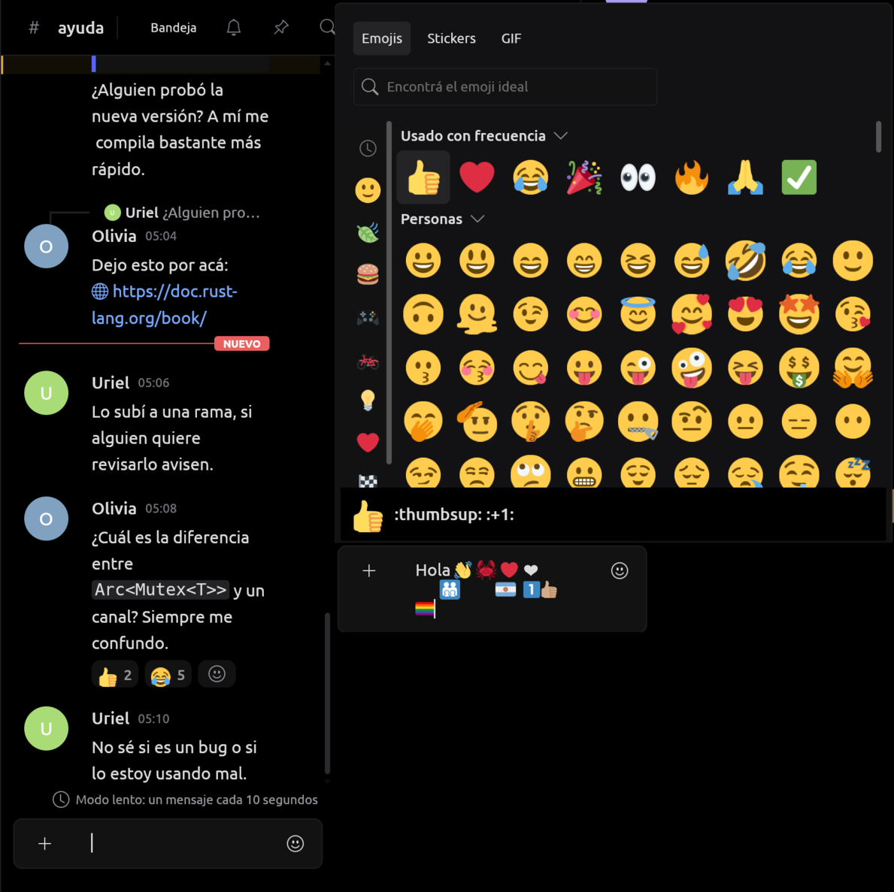

# Imágenes y expresiones

Avatares, íconos, vistas previas, emojis, stickers y GIF: cómo se piden,
se limitan y se dibujan. El catálogo, la selección, el envío y la imagen son
contratos separados: ver una imagen no concede permiso para enviarla, y
seleccionar una expresión no envía un mensaje. Los adjuntos (descargas,
subidas, visor) están en [FILES.md](FILES.md) y [VISOR.md](VISOR.md).

## Recursos del proveedor

`RemoteImage` es una referencia de dominio independiente del servicio:
avatares, íconos de servidor, miniaturas de expresiones y vistas previas.
El adaptador traduce identificadores y hashes válidos a rutas públicas del
CDN y conserva las URLs de adjuntos que recibe; la UI no construye rutas ni
recibe credenciales. `RemoteImage` y `RemoteFile` ocultan en `Debug` las
firmas temporales de las URLs. Los campos nuevos persistidos llevan
`serde(default)`.

Después del layout, `rune-ui::wanted_images` enumera lo visible (riel,
conversaciones, miembros, perfil, filas del timeline, celdas del selector,
las pestañas de Amigos, los diálogos de grupo y las sugerencias de @). Una
persona sin foto propia se pide con la predeterminada de su servicio
(`User::picture`), nunca sólo con la inicial.
`rune-core::Images` mantiene una caché en RAM y despierta la ventana al
terminar. Mientras falta la imagen se ven iniciales o un marcador; un fallo
no impide leer la conversación.

| Límite | Implementación |
| --- | --- |
| Concurrencia | 4 descargas/decodificaciones; los decoders en curso conservan su permiso al cancelar |
| Respuesta de artwork | 1 MiB, comprobado antes y durante la descarga |
| Artwork de origen | PNG, WebP o GIF, hasta 512 × 512; asignación del decoder acotada a 4 MiB |
| Miniatura | PNG de 128 × 128, conserva proporción con margen transparente |
| Caché | 256 entradas y 16 MiB de base64; LRU en memoria, sin disco |
| Red | Cliente separado sin cabeceras de cuenta ni cookies; HTTPS y origen exacto declarado por el proveedor; sin redirecciones |
| Reintentos | Fallos transitorios: al menos 30 s; 429/5xx conservan la espera por origen aun al purgar la caché; un `Retry-After` ilegible bloquea ese origen hasta cerrar sesión |
| Cierre de sesión | Cancela tareas, cambia de generación, vacía recursos de core/UI y texturas de limn |

La transformación corre con `spawn_blocking`. limn recibe `RasterImage`; su
backend tiene dos trabajadores de decodificación y una cola de 32
trabajos/16 MiB. Los 16 MiB de RUNE cuentan el base64 retenido, no toda la
RAM: además hay miniaturas en curso y texturas GPU. El host limita la caché
de texturas de limn a 64 entradas fuera de pantalla (como mucho 96 MiB RGBA
con las vistas previas más grandes). limn expulsa primero lo dibujado hace
más tiempo y nunca una imagen dibujada en el paso actual o el anterior: si
no, con más de 64 imágenes en pantalla (el selector de emoji con 72) las
imágenes se turnaban para aparecer.

Los stickers ignoran el parámetro `size` del CDN, por eso se admite su
tamaño de origen antes de reducirlos; los emojis se piden como WebP para
cubrir los subidos en WebP/AVIF
([formatos del CDN](https://docs.discord.com/developers/reference#image-formatting)).

## Vistas previas de adjuntos

`Attachment.preview` es un `RemoteImage` de clase `AttachmentPreview`;
`Attachment.download`, el `RemoteFile` original. Un archivo sin vista previa
sigue siendo un archivo: no se inventan píxeles. Las dimensiones de los
metadatos reservan el lugar antes de cargar.

| Límite | Implementación |
| --- | --- |
| Respuesta | Hasta 8 MiB, por longitud anunciada y por bytes recibidos |
| Formatos | PNG, JPEG, WebP y GIF, comprobados por su contenido |
| Origen | Hasta 4096 por lado y 16 777 216 píxeles; asignación del decoder de 80 MiB |
| Salida | PNG de hasta 768 × 512 por la densidad de la pantalla (1, 1,5 o 2: 1536 × 1024 en densidad 2), sin recortar ni ampliar imágenes pequeñas |
| Concurrencia | Hasta dos vistas previas dentro de los cuatro trabajos de imagen |
| Caché | La misma de 256 entradas/16 MiB, por el cuadrado de la densidad |

Densidad (2026-10-19): el escritorio pasa los píxeles por punto de la
ventana (`Client::set_image_density`) y todo se decodifica para ese paso
(1, 1,5 o 2; más denso, 2): vistas previas, banners (512 × 256 por la
densidad) y las imágenes chicas (128 px por la densidad: avatares, íconos,
stickers). Un paso nuevo vuelve a decodificar desde el disco o la red. El
proveedor puede dar la dirección del tamaño dibujado (`Provider::image_at`):
el no oficial pide al CDN `size=` por la densidad, hasta la potencia de dos
siguiente (sólo fixtures, sin probar contra el servicio real); los adjuntos
bajan su archivo como antes.

`image_failures` comunica a la UI sólo los recursos visibles que fallaron,
sin el cuerpo del error ni las firmas. Mientras la vista previa carga o si
falla, su ThumbHash (`ImageKind::ThumbHash`) cubre la caja: se decodifica
al instante, sin red, en a lo sumo 32 px. Una imagen explícita que el filtro
de la cuenta tapa se pide como `ImageKind::Obscured`: la misma vista previa
achicada a 24 px y desenfocada en CPU, hasta que la persona la revela
([DISCORD_SESSION.md](DISCORD_SESSION.md)).

El adaptador de Discord usa `url` y, para la vista previa, `proxy_url`
([objeto Attachment](https://docs.discord.com/developers/resources/message#attachment-object)).
Acepta HTTPS en `cdn.discordapp.com` y `media.discordapp.net`, con una ruta
cuyos ids coincidan con el canal y el archivo recibidos; rechaza
credenciales, fragmentos, puertos no estándar y rutas incompatibles. Los
[enlaces de adjuntos caducan](https://docs.discord.com/developers/reference#signed-attachment-cdn-urls):
RUNE no fabrica firmas ni las renueva, y un enlace vencido puede fallar
hasta recibir datos nuevos del mensaje. SVG, AVIF y HEIC no se decodifican
como vistas previas.

Como Serein, RUNE separa los presupuestos de imagen fija, animación y visor,
reserva el espacio antes de cargar y separa las descargas explícitas del
cacheado visual; no tiene su escalera de resoluciones ni su caché en disco.

## Selector de expresiones

El selector tiene pestañas de emojis, stickers y GIF, con búsqueda por
nombre (recorre hasta 500 elementos y muestra hasta 72 coincidencias). El
adaptador entrega el texto opaco que se inserta: la UI no conoce la
sintaxis del protocolo. El autocompletado de `:` sólo sugiere lo que se
puede usar.

### Qué se puede usar

- **Plan de la cuenta.** El proveedor informa `Event::Perks` (emojis de
  otros servidores, animados, stickers de otros servidores y el nombre de
  lo que los desbloquea). Mientras no lo informó, el selector ofrece sólo
  el servidor del canal. Con el plan conocido ofrece todos los servidores
  de la cuenta (el del canal primero) y lo que no se puede usar lleva un
  candado y el motivo («Necesitás Nitro para usar emojis de otros
  servidores acá»). A diferencia de Serein, RUNE no cambia un emoji
  bloqueado por un enlace a su imagen.
- **Permisos externos.** `EXTERNAL_EMOJI` (bit 18) y `EXTERNAL_STICKERS`
  (bit 37) llegan a `Abilities::external_emoji`/`external_stickers`.
  `Store::emoji_perk` y `sticker_perk` preguntan primero por el permiso del
  canal y después por el plan, como el cliente oficial. El compositor, la
  edición y los comandos no mandan un texto que nombra un emoji que no se
  puede usar ahí: avisan por qué y conservan el borrador. Con los
  beneficios desconocidos (o desde la caché local) no frenan nada: decide
  el servicio.
- Los roles restringidos de cada emoji se respetan cuando se conocen.

### Stickers

Seleccionar un sticker abre una vista previa de 56 px con **Quitar** y
**Enviar sticker**; el envío es un mensaje aparte y conserva el borrador de
texto. Capacidades, permisos y catálogo se vuelven a comprobar al enviar.
Los **paquetes estándar** (capacidad `sticker_packs`) se piden al abrir la
pestaña (`Command::LoadStickerPacks`) y van al final, uno por sección.

**Lottie** (`format_type` 3): el JSON de
`https://cdn.discordapp.com/stickers/{id}.json` se pide como cualquier
imagen de expresión (hasta 1 MiB) y sólo una imagen de expresión cuya ruta
termina en `.json` llega al rasterizador, **rasterlottie** (Rust puro sobre
tiny-skia, sin GIF, imágenes embebidas ni texto). Lienzo de hasta 1024 px,
dibujado a 128 px, a 30 cuadros por segundo como mucho, con los
presupuestos de un GIF. Antes de rasterizar, RUNE revisa el modelo: sin
ciclos de precomposiciones ni más de 8 niveles (rasterlottie agotaría la
pila), repetidores de hasta 64 copias, estrellas y polígonos de hasta 64
puntas y no más de 20 000 capas y formas por cuadro. Lo que no soporta
(expresiones, efectos, texto) muestra el nombre en la celda y se envía
igual. Serein dibuja un cuadro quieto; RUNE lo anima.


### GIF

- **GIF del servicio** (capacidad `gif_search`): `Command::SearchGifs` →
  `Event::GifResults`. La pestaña abre en tendencias con categorías como
  mosaicos; las sugerencias (`Command::SuggestGifs`) aparecen como fichas
  mientras se escribe. En la sesión no oficial, páginas de 50 hasta la
  décima con `offset` (el cliente oficial no pagina: si Discord contesta la
  misma página, la pestaña deja de ofrecer otra). Las vistas previas se
  animan con el presupuesto común, nunca con movimiento reducido.
- **GIPHY** (opcional): `rune-core::GifSearch` hace Search y Trending con
  `GIPHY_API_KEY` del entorno, una clave de una aplicación propia (nunca la
  de Discord, Serein u otro cliente; nunca en argumentos, configuración ni
  logs). Sin ella, el buscador no aparece. Una página de hasta 20, offset
  hasta 480, sin búsqueda en cada pulsación; miniaturas fijas
  (`fixed_width_small_still`) de los hosts de `giphy.com` exactos, 1 MiB
  cada una, cuatro a la vez, 25 s por búsqueda. Las
  [reglas de GIPHY](https://developers.giphy.com/docs/#best-practices)
  piden URLs sin modificar, atribución visible y autorización para cachear:
  por eso no usa la caché de imágenes, SQLite ni disco, y la marca está en
  el pie del selector ([GIPHY.md](../assets/licenses/GIPHY.md)). Las
  claves beta tienen 100 consultas por hora. Tenor no acepta clientes API
  nuevos desde enero de 2026. Si hay las dos fuentes, dos botones eligen.
- **Enlace manual**: sin buscador se puede pegar un enlace HTTPS; los
  últimos 12 quedan sólo durante la sesión.
- **Favoritos**: un corazón en cada resultado. Con
  `synced_gif_favorites` se sincronizan con la cuenta (la sesión no oficial
  los guarda en el campo 2 de `FrecencyUserSettings`, como Serein); si no,
  quedan sólo en este equipo, en los ajustes locales (hasta 100). La
  pestaña dice cuál de los dos. Emojis y stickers no tienen favoritos que
  sincronizar (Serein tampoco).

Elegir un GIF siempre **inserta su enlace en el borrador**; la persona
confirma el envío. Cada búsqueda se ata a cuenta, canal, pestaña e
identificador: cambiar de contexto cancela y descarta, y las respuestas
tardías se ignoran.


### Emojis en los mensajes

- Los mensajes conservan el contenido original; el adaptador genera
  referencias tipadas para mostrar usuarios, roles, canales y emojis sin
  cambiar lo que se copia o edita.
- **Jumbo**: un mensaje de sólo emoji (hasta 30) pide la imagen del
  servidor a 96 px (en una línea, 48); los Unicode se dibujan como imagen de
  Twemoji a 48 px (22 en modo compacto). El detector usa el índice de
  Twemoji: un keycap y las flechas del paquete cuentan, como en el cliente
  oficial; un dígito, ©, ®, ™ o un emoji con VS15, no.
- **Detalle**: un clic en un emoji de un mensaje (o clic secundario en una
  reacción) abre una tarjeta con su imagen, nombre, si es de un servidor,
  el servidor de origen si está en el catálogo y «Copiar emoji». Los emoji
  del texto son botones enfocables.
- **Estados**: miembros, amigos y conversaciones muestran el emoji del
  estado personalizado antes de sus palabras; los fijados dibujan sus
  emoji. Los extractos de búsqueda dicen `:nombre:` sin imagen (falta en
  limn un subtítulo de `ListRow` con elementos).


### Subir emojis y stickers

Desde Ajustes del servidor → Emojis o Stickers, con el selector de archivos
y `rune-core::expression_images` en un hilo de servicio. Un GIF que ya
cumple el límite queda animado (emoji hasta 256 KB; sticker 320 × 320 y
hasta 512 KB); cualquier otra imagen se recorta al cuadrado y se hace PNG de
128 px (emoji) o 320 × 320 (sticker). `ExpressionImage` vuelve a comprobar
formato, tamaño y peso, y `NewExpression::problem` el nombre, el emoji
relacionado y la descripción.

### Simulación

Plan «Plus (simulado)» con emojis en todos lados y stickers sólo en su
servidor; dos paquetes, uno Lottie (`assets/sticker-sample.json`, una
animación propia); GIF con cuatro páginas de doce y seis categorías;
#off-topic niega los permisos externos.

## Emoji a color (Twemoji)

RUNE pinta los emoji Unicode con [Twemoji](https://github.com/jdecked/twemoji)
17.0.3 (CC BY 4.0), los mismos que acredita Discord. El texto sigue siendo
Unicode: limn mide, parte líneas, selecciona, copia y anuncia a la
accesibilidad los caracteres originales; sólo cambia el dibujo, en el
backend, así que cubre todo el texto que limn pinta (mensajes, nombres,
reacciones, selector, avisos y el editor).

| Pieza | Dónde |
| --- | --- |
| Paquete | `assets/twemoji/pngs.bin`: los 4009 PNG de 72 × 72 del release, sin modificar, uno tras otro |
| Índice | `assets/twemoji/index.tsv`: secuencia sin U+FE0F, posición, largo y presentación por defecto según `emoji-data.txt` 17.0.0 |
| Generador | `scripts/twemoji.py`: sólo biblioteca estándar; fija commit y SHA-256, y es reproducible |
| Atribución | [assets/licenses/TWEMOJI.md](../assets/licenses/TWEMOJI.md) |
| Código | `crates/rune-components/src/twemoji.rs`: `picture(grafema)`, `emoji_len(texto)` e `image(secuencia)`; se instala con `limn_egui::set_color_emoji` |

Un paquete de PNG y no un atlas: se decodifica sólo lo que aparece, al
tamaño dibujado, sin reservar los ~83 MiB RGBA de un atlas; 72 px cubren el
emoji en línea incluso a escala 3.

Reglas: la unidad es el grafema extendido (ZWJ, tonos de piel, banderas,
keycaps). U+FE0F se ignora al buscar; U+FE0E pide texto. Un punto de código
con presentación de texto por defecto (`❤`, `©`, `☀`) va en color sólo con
U+FE0F. Lo que no está en el paquete conserva el glifo de la fuente.
Mientras un PNG se decodifica (hasta 24 por cuadro) se ve el glifo un
cuadro. Límite: el ancho lo da la fuente monocroma, así que una secuencia
que Noto Emoji no compone (familias, banderas regionales) queda centrada con
aire y un keycap invade un poco al vecino.



## Íconos de la interfaz

`assets/glyphs/` tiene el set de íconos de RUNE. `rune_components::glyphs::pack`
lo instala en cada ventana con `limn_egui::set_icon_pack`; un `limn::Icon` que
el set no tiene sigue siendo Bootstrap Icons (Github, entre otros).

El sistema sigue al de Discord, que se estudió con REA estático sobre los
bundles públicos de su cliente web (autorizado el 2026-10-16): una grilla de
24 px que se muestra a 12, 16, 18, 20, 24 o 32 px; formas sólidas de un solo
color, cada una un `path` con `fill-rule="evenodd"` y sin trazos; líneas de
2 px con puntas redondas; esquinas de 3 px; insignias en la esquina inferior
derecha (círculo de 5 px en 19,19) y tachados recortados del cuerpo con un
hueco. Las siluetas se acercan a las suyas a pedido del dueño (2026-10-19),
pero cada ícono se construye con primitivas y coordenadas propias en
`tools/rune-icons/icons.py`; no se copió ningún trazo ni recurso.

Los tipos de canal que limn no tiene (anuncios, foro, hilo, escenario) son
`glyphs::{MEGAPHONE, FORUM, THREAD, STAGE}`. Un canal privado usa la versión
de su ícono con el candado recortado arriba a la derecha (`glyphs::locked`),
como el cliente oficial. Si un ícono no tiene esa versión, el candado se
superpone.

Los pares contorno/relleno de limn comparten el dibujo sólido, como en
Discord, salvo los que son el estado apagado de un interruptor: `Heart`,
`Play`, `Pause` y `Stop` son contornos de 2 px.

```sh
nix shell --impure --expr 'with import <nixpkgs> {}; python3.withPackages (p: [ p.skia-pathops p.picosvg ])' \
  -c python3 tools/rune-icons/icons.py assets/glyphs
```

## Recursos propios de `assets/`

Los demás SVG de `assets/` se dibujaron para RUNE en `currentColor`, para
que el tema los tiña.

| Archivo | Qué dibuja | Dónde |
| --- | --- | --- |
| `rune-mark.svg` | La marca: una R de tres bloques a 45° (banda superior, banda larga y pie) sobre una grilla de 10 × 8, diseñada con el dueño el 2026-10-21 (archivo de Figma «RUNE — Marca») | `rune_components::MARK` (carril, pantalla de carga, inicio de sesión, actualizaciones, perfil); en rojo de marca `rune_components::BRAND` (`#D62D2D`) donde RUNE se presenta |
| `glyphs/{crown,headphones-off,person,shield,signal,calendar,eye-off}.svg` | Corona del dueño, auriculares tachados, persona, escudo, señal, calendario, ojo tachado | `members::CROWN`, `HEADPHONES_OFF`, `user_settings::PERSON` y `SHIELD`, `voice::SIGNAL`, `events::CALENDAR`, `desktop::EYE_OFF` |
| `icons/rune-small.svg` | El ícono a 16, 24 y 32 px: la placa llena el cuadro y la marca cae en píxeles enteros | Origen de `icons/hicolor/16x16`, `24x24` y `32x32` |
| `icons/rune.svg` | El ícono desde 48 px: la marca en blanco sobre una placa que va del casi negro `#2B080A` al rojo `#E0292B`, en la grilla de íconos de macOS (la placa, 824 de 1024) | Origen de `icons/rune.png` y del resto de `icons/hicolor` |
| `icons/rune.png`, `icons/hicolor/*` | El ícono de la aplicación, dibujado desde esos dos SVG | Ventana, bandeja, `rune --install`, notificaciones, entrada de escritorio, README |
| `icons/rune.ico` | El mismo ícono para Windows: mapas de bits de 32 bits de 16 a 128 px y PNG de 256 | Ejecutable, instalador y ventana de inicio de sesión |

Los sonidos (`assets/sounds/*.ogg`) son tonos sintetizados por
`scripts/sounds.sh` ([AUDIO-NOTICES.md](../assets/licenses/AUDIO-NOTICES.md)).
Las fuentes y los símbolos de respaldo están en [FONTS.md](FONTS.md); lo de
terceros, en [THIRD_PARTY_NOTICES.md](../THIRD_PARTY_NOTICES.md).
