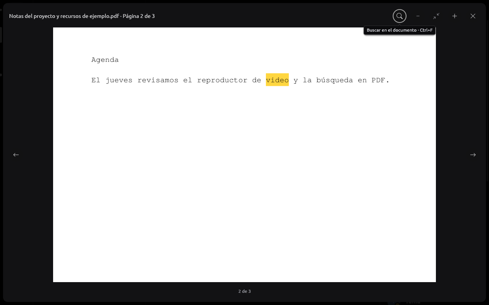

# Vista previa de documentos

RUNE permite ver **un PDF página por página** desde su tarjeta o menú
contextual («Ver PDF»). Es una vista rasterizada con el `ImageViewer` de
limn: zoom, ajuste y cierre mantienen la misma interacción que las imágenes,
y sus flechas (o ← y →) cambian de página. Se puede
[buscar en su texto](#búsqueda) y las coincidencias se resaltan en la
página. No es un lector completo: no hay selección de texto, formularios,
JavaScript ni enlaces del documento. Copiar el enlace, abrirlo o guardar el
archivo siguen siendo acciones explícitas. El visor es el mismo de las
imágenes ([VISOR.md](VISOR.md)).

## Flujo y límites

`rune-components` identifica PDF por MIME o extensión y ofrece «Ver PDF».
Esto solo decide la acción visual. `rune-ui::documents` resuelve el
adjunto actual y emite `PreviewDocument`; no descarga nada al mostrar el
timeline. El resultado solo contiene píxeles. Se descartan resultados viejos
al cerrar, cambiar conversación/cuenta, borrar el mensaje o abrir otra imagen.

`rune-core::Documents` mantiene una petición reemplazable, sin credenciales
de cuenta. Verifica HTTPS y los orígenes de archivos permitidos por el
proveedor, rechaza redirects y limita tanto el tamaño declarado como los
bytes realmente recibidos a **16 MiB**. Comprueba el encabezado PDF antes de
invocar el parser; el encabezado no se considera validación estructural.
No guarda PDF ni raster en SQLite o una caché persistente.

## Páginas

El PDF descargado queda en memoria (16 MiB como máximo) solo mientras su
visor está abierto, para pedir otras páginas sin descargarlo de nuevo. Se
libera al cerrar el visor, al cancelar, al cambiar de conversación o de
cuenta. Cada página se pide con `Intent::DocumentPage` cuando se muestra; si
se pasa a otra antes de que termine, la anterior se cancela y su proceso
aislado se mata. La interfaz conserva las últimas 4 páginas renderizadas;
volver a una de ellas no vuelve a ejecutar el renderer.

El total de páginas sale de `pdfinfo`, del mismo paquete Poppler y con el
mismo sandbox y límites que el renderer. Solo se lee la línea `Pages:` de los
primeros 64 KiB de su salida; un total imposible o ausente se trata como un
documento de una página.

La rasterización corre fuera del hilo UI. Un directorio temporal privado
contiene el PDF y el PNG; se elimina al terminar o cancelar. `prlimit`
limita el proceso a 512 MiB de espacio de direcciones, 5 segundos de CPU,
8 MiB por archivo de salida, 64 descriptores y ningún core dump. El plazo
de pared es de 10 segundos. `bubblewrap --unshare-all` separa red, procesos
y montajes: solo expone los paquetes inmutables de Nix, configuración de
fuentes, el PDF de entrada y un directorio de salida. No monta el home,
la sesión de RUNE ni otros documentos; se limpian las variables de entorno.

Poppler recibe únicamente la página pedida y un lado máximo de 1200 px. El PNG
se verifica como archivo regular, se limita a 8 MiB y se decodifica con
dimensiones y asignaciones acotadas antes de recodificarlo sin metadatos.
Si el aislamiento no puede iniciarse, la vista falla; no hay fallback que
ejecute el parser fuera del sandbox. PDF inválidos, cifrados o que superen
los límites pueden no tener vista previa; el mensaje de error no muestra
salida del parser ni la URL del adjunto.

## Búsqueda

La lupa de la cabecera del visor («Buscar en el documento», también
Ctrl+F) abre un `Modal` de limn sobre la página con un campo de búsqueda.
La primera vez pide `Intent::DocumentText`: el núcleo pasa el PDF que ya
tiene en memoria a `pdftotext`, del mismo paquete de Poppler que dibuja las
páginas (su ruta sale de la del renderer, no del PATH), con el **mismo
aislamiento** (bubblewrap sin red ni hogar, prlimit, directorio temporal
privado), con `-bbox`: su informe (XHTML) da
cada palabra con su caja en puntos y el tamaño de cada página, y RUNE lee
hasta 24 MiB en 15 s (unas 250 000 palabras). Sólo se lee el cuerpo
(`<doc>`: la cabecera trae el título del PDF); cada palabra queda como
`rune_model::PdfWord`, sin caracteres de control y con su caja como
fracción de la página (0 a 1, recortada a ella; una caja sin sentido se
descarta). Poppler da el tamaño de la página como se guarda, pero las cajas
como se ve: en una página girada un cuarto de vuelta (`/Rotate` 90 o 270)
ancho y alto se intercambian antes de dividir. Para saber cuáles, el mismo
`pdfinfo` del sandbox informa cada página (`-f 1 -l 9999`, «Page N rot»,
hasta 1 MiB); si no puede, se toman sin girar. Vive sólo mientras el visor
está abierto: cerrarlo, cambiar de conversación o de cuenta lo descarta
junto con el PDF.

La búsqueda es local, sin distinguir mayúsculas: lista hasta 50 páginas
que tienen el texto, cada una con un extracto alrededor de la primera
aparición, y pulsar una va a esa página (pidiéndola si no está entre las
cuatro dibujadas). Esc cierra la búsqueda antes que el visor. Un PDF de
imágenes (escaneado) dice que no tiene texto para buscar. La comparación es
letra por letra en minúsculas, así un lugar en el texto de la página (sus
palabras unidas por un espacio) es el mismo en sus palabras.

**Resaltado en la página.** Al cerrar la búsqueda, al ir a un
resultado o a otra página, la interfaz calcula dónde está la consulta en la
página que se muestra: una marca por palabra que cubre cada coincidencia,
recortada a las letras que cubre (tomadas como de igual ancho), hasta 256.
Pide esa página con sus marcas (`Intent::DocumentPage { marks }`); el
núcleo la renderiza como siempre y, antes de volver a codificarla, pinta
las marcas como un resaltador: multiplica un amarillo, así el texto queda
oscuro. El resultado dice con qué marcas se dibujó, y la interfaz guarda
aparte la última página resaltada: mientras llega se ve la página sin
resaltar, y sin consulta, la de siempre. limn no cambia: es la misma
imagen del visor.



Probado con tests ignorados que corren el sandbox real sobre PDF propios
(`documents::tests::sandbox_reads_the_text_of_each_page_for_a_search`):
texto por página, un PDF sin texto, uno inválido, las cajas de las palabras,
el resaltado sin pintar fuera de la página y una página con `/Rotate 90`.

## Entorno reproducible

Es una capacidad opcional de Linux/Nix. Se reutilizan `image`, Tokio y
reqwest existentes; Tokio habilita su módulo `process`. Las rutas absolutas
de Poppler, bubblewrap y prlimit se fijan al compilar, no mediante el PATH
del documento. No se instala nada globalmente:

```sh
nix-shell --arg withDocs true --arg withLogin true
# O: nix develop .#documents
cargo run -p rune-desktop
cargo test -p rune-core documents
cargo test -p rune-core documents::tests::sandbox_counts_and_renders_only_the_requested_owned_page -- --ignored --nocapture
```

Una compilación sin ese entorno devuelve «La vista previa de PDF no está
disponible en este equipo». Los otros archivos conservan las acciones
existentes. No hay soporte en Windows/macOS ni un empaquetado del sandbox
fuera de Nix.

La metadata de los paquetes Nix consultados declara Poppler 25.10.0 como
`GPL-2.0-or-later`, bubblewrap 0.11.2 como `LGPL-2.0-or-later` y util-linux
2.42 con varias licencias por componente. RUNE invoca ejecutables separados;
no copió ni enlazó su código. Esta lista no reemplaza una auditoría de los
avisos de cada binario si se redistribuyen dentro de un paquete de RUNE.

## Referencia

Serein (`crates/ui/src/attachments.rs`) clasifica PDF y ofrece acciones de
archivo, pero no se encontró un rasterizador; la vista por páginas es propia
de RUNE.
