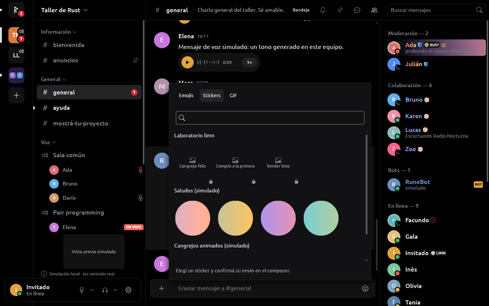
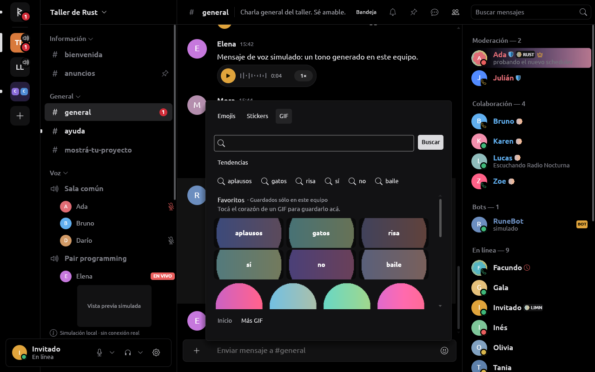
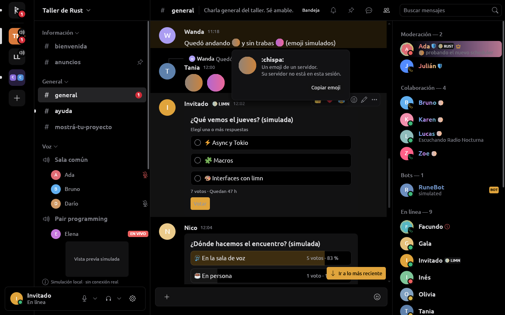
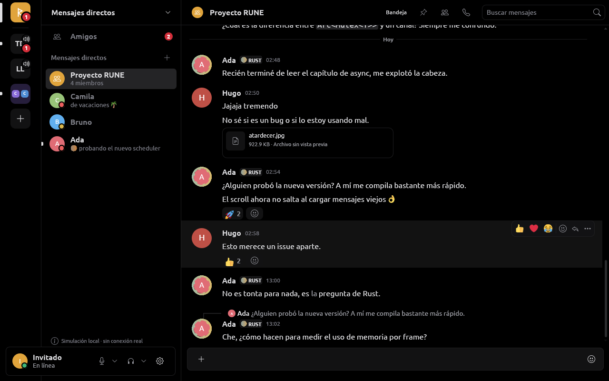

# Stickers y GIF

Estado de la iteración del 2026-10-14. El catálogo, la selección, el envío y
la imagen son contratos separados: ver una imagen no concede permiso para
enviarla, y seleccionar una expresión no envía un mensaje.

## Implementado

- Los stickers del servidor actual llegan por el catálogo del proveedor y
  sus actualizaciones. El picker consulta disponibilidad y las habilidades
  del canal; el envío vuelve a comprobar ambas en el proveedor.
- Seleccionar un sticker abre una vista previa de 56 px junto a su nombre y
  los controles **Quitar** y **Enviar sticker**. Se conserva el borrador de
  texto. El recurso permanece solicitado al cerrar el picker y se libera
  cuando se retira la selección o cambia la conversación.
- PNG/APNG y GIF tienen una vista previa estática. Los GIF usan el primer
  cuadro; no se acumulan cuadros de animación. Lottie se dibuja desde el
  2026-10-18 (abajo, «Stickers Lottie»).
- Los GIF adjuntos recibidos también pueden generar una vista previa
  estática, utilizando la URL que entrega el mensaje. Los spoilers siguen
  sin descargarse automáticamente. El archivo original conserva su acción
  de descarga explícita.
- La pestaña GIF conecta un buscador opcional e independiente de la cuenta
  de chat: GIPHY, con una clave propia de la aplicación. Las consultas son
  explícitas y seleccionar un resultado sólo inserta su URL en el borrador.
  Sin configuración se conserva la entrada manual de enlaces HTTPS; sólo
  esos enlaces manuales tienen recientes en RAM.

El worker de `rune-core` usa el decoder GIF de la dependencia `image` ya
existente, habilitando únicamente su feature `gif`. La decodificación sigue
fuera del hilo UI. Arte y stickers conservan sus límites de 1 MiB de entrada,
512 px por lado, 4 MiB de asignación del decoder y salida PNG de 128×128.
Adjuntos conservan 8 MiB, 4096 px por lado, 80 MiB de asignación y salida de
hasta 768×512 sin aumentar imágenes pequeñas. No cambia la concurrencia ni
el límite de caché. Un archivo excedido o corrupto mantiene el fallback.

Las descargas de imágenes siguen sin credenciales, cookies ni redirecciones,
limitadas a los orígenes declarados por el proveedor. No se descargan URLs
arbitrarias pegadas en la pestaña GIF.

## Evidencia y referencias

| Hallazgo | Evidencia | Confianza y alcance |
| --- | --- | --- |
| GIF es el formato de sticker 4; PNG/APNG, Lottie y GIF son formatos distintos | [Recurso Sticker oficial](https://docs.discord.com/developers/resources/sticker) | Alta, contrato público de datos; no demuestra autorización de una sesión personal |
| Los stickers GIF usan `https://media.discordapp.net/stickers/{id}.gif`; PNG/APNG usan el CDN PNG | [Image Formatting oficial](https://docs.discord.com/developers/reference#image-formatting) | Alta, formato documentado; ninguna petición a cuenta real en estas pruebas |
| Serein separa catálogo, detalle, recientes y permisos del envío | `references/serein/crates/client-core/src/stickers.rs` | Alta, inspección de código público del commit `d1af883c9d7dda90d1261a2d15fc852a5445204d` |
| Serein usa identificadores de petición, cancelación y caché de consultas para GIF | `references/serein/crates/client-core/src/gifs.rs` | Alta para esa implementación; no observación del cliente oficial |
| Serein consulta búsqueda y tendencias mediante rutas de GIF del cliente Discord, con `provider=klipy`; no GIPHY directo | [función `gifs`, commit examinado](https://github.com/ViceVerse-cz/Serein/blob/d1af883c9d7dda90d1261a2d15fc852a5445204d/crates/discord-api/src/lib.rs#L1559) | Alta para su código; no son una integración oficial acreditada ni se añadieron a RUNE |

Serein se consultó en modo de solo lectura. No se copió código, recursos,
claves ni mecanismos de identidad. Esta investigación no usa ingeniería
inversa del cliente oficial.

En ese checkout, `/gifs/search`, `/gifs/trending` y `/gifs/trending-gifs`
usan `media_format=tinygif` y `locale=en-US`. Su código las describe como
un intermediario no oficial de KLIPY. El coordinador cancela respuestas
obsoletas y limita su caché a ocho páginas/768 KiB durante diez minutos;
el picker distribuye resultados en dos columnas proporcionales y omite
pintar celdas fuera del viewport. Son decisiones observadas en código de
Serein, no mediciones de Discord ni autorización para reutilizar esas rutas.
Su acción de selección es enviar; RUNE conserva la decisión de insertar
el enlace en el borrador para que la persona confirme el envío.

## Buscador opcional

`rune-core::GifSearch` implementa Search y Trending de
[GIPHY](https://developers.giphy.com/docs/api/). El host lee
`GIPHY_API_KEY` del entorno, sólo fuera del modo captura. La clave debe
pertenecer a una aplicación propia registrada en el
[dashboard de GIPHY](https://developers.giphy.com/dashboard/); no se reutiliza
una clave de Discord, Serein ni otro cliente. No hay claves en argumentos,
configuración persistente, logs ni estados de UI. La ausencia de esa variable
mantiene el buscador deshabilitado. No se ha probado una consulta real con
clave propia en esta iteración.

La documentación vigente de GIPHY limita las claves beta a **100 consultas
por hora**; capacidad de producción requiere su trámite y condiciones propios.

El picker conserva una sola página, de hasta 20 resultados, en el orden
recibido. **Buscar**, Enter y **Tendencias** consultan explícitamente; **Más
GIF** reemplaza la página. El límite local de offset es 480. No hay búsqueda
en cada pulsación, precarga, mezcla de proveedores ni recientes de GIPHY.
La selección conserva el texto del composer y no envía el mensaje.

Cada solicitud se vincula a cuenta, canal, pestaña e identificador. Cambiar
de contexto cancela el trabajo y descarta las imágenes. La UI rechaza tanto
respuestas tardías como clics de una página anterior. Los errores de red son
mensajes estáticos; nunca incluyen una URL de solicitud con la clave. Un
429 mantiene su espera incluso al cancelar o reconfigurar el servicio.

Presupuestos: metadatos de hasta 256 KiB, cuatro cargas de miniaturas
simultáneas, 1 MiB por imagen y normalización de 128×128 fuera del hilo UI.
La fase de miniaturas termina a los ocho segundos; imágenes lentas o
inválidas conservan su celda de fallback. El conjunto activo contiene como
máximo 1.25 MiB de píxeles RGBA normalizados, más la codificación PNG/base64
y las texturas del backend. No es una medición de RAM de la aplicación.
La búsqueda completa tiene timeout de 25 segundos.

Sólo se aceptan enlaces de compartición HTTPS de `giphy.com`/`www.giphy.com`
y miniaturas de `media.giphy.com`, `media0.giphy.com` a `media4.giphy.com`, e
`i.giphy.com`. Se preserva la URL retornada; no se siguen redirecciones ni se
agregan credenciales de chat. Una descripción inválida rechaza la página
completa, no filtra ni reordena sus resultados. Un fallo al cargar una imagen
sólo afecta su vista previa.

Las [reglas vigentes de GIPHY](https://developers.giphy.com/docs/#best-practices)
requieren solicitudes directas, URLs sin modificar, atribución visible y
autorización previa para cachés de contenido. Por eso este servicio no usa
la caché reutilizable de imágenes de RUNE, SQLite ni almacenamiento en disco.
Los datos se retienen únicamente mientras se presenta esa página. La marca
oficial está enlazada en el pie del selector y su procedencia figura en
[GIPHY.md](../assets/licenses/GIPHY.md).

[Tenor](https://developers.google.com/tenor/guides/quickstart) informa que
desde enero de 2026 no acepta clientes API nuevos. Por eso no se presupone
que RUNE pueda obtener una clave nueva ni se reutiliza la de otro cliente.

La reproducción animada sigue pendiente: necesita presupuesto de cuadros,
pausa fuera del viewport y respeto por movimiento reducido. El buscador usa
la representación estática documentada `fixed_width_small_still`; no anuncia
animación. Los stickers de chat continúan usando el catálogo del servidor,
no el buscador de stickers de GIPHY.

## Favoritos y su alcance (2026-10-17)

Los GIF se marcan con un corazón en cada resultado del buscador y en cada
enlace usado en la sesión; la lista **Favoritos** de la pestaña los agrega al
borrador (nunca envía). La pestaña dice dónde se guardan:

- **Sincronizados con tu cuenta**, cuando el proveedor declara
  `synced_gif_favorites`: `LoadGifFavorites` al abrir la pestaña por primera
  vez y `SetGifFavorite` por cada corazón, mostrado antes de la respuesta y
  devuelto si se rechaza. La sesión de Discord los guarda donde los guarda
  Serein: el campo 2 de `FrecencyUserSettings` en `settings-proto/2`
  ([detalle](DISCORD_SESSION.md#administración-del-servidor-2026-10-17)).
- **Guardados sólo en este equipo**, si no: en los ajustes locales (una
  línea por favorito con su dirección, vista previa y tamaño; sólo
  direcciones HTTPS públicas, hasta 100). La simulación usa este alcance.

Emojis y stickers no tienen favoritos que guardar: Serein no sincroniza
`favorite_emojis`, `emoji_frecency` ni `favorite_stickers`, y sus frecuentes
viven sólo en la sesión, como en RUNE. Captura:
[gif-favorites-2026-10-17.png](img/gif-favorites-2026-10-17.png).

## Emojis y stickers nuevos (2026-10-17)

Se suben desde Ajustes del servidor → Emojis o Stickers, con su propio
alcance: el selector de archivos de siempre y `rune-core::expression_images`
en un hilo de servicio, sin pasar por la cola de adjuntos de mensajes. Un
GIF que ya cumple el límite queda tal cual, animado (emoji hasta 256 KB;
sticker exactamente 320 × 320 y hasta 512 KB); cualquier otra imagen (PNG,
JPEG, WebP o un GIF que no entra) se recorta al cuadrado y se hace PNG de
128 px (emoji) o 320 × 320 (sticker). `ExpressionImage` vuelve a comprobar
formato, tamaño y peso antes de que el comando exista, y
`NewExpression::problem` el nombre (emoji: 2 a 32 letras sin acentos,
números o guiones bajos; sticker: 2 a 30 caracteres), el emoji relacionado
del sticker (1 a 200) y su descripción (vacía o 2 a 100). Captura:
[server-sticker-upload-2026-10-17.png](img/server-sticker-upload-2026-10-17.png).

## Plan de la cuenta, paquetes y GIF del servicio (2026-10-17, P5)

Paridad con Serein ([P5](../tasks/serein-parity.md)); detalle de las rutas
en [DISCORD_SESSION.md](DISCORD_SESSION.md#presencia-rica-identidad-visual-y-expresiones-2026-10-17-rama-presencia-e-identidad).

- **Lo que permite el plan.** El proveedor informa `Event::Perks`
  (`Perks`: emojis de otros servidores, animados, stickers de otros
  servidores y el nombre de lo que los desbloquea, «Nitro»). Mientras no
  lo informó, el selector ofrece como antes sólo el servidor del canal.
  Con el plan conocido ofrece **todos los servidores de la cuenta** por
  sección (el del canal primero; en un privado, todos), y lo que no se
  puede usar lleva un candado y el motivo como ayuda: «Necesitás Nitro para
  usar emojis de otros servidores acá», «… emojis animados», «… stickers
  de otros servidores acá». Lo decide `Store::emoji_perk` y
  `Store::sticker_perk`; el autocompletado de `:` sólo sugiere lo que se
  puede. A diferencia de Serein, RUNE no cambia un emoji o sticker
  bloqueado por un enlace a su imagen.
- **Paquetes estándar** (capacidad `sticker_packs`). Se piden al abrir la
  pestaña de stickers mientras no se leyeron (`Command::LoadStickerPacks`
  → `Event::StickerPacks`), y van al final, uno por sección; se pueden
  enviar en cualquier conversación. Un sticker sin dibujo (un Lottie que el
  rasterizador no soporta) muestra su nombre en la celda y se envía igual.
- **GIF del servicio** (capacidad `gif_search`). Con la búsqueda del
  proveedor (`Command::SearchGifs` → `Event::GifResults`, el mismo
  `GifPage` que GIPHY más sus `categories`), la pestaña abre en
  tendencias: las categorías son mosaicos con su imagen que buscan su
  nombre, y las sugerencias (`Command::SuggestGifs` →
  `Event::GifSuggestions`) aparecen como fichas mientras se escribe (con el
  campo vacío, lo que está en tendencia). Las vistas previas se piden como
  cualquier imagen mientras la pestaña las muestra y se animan con el
  presupuesto existente, nunca con movimiento reducido. Si también hay
  clave de GIPHY, dos botones eligen cuál usar. Elegir un GIF sigue
  insertando su enlace en el borrador, y los favoritos son los mismos
  (sincronizados en `settings-proto/2` o en este equipo).
- **Simulación.** Plan «Plus (simulado)» con emojis en todos lados y
  stickers sólo en su servidor, dos paquetes («Saludos (simulado)» con
  imágenes y «Cangrejos animados (simulado)», Lottie), GIF que responden
  a la búsqueda con cuatro páginas de doce y seis categorías. Ahora la
  simulación también envía stickers.

### Stickers Lottie (2026-10-18, rama `video-y-documentos`)

Los stickers de vectores animados (`format_type` 3, los de los paquetes de
Discord) traen su JSON en `https://cdn.discordapp.com/stickers/{id}.json`,
la ruta que usa Serein. El adaptador lo pide como cualquier imagen de
expresión (mismo cliente sin credenciales, hasta 1 MiB) y el núcleo, sólo
para una imagen de expresión cuya ruta termina en `.json` (ninguna otra
se lee como vectores: emoji, avatares o vistas previas de GIF que empiecen
con `{` no llegan al rasterizador), lo dibuja con **rasterlottie** 0.2.4
(Rust puro sobre tiny-skia, que ya estaba en el árbol por resvg; sin sus
funciones por defecto: ni GIF, ni imágenes embebidas, ni texto):

- lienzo de hasta 1024 px, dibujado a 128 px; su primer cuadro es la
  imagen fija y sus cuadros, a 30 por segundo como mucho, van a la caché de
  animaciones con los presupuestos de un GIF (120 cuadros, 16 MiB, 2 s de
  dibujo; uno de más de 10 s queda quieto). Los píxeles premultiplicados de
  tiny-skia se vuelven rectos (`demultiply` de tiny-skia).
- Antes del rasterizador, RUNE revisa el modelo ya leído por rasterlottie,
  resolviendo las precomposiciones como él (el primer asset con ese id; uno
  sin id es «»): que no formen un ciclo ni aniden más de 8 niveles
  (rasterlottie las seguiría sin fin hasta agotar la pila, que no se puede
  atrapar), que un repetidor no haga más de 64 copias ni se desplace más de
  64, que una estrella o un polígono no tenga más de 64 puntas (los reserva
  tal cual los dice el JSON; animados se rechazan, porque la curva puede
  pasarse de sus valores) y que un cuadro no dibuje más de 20 000 capas y
  formas con todo expandido. Un pánico suyo termina en la tarea de
  decodificación, sin imagen.
- Lo que rasterlottie no soporta (expresiones, efectos, texto, imágenes)
  queda como antes: la celda con el nombre, y el sticker se envía igual.
- Serein dibuja sólo un cuadro quieto; RUNE lo anima donde animan los GIF.
- Simulación: «Cangrejos animados (simulado)» usa
  `assets/sticker-sample.json`, una animación propia (una bola que sube y
  baja), que la captura dibuja por el mismo camino
  ([captura](img/lottie-stickers-2026-10-18.png)).

**Sólo fixtures**: sin probar con stickers reales de Discord.

## Emoji y estados (2026-10-18, rama `emoji-y-estados`)

Sólo fixtures y simulación; nada se probó contra Discord. Evidencia en
[REA.md](REA.md#cliente-web-oficial-gif-emoji-grandes-y-permisos-externos-2026-10-18).

- **Permisos de expresiones externas.** `Permissions::EXTERNAL_STICKERS`
  (bit 37 de Discord) se suma a `EXTERNAL_EMOJI` (bit 18), y `Abilities`
  a `external_emoji` y `external_stickers` (sólo los pide un canal de
  servidor). Para un emoji o sticker de otro servidor, `Store::emoji_perk`
  y `sticker_perk` preguntan primero por el permiso del canal y después
  por el plan, como el cliente oficial (`DISALLOW_EXTERNAL` antes que
  `PREMIUM_LOCKED`). El selector muestra el candado con «No tenés permiso
  para usar emojis de otros servidores en #canal»; el compositor, la
  edición y los comandos locales no mandan un texto que nombra (fuera de
  código y enlaces) un emoji que no se puede usar ahí: avisan por qué y
  conservan el borrador. Con los beneficios de la cuenta desconocidos no
  frenan nada: decide el servicio. Desde la caché local el permiso externo
  cuenta como desconocido (puede ser anterior al bit 37). La simulación
  niega los dos permisos a @everyone en #off-topic y rechaza ahí el
  sticker externo. Los ajustes de roles y de canales muestran «Usar
  stickers externos».
- **Más GIF con el proveedor no oficial.** Páginas de 50 hasta la décima:
  la segunda en adelante lleva `offset`, una página llena ofrece la
  siguiente y las categorías vienen sólo con la primera. El cliente
  oficial no pagina, así que no está probado que Discord respete el
  `offset`: si contesta la misma página, la pestaña deja de ofrecer otra.
- **Emoji jumbo.** Un mensaje de sólo emoji (hasta 30) pide la imagen del
  servidor a 96 px (`TextTarget::Emoji::jumbo`; en una línea, 48), nítida
  hasta escala 2 porque RUNE guarda cada emoji a 128 px. Sus emoji Unicode
  se dibujan como imagen de Twemoji en la línea, 48 px como uno del
  servidor (22 en modo compacto), y el detector usa el índice de Twemoji:
  un keycap (1️⃣) y las flechas del paquete (➡, ⬅, ↔, ↩) cuentan, como las
  dibuja el cliente oficial; un dígito, `→` (fuera del paquete), ©, ® y ™
  no, ni un emoji con VS15, que pide su forma de texto. El PNG del paquete
  es de 72 px: a escala 2 el jumbo Unicode se agranda (uno del servidor,
  no).
- **Detalle de emoji.** Un clic en un emoji de un mensaje, o un clic
  secundario en una reacción, abre una tarjeta con su imagen, su nombre,
  si es de un servidor o estándar, el servidor de origen (si la sesión lo
  tiene en su catálogo, buscado por el id que da el proveedor en
  `TextTarget::Emoji::id`, con el nombre actual) y «Copiar emoji», que
  copia el emoji tal como se escribe. Se cierra al cambiar de conversación
  o si el mensaje desaparece. Es la idea de `emoji_details.rs` de Serein,
  reimplementada. Los emoji del texto son botones enfocables, como las
  menciones y los enlaces: la tarjeta también se abre con el teclado.
- **Estados con emoji.** Las listas de miembros, amigos y conversaciones
  muestran el emoji del servidor del estado personalizado (14 px antes de
  las palabras, recortadas con «…»), y la fila de un privado dice lo que
  la persona está haciendo, como la de miembros. Los fijados dibujan sus
  emoji (y los animados se mueven). Los extractos de búsqueda dicen
  `:nombre:` en lugar del token, sin la imagen: falta en limn un
  subtítulo de `ListRow` con elementos y el recorte con «…» de un texto
  formateado (pendiente en `tasks/todo.md`).

## Validación

Pruebas locales cubren primer cuadro de GIF, mil cuadros posteriores sin
cambiar la salida, cola corrupta después del primer cuadro, truncamiento del
primer cuadro, dimensiones gigantes de canvas y frame, límites de bytes,
orígenes documentados, disponibilidad de catálogo, GIF adjuntos y spoilers.
La prueba UI verifica selección real en el picker, conservación de la carga
al cerrarlo, dibujo mediante `RasterImage` de limn y liberación al quitarlo,
sin emitir un envío. Las pruebas no acreditan envíos reales a Discord.

El nuevo adaptador tiene fixtures HTTP locales para parámetros exactos,
paginación, límites, rechazo de redirecciones/orígenes, cancelación, resultados
viejos, backoff 429 y concurrencia de miniaturas. La UI verifica inserción
sin envío, paginación, foco, descarte al cerrar/cambiar de contexto y títulos
vacíos/largos. Estas pruebas no necesitan claves reales ni datos de cuentas.

REA ejecutó el binario propio de pruebas de `rune-core`, filtro
`gifs::tests --test-threads=1`, con `GIPHY_API_KEY` vacío: **8 pasaron**, salida
0, en 0.30 s de tests. Evidencia
`ev_bf3a1256859dcc146518102edd37194e85740a04cb9423aed722e6634871090c`,
exportada en [rea-gif-search-2026-10-14.json](evidence/rea-gif-search-2026-10-14.json).
SHA-256 muestreado antes de ejecutar:
`12b699bf9da4320e45c60a1f1a4561e6519c15b84c5417e1f3ec46e093db2798`.

Es una observación de ejecución controlada de fixtures de RUNE, no evidencia
de tráfico real a GIPHY ni del funcionamiento interno de Discord. La captura
no observa tráfico de red, llamadas de sistema ni el entorno heredado
completo. El hash se toma antes del lanzamiento, sin vínculo atómico con la
imagen ejecutada. REA dejó intacto un proceso ajeno cuya pertenencia no pudo
verificar. No hubo inspección de credenciales, cuentas ni cliente oficial.
