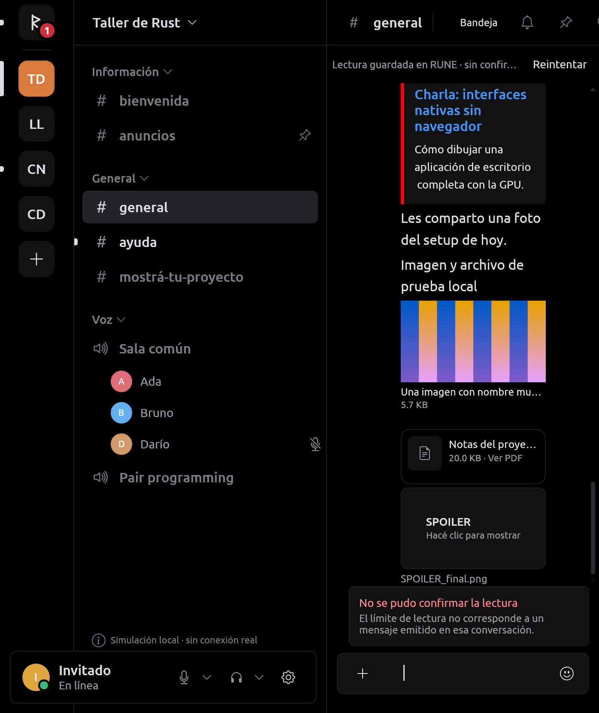
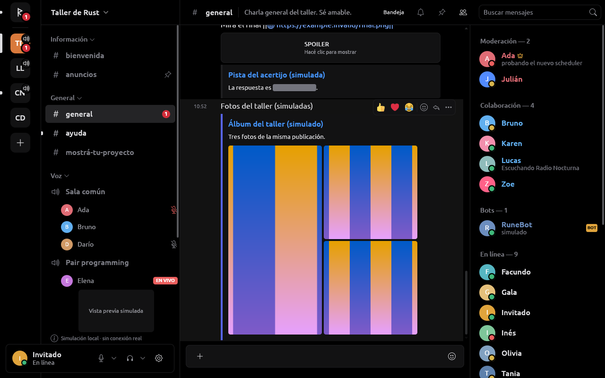
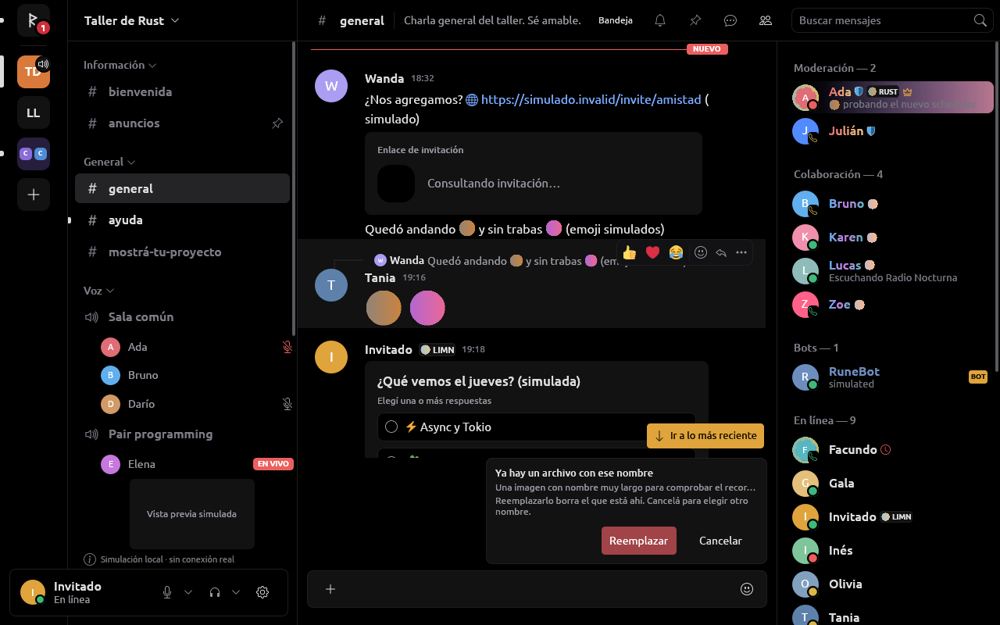
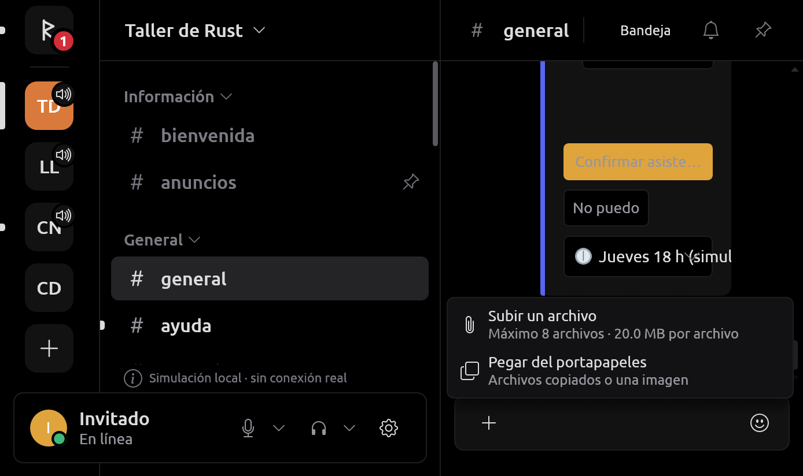
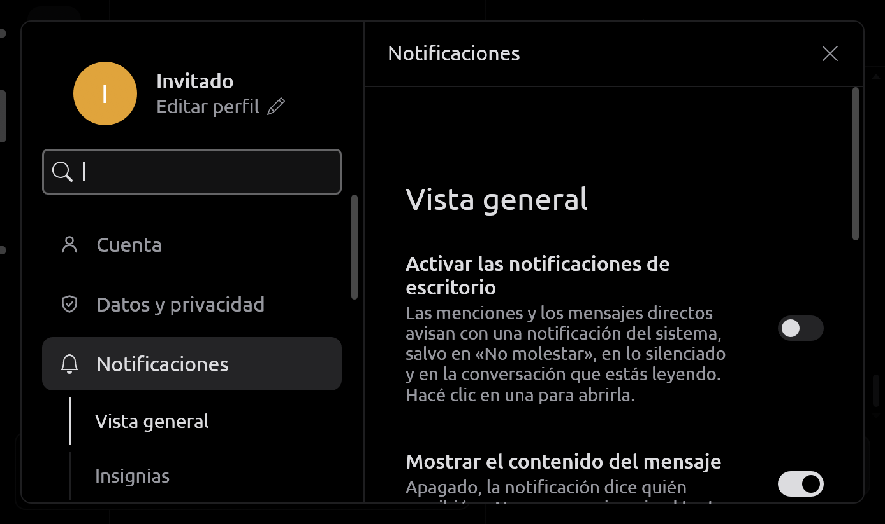

# Imágenes y archivos

Adjuntos recibidos y enviados, descargas, «Guardar como», portapapeles y
notificaciones. La UI no construye URLs ni conoce el protocolo del
proveedor: recibe `RemoteImage`/`RemoteFile` y pide cosas con `Intent`. Los
campos nuevos de adjuntos llevan `serde(default)`: un mensaje antiguo sigue
leyéndose como archivo sin vista previa. El pipeline de imágenes (caché,
límites de decodificación, CDN) está en [ARTWORK.md](ARTWORK.md); el visor
a pantalla completa, en [VISOR.md](VISOR.md); los PDF, en
[DOCUMENTS.md](DOCUMENTS.md); audio y video adjuntos, en [MEDIA.md](MEDIA.md).

Lo del proveedor no oficial (subidas, descargas de la cuenta, reenvíos)
está probado sólo con fixtures en loopback, no contra el servicio real.

## Presentación en el timeline

`rune-components::message` reserva un rectángulo proporcional de hasta
360 × 260 puntos con las dimensiones de los metadatos; cargar o fallar no
cambia esa geometría. Se distinguen carga (con el ThumbHash del adjunto
como suplente), fallo y archivo sin vista previa. Los nombres largos se
recortan y conservan su texto completo en accesibilidad y en la ayuda.

Un clic abre el visor; el menú contextual ofrece abrir en el navegador,
copiar el enlace, **Guardar en Descargas**, **Guardar como…** y, si se
puede bajar, **Copiar imagen** o **Copiar video**.

### Animación

Los GIF, APNG y WebP animados (adjuntos y stickers) se animan en el
timeline. `rune-core` decodifica los cuadros fuera del hilo de UI, en el
mismo trabajo acotado que el primer cuadro y ya escalados al tamaño de la
vista previa: lienzo de hasta 4 Mpx, 1000 cuadros leídos, 2 s de
decodificación, 120 cuadros y 16 MiB RGBA por animación. Si sobran cuadros
se descarta uno de cada dos sumando sus demoras (el ciclo dura lo mismo);
si algo falla queda el primer cuadro fijo. Toda la caché comparte 64 MiB de
cuadros: pasado ese límite, las imágenes menos recientes vuelven a su
primer cuadro sin descargarse de nuevo. Las demoras menores a 20 ms se
muestran a 100 ms, como en los navegadores. Los embeds `gifv` (MP4) se
convierten en cuadros ([MEDIA.md](MEDIA.md)).

El host presenta el cuadro vigente en una superficie de limn
(`Element::surface` + `limn_egui::present_surface`), que reescribe la misma
textura. Sólo anima lo que devuelve `rune_ui::playable_images`: filas
visibles, con vistas previas activadas, sin movimiento reducido (de RUNE o
del sistema), con la ventana no minimizada y, con el visor abierto, sólo la
imagen que muestra. Lo demás se olvida, textura incluida. Cerrar sesión
libera cuadros, superficies y estado.

### Spoilers

Un adjunto con `SPOILER_` o la marca 8 ocupa su lugar sin mostrar nada y no
pide píxeles hasta que la persona pulsa «Hacé clic para mostrar»; tampoco
abre el visor ni renderiza el PDF antes. El revelado vale para la sesión.
Guardar sigue siendo una acción explícita del menú.



`--capture-animation` reemplaza en la captura la vista previa por dos
cuadros generados localmente:

```sh
cargo run -p rune-desktop -- --provider mock --screenshot /tmp/rune-media.png --channel general --capture-animation --action jump:latest
```

### Tarjetas de enlaces

Serein es la referencia de comportamiento (reimplementado):

- **Galería**: las tarjetas que siguen a otra con el mismo enlace y sólo
  suman una imagen grande (`rich` o `image`, sin video ni texto propio
  distinto) se dibujan dentro de la primera (`rune_model::card_groups`): 2
  lado a lado, 3 con una alta a la izquierda, 4 en cuadrado, cada una
  recortada a su celda. Hasta 4, como el cliente oficial.
- **Visor**: pulsar una imagen de tarjeta abre el visor (`Viewed::Card`),
  que recorre la galería. El póster de un video abre su página.
- **Spoilers**: el texto entre `||` de la descripción y los campos de una
  tarjeta, de los componentes de una app y del texto reenviado queda oculto
  hasta pulsarlo. Una tarjeta cuyo enlace el mensaje escribió entre `||` se
  tapa entera, como en el cliente oficial; una con spoiler en su propio
  texto oculta sus imágenes. Ninguna imagen tapada se pide antes del
  revelado (`Embed::hides_pictures`).
- **Reenvíos**: los archivos de `message_snapshots` conservan su dirección
  si apunta al host de archivos de Discord bajo el canal de origen (también
  la forma `/attachments/{canal}/{mensaje}/{archivo}/{nombre}`). Se ven, se
  reproducen, se abren y se guardan como los propios (`Message::files`).



## Descargas

`Intent::DownloadFile` llega a `rune-core::files`, fuera del hilo de UI:
dos transferencias concurrentes, 128 MiB por archivo, conexión de 10 s y
petición de 120 s. Sólo acepta los orígenes HTTPS exactos declarados por el
proveedor, sin redirecciones, userinfo, fragmentos, cookies ni cabeceras de
cuenta. Exige HTTP 200 y limita el tamaño declarado y el recibido; un
tamaño de adjunto conocido debe coincidir con el descargado. Las URLs
firmadas se usan tal como llegaron: no se sintetizan firmas ni se inventa
una renovación, y un enlace vencido falla de forma explícita.

En Linux la carpeta sale de `xdg-user-dir DOWNLOAD` (o `$HOME/Downloads`).
El nombre se sanea y se limita a 180 bytes UTF-8; nunca se usa como ruta.
Se descarga a un parcial privado (`0600`) que se borra al fallar o cancelar.
Al completar y sincronizar se publica con un hard link en la misma carpeta:
no reemplaza archivos ni enlaces existentes y agrega un sufijo numérico si
el nombre está ocupado; un sistema de archivos sin hard links falla con
aviso. Cerrar sesión cancela transferencias, pero no borra lo ya
descargado. Nunca se abre ni ejecuta el archivo guardado.

### Guardar como

«Guardar como…» está en el menú del adjunto
(`attachment:{m}:{a}:save-as`) y en el visor (también Ctrl+S). La UI guarda
sólo la petición, la fase y el nombre mostrado; `Intent::SaveAttachmentAs`
lleva IDs y el host vuelve a resolver el adjunto visible
(`rune_ui::attachment_download`).

1. Core revisa el origen, el tamaño y que haya uno de los dos lugares de
   descarga (compartidos con «Guardar en Descargas») **antes** de abrir el
   diálogo.
2. El diálogo SaveFile del portal corre en el mismo `FileChooser` que
   «Subir un archivo»: un diálogo a la vez («Esperá a que se cierre el otro
   diálogo de archivos.»). La ruta elegida no sale de Core.
3. Si el nombre ya es una carpeta o un enlace, se rechaza sin preguntar. Si
   es un archivo común, Core lo dice antes de descargar
   (`SaveUpdate::Exists`, sólo el nombre) y la barra pregunta «Ya hay un
   archivo con ese nombre» con «Reemplazar» (`Intent::ReplaceSavedFile`) y
   «Cancelar». Con la palabra de la persona descarga al parcial y, justo
   antes de publicar, vuelve a mirar: si ahora hay una carpeta, un enlace u
   otro archivo (otro dispositivo e inodo), no lo toca y avisa; si no,
   `rename(2)` lo reemplaza de una vez. Sin pregunta, la publicación es un
   hard link al nombre exacto: si otro proceso lo creó mientras tanto, se
   conserva lo suyo. Nunca agrega sufijos.
4. Una barra sobre el editor dice «Eligiendo dónde guardar…» o «Guardando
   archivo…» con su progreso; «Cancelar» cierra el diálogo o corta la
   descarga. El final es «Archivo guardado», «No se pudo guardar el
   archivo» con el motivo, o nada si se canceló.
5. Cerrar sesión o cambiar de cuenta cancela la operación.

El archivo nuevo queda `0600`, no copia los permisos del anterior. El
diálogo GTK ya pregunta por su cuenta al elegir un nombre existente: en ese
caso la persona confirma dos veces (RUNE no sabe si el portal preguntó).
Queda una ventana mínima entre la última mirada y el `rename`: Linux no
tiene un rename que compruebe lo que reemplaza.



### Copiar imagen y Copiar video

El archivo se baja como una descarga explícita (mismo cliente, mismo límite
y cupos) a `$XDG_RUNTIME_DIR/rune-copied`, carpeta `0700` de la persona;
nunca `/tmp`. La imagen se decodifica (hasta 4096 px de lado, 80 MiB de
asignación) y va al portapapeles como píxeles; el parcial se borra. El video
queda en esa carpeta y va como `text/uri-list`; la copia siguiente lo
reemplaza. Un adjunto tapado no se copia hasta revelarlo. Sólo Linux, por
X11 (ver [Portapapeles](#pegar-del-portapapeles)).

## Selector de archivos

`rune-platform::file_dialogs` usa `org.freedesktop.portal.FileChooser`
(OpenFile y SaveFile) y no conoce cuentas, canales ni proveedores: el
consumidor de Core valida ese alcance. `FileChooser::session` crea una
conexión D-Bus dedicada y un único worker fijo de archivos; Core mantiene
una instancia para no acumular hilos.

- `choose_files` devuelve de uno a diez `SelectedFile` o un `PickError`
  tipado con texto seguro. Valida todas las URIs antes de abrir (sin
  repetidas, sin truncar el lote) y abre en un solo job, comprobando tipo,
  tamaño individual y suma.
- `SelectedFile` tiene propiedad única, sin `Clone` ni serialización:
  `info()` expone nombre y tamaño; `into_parts()` transfiere el descriptor
  al servicio. El descriptor no llega a la UI, a eventos ni a SQLite, y no
  se reabre por ruta (salvo la restauración del borrador, abajo). Se abre
  sólo lectura, `NONBLOCK | CLOEXEC`, y se verifica con sus propios
  metadatos: archivo regular y dentro del límite. Un FIFO, directorio o
  dispositivo falla.
- La URI se limita a 4096 bytes y debe ser un archivo local, sin
  credenciales, query ni fragmento. Se rechazan escapes incompletos,
  controles, `%2F` y segmentos `.`/`..` (también `%2e`) antes de que el
  parser cambie la ruta. El nombre visible pierde controles y se limita a
  180 bytes UTF-8.
- `save_file` devuelve un `SaveDestination` privado, con `Debug` redactado;
  elegir no abre, crea ni trunca el destino.
- El portal se correlaciona por ruta propia y dueño D-Bus único, con la
  suscripción antes de `OpenFile`; un cambio de dueño invalida la petición.
  Las llamadas de control tienen 2 s de plazo y la selección 300 s; la
  respuesta se limita a 64 KiB. Cancelar descarta el resultado de un
  syscall ya iniciado, pero no lo interrumpe; el worker se drena antes del
  intento siguiente.

### Diálogos sobre la ventana

Los diálogos del portal reciben la ventana de RUNE como `parent_window`:
`x11:{hex}` en X11, y en Wayland la superficie exportada con xdg-foreign v2
(`rune_platform::wayland_parent::export`, usando la conexión de winit como
invitado y su propia cola, una sola vez al preparar la ventana). Sin el
protocolo, los diálogos abren sin parent y se avisa una vez en stderr.
Llega a subir archivos, «Guardar como», la carpeta de sonidos, las imágenes
de perfil, grupo, emojis y stickers, y al diálogo de pantalla compartida.
La modalidad la decide el portal; ver [PLATFORM.md](PLATFORM.md).

## Adjuntos de salida

Recorrido: **elegir → preparar → añadir al borrador → enviar explícitamente
→ confirmar o fallar/reintentar**. La selección nunca envía.

- **UI** (`rune-ui::uploads`): metadatos por conversación
  (`PendingAttachment`: token, nombre y tamaño; sin rutas, handles ni
  bytes). El host valida identidad, conexión y VER/ESCRIBIR/ADJUNTAR (y
  HISTORIAL si hay respuesta) antes de llamar a `Client`; Core y el
  proveedor vuelven a comprobar al ejecutar. Quitar y cancelar no necesitan
  permiso de escritura.
- **Core** (`rune-core::uploads`): un actor dueño único del registro de
  archivos, con el selector persistente y un worker fijo de preparación (no
  un hilo por archivo). Antes de leer reserva un presupuesto compartido de
  **32 MiB y diez entradas**. Comprueba identidad, tamaño, mtime y ctime
  desde la selección, antes y después de una lectura acotada con EOF; un
  cambio falla el lote entero. `Bytes::from_owner` sella el buffer sin otra
  copia. La lectura es secuencial: no es una instantánea simultánea del
  filesystem.
- **Envío**: `send_attachments` reserva el nonce; `retry_attachment_send`
  conserva nonce, cuerpo, orden y bytes originales y nunca reabre la ruta.
  Cola llena o fallo no degradan el envío a sólo texto. No hay reintentos
  automáticos. Desconectar conserva los preparados; cambiar de cuenta o
  perder el permiso del canal los invalida.
- **Confirmación**: `Event::UploadProgress` llegar al total no confirma el
  mensaje. El ACK exige autor, canal, nonce e IDs y metadatos remotos
  válidos y distintos; uno incompleto deja el resultado ambiguo y conserva
  los preparados. Consumir el borrador compara revisión y tokens: una
  confirmación vieja no borra lo añadido después.
- **Límites**: la simulación admite diez archivos, 20 MiB por archivo y
  25 MiB por mensaje (texto incluido); la sesión no oficial, diez archivos
  con el límite del plan de la cuenta y el boost del servidor
  ([DISCORD_SESSION.md](DISCORD.md)).

Al cerrar, el runtime pasa a un hilo `rune-core-shutdown`; nunca se drena
un receptor con bytes en el hilo de UI.

### Archivos del borrador entre ejecuciones

Los archivos de un borrador vuelven al reiniciar, como su texto. Se guarda
**dónde está cada uno y su tamaño al elegirlo**, nunca sus bytes, en la
tabla `draft_files` (por cuenta y conversación), sellado con la clave de la
cuenta como el texto del borrador ([SECURITY.md](SECURITY.md#datos-locales)),
y se borra con el resto de los datos de la cuenta.

- La UI marca la conversación cuando cambian sus archivos y el host, con el
  ritmo del texto, le pide a Core que los guarde: Core sabe de qué ruta
  leyó cada uno. Una imagen pegada, una ruta no UTF-8 y los archivos de una
  publicación de foro a medio escribir no se guardan.
- Al abrir la conversación, Core abre cada ruta otra vez con las mismas
  comprobaciones que al elegirla y descarta la que falta, no se puede leer
  o cambió de tamaño; la UI avisa «Algunos archivos del borrador no
  volvieron». Si todavía no hay lugar en el presupuesto, esperan sin aviso.
- Con la sesión no oficial vuelven cuando llega la clave de la caché
  cifrada (`Update::Restored`).

### Pegar del portapapeles

`rune_platform::clipboard::read_attachments` lee del portapapeles X11 (por
`arboard`, que egui-winit ya compila) los archivos copiados
(`text/uri-list`) o una imagen (`image/png`, hasta 4096 × 4096). En Wayland
llega por XWayland. Corre en el worker fijo de Core: `PickInput::Clipboard`
comparte job, cancelación y presupuesto con el selector. Los archivos
siguen el camino de rutas (`validate_local_paths`, `open_local_files`); la
imagen se codifica PNG sin pérdida como `imagen.png`.

- **Menú «+» → «Pegar del portapapeles»** (`composer:paste`).
- **Ctrl+V** de un texto que nombra archivos (rutas absolutas o
  `file:///`, una por línea): el host retiene el pegado, Core lee el
  portapapeles y, si hay archivos, se adjuntan y el texto no se pega; sin
  archivos o a los 500 ms el texto entra donde se estaba editando
  (`PasteTarget` de limn).
- **Límite**: con sólo una imagen en el portapapeles, egui-winit no entrega
  Ctrl+V, así que se pega desde el menú.



### Arrastrar y soltar

Bloqueado. El host limpia todos los `RawInput.dropped_files` y
`hovered_files` antes del bridge y rechaza `FilesDropped`: no abre rutas ni
lee bytes, y las válidas muestran «Todavía no podés adjuntar archivos
arrastrándolos. Usá Adjuntar.»; Enter no envía en ese cuadro. Por qué:
eframe/egui-winit sigue en winit 0.30 (sin arrastre en Wayland y, en X11,
sin la posición de `XdndPosition`) y con un portapapeles smithay fijo;
`limn-dnd` recibe archivos en Wayland pero convive mal con ese portapapeles
(observado en Hyprland). Lo destrabaría que egui publique la inyección del
portapapeles o pase a winit 0.31 (`DataTransfer`). La API de Core
(`Client::prepare_attachment_paths`) queda lista para una entrada con
posición fiable.

## Notificaciones del sistema

`rune_platform::notifications::Notifier` usa `org.freedesktop.Notifications`
(el portal pide un ID de aplicación instalada que RUNE no tiene) en un hilo
con su propia conexión D-Bus, que arranca con la primera. Sólo atiende
`ActionInvoked` del dueño actual del servicio y de notificaciones propias;
el cuerpo se escapa para que el texto de alguien no sea markup.

`rune_ui::message_alert` decide qué avisa: menciones y mensajes directos,
nunca los propios, nada en «No molestar», en lo silenciado o en «Nada», ni
en la conversación leída con la ventana enfocada. Un clic abre la
conversación sólo si es de la cuenta actual; cambiar de cuenta retira las
mostradas. Una llamada entrante (`rune_ui::call_alerts`) es `call.incoming`,
crítica y sin vencimiento, con «Aceptar» y «Rechazar» (atendidos por
`rune_ui::answer_alert` sólo para la cuenta actual); se retira al dejar de
sonar y al cerrarse RUNE.

Ajustes → Notificaciones: activarlas (apagadas hasta que se piden), mostrar
el contenido (si no, «Nuevo mensaje») y el sonido de mensajes, un tono
predeterminado de Discord (`assets/sounds/discord/message1.mp3`). Probado
con un demonio falso en un bus privado.



## Pruebas

Las pruebas HTTP usan servidores locales y datos sintéticos: cabeceras sin
credenciales, redirecciones, respuestas parciales, tamaños inválidos,
cancelación, nombres peligrosos, permisos, colisiones, enlaces simbólicos y
concurrencia. Las del portal usan un bus D-Bus privado. Las de UI cubren
geometría estable, estados de carga, foco, permisos, navegación, borrado y
cierre de sesión. Capturas reproducibles sin red:

```sh
cargo run -p rune-desktop -- --provider mock --screenshot /tmp/rune-files.png --channel general --capture-attachments --capture-hover
cargo run -p rune-desktop -- --provider mock --screenshot /tmp/rune-save.png --channel general --capture-attachments --action attachment:9000000000000082:82:save-as --action capture:save-exists
```

`--capture-attachments` sólo existe con el proveedor simulado y en captura;
no toca una cuenta ni SQLite.
