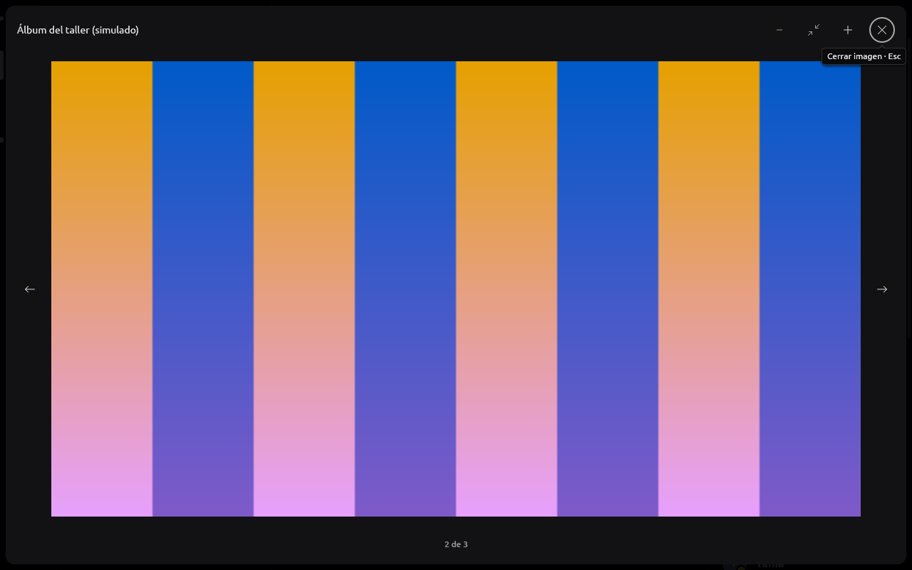

# Imágenes y archivos

Implementación del 2026-10-14. Los adjuntos recibidos pueden proporcionar
una vista previa y una descarga independientes. Los campos nuevos tienen
`serde(default)`: un mensaje antiguo sigue leyéndose como archivo sin
vista previa. La UI no construye URLs ni conoce el protocolo del proveedor.

## Presentación

`rune-components::message` reserva un rectángulo proporcional de hasta
360 × 260 puntos. Cargar o fallar no cambia esa geometría. Los nombres
largos se recortan y conservan su texto completo en accesibilidad/tooltip.
Se distinguen carga, fallo y archivo sin preview; ya no se presenta un
adjunto real como «Vista previa simulada».

Un clic abre el `ImageViewer` existente de limn, con zoom y Escape. El
visor guarda IDs de conversación/mensaje/adjunto; resuelve el recurso
vigente y se cierra al navegar, eliminar el mensaje o cerrar sesión.
Al cerrarlo vuelve el foco al adjunto. El menú contextual de la tarjeta
ofrece abrir en navegador, copiar enlace, **Guardar en Descargas** y
**Guardar como…**; el visor ofrece «Guardar como…» en su encabezado
(`ImageViewer::action`, PR #72 de limn). Ver [Guardar como](#guardar-como-082-2026-10-17).

El pipeline de descarga/decodificación de previews y su comparación con
Serein están en [ARTWORK.md](ARTWORK.md). Los adjuntos de audio y video se
reproducen dentro de RUNE desde el 2026-10-17
([MEDIA.md](MEDIA.md#implementado-reproducir-audio-y-video-adjuntos-y-gif-de-tarjetas-2026-10-17)).
Los PDF se ven [página por página](DOCUMENTS.md), opcional en
Linux/Nix, y se buscan por su texto. Se mantiene el archivo descargable
cuando corresponde. El zoom usa el thumbnail validado; la resolución
original se pide sólo desde el visor (ver abajo).

### Animación y spoilers (2026-10-16)

Los GIF y WebP animados recibidos (adjuntos y stickers) se animan en el
timeline. `rune-core` decodifica los cuadros en el mismo trabajo acotado que
el primer cuadro, fuera del hilo de UI, ya escalados al tamaño del preview:
lienzo de hasta 4 Mpx, 1000 cuadros leídos, 2 s de decodificación, 120
cuadros y 16 MiB RGBA por animación. Si sobran cuadros se descarta uno de
cada dos sumando sus demoras, así el ciclo dura lo mismo; si algo falla queda
el primer cuadro estático. Toda la caché comparte 64 MiB de cuadros: pasado
ese límite las imágenes menos recientes vuelven a su primer cuadro sin
descargarse de nuevo. Las demoras menores a 20 ms se muestran a 100 ms,
como los navegadores.

El host presenta el cuadro vigente en una superficie de limn
(`Element::surface` + `limn_egui::present_surface`), que reescribe la misma
textura. Solo anima lo que `rune_ui::playable_images` devuelve: filas
visibles del timeline, con previews activados, sin movimiento reducido (de
RUNE o del sistema), sin visor abierto y con la ventana no minimizada. Lo
demás se olvida, textura incluida, y vuelve a empezar al reaparecer. Cerrar
sesión libera cuadros, superficies y el estado de la interfaz. Con el
visor abierto anima sólo la imagen que muestra, dibujada como superficie
(`rune_ui::playable_images`, test
`animations_play_in_view_or_in_their_viewer_without_reduced_motion`).
Los embeds `gifv` animan también, desde el 2026-10-17 (abajo).

Un adjunto con `SPOILER_` o la marca 8 conserva su referencia de preview,
pero la tarjeta ocupa el mismo lugar sin mostrar nada de la imagen y no pide
píxeles hasta que la persona pulsa «Hacé clic para mostrar». Tampoco abre el
visor ni renderiza el PDF antes del revelado. El revelado es local a la
sesión; guardar el archivo sigue siendo una acción explícita del menú.

```sh
cargo run -p rune-desktop -- --provider mock --screenshot /tmp/rune-media.png --channel general --capture-animation --action jump:latest
```

`--capture-animation` reemplaza en la captura el preview local por dos
cuadros generados localmente; sirve para ver la superficie en su lugar.


Desde el 2026-10-17 los embeds `gifv` sí animan: su MP4 se convierte en
cuadros ([MEDIA.md](MEDIA.md#implementado-reproducir-audio-y-video-adjuntos-y-gif-de-tarjetas-2026-10-17)).

### Tarjetas: galerías, visor, spoilers y reenvíos (2026-10-17)

Con Serein como referencia de comportamiento (sin copiar código):

- **Galería**: las tarjetas que siguen a otra con el mismo enlace y sólo
  suman una imagen grande (sin video, sin texto propio distinto, de tipo
  `rich` o `image`) se dibujan dentro de la primera
  (`rune_model::card_groups`): 2 imágenes lado a lado, 3 con una alta a la
  izquierda, 4 en cuadrado, cada una recortada para llenar su celda
  (`RasterImage::cover` o `SurfaceFit::Cover` si anima). Hasta 4 por
  galería; Serein no pone tope, el cliente oficial muestra 4.
- **Visor**: pulsar una imagen de tarjeta (sola, de la galería, la
  miniatura o la de un GIF) abre el visor de adjuntos, que ahora muestra un
  archivo o una imagen de tarjeta (`Viewed::Card`) y recorre las imágenes
  de la galería con sus flechas o ← y →. El póster de un video sigue
  abriendo su página. A diferencia de Serein, el visor pagina la galería.
- **Spoilers**: el texto entre `||` de la descripción y los campos de una
  tarjeta, de las partes de una app y del texto reenviado queda oculto
  hasta pulsar cada uno. Una tarjeta cuyo enlace el mensaje escribió entre
  `||` se tapa entera, como en el cliente oficial (Serein no lo hace); una
  con spoiler en su propio texto oculta sus imágenes (como Serein). Ninguna
  imagen tapada se pide antes del revelado (`Embed::hides_pictures`), y
  revelarla la pide. El revelado es de la sesión, como el de los adjuntos.
- **Reenvíos**: los archivos de `message_snapshots` conservan su dirección
  si apunta al host de archivos de Discord bajo el canal de origen, también
  con la forma `/attachments/{canal}/{mensaje}/{archivo}/{nombre}` que usa
  Discord para ellos. Se ven, se reproducen, se abren en el visor o como
  PDF y se guardan como los propios (`Message::files`).




### Resolución original (2026-10-17)

El visor ofrece «Ver en resolución original» cuando la imagen es más
grande que su vista previa (768×512) y no está animando. Pide la misma
dirección como `ImageKind::Original`: se decodifica una vez para comprobar
que está entera y dentro de 4096 px y 80 MiB, y se guarda tal como vino
(PNG, JPEG, WebP o GIF, hasta 8 MiB) para que el host la decodifique al
mostrarla. Hay **una a la vez**, fuera del presupuesto de 16 MiB de las
vistas previas para que ninguna saque a la otra; la vista previa sigue a la
vista hasta que llega. Cambiar de imagen vuelve a la vista previa.

## Descargas explícitas

`Intent::DownloadFile` llega al servicio `rune-core::files`, fuera del hilo
de UI. El servicio admite dos transferencias concurrentes y 128 MiB por
archivo, con conexión de 10 s y petición de 120 s. Solo acepta los orígenes
HTTPS exactos declarados por el proveedor, sin redirecciones, userinfo,
fragmentos, cookies ni cabeceras de cuenta. Se exige HTTP 200 y se limita
tanto el tamaño declarado como el cuerpo recibido. Un tamaño de adjunto
conocido debe coincidir con el descargado.

En Linux se resuelve la carpeta configurada mediante `xdg-user-dir DOWNLOAD`
en un worker; si no está disponible, se utiliza `$HOME/Downloads`. El
selector SaveFile de plataforma (08.1) está integrado desde el 2026-10-17
(08.2): «Guardar como…» en el menú del adjunto y en el visor de imágenes
([estado](../tasks/save-as-contract.md#estado-de-082-2026-10-17)); el
reemplazo confirmado (08.3) llegó el 2026-10-18
([abajo](#reemplazar-en-guardar-como-083-2026-10-18)). El nombre se sanea y limita a 180 bytes
UTF-8; nunca se usa como ruta. Un archivo parcial privado (0600 en Unix)
se elimina al fallar o cancelar. La creación incluye su guard de limpieza
en el mismo trabajo bloqueante, evitando residuos si se cancela ese paso.

Al completar y sincronizar el archivo se publica mediante un hard link
en la misma carpeta. No reemplaza archivos ni enlaces simbólicos existentes;
añade un sufijo numérico si hay una colisión. Si el sistema de archivos no
admite hard links, falla con un aviso y elimina el parcial. La publicación
es el punto de commit: una cancelación que coincida con esa operación puede
dejar el archivo ya completo. Cerrar sesión cancela transferencias y
descarta sus avisos, pero no borra archivos que la persona ya descargó.
Nunca se ejecuta ni abre automáticamente el archivo guardado.

Las URLs firmadas se conservan tal como llegaron; no se sintetizan firmas
ni se inventa una renovación. Un enlace vencido falla de forma explícita.

## Verificación

Las pruebas HTTP usan exclusivamente servidores locales y datos sintéticos.
Cubren cabeceras sin credenciales, redirecciones, respuestas parciales,
tamaños inválidos, interrupción/cancelación, nombres peligrosos, permisos,
colisiones, enlaces simbólicos y concurrencia. Las pruebas de UI cubren
geometría estable, carga/error/ready, nombres largos, foco, zoom, permisos,
navegación, borrado y cierre de sesión.

La captura reproducible usa una imagen geométrica original, sin red:

```sh
cargo run -p rune-desktop -- --provider mock --screenshot /tmp/rune-files.png --channel general --capture-attachments --capture-hover
cargo run -p rune-desktop -- --provider mock --screenshot /tmp/rune-viewer.png --channel general --capture-attachments --action attachment:9000000000000082:82:preview
```

El harness solo admite `--capture-attachments` con proveedor simulado y
captura; no inserta contenido en una cuenta ni guarda eventos en SQLite.
La evidencia de ejecución nativa se registra en [REA.md](REA.md). Estas
pruebas no acreditan una descarga desde la cuenta real del usuario.

## Selector local Linux, prerrequisito de 07

Desde el 2026-10-15, `rune-platform::file_dialogs` permite seleccionar **uno a
diez archivos locales** (ocho hasta el 2026-10-18) mediante `org.freedesktop.portal.FileChooser`. Es un
servicio asíncrono independiente de cuentas y proveedores. Ahora lo consume
`rune-core::uploads`; el host conecta Client con el composer limn para la
[primera integración de salida](#adjuntos-de-salida-de-un-archivo), habilitada
sólo en la simulación local.

`FileChooser::session` crea una conexión D-Bus dedicada y un único worker fijo
de archivos. `choose_files(&mut self, &PickRequest, CancelSignal)` devuelve
`Vec<SelectedFile>` completo o un `PickError` tipado con texto seguro en español.
La petición lleva un ID no nulo, `max_files`, `max_file_bytes`,
`max_total_bytes`, parent opcional y carpeta inicial opcional absoluta;
el `CancelSignal` es un receptor `watch<bool>`. Cancelar o
cerrar su emisor invalida la selección. La API no conoce cuentas, canales ni
proveedores: el consumidor de Core valida ese alcance.

`SelectedFile` tiene propiedad única, sin `Clone` ni serialización. `info()`
expone sólo nombre visible y tamaño; `into_parts()` transfiere descriptor,
metadatos y ese resumen al servicio. El descriptor no debe llegar al polling de
UI, a un evento de proveedor ni a una serialización, ni reabrirse por ruta.
Aparte del descriptor, `path()` dice de dónde se abrió, sólo para que Core
guarde la ruta del borrador entre ejecuciones (ver
[Archivos del borrador](#archivos-del-borrador-entre-ejecuciones)); la próxima
ejecución abre esa ruta otra vez con todas las comprobaciones. Se abre fuera de UI en modo
sólo lectura, `NONBLOCK | CLOEXEC`, y se verifica con los metadatos del propio
descriptor: archivo regular y tamaño no mayor al límite solicitado. Un FIFO,
directorio o dispositivo falla. La API de plataforma no lee contenido; la
preparación de Core lee después el descriptor con su propio límite.

La URI está limitada a 4096 bytes y debe identificar un archivo local, sin
credenciales, query ni fragmento. Se rechazan escapes incompletos, controles o
backslashes sin codificar, separadores `%2F` y segmentos completos `.`/`..`,
incluso `%2e`, antes de que el parser cambie la ruta. Los nombres con espacios
codificados, bytes no UTF-8 o un `%2e` literal codificado como `%252e` se conservan. El nombre
visible elimina controles y se limita a 180 bytes UTF-8; no se usa como ruta.

El portal se correlaciona por ruta propia y propietario D-Bus único, con
suscripción anterior a `OpenFile`. Una respuesta temprana no entrega el archivo
antes de validar el handle devuelto; un cambio de propietario invalida la
petición. Cancelación, timeout y descarte del futuro cierran sólo la petición
propia y retiran la conexión cuando no puede asegurarse su limpieza. El futuro
se destruye dentro del contexto Tokio que lo creó; la limpieza tiene una sola
tarea acotada, incluso si se descarta desde otro contexto. Las llamadas de
control tienen 2 segundos de plazo y la selección 300 segundos. La respuesta
decodificada está limitada a 64 KiB y hasta diez URIs; el buffer de recepción
interno de zbus puede ser mayor, por lo que este límite no es una promesa de RSS.

El worker no se une al hilo UI al cerrar. Una llamada de filesystem ya iniciada
puede tardar en terminar: cancelar descarta su resultado, pero no interrumpe el
syscall. El servicio retiene su único receptor y espera drenarlo antes de otro
intento; renovar D-Bus conserva ese mismo worker. Core mantiene esta instancia
para no acumular hilos al reintentar. En Wayland la
prueba se hizo sin parent: un raw window handle no reemplaza el token exportado
de `xdg_foreign`. Desde el 2026-10-18 la ventana se exporta y el diálogo
recibe su handle ([diálogos sobre la ventana](#diálogos-sobre-la-ventana-2026-10-18));
la modalidad la decide el portal y no se probó con uno real.

Las **34 pruebas específicas del checkpoint inicial** usan archivos sintéticos
y un bus D-Bus privado,
sin operar una cuenta. Cubren URI y symlinks, límites y tipos de archivo,
cancelación/descarte, respuestas tempranas y ajenas, cambio de propietario,
fallos de limpieza y renovación. REA observó salida 0 sin truncación:
[pruebas](evidence/file-picker-tests-process-2026-10-15.json). Ese checkpoint de
plataforma pasó
**959 pruebas**, seis ignoradas y 25 suites; formato, Clippy estricto y release
con todas las features correctos.

La versión inicial del ejemplo `cargo run -p rune-platform --example pick_file`
se probó con el portal GTK real en Linux/Wayland. Se observaron apertura y cancelación; una
selección posterior preparó el descriptor de un fixture de 50 bytes y sus
metadatos de dispositivo/inodo coincidieron, sin leer contenido:
[selección nativa](evidence/file-picker-native-select-final-2026-10-15.json).
Los intentos previos conservados de QA fallaron por el orden del observador y
la API de foco; la selección final usó el mismo binario.
El [checkpoint](evidence/file-picker-checkpoint-2026-10-15.json) reúne evidencia
y límites. Esto no acredita «Guardar como», notificaciones, portapapeles,
atajos, keyring ni otras plataformas; los recorridos 07 y 08 siguen pendientes.

## Adjuntos de salida de un archivo

La primera integración 07.1 conectó **elegir → preparar → añadir al borrador
→ enviar explícitamente → confirmar o fallar/reintentar**. La interfaz es limn
y se identifica como simulación local; los proveedores reales no habilitan
esta capacidad. El [contrato](../tasks/uploads-contract.md) define los DTO y
el reparto de responsabilidades. La selección no envía ningún mensaje.

`rune-ui::uploads` conserva listas de metadatos por conversación y una
preparación activa. `PendingAttachment` contiene token, nombre y tamaño;
no contiene rutas, handles ni bytes. Cambiar conversación conserva esos
borradores en RAM dentro del presupuesto; los archivos preparados no se
guardan en SQLite ni sobreviven a un reinicio. El host valida identidad,
conexión, VIEW/SEND/ATTACH y READ_HISTORY si hay respuesta antes de llamar a
Client. Core y el proveedor vuelven a comprobar su ámbito al ejecutar.

El actor `rune-core::uploads` es el único dueño del registro de archivos y
construye los comandos con payload. Mantiene el selector Linux persistente
y un worker fijo de preparación; no crea un hilo por archivo. Antes de leer
reserva un presupuesto compartido de **32 MiB y diez entradas** (ocho hasta
el 2026-10-18). Se comprueban
identidad, tamaño, mtime y ctime desde la selección, antes y después de una
lectura acotada con comprobación de EOF; una modificación detectada falla.
`Bytes::from_owner` sella el buffer sin otra copia completa y mantiene el crédito
hasta que desaparece su último clon o slice. El reintento utiliza esos bytes
originales y nunca vuelve a abrir la ruta.

La política inicial de 07.1 admitía **un archivo por mensaje, 20 MiB por archivo
y 25 MiB por mensaje**, contando también los bytes del texto. Son límites de
simulación, no límites acreditados de Discord. La cola de Core tiene ocho
trabajos y no espera capacidad en UI; Busy conserva el borrador. Una preparación
pendiente bloquea el envío completo, incluso si el texto está listo. Se admiten
mensajes sólo con archivo, sin inventar AttachmentId ni URL antes del ACK.

`send_attachments` reserva el nonce lógico y el actor conserva cuerpo, respuesta
y tokens para el reintento explícito. `retry_attachment_send` cambia request y
mantiene nonce/cuerpo/bytes. Cola llena y fallo no degradan el envío a texto.
Cuenta, canal, generación, permiso, deadline y cancelación se comprueban en
Core y Mock; un comando encolado de otra generación se rechaza. Desconectar
conserva los preparados e invalida intentos; cambiar cuenta o revocar el canal
invalida sus concesiones. Quitar y cancelar siguen disponibles sin permiso de
escritura y actúan mediante controles pequeños, fuera de la cola del proveedor.

`Event::UploadProgress` tiene una única proyección en Store: llegar al total
de bytes no confirma el mensaje. El ACK exige autor/cuenta, canal, nonce e
identidad y metadatos de los adjuntos remotos válidos. Un mensaje entrante con
nonce colisionado se conserva desacoplado; una entrega local o IDs nulos no se
reinterpretan como mensaje remoto. Un ACK incompleto deja el resultado ambiguo
y conserva los preparados. Una confirmación completa tardía puede resolver un
envío cancelado, consumiendo sólo sus tokens originales. Un fallo definitivo
de la petición exacta puede resolver la incertidumbre; un fallo viejo no cambia
el reintento. Mock verifica que el nonce no se reutilice con otro cuerpo,
respuesta o archivo. No hay reintentos automáticos y los ambiguos requieren
garantía de idempotencia vigente.

Consumir el borrador compara revisión y tokens enviados; una confirmación vieja
no borra texto, respuesta ni archivos añadidos después. La cancelación de una
lectura no interrumpe un syscall de filesystem ya iniciado: el worker conserva
su único receptor y el actor drena el resultado al terminar, aunque no se abra
otro selector. El cierre normal invalida los fences y transfiere el runtime a
un hilo `rune-core-shutdown` por Client; nunca drena el receiver con bytes en
UI. Si el SO no permite crear ese hilo, se usa el shutdown no esperante de
Tokio y no se extiende a ese caso la garantía normal del hilo de destrucción.

La revisión reprodujo y corrigió la retención de `pending_files` al eliminar
canal/servidor. El snapshot posterior pasó **1032 pruebas** con todas las
features, seis ignoradas y 25 suites, formato y Clippy estricto correctos.
La compilación release del workspace con todas las features terminó correctamente
en 66 segundos para 11 crates. REA volvió a ejecutar los binarios retenidos:
Core 146 aprobadas y una ignorada, State 107, UI 299, Provider 50 y Desktop 33;
todos terminaron con salida 0 y terminal completo.

El checkpoint **07.1** se verificó en ventana nativa con un fixture propio de
50 bytes y el mismo release. La [preparación](img/upload-prepared-2026-10-15.png)
muestra `seleccionado.txt` junto a «Borrador con archivo» intacto; la
[confirmación](img/upload-sent-2026-10-15.png) muestra «Archivo de prueba enviado»
con su adjunto de 50 B, composer vacío y sin pendiente. Ambas capturas son de
1396×1660 y muestran la etiqueta de simulación local. El envío se activó con
Enter después del cierre del portal, comprobando ejecutable, PID, dirección
activa y título «RUNE — general». Un intento previo de QA quedó preparado sin
enviar: su guard esperaba «RUNE» y abortó antes de introducir Enter; no requirió
cambios de producto.

El [registro](evidence/uploads-checkpoint-2026-10-15.json) conserva hashes,
replays completos, regresiones RED/GREEN y recuperación del ENOSPC de una
caché incremental generada. La observación del compositor es auxiliar: el
entorno heredado queda parcialmente desconocido y el hash previo no vincula
atómicamente la imagen ejecutada del SO. La selección y el ACK de Mock no
acreditan envío remoto. La ampliación a varios archivos se documenta abajo.
Al cerrar 07.1, arrastrar y soltar, pegar archivos y el transporte remoto
verificable seguían pendientes. Las porciones posteriores se documentan abajo;
los checkboxes completos de 07 y 08 permanecen abiertos.

## Lotes de archivos (07.2)

La selección múltiple está implementada y probada localmente. Mock admite
**hasta diez archivos por mensaje, 20 MiB por archivo y 25 MiB por mensaje**,
incluido el texto. Core conserva su límite global de **32 MiB y diez entradas**,
con un único selector y un worker fijo por servicio. Son límites simulados,
sin habilitar transporte real.

`choose_files` valida todas las URIs antes de abrir: entre uno y la capacidad
solicitada, sin rutas decodificadas repetidas, sin truncar ni deduplicar el lote.
Un solo job abre secuencialmente y comprueba tipo, tamaño individual y suma.
`max_total_bytes=0` admite sólo archivos vacíos; `max_files=0` y
`max_file_bytes=0` son peticiones inválidas. Se conserva la correlación del
portal y su respuesta temprana; la limpieza mantiene los mismos workers.

Core calcula capacidad con el borrador actual, las entradas globales y los
créditos retenidos por clones/transporte. Los archivos reclamados por un envío
pendiente no cuentan como un nuevo borrador del mismo mensaje. Reserva un
rango de tokens con suma comprobada y todos los créditos antes de leer.
La preparación falla completa si cambia o se cancela el segundo archivo;
cada buffer tiene su propia lease. La lectura es secuencial: no representa una
instantánea simultánea de todo el filesystem.

El actor valida todo el lote antes de insertar. Si falta un token al entregar
el resultado, libera todos sus hermanos. `Prepared` devuelve un vector de
metadatos; la UI lo añade con una revisión o devuelve todos los tokens nuevos,
conservando texto, respuesta y archivos previos. Un callback repetido protege
los tokens ya reclamados por un borrador o envío. La lista usa scroll con
altura acotada para mantener visible el editor. Cerrar sesión o cambiar cuenta
devuelve un terminal de cancelación del ámbito original, sin metadatos cruzados.

Retry conserva orden, texto, respuesta, bytes y nonce lógico del lote completo;
Mock rechaza tokens repetidos y cambios en cualquier cuerpo. Core y Store
exigen IDs remotos de adjuntos distintos, no nulos, y metadatos completos antes
de consumir el pendiente. Un ACK incompatible conserva el resultado ambiguo.

El workspace pasó **1073 pruebas**, seis ignoradas y 25 suites con todas las
features, formato y Clippy estricto. Release compiló 10 crates en 49,72 s y
los ejemplos cuatro en 7,21 s. REA repitió Core 161 aprobadas/una ignorada,
State 109, UI 307, Provider 54, Platform 45 y Desktop 33, con salida 0 y
terminal completo. El [checkpoint 07.2](evidence/uploads-multiple-checkpoint-2026-10-15.json)
conserva los ocho binarios retenidos, hashes, replays y regresiones. La
validación nativa cerró **sólo el alcance local Linux/Mock de 07.2**. El ejemplo
del selector devolvió dos descriptores de 48 B, cuyos dispositivos/inodos
coinciden con los fixtures propios: [registro](evidence/uploads-multiple-native-picker-2026-10-15.json).
Dos capturas de 1396×1660 del release retenido muestran el recorrido conectado:

- [Preparados](img/upload-multiple-prepared-2026-10-15.png): `segundo.txt` y
  `primero.txt`, 48 B cada uno, junto al borrador intacto «Borrador con dos
  archivos». La selección no envió. [Registro](evidence/uploads-multiple-native-prepared-2026-10-15.json).
- [Confirmados por Mock](img/upload-multiple-sent-2026-10-15.png): un mensaje
  con ambos adjuntos, editor vacío y sin preparación pendiente.
  [Registro](evidence/uploads-multiple-native-sent-2026-10-15.json).

El controlador de QA verificó por fases el diálogo GTK activo, su carpeta
propia y la lista antes de seleccionar. Tras cerrar el portal, el envío exigió
ejecutable retenido, PID, dirección activa y título «RUNE — general»;
introdujo Enter a los 0,2504 s. Los intentos 01 y 03 quedan conservados como
QA sin selección/preparación acreditada, sin contarlos como éxitos. El nombre
`prepared.png` se reutilizó: la imagen canónica corresponde al intento 04,
no al registro previo 03. El bundle reúne 55 registros y cuatro incógnitas.
Hash previo, muestreo y observación del compositor no son prueba atómica de
imagen del SO ni trazas completas de red/syscalls; el entorno heredado sigue
parcialmente desconocido. Estas capturas no prueban entrega remota.

El pin de limn de este checkpoint es `2618b37`. La [PR #49](LIMN_INTEGRATION.md#composer-como-destino-de-archivos-pr-49-2026-10-15)
está abierta y en integración local, con opt-in de Composer y guard de
superficies; la actualización para 07.3 comenzó después de retener los binarios
y fuentes de 07.2. La implementación y verificación propia de arrastre se
describe a continuación. Pegado, otras plataformas y transporte remoto
continúan separados; 07 y 08 completos siguen abiertos.

## Rutas de archivos por arrastre (07.3.1)

El prototipo local 07.3.1 conectó rutas en limn, Desktop y Core. La suite
integral con todas las features pasó **1098 pruebas**, seis ignoradas y 25
suites en 5,47 s; formato y Clippy estricto de todos los targets/features
correctos. Release compiló ocho crates en 51,13 s. **El recorrido nativo de
este snapshot sigue abierto y bloqueado por el backend**; no se atribuye a esta
entrada la selección GTK ni las capturas de 07.2.

En ese prototipo, Composer habilitó el destino de archivos en su editor y el
host consumía `UiAction::FilesDropped` tras revalidar vista y permisos. La
política actual 07.3.2 descrita abajo desactiva ese ingreso legacy.
`Client::prepare_attachment_paths(request, channel, Vec<PathBuf>)` mueve las
rutas al mismo servicio de selección/preparación. Ui/Store conservan sólo
la petición y luego metadatos/tokens, sin rutas, descriptores ni bytes.
La API Core sólo prepara y requiere envío explícito posterior; el host actual
no la llama desde un drop nativo.

El prototipo `raw_input_hook` rechazaba el lote completo si superaba ocho rutas,
4096 bytes por ruta o 32 KiB agregados, o contenía rutas relativas/NUL. La admisión Core vuelve
a validar con `validate_local_paths`, rechaza duplicados y acota la capacidad
de las asignaciones retenidas. Ninguna fase llama `DroppedFile::bytes`.
La primitiva síncrona `open_local_files` abre el lote completo en el worker
fijo Core; después reserva todas las leases y lee con las comprobaciones
anteriores. No se crea otro hilo ni se reabre durante retry. Un fallo del
segundo archivo descarta también el primero, sin publicar un subset.

Picker y Paths comparten Job, control, token range, cancelación y presupuesto.
Antes de abrir Paths se drena el preparador anterior y, si ya existe selector,
`FileChooser::wait_idle`. Esa API sólo espera su limpieza/resultados pendientes;
no conecta ni renueva el portal. Un ingreso por rutas sin selector previo no
crea una sesión D-Bus.

El pin del snapshot 07.3.1 es `1ad33eb224b6b4fb48de9423b23a89d6230e087f`: el bridge entrega
los archivos después de la entrada ordinaria del cuadro. La revalidación del
prototipo no bastó para obtener una posición ligada al lote. Como egui agrupa
metadata y teclado por separado, el prototipo bloqueaba `Submitted` del editor
en todo cuadro con un drop válido o rechazado, incluida accesibilidad. El host
actual conserva esa barrera para los drops rechazados: Enter no consume el
borrador ni envía texto; Shift+Enter y los otros controles conservan su uso.
Este orden no acredita cronología del SO ni nuevos recorridos de touch.

Pruebas dirigidas verificadas: **Core uploads 50 y host 6**, UI 6, plataforma
54 y componente 1. Cubren congelado y envío explícito de dos archivos, rechazos
sin consumir tokens, fallo del segundo archivo con recuperación, Busy/cancel/drain,
destino obsoleto/cubierto y Enter del mismo cuadro con borrador/Mock intactos.
El [registro local 07.3.1](evidence/uploads-drop-checkpoint-2026-10-15.json)
conserva seis binarios, un archivo de fuentes con 223 archivos en el pin `1ad33eb`
y cinco replays REA canónicos: 670 aprobadas/una ignorada, salida 0 y terminal
completo. Los intentos truncados se conservan separados. Dos gestos nativos con
fixtures propios no produjeron preparación: no se pulsó Enter ni se envió, y
no hay PNG nativo aceptado de este incremento. El bundle tiene 65 registros y
cuatro incógnitas; salida 0 de tests no equivale a QA nativa exitosa.

La vía RawInput inspeccionada usa winit **0.30.13**: su backend Wayland no
produce eventos DnD de archivos y X11 no expone `XdndPosition` al consumidor.
No se sustituye la posición ausente
por foco, canal actual o puntero global. La [PR #4571 de winit](https://github.com/rust-windowing/winit/pull/4571)
añade la nueva API en 0.31 beta; eframe/egui 0.36.2 y su rama principal aún
dependen de 0.30.13. La [PR #7731 de egui](https://github.com/emilk/egui/pull/7731)
es un borrador incompleto, no un pin compatible listo. Ésa es una alternativa
de integración upstream, no la única vía posible para Wayland. Arrastre
Wayland no se considera funcional ni cerrado; Windows/macOS tampoco están
verificados. Contratos y pendientes de
portapapeles en [la continuación de 07](../tasks/uploads-next.md#073-arrastre-y-portapapeles).

La inspección estática posterior encontró **`limn-dnd` existente**: el mismo
árbol git `5d357bea…` en `2618b37`, `1ad33eb` y main `a3ce02a` del 2026-10-15.
No estaba ausente de esos fuentes: no forma parte del grafo Cargo efectivo de
RUNE ni está conectado al bridge. Usa una cola privada sobre el `wl_display`
y la superficie de la ventana, con coordenadas de la oferta y lista URI; podría
evitar una migración de winit para Wayland. Es un **candidato no integrado ni
verificado con drops entrantes en RUNE**, no soporte nativo acreditado.
[Auditoría estática y fuentes](evidence/limn-dnd-existing-backend-audit-2026-10-15.json).

El endurecimiento receive-only está implementado y publicado como
[PR #55](https://github.com/Niiihuel/limn/pull/55), Draft abierta: Copy, oferta
exacta, identidad/cancelación, lector/colas acotados, lote completo o error,
dueño retenido y cierre sin join en UI. [Verificación limitada en Weston](evidence/limn-drop-receiver-weston-2026-10-15.json):
dos fixtures, Accept/Reject explícitos y cierre normal; la demo no lee contenido
ni prueba Core/envío o integración RUNE. Faltan el owner SDK compartido para la convivencia
clipboard/DnD observada en Hyprland, un pin aprobado y el consumidor RUNE.
El owner de biblioteca #62 y el opt-in entrante #63 ya están publicados en el
[checkpoint actual](evidence/limn-text-clipboard-matrix-2026-10-15.json); queda su integración SDK/RUNE y verificación Hyprland.
El backend legacy inspeccionado admitía Move y finalizaba antes de la admisión; la [especificación Wayland](https://wayland.freedesktop.org/docs/html/apa.html#protocol-spec-wl_data_source)
permite a la fuente borrar los datos tras completar Move. La cadena observada
en winit 0.30.13 conserva una Connection en WindowState, pero obtener un
`Arc<Window>` por sí solo no prueba el ciclo de vida del backend prestado ni
su limpieza: hacen falta un protocolo de cierre y pruebas del dueño/event loop.
Esta observación estática no habilita imports ni cambia el rechazo legacy.

## Rechazo del arrastre legacy (07.3.2)

El host actual limpia **todos** los `RawInput.dropped_files` y `hovered_files`
antes de llamar al bridge. También rechaza una acción `FilesDropped` que llegue
por fallback. No llama `Client::prepare_attachment_paths`, no abre rutas ni lee
bytes. Las rutas inválidas o excesivas conservan su error específico; las
válidas muestran «Todavía no podés adjuntar archivos arrastrándolos. Usá Adjuntar.»
La fachada Core y su preparación por lotes quedan disponibles para una entrada
futura con posición fiable, sin habilitarla por inferencia de foco/puntero.

La regresión funcional reprodujo la admisión indebida antes de aplicar la
política. Pasaron ocho regresiones del host y siete de avisos. El pin actual
`22e0fd93c14b3f3c89375135f83c1e9c41307330` incorpora la
[PR #50](https://github.com/Niiihuel/limn/pull/50), abierta sin merge público,
mediante cherry-pick propio. Su opt-in `shrink_height_to_fit()` permite que el
envoltorio del aviso ceda altura al composer sin cambiar la API de ancho de
filas. Avisos y lista de archivos usan scroll acotado: texto largo, respuesta,
ocho adjuntos y editor multilínea siguen accesibles en la ventana mínima.

**El rechazo negativo 07.3.2 y su pulido visual están verificados.** Un arrastre
real de Dolphin con dos fixtures propios de 54 y 55 B a Mock RUNE X11 mostró
el aviso completo encima del editor, «Borrador conservado» visible y ningún
adjunto preparado. No se pulsó Enter. El
[replay nativo](evidence/uploads-drop-native-rejected-2026-10-15.json) terminó
con salida 0, señal 0 y sin truncar; la
[captura canónica](img/uploads-drop-native-rejected-2026-10-15.png) tiene
175832 B. La ausencia de envío automático se verifica en las regresiones del
host, no por la captura. El [intento anterior](evidence/uploads-drop-native-rejected-attempt-01-2026-10-15.json)
con aviso pero editor tapado permanece como histórico no canónico.

El snapshot final pasó **1120 pruebas**, seis ignoradas y 25 suites en 5,50 s;
formato y Clippy estricto correctos, release de seis crates en 49,56 s. Tres
replays de binarios completos verificaron UI 320, componentes 101 y host 41:
**462 aprobadas, ninguna ignorada ni filtrada**, salida 0 sin truncar. El
[checkpoint](evidence/uploads-drop-rejected-checkpoint-2026-10-15.json) retiene
227 archivos fuente y cuatro binarios; el bundle conserva 76 registros y cuatro
incógnitas. Su [auditoría estricta](evidence/uploads-drop-rejected-audit-2026-10-15.json)
cotejó 48 archivos y 68 campos de hash, sin errores ni pendientes.

El inventario canónico Mock pasa de 17 a **18**, incluyendo esta captura de
rechazo. Esto no acredita importación funcional por arrastre ni cierra 07/08.
Los snapshots históricos 07.3.1 (1098 pruebas) y SaveFile 08.1 (1112 pruebas)
conservan `1ad33eb`; no se les atribuye el pin ni la evidencia nuevos.

## Selección de destino Guardar como (08.1)

**08.1 está completo como API de plataforma y ejemplo nativo sin red.**
`SaveRequest` contiene id, nombre sugerido, parent y carpeta sugerida opcionales;
`FileChooser::save_file` usa SaveFile y devuelve `SaveDestination` privado,
sin Clone/Serialize y con Debug redactado. Su consumo entrega una ruta sólo al
servicio. Elegir no abre, crea, trunca ni resuelve symlinks del destino, y no
establece una política de sobrescritura. Comparte conexión, worker y limpieza
con OpenFile. Una URI local, respuesta de hasta 64 KiB y las mismas defensas de
owner/path/handle/cancelación; nombre sugerido de hasta 180 bytes y ruta de 4096.

Pasaron **64 pruebas unitarias y un doctest**; el replay REA conserva sólo las
64 unitarias, con salida 0 sin truncar. El ejemplo GTK confirmó que la selección
coincidía con el destino exacto del fixture; el destino permaneció ausente y
el archivo existente intacto. La cancelación tuvo terminal correcto tras ocho
segundos, pero el observador llegó tarde y no acredita una ventana vista para
ese intento. Dos franjas GTK verificaron nombre/carpeta; no son capturas nuevas
del workspace Mock ni prueba de descarga.

El [checkpoint 08.1](evidence/save-file-picker-checkpoint-2026-10-15.json)
retiene dos binarios y tres registros REA. Su auditor estricto cotejó 37 archivos
y 39 campos de hash, sin modificar los tres ledgers históricos. No acredita
Core/UI ni escritura. El [contrato](../tasks/save-as-contract.md) dejaba
08.2 para descargas, menú y publicación CreateNewOnly, hecho el 2026-10-17
(abajo); el reemplazo autorizado (08.3) se hizo el 2026-10-18 (abajo).

## Guardar como (08.2, 2026-10-17)

«Guardar como…» está en el menú del adjunto
(`attachment:{m}:{a}:save-as`) y en el encabezado del visor de imágenes,
con la misma acción. La UI guarda sólo la petición, la fase y el nombre
mostrado; `Intent::SaveAttachmentAs` lleva IDs y el host vuelve a resolver
el adjunto visible (`rune_ui::attachment_download`).

1. Core revisa el origen del enlace, el tamaño (128 MiB) y uno de los dos
   lugares de descarga **antes** de abrir el diálogo; si falla, lo dice sin
   abrirlo. «Guardar en Descargas» y «Guardar como» comparten esos dos lugares.
2. El diálogo SaveFile corre en el `FileChooser` del actor de adjuntos, el
   mismo de «Subir un archivo»: un solo selector y un diálogo a la vez; otro
   pedido mientras hay uno abierto responde «Esperá a que se cierre el otro
   diálogo de archivos.». La ruta elegida no sale de Core.
3. Si el nombre ya existe (archivo, carpeta o enlace) se avisa **antes** de
   descargar. La descarga va a un parcial privado (`0600`) del mismo
   directorio, se verifica el tamaño y se publica con un hard link al nombre
   exacto: si otro proceso creó ese nombre mientras tanto, se conserva lo
   suyo, se borra el parcial y se avisa «Ese archivo ya existe. Elegí un
   nombre diferente.». Nunca agrega sufijos, y sobrescribe sólo un archivo
   común que la persona confirmó reemplazar ([08.3](#reemplazar-en-guardar-como-083-2026-10-18));
   una carpeta o un enlace, nunca.
4. Una barra sobre el editor dice «Eligiendo dónde guardar…» o «Guardando
   archivo…» con su progreso, y «Cancelar» cierra el diálogo o corta la
   descarga y borra el parcial. El final es «Archivo guardado» con el nombre,
   «No se pudo guardar el archivo» con el motivo, o nada si se canceló.
5. Cerrar sesión o cambiar de cuenta cancela la operación (Core y UI).

Diferencias con el contrato: no hay un `SharedNativeDialogs` aparte (el
actor de adjuntos ya era dueño único del selector y suma el trabajo Save);
el directorio no se ancla en un descriptor, se usa la ruta (atajo marcado en
el contrato). Pruebas: Core (nombre exacto, existente, enlace, carrera antes
del commit, diálogo cancelado, cuerpo corto, lugares compartidos y cierre del
diálogo al cancelar) y UI (IDs, fases, cancelación, otra cuenta, visor).
Sin QA con el portal real en esta iteración. [Captura](img/save-as-2026-10-17.png),
[visor](img/save-as-viewer-2026-10-17.png).

## Reemplazar en «Guardar como» (08.3, 2026-10-18)

Rama `escritorio-linux`. El punto 3 de arriba cambia sólo para un **archivo
común** que ya tiene el nombre elegido:

1. Core lo ve antes de descargar (`symlink_metadata`, sin seguir enlaces) y
   lo dice con `SaveUpdate::Exists { request, filename }`: sólo el nombre,
   nunca la ruta. Nada se descarga mientras tanto.
2. La barra cambia a «Ya hay un archivo con ese nombre», el nombre y
   «Reemplazarlo borra el que está ahí. Cancelá para elegir otro nombre.»,
   con «Reemplazar» (`save-as:replace`, `Intent::ReplaceSavedFile`) y
   «Cancelar» (el mismo `save-as:cancel`). Un segundo clic no manda nada.
   El nombre se muestra entero, en varias líneas si hace falta. Si Core ya
   no espera esa respuesta (por ejemplo en la captura, donde nunca empezó
   el guardado), la barra se cierra con «No se pudo reemplazar el archivo
   en esa carpeta.» en lugar de quedar en «Guardando archivo…».
3. Con la palabra de la persona (`Client::replace_save`) descarga al parcial
   privado de siempre y, justo antes de publicar, vuelve a mirar el nombre:
   si ahora hay una carpeta o un enlace, no lo toca y avisa «Ese archivo ya
   existe…»; si es otro archivo (otro dispositivo e inodo que el que se
   preguntó), lo deja y avisa «El archivo cambió mientras se descargaba.
   Volvé a guardarlo.». Si no, `rename(2)` cambia el nombre de una vez:
   quien abra el archivo ve el viejo o el nuevo, entero, nunca uno a
   medias. Una descarga que falla deja el archivo anterior como estaba.
   Queda una ventana mínima entre esa última mirada y el `rename`: Linux no
   tiene un rename que compruebe lo que reemplaza.
4. Una carpeta o un enlace con ese nombre se siguen rechazando sin
   preguntar, y un archivo que otro proceso crea **durante** una descarga
   sin pregunta se conserva (hard link, como antes).

El archivo nuevo queda `0600`, como cualquier otro que guarda RUNE; no
copia los permisos del anterior. El diálogo GTK del portal ya pregunta por
su cuenta al elegir un nombre existente: en ese caso la persona lo confirma
dos veces (RUNE no puede saber si el portal preguntó).

Pruebas: Core (reemplazo entero con la palabra, nada sin ella, descarga
fallida que conserva el anterior, otro archivo puesto en el nombre después
de preguntar que se conserva, carpeta que no se pregunta ni se reemplaza,
un solo aviso y la espera hasta la palabra) y UI (fases, botón
una sola vez, otra petición no cuenta, cancelar mientras pregunta).
[Captura](img/escritorio-linux-reemplazar-2026-10-18.png) con la simulación
(`--capture-attachments --action attachment:9000000000000082:82:save-as
--action capture:save-exists`).

## Diálogos sobre la ventana (2026-10-18)

Rama `escritorio-linux`. Los diálogos del portal reciben la ventana de RUNE
como `parent_window`, para abrirse sobre ella y modales a ella:

- **X11** (o XWayland): el id de la ventana, `x11:{hex}`.
- **Wayland**: la superficie de la ventana se exporta con xdg-foreign v2
  (`zxdg_exporter_v2.export_toplevel`) y se pasa `wayland:{handle}`.
  `rune_platform::wayland_parent::export` usa la conexión de winit como
  invitado (`Backend::from_foreign_display`: no la cierra) y su propia cola;
  hace dos idas y vueltas al compositor (registro y exportación) en el hilo
  de la interfaz, una sola vez, al preparar la ventana (como el propio
  winit), nunca al hacer clic en un diálogo, y la exportación queda hasta
  que RUNE termina. Un compositor sin el protocolo deja los
  diálogos sin parent, como antes, y lo dice una vez en stderr.
- Llega a «Subir un archivo», «Guardar como», la carpeta de sonidos, las
  imágenes de perfil, de grupo y de emojis/stickers, y al diálogo de la
  pantalla compartida (ScreenCast).

Verificado: la exportación en un **sway 1.12 headless privado** (wlroots,
nunca el escritorio del dueño) devolvió un handle `wayland:…` y RUNE siguió
pintando sin errores de protocolo. No se probó con un portal real que lo
importe (GTK o KDE), ni en Hyprland: ver qué probar en
[PLATFORM.md](PLATFORM.md#qué-falta-probar-en-un-escritorio-real).

## Pegar del portapapeles (2026-10-17)

`rune_platform::clipboard::read_attachments` lee del portapapeles X11, por
`arboard` (la biblioteca que egui-winit ya compila), los archivos copiados
(`text/uri-list`) o una imagen (`image/png`, como píxeles RGBA de hasta
4096 × 4096). En Wayland llega por XWayland; sin XWayland no hay nada que
leer. Bloquea, así que Core lo llama sólo en su worker fijo de archivos:
`PickInput::Clipboard` comparte job, cancelación, presupuesto y publicación
con el selector. Los archivos siguen el camino de rutas (`validate_local_paths`,
`open_local_files`); la imagen se codifica PNG sin pérdida como
`imagen.png`. Sin archivos ni imagen: `UploadError::Empty`.

- **Menú «+» → «Pegar del portapapeles»** (`composer:paste`): mismas
  validaciones, límites y permisos que «Subir un archivo».
- **Ctrl+V** de un texto que nombra archivos (cada línea una ruta absoluta o
  `file:///`, como copian los gestores de archivos): el host retiene el
  pegado, Core lee el portapapeles y, con archivos, se adjuntan y el texto
  no se pega; sin archivos o a los 500 ms el texto entra en el mismo estado
  de edición (`PasteTarget` de limn) o en ninguno si cambió.
- **Límite:** con sólo una imagen en el portapapeles, egui-winit no entrega
  Ctrl+V (no hay texto que pegar), así que se pega desde el menú. Arreglarlo
  pide el dueño Wayland compartido de limn integrado al SDK, o un cambio en
  egui-winit. [Captura del menú](img/paste-menu-2026-10-17.png).

## Copiar imagen y Copiar video (2026-10-18)

El menú de un adjunto que se puede bajar ofrece «Copiar imagen» (si tiene
vista previa) o «Copiar video». El archivo se baja como una descarga
explícita (mismo cliente sin credenciales, límite de 128 MiB y los dos
cupos compartidos con Descargas y «Guardar como») a
`$XDG_RUNTIME_DIR/rune-copied`, carpeta 0700 de la persona; nunca `/tmp`.
La imagen se decodifica (hasta 4096 px de lado, 80 MiB de asignación) y va
al portapapeles como píxeles; el archivo parcial se borra. El video queda
en esa carpeta y va como `text/uri-list`; la copia siguiente lo reemplaza
(los `.part` que todavía llegan quedan). `rune-platform::clipboard` escribe
con `arboard` (X11, el mismo que lee lo pegado) y mantiene su dueño vivo
mientras RUNE corre; en Wayland llega por XWayland, y sin XWayland avisa
que RUNE no tiene ahí una ventana propia del portapapeles. Un adjunto
tapado (spoiler o explícito) no se copia hasta revelarlo. Sólo Linux.

## Notificaciones del sistema (2026-10-17)

`rune_platform::notifications::Notifier` usa `org.freedesktop.Notifications`
(el portal de notificaciones pide un ID de aplicación instalada que RUNE no
tiene) en un hilo con su propia conexión D-Bus, que arranca al mostrar la
primera. Devuelve sólo la clave propia de una notificación de este cliente,
sólo por `ActionInvoked` del dueño actual del servicio; el cuerpo se escapa
para que el texto de alguien no sea markup. `rune_ui::message_alert` decide
qué avisa: menciones y mensajes directos, nunca los propios, nada en «No
molestar», en servidores, categorías o canales silenciados o en «Nada», ni en
la conversación leída con la ventana enfocada. Un clic abre la conversación
sólo si es de la cuenta actual; cambiar de cuenta retira las mostradas.
Desde el 2026-10-18 la de una llamada entrante (`rune_ui::call_alerts`) es
`call.incoming`, crítica y sin vencimiento, con «Aceptar» y «Rechazar»: el
botón vuelve como `Click = (clave, botón)`, sólo si esa notificación lo
ofreció, y `rune_ui::answer_alert` lo atiende sólo para la cuenta actual. Se
retira (`Notifier::withdraw`) al dejar de sonar, otra vez en el cuadro
siguiente si el servicio estaba ocupado, y al cerrarse RUNE; las llamadas
son lo último que se olvida de las 32 recordadas.
Ajustes → Notificaciones: activarlas (apagadas hasta que se piden), mostrar
el contenido (si no, «Nuevo mensaje») y el sonido de mensajes, un tono propio
(`assets/sounds/message.ogg`, ffmpeg `aevalsrc`) que suena por el mismo camino
que los de la llamada. Probado con un demonio falso en un bus privado; sin
QA de escritorio en esta iteración. [Captura](img/notifications-2026-10-17.png).

## Arrastrar y soltar

Sigue bloqueado: `limn-dnd` (PR #55/#62/#63 ya mezcladas en limn) recibe
archivos en Wayland, pero convive mal con el portapapeles de egui-winit en
Hyprland mientras el dueño Wayland compartido no reemplace a
smithay-clipboard dentro de eframe (SDK#1–3, commits locales sin publicar);
sin eso el drop se sigue rechazando como en 07.3.2.

Revisado el 2026-10-17: ya salió eframe/egui-winit 0.37.0, pero sigue en
winit 0.30.13 (sin arrastre en Wayland; en X11 sin la posición de
`XdndPosition`) y con su portapapeles smithay fijo, sin forma de
inyectarle otro dueño. No hay nada que destrabar en `limn-egui` ni en
`apps/desktop` sin parchear egui dentro de RUNE, que no se hace. Lo que
destrabaría: que egui publique la inyección del portapapeles (lo de
SDK#1–3) o pase a winit 0.31 (`DataTransfer`, hoy en beta).

## Archivos del borrador entre ejecuciones

Desde el 2026-10-18 (envios-y-subidas), los archivos de un borrador vuelven
al reiniciar, como su texto. Se guarda **dónde está cada uno y su tamaño al
elegirlo**, nunca sus bytes, en la tabla `draft_files` del almacén local
(esquema 6), por cuenta y conversación, sellado con la clave de la cuenta como
el texto del borrador (ver [SECURITY.md](SECURITY.md#datos-locales)), y se
borra con el resto de los datos de la cuenta.

- La interfaz marca la conversación cuando cambian sus archivos (se agregan,
  se quitan o se envían) y el host, con el mismo ritmo que el texto, le pide
  a Core que guarde los de ahora: Core sabe de qué ruta leyó cada uno.
  Una imagen pegada (sin archivo), una ruta que no es UTF-8 y los archivos de
  una publicación de foro a medio escribir no se guardan.
- Al abrir la conversación en la próxima ejecución, Core abre otra vez cada
  ruta por separado (una ruta repetida, una sola vez), con las mismas
  comprobaciones que al elegirla (ruta absoluta, archivo normal, permisos y
  límites), y descarta el que ya no está, no se puede leer o tiene otro
  tamaño. La interfaz avisa cuáles faltan («Algunos archivos del borrador no
  volvieron») y el borrador se guarda otra vez como quedó. Vuelven una sola
  vez por ejecución.
- Si todavía no hay lugar para todos (otros borradores tienen archivos o
  memoria preparados), esperan sin aviso y vuelven cuando se libera; mientras
  esperan, guardar el borrador otra vez los conserva. Sólo los que no
  entrarían nunca en un mensaje (más de diez, o más bytes que su límite) se
  descartan con aviso. Si falta memoria a mitad de camino (una carrera), no
  vuelve ninguno, se muestra ese error y la fila queda como estaba para la
  próxima ejecución.
- Con la simulación se leen al arrancar; con una cuenta real del proveedor
  no oficial, junto con sus borradores cuando llega la clave de su caché
  cifrada (`Update::Restored`): Core los guarda y vuelven al abrir cada
  conversación, igual que en la simulación. Cambiar de cuenta los descarta
  de memoria (siguen guardados para la suya).
