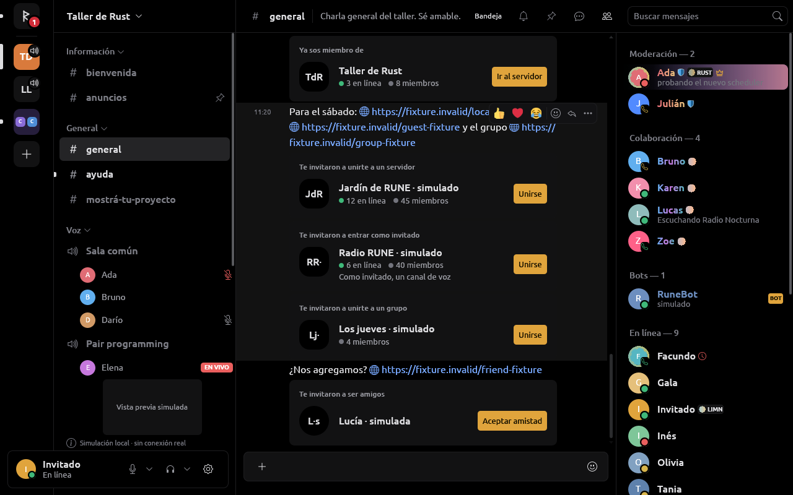
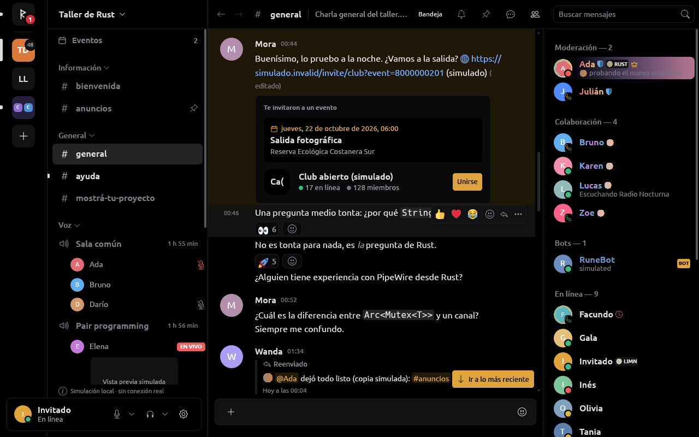
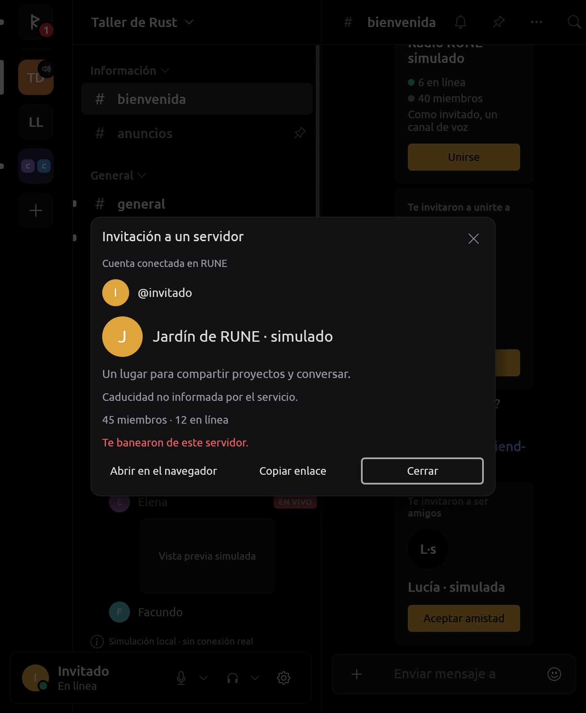
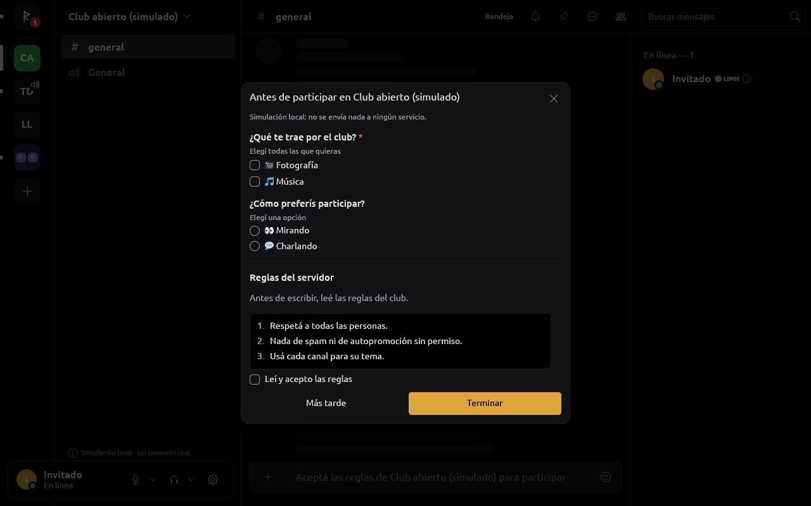
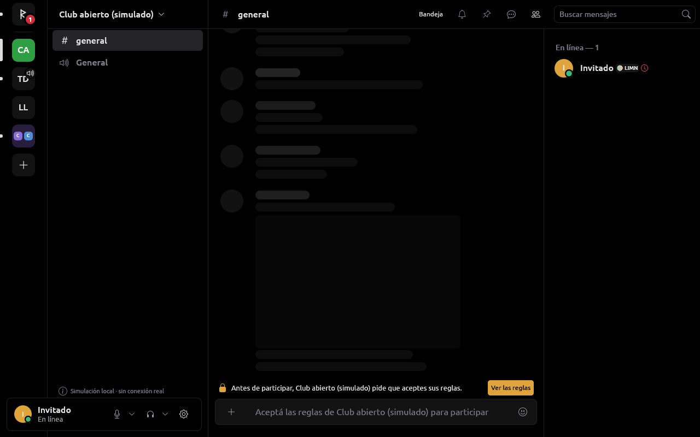
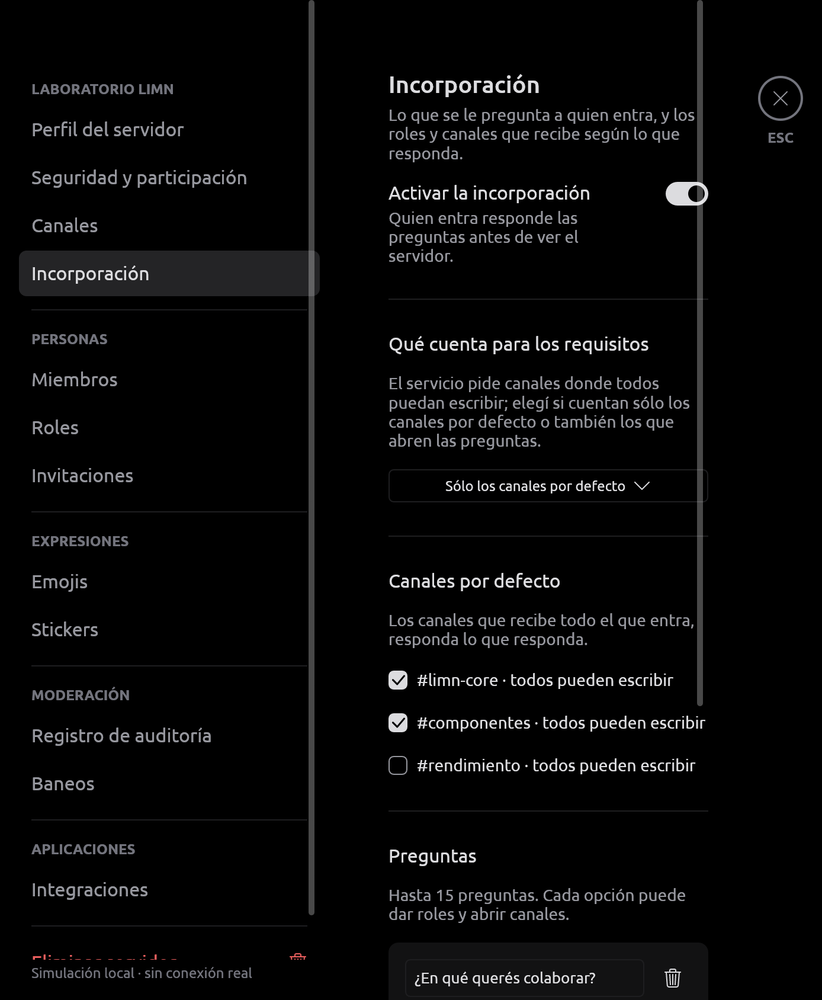

# Invitaciones: vista previa, aceptación y reglas al entrar

RUNE revisa y acepta invitaciones de servidores, grupos, amistad, ingreso
como invitado y eventos, dentro de su propia interfaz (limn). La aceptación
nativa es del proveedor no oficial (decisión del dueño del 2026-10-16); si
Discord pide un hCaptcha, «Verificar» abre la ventana aislada de RUNE donde
lo resuelve la persona y el adaptador repite la misma aceptación una sola
vez. Autorización y alcance en
[SECURITY.md](SECURITY.md#verificación-de-invitaciones-autorizada-el-2026-10-16).
**Sólo fixtures: no probado contra el servicio real.**

## Por dónde se llega

- El «+» del riel abre «Añadir un servidor»; «Revisar una invitación» acepta
  un **enlace completo** (no códigos sueltos) en un `TextField` acotado a
  2048 bytes, que no se persiste y cuyo `Debug` oculta el contenido. Un
  enlace no reconocido queda en el formulario con un error. Escape, cierre o
  cambio de cuenta descartan el campo.
- Un enlace cliqueado (`Intent::OpenUrl`) pasa primero por el adaptador: las
  invitaciones reconocidas abren el modal; el resto va al navegador.
- Las tarjetas de los mensajes (abajo).

La UI no conoce hosts, rutas ni tipos wire: el adaptador reconoce la
invitación con una función pura (`Provider::invitation_target`) y devuelve
un destino opaco con su página canónica. Reconocer un enlace nunca acepta
ni redirige.

## Tarjetas en los mensajes

El adaptador (`text.rs`) marca cada invitación del mensaje, escrita sola,
entre `<…>` o como dirección de un `[texto](…)`, salvo en código y en
spoilers (la tarjeta revelaría el destino). Una por código aunque se
escriba con dos dominios, como mucho diez por mensaje, como el cliente
oficial; también reconoce `ptb.` y `canary.discord.com/invite/`. La UI
muestra una tarjeta por enlace, en orden, con acciones
`msg:{id}:invitation:{n}:{acción}`.

Con `invitation_preview` permitido, la tarjeta de un mensaje visible
consulta sola el destino, como Serein, y muestra «Te invitaron a…» (unirte
a un servidor, a un grupo, a ser amigos, a entrar como invitado, a un
evento), «Ya sos miembro de» o «Invitación no disponible», con la marca,
el nombre y los conteos. Sin el permiso queda una tarjeta genérica.

- **Acotado** (`rune-ui/src/invitation_cards.rs`): sólo filas visibles del
  timeline abierto; una consulta por invitación aunque la repitan varios
  mensajes; como máximo ocho en vuelo (y `rune-core` contesta «no
  disponible» sin preguntar al proveedor si recibe más); una respuesta vale
  cinco minutos, un fallo uno (o el `Retry-After`, compartido con el
  modal); una consulta sin respuesta en 30 s libera su lugar. Respuestas de
  otra petición u otra cuenta se descartan.
- **Transporte**: el mismo GET público sin credenciales del modal.
- «Unirse» (o «Aceptar amistad») abre la invitación en el modal de RUNE,
  que pide confirmar; «Ir al servidor», «Ir al grupo» o «Enviar mensaje»
  aparecen si la cuenta ya tiene el destino. Si la conexión no acepta esa
  clase, abre la página en el navegador y lo dice.



## Modal

Muestra el destino, la **cuenta conectada en RUNE** (de `Store::me_user()`,
nunca del inviter ni del navegador), conteos aproximados (con tooltip
«Cantidades aproximadas»), caducidad, **Copiar enlace** y **Cerrar**; con la
capacidad, **Aceptar invitación**. Consultar o copiar nunca acepta, y doble
clic no duplica la operación. Separar consulta y confirmación sigue el
[flujo público de Discord](https://support.discord.com/hc/en-us/articles/360034842871-How-do-I-join-a-Server).

- **Caducidad**: `InvitationPreview.expires_at` (el `expires_at` nullable
  de [Invite Resource](https://docs.discord.com/developers/resources/invite#invite-object))
  se muestra como fecha, «Esta invitación venció» o «Caducidad no informada
  por el servicio»; nunca se inventa. Despierta la UI al vencer. El plazo
  monotónico de la orden se acota a `min(60 s, tiempo restante)`; una fecha
  vencida o malformada no emite la orden ni pasa el preflight.
- **429**: cuenta regresiva que despierta la UI; «Volver a consultar» sólo
  al terminar y con otro clic. La espera sobrevive a cerrar y reabrir.
- Tras el ACK espera el destino por sus propios eventos y lo abre; un
  servidor confirmado siempre ofrece **Abrir servidor**, aunque no tenga
  canales visibles. Cerrar desarma la navegación automática sin afirmar que
  revierte una solicitud enviada.

## Clases de invitación

`InvitationDestination` (en `rune-provider`) dice adónde lleva:
`Server`, `Guest { server, channel }`, `Group(canal)` o `Friend(persona)`.
La sesión lee `type` (`GUILD` 0, `GROUP_DM` 1, `FRIEND` 2) y `flags`
(`IS_GUEST_INVITE` 1) del GET público, como el cliente oficial (REA). Un
grupo se nombra por su nombre o sus integrantes, la amistad por quien
invita, el invitado por el servidor. Otro tipo, una bandera de invitado
fuera de un servidor o un id inválido no llevan a ningún lado. Los cuatro
se aceptan con el mismo `POST /invites/{code}`; después, la amistad lleva a
la conversación con quien invitó (crearla es una escritura: «Enviar
mensaje» la pide), el grupo al grupo y el invitado no pasa por el
onboarding.

Cada clase tiene su capacidad: `invitation_accept`, `group_invitations`,
`friend_invitations` y `guest_invitations` (`Capabilities::accepts`).
`Store::accept_invitation` dice por qué no (sin capacidad, ya en el grupo,
ya son amigos, «Es una invitación tuya»); `Store::invitation_joined` dice si
la cuenta ya tiene lo que da la invitación, siempre por sus eventos: el ACK
nunca crea nada.

Las invitaciones de aplicaciones o transmisiones (`target_type`) se
rechazan al aceptar.

### Eventos

Un enlace puede nombrar un evento programado
(`https://discord.gg/{código}?event={id}`, como lo arma el cliente oficial).
El reconocedor conserva `?event={id}` (sólo dígitos) en la página canónica;
la consulta agrega `guild_scheduled_event_id` y lee
`guild_scheduled_event`, y se muestra sólo el evento que nombra el enlace y
del servidor al que lleva (`InvitationPreview::event`). La tarjeta suma un
recuadro con cuándo es, su nombre y dónde. Quien no es miembro acepta como
siempre y, al llegar, se abre el servidor y el detalle del evento (salvo
que el servidor pida reglas antes); quien ya es miembro ve «Ver evento». La
aceptación es la común, con `invite_guild_scheduled_event_id` en
`X-Context-Properties`.



## Cómo funciona por dentro

1. `rune-provider/src/invitations.rs`: `InvitationTarget`,
   `InvitationPreview`, errores estáticos e `InvitationResult` por petición;
   `inspect_invitation` obtiene metadatos. La escritura es aparte:
   `Command::AcceptInvitation { request, target, destination, account,
   expires_at }`, `InvitationJoinError` y `Event::InvitationAcceptance`, sin
   credenciales. Las capacidades son falsas por defecto; `Store` exige
   cuenta, conexión y estado confirmado, nunca una instantánea de SQLite.
2. `rune-discord-session/src/invitations.rs` valida HTTPS, origen, ruta y
   código, y consulta con un cliente HTTP aparte, sin credenciales, cookies
   ni redirecciones: sólo GET al endpoint fijo, 64 KiB y timeout.
3. `rune-core/src/invitations.rs`: una tarea y una cola acotada, cancela
   consultas reemplazadas, filtra resultados viejos por generación y
   conserva `Retry-After`. Nada se persiste.
4. `rune-ui/src/invitations.rs` guarda `Ui::invitation` y ata respuesta,
   petición, destino y cuenta.
5. La aceptación va por la cola autenticada de la sesión, no por la de
   previews. Se revalida cuenta, enlace, plazo y destino (que no esté ya ahí
   ni sea su propio enlace), se vuelve a consultar el destino con el GET
   anónimo, se comprueba que siga siendo el mismo (tipo, ids, bandera) y se
   manda un único POST; la respuesta debe nombrar el destino mostrado.
6. `rune-core/src/invitation_acceptance.rs` conserva una única escritura
   aunque se cierre el modal. Sin respuesta a los 60 s el resultado es
   ambiguo y no libera la operación para repetirla. Ningún error repite
   automáticamente el ingreso.

La consulta pública nunca concede membresía ni permisos. Los destinos
redactan su `Debug`, no se registran cuerpos remotos, un 403 no inicia un
login ni cambia de endpoint, y el modo de capturas bloquea las consultas.

## Rechazos

**El log dice por qué.** Cada paso de la aceptación deja una línea en
stderr y en `~/.local/state/rune/rune.log`, y el resultado otra:

```text
rune: invitation: preflight GET: HTTP 200
rune: invitation: POST: HTTP 403, error code 40007
rune: invitation: not accepted: Banned
```

También `HTTP 403, no error code`, `HTTP 401`, `POST after verification:
…`, `no answer (timed out)` y `not sent: still waiting after a rate limit`.
Un `not accepted: …` sin línea HTTP antes quiere decir que RUNE no mandó
nada. Las líneas nunca llevan el cuerpo, el token, el código, el destino
ni la cuenta. **Si una aceptación falla, mandar las líneas que empiezan
con `rune: invitation:`.**

Causas con nombre, por el código JSON de error (REA del cliente web):

| Código | Causa (`InvitationJoinError`) | Texto |
| --- | --- | --- |
| 30001 | `ServerLimit` | «Llegaste al máximo de servidores: salí de uno para entrar.» |
| 40007 | `Banned` | «Te banearon de este servidor.» |
| 30019 | `ServerFull` | «El servidor está lleno.» |
| 40069 | `InvitesPaused` | «El servidor pausó sus invitaciones.» |
| 50095 | `Region` | «Este servidor no está disponible en tu región.» |
| 20024, 20086, 700000, 700002 | `AgeRestricted` | «El servicio no deja entrar a este servidor por la edad de la cuenta.» |
| 400000–409999 | `LimitedAccess` | «Las funciones de este servidor están limitadas: no admite ingresos ahora.» |
| 40068 | `AccountLimited` | «El servicio limitó esta cuenta y no la deja entrar a servidores.» |
| 10006 | `Invalid` | «La invitación ya no es válida.» |

Otro 400/403 sigue siendo `Invalid`/`Denied`; los de sesión, cuenta y
hCaptcha están en `rejections.rs`. Ya estar ahí no es un rechazo:
`AlreadyJoined` dice «Ya sos miembro…», «Ya estás en este grupo.» o «Ya son
amigos.» y ofrece abrirlo.

**Sin «Volver a intentar» después de un rechazo**: repetirlo no cambia la
respuesta y puede perjudicar a la cuenta. `can_retry` queda sólo para
`Unavailable` (no se mandó nada) y `RateLimited` (al terminar la espera);
el hCaptcha sigue con «Verificar».

**Abrir en el navegador** (`invitation:browser`, tooltip «Se abre con la
cuenta de tu navegador, no con la de RUNE.») pide `Intent::OpenInBrowser`
con la página canónica que da el adaptador
(`https://discord.com/invite/{código}`). Aparece siempre con un proveedor
no oficial y con cualquier otro después de un rechazo. No es un respaldo
automático: nombra el navegador y no promete la cuenta de RUNE, que no
comparte su sesión con nada; si la persona entra, el servidor llega por el
Gateway como cualquier otro.



## Reglas y onboarding al entrar

Al aceptar una invitación a un servidor que pide algo (reglas pendientes,
`MemberRestrictions::pending`, u onboarding sin terminar,
`ServerOptions::onboarding` sin `onboarded`), RUNE abre «Antes de participar
en {servidor}» apenas abre el servidor (`rune_ui::onboarding`): las
preguntas (cada opción con su emoji, título y descripción; una o varias) y
después las reglas numeradas con «Leí y acepto las reglas», o los campos de
texto y opción múltiple que pida. «Terminar» manda primero las respuestas
(`Command::AnswerOnboarding`) y, confirmadas, las reglas
(`Command::AnswerServerRules`), como Serein y el cliente oficial. El
resultado: «Listo: ya podés participar», «Enviado: la moderación va a
revisar tus respuestas» o el rechazo.

Con «Más tarde» queda una barra sobre el compositor que vuelve a abrirlo.
Mientras las reglas esperan, el compositor está cerrado y lo dice
(`Store::abilities`); en revisión o rechazado, también después de
reconectar (no después de cerrar RUNE). Entrar como invitado nunca abre el
diálogo. Si una parte no llegó, ofrece «Reintentar» antes de mandar nada;
si ya no se debe nada, se cierra solo. El onboarding propio se edita en
Ajustes del servidor › Incorporación (`PUT /guilds/{g}/onboarding`).
Detalle del proveedor en [DISCORD_SESSION.md](DISCORD_SESSION.md).





## Simulación

`MockProvider` tiene enlaces propios en `#general`
(`https://simulado.invalid/invite/{club,radio,jueves,amistad,revelado,cerrado}`,
uno con tres invitaciones entre texto, y `club?event=8000000201`). Los
consulta sin red y al aceptarlos manda lo que mandaría un servicio (un
servidor con sus canales, sólo el canal de voz del invitado, un grupo o la
amistad) y después el ACK. El club pide preguntas y reglas; `revelado`,
reglas con campos que revisa la moderación; la radio tiene onboarding que a
un invitado no se le pide; `cerrado` siempre se rechaza como `Banned`.
Capturas: `--provider mock --screenshot <archivo> --capture-invitation`
(con `--action invitation:accept` para el rechazo) y
`--capture-onboarding`.

## Interfaces oficiales

La API pública documenta `GET /invites/{code}` (metadatos, distingue
servidor, grupo y amistad), pero no una aceptación general: `Add Guild
Member` exige `guilds.join` y un token **bot** de la misma aplicación, y el
`AcceptActivityInvite` del Social SDK es para juegos. Por eso la aceptación
vive sólo en el adaptador no oficial (y en la simulación); el proveedor
OAuth2 no la habilita ([DISCORD_OAUTH.md](DISCORD_OAUTH.md)).

Faltan verificaciones de teléfono o correo: remiten a la aplicación
oficial.
