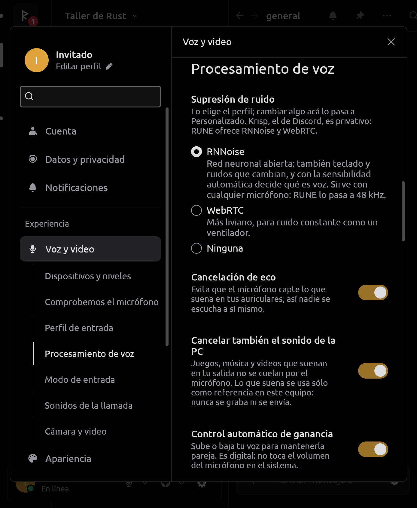
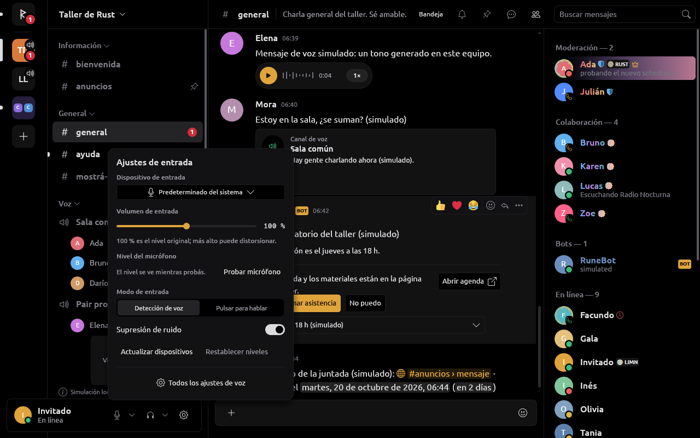
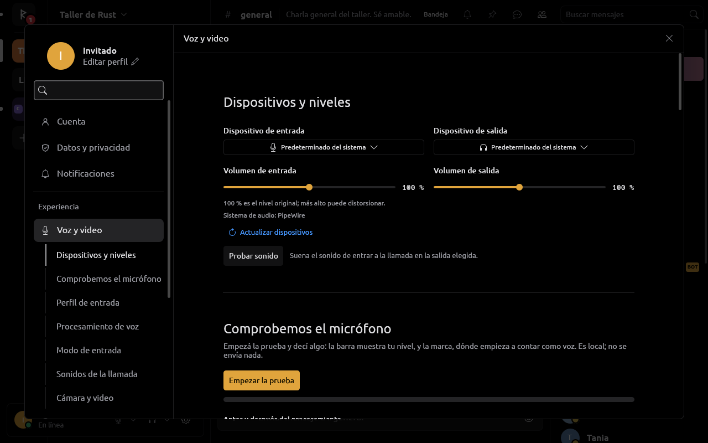
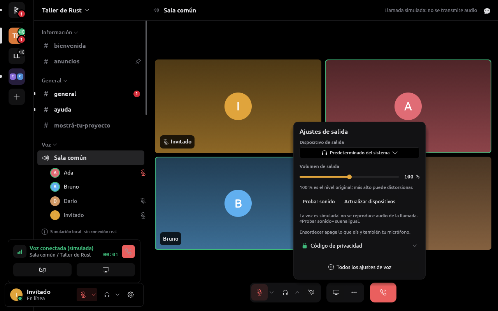
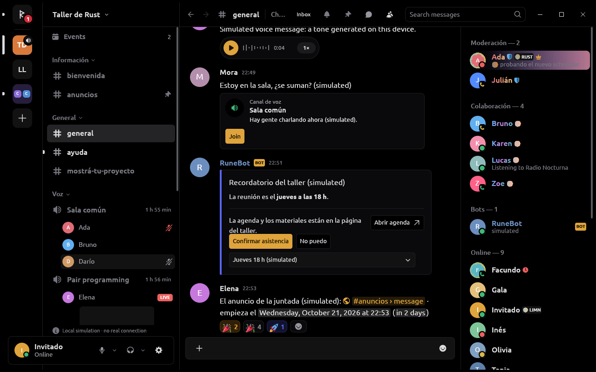
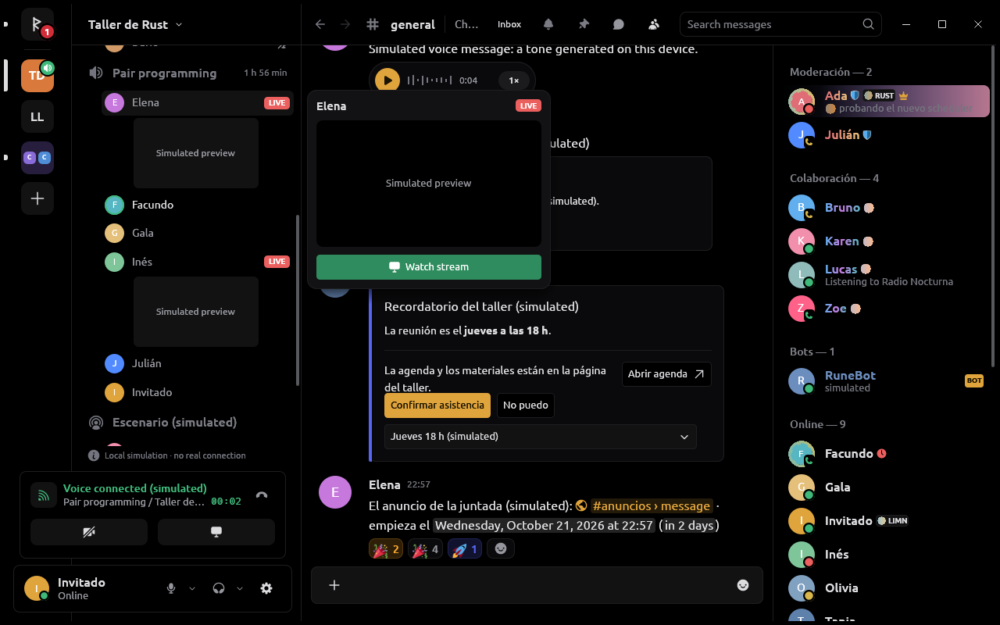
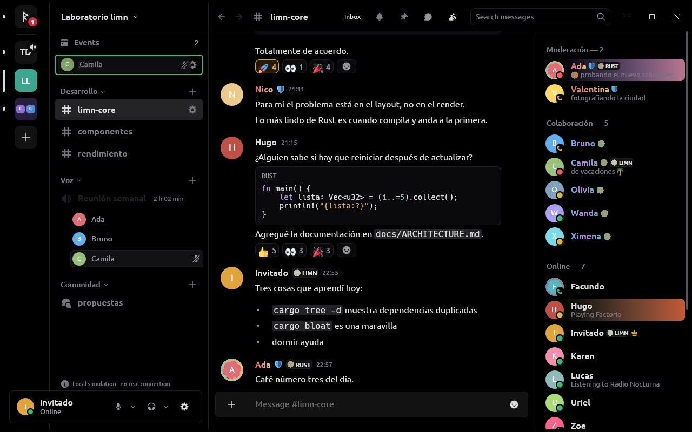
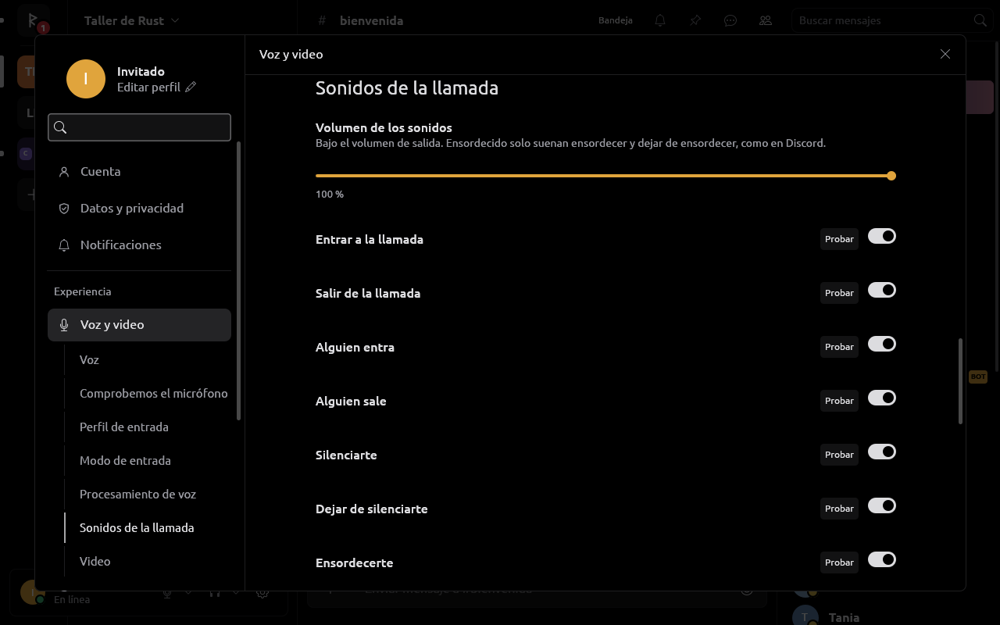
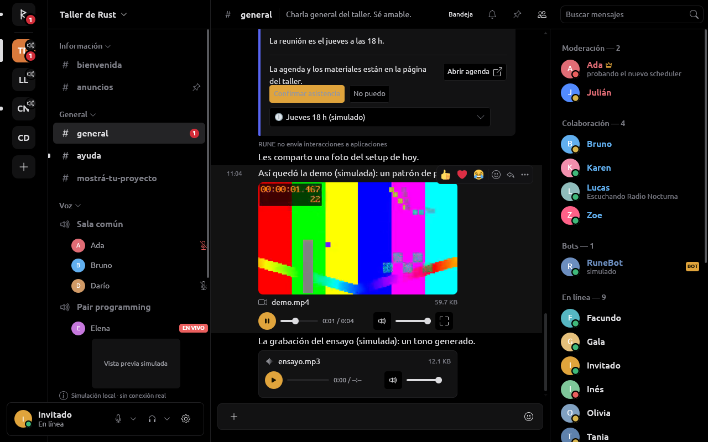

# Medios de RUNE (`rune-media`)

`rune-media` hace todo lo que suena o se ve en tiempo real: dispositivos de
audio, captura y procesamiento del micrófono, salida, Opus, jitter, mezcla
de una llamada, reproducción de mensajes de voz y adjuntos, sonidos, y la
captura, codificación y decodificación de pantalla y cámara. No sabe de
ningún servicio ni de la interfaz: el transporte de voz y video de Discord
(WebSocket de voz, UDP/RTP, cifrado de transporte, DAVE) vive en
`rune-discord-session` ([DISCORD_SESSION.md](DISCORD_SESSION.md)), y lo
específico del video de llamadas está en [VIDEO.md](VIDEO.md).

**Estado.** El dueño usó las llamadas con su cuenta, pero no hay una
prueba registrada de cada caso; casi todo lo de abajo está probado sólo con
fixtures y backends falsos, sin dispositivos. Lo que nadie escuchó o vio
todavía está en [Límites](#límites) y en `tasks/todo.md`.

## Piezas elegidas y por qué

| Pieza | Elección | Por qué |
| --- | --- | --- |
| E/S de audio | `cpal =0.18.2` con la feature `pipewire` en Linux | Host PipeWire nativo, priorizado sobre PulseAudio y ALSA; WASAPI y CoreAudio en las otras plataformas. Fijado: la 0.19 cambia la API (`play` → `start`, streams duplex). |
| Colas de tiempo real | `rtrb =0.4.0` (SPSC) | Sin asignaciones ni locks en el callback, sin dependencias. |
| Estado hacia la UI | `arc-swap 1.9.2` | Una única solicitud y una instantánea coherentes, sin mutex ni cola de comandos. |
| Procesamiento | `sonora 0.2.0` (port puro Rust del APM de WebRTC: AEC3, NS, AGC2, pasaaltos) | BSD-3, sin C++ ni bibliotecas del sistema. La misma de Serein. |
| Supresión neural | `nnnoiseless 0.5.2` (RNNoise en Rust) | BSD-3, puro Rust. Krisp es privativo: no está, y la interfaz lo dice. |
| Opus | `opus =0.4.0` (libopus 1.6 incluido por `opusic-sys`, compilado con `cmake`) | Mantenido por su autor original; no depende de la libopus del sistema en Windows ni macOS. Su multistream sirve para los Ogg de varios canales sin otra biblioteca. |
| H264 por software | `openh264 =0.9.8`, feature `source` | Decisión del dueño (ver [VIDEO.md](VIDEO.md#decisiones-del-dueño)). |
| Video por GPU, WebM y MKV | `gstreamer`/`-video 0.25.4`, `-app 0.25.2` (sólo Linux, enlace dinámico) | VA-API y NVENC/NVDEC con un mismo pipeline, ya estaba en el entorno por el login. LGPL: sólo dinámico. No reemplaza a `cpal`, `pipewire` ni `opus`. |
| Pantalla y cámara en Linux | Portales ScreenCast y Camera con el `zbus` de `rune-platform`, más `pipewire 0.10.1` directo | La única vía soportada en Wayland o en un sandbox. No se usa `ashpd`: su feature `pipewire` pide `pipewire ^0.9` y choca (`links = "pipewire-0.3"`) con la 0.10 que trae `cpal`. |
| Pantalla, cámara y sonido en Windows | Windows.Graphics.Capture, Media Foundation y loopback de WASAPI | Las APIs del sistema, sin dependencias de terceros. |
| Audio y video adjuntos | `symphonia 0.5.5` (sólo `aac`, `flac`, `isomp4`, `mkv`, `mp3`, `ogg`, `pcm`, `vorbis`, `wav`) y un lector MP4 propio | Rust puro, sin decodificadores del sistema. |
| MJPEG de cámaras | `zune-jpeg` (ya en el árbol por `image`) | Sin dependencia nueva. |

Descartado: WebRTC (`webrtc`, `str0m`, `libwebrtc`): la voz de Discord no
es WebRTC, y `libwebrtc` baja binarios durante el build; `xcap`, `scap` y
`crabgrab` para pantalla (sin streaming en Wayland, `pipewire` viejo o sin
Linux); `rubato`: Sonora remuestrea por dentro y la salida convierte en su
callback.

**Entorno Nix.** `shell.nix` trae `cmake` (libopus), `nasm` (acelera
OpenH264) y `libstdc++` (OpenH264 es C++), `gstreamer`, `gst-plugins-base`,
`-good` y `-bad`, y fija un rpath en `RUSTFLAGS` con las bibliotecas que se
enlazan o se abren en ejecución (alsa-lib, pipewire, wayland, vulkan,
GStreamer): con rust-lld, el `ld-wrapper` de Nix no pone el RUNPATH y el
binario no arrancaba fuera del shell. `RUNE_GST_PLUGINS` lleva las rutas de
los plugins para que un binario que corre afuera los encuentre.

## Hilos y reglas

- **Nada bloquea en los callbacks de audio**: sin `Mutex`, logs,
  asignaciones, E/S ni `panic`; sólo `rtrb`, atómicos y aritmética.
- Cada controlador (`Capture`, `Playback`, `CallMedia`, `Clip`, `Video`)
  tiene su hilo, dueño de sus streams. Crearlo no abre dispositivos:
  `configure(Some(...))` publica lo deseado y `configure(None)` detiene. La
  UI sólo lee instantáneas; nunca espera una apertura o un cierre.
- Colas acotadas que descartan lo viejo; nunca hay contrapresión hacia el
  audio. Opus, AEC y jitter nunca corren en el callback.
- La red vive en el runtime del proveedor; el puente con `rune-media` son
  colas acotadas.

## Captura (`Capture`)

Una sola captura sirve la prueba de micrófono, el indicador propio de voz
y la llamada.

- El callback convierte a float finito, recorta a `[-1, 1]`, promedia los
  canales y escribe un ring de 200 ms. Se aceptan de 1 a 8 canales y tasas
  de 8 a 192 kHz divisibles por 100; el resto falla antes de reservar.
- Se pide 48 kHz al dispositivo (como Serein); si no lo ofrece, el
  trabajador remuestrea antes de procesar, así RNNoise corre con cualquier
  micrófono y lo que sale ya está a la tasa de la llamada.
- El trabajador procesa cuadros exactos de 10 ms. Cada solicitud tiene una
  generación: al mutear o cambiar la configuración se descartan cuadros,
  estados y errores viejos, y se vacían acumulador e historia DSP. Un ring
  lleno descarta lo nuevo y lo cuenta; un hueco reinicia el cuadro parcial y
  el filtro para no empalmar audio discontinuo; 250 ms sin cuadro limpian
  los niveles.
- Reintentar exige `None` y la solicitud de nuevo: un error no provoca un
  bucle de aperturas. Mute cierra la admisión al instante (y suelta el
  micrófono).
- `CaptureSnapshot`: `Idle`/`Starting`/`Running`/`Failed`, niveles crudo y
  procesado (escala del medidor), descartes, cuadros y costo del último
  procesamiento (no es latencia extremo a extremo).

**Dispositivos.** Con PipeWire, cpal 0.18.2 lista cada sumidero también como
entrada `Duplex`, y abrirlo graba lo que suena en el equipo:
`rune_media::devices` deja afuera de las entradas los `Duplex` del host
PipeWire (los nombres no alcanzan: los sumideros virtuales de EasyEffects
no los siguen). ALSA, WASAPI y CoreAudio no se filtran (ahí un `Duplex` es
un micrófono real). Un monitor guardado antes en los ajustes figura como
«Dispositivo no disponible» y la captura abre el micrófono predeterminado,
nunca la salida. Límite: un nodo `Audio/Duplex` genuino (FireWire) también
se oculta.

## Procesamiento

Cadena: volumen de entrada (0–200 %, por un atómico) → AEC3 → pasaaltos y
NS de WebRTC → RNNoise → AGC2 → compuerta de voz. El cancelador va primero,
porque necesita el micrófono lineal respecto de lo reproducido, y en su
propia instancia de Sonora; RNNoise va antes de la ganancia. Cambiar
supresor, eco o ganancia reconfigura la captura abierta sin reabrir el
dispositivo; reiniciar el resto (mute, hueco, otro supresor) no le borra al
AEC lo que aprendió.

- **Perfiles** (Ajustes › Voz y video, en el orden de Discord y Serein):
  *Aislamiento de voz* (RNNoise, cancelación de eco, ganancia automática y
  compuerta; el predeterminado, como en Discord y Serein), *Estudio* (nada)
  y *Personalizado*. Tocar un control con un perfil fijo pasa a
  Personalizado desde lo que el perfil mostraba.
- **Supresión de ruido**: RNNoise, WebRTC (Sonora) o ninguna. RNNoise
  trabaja a 48 kHz en cuadros de 480 muestras sin reservar memoria.
- **Compuerta de voz** (`CaptureProcessor::set_speech_gate`): con detección
  de voz, sensibilidad automática y RNNoise deja pasar lo que RNNoise oye
  como voz (dos cuadros seguidos con probabilidad ≥ 0,6 que no sean un
  clic), lo sostiene 300 ms y abre y cierra con rampas de 5 y 20 ms; la
  llamada y el anillo de «hablando» usan lo que pasó. Con pulsar para
  hablar, umbral manual o sin RNNoise decide el nivel sostenido del cuadro
  (`VoiceActivity::update_sustained`), así un clic suelto no abre el
  micrófono.
- **Sensibilidad automática** (`VoiceActivity::automatic`): sigue el nivel
  más bajo reciente (baja al instante, sube 1,2 dB/s) y pone el umbral
  15 dB encima, entre −42 y −15 dBFS.
- **Ganancia automática**: AGC2 digital adaptativa (hasta 20 dB); nunca
  toca el volumen del sistema.
- **Eco** (revisado el 2026-10-19, ver
  [PERFORMANCE.md](PERFORMANCE.md#eco)): la salida copia a un ring de
  referencia exactamente lo que sonó, con la ganancia, incluido el silencio
  de un underrun o de ensordecer: así la referencia lleva el reloj del
  parlante. Antes de cada cuadro del micrófono la captura le pasa a AEC3
  todo lo que sonó desde el anterior (hasta 80 ms), apenas llega: el eco
  siempre viene después de lo que lo hizo y AEC3 encuentra el retardo solo.
  Antes pasaba 10 ms por cuadro y rellenaba con silencio si todavía no
  había llegado: la referencia quedaba corrida respecto del micrófono, a
  veces después de su propio eco. AEC3 es una etapa aparte (Sonora sin
  supresor) que sigue encendida mientras haya referencia, sin apagarse tras
  200 ms sin sonido: silenciarse, un hueco o cambiar el supresor ya no le
  borran lo que aprendió del camino del eco. Al reabrir o reconfigurar la
  captura se tira lo que sonó mientras no se leía, en el primer cuadro,
  como al abrir.
- **Sonido de la PC** (`system_echo`, prendido por defecto con la
  cancelación de eco): la referencia pasa a ser el *loopback* de la salida
  que usa RUNE, o sea todo lo que suena ahí (juegos, música, videos y la
  propia llamada), así eso tampoco se cuela por el micrófono. Una sola
  referencia, nunca las dos: el loopback ya trae lo de RUNE. En PipeWire es
  el monitor del sumidero (cpal abre su entrada `Duplex`; la salida
  predeterminada es `sink_default`, que sigue a la del sistema); en Windows,
  el loopback de WASAPI del punto de salida (cpal lo hace al abrir una
  salida como entrada). Se abre en el hilo de captura, se cierra al apagarlo
  o al terminar la captura, y si no da nada por 500 ms vuelve la referencia
  de RUNE; Ajustes dice cuál se usa. Es sólo una referencia: de su ring va a
  `CaptureProcessor::render` y a ningún otro lado; nunca se codifica, se
  manda, se reproduce ni se guarda (un test lo comprueba). Discord no tiene
  esta opción: su AEC usa lo que reproduce él, y Krisp quita ruido pero no
  la voz de un juego; Serein tampoco la tiene.



Ajustes guardados: `input_profile`, `noise_suppression`
(`off`/`webrtc`/`rnnoise`; el `true` viejo se lee como `webrtc`),
`echo_cancellation`, `automatic_gain`, `system_echo`, `input_volume`.

## Salida (`Playback`)

- Todo lo que suena es mono a 48 kHz. Se prefiere una configuración de
  48 kHz del dispositivo con período de 20 ms; si no, se interpola en
  línea (`Linear`, atajo marcado en el código: si un dispositivo sin 48 kHz
  suena mal, va un remuestreador de banda limitada).
- El callback sólo hace `pop` de un ring de 200 ms y aplica la ganancia
  (una prueba lo verifica con un asignador contador). El trabajador lo
  mantiene en 40 ms (o dos períodos). Underrun: silencio contado. Un `Feed`
  con más de 120 ms pierde lo más viejo.
- Volumen (0–200 %) y ensordecer van por un atómico, sin reabrir nada. Otra
  salida reconstruye el stream; con «Predeterminado del sistema» se revisa
  cada segundo si cambió. Un error reintenta cada 500 ms hasta 10 veces.
- Fuentes: el `Feed` de la llamada o de «Escucharme», y `sound_feed`, que
  el hilo suma muestra a muestra (hasta cuatro sonidos a la vez): un sonido
  fuera de una llamada suena encima de un mensaje de voz o de la prueba sin
  cortarlos. Durante una llamada con audio «Escucharme» no suena: la salida
  es de la llamada.
- `PlaybackSnapshot` publica la latencia que predice el sistema de audio y
  la cola (no es latencia acústica).

## Llamadas (`codec`, `jitter`, `mixer`, `call`)

- **Opus**: 48 kHz mono, tramas de 20 ms, VoIP, 64 kbit/s, FEC en banda y
  10 % de pérdida esperada. Mono como Serein: la mitad de trabajo y suena
  igual en receptores estéreo. Una pérdida se reconstruye con el FEC del
  paquete siguiente o con el PLC de libopus.
- **Jitter**, uno por persona: 16 ranuras (320 ms), arranca con 40 ms,
  reordena, descarta duplicados y tardíos, oculta hasta 3 pérdidas
  seguidas. Retardo fijo, no adaptativo (atajo).
- **Mezcla**: hasta 64 fuentes, 120 ms decodificados por fuente, volumen
  (0–200 %) y silencio por persona elegidos por quien escucha, recorte duro.
  «Habla» por encima de ≈ −40 dBFS con 300 ms de sostén. El sonido de una
  transmisión mirada entra con su propia clave (`mixer::STREAM_SOUND`, bit
  63), así no marca a su dueño hablando y tiene volumen propio: el del
  menú de la transmisión (clic derecho en ella, ver
  [VIDEO.md](VIDEO.md)), aparte del de la persona. Ensordecer calla las
  dos, como el cliente oficial.
- **`CallMedia`**, hilo `rune-call` cada 20 ms: toma el micrófono procesado
  de un `Tap` (descarta lo que espere más de 60 ms), lo deja pasar sólo si
  el host abre la compuerta (conectado, sin mute ni ensordecer, la tecla si
  se usa pulsar para hablar, y la actividad de voz), codifica y entrega al
  proveedor. Lo recibido va al mezclador y la mezcla al `Feed` de la salida.
  Ensordecido no suena nada. `play_sound` y `play_alongside` suman sonidos y
  clips a la mezcla sin tocar lo que se envía.
- **Host** (`apps/desktop/src/audio.rs`): el proveedor entrega su
  `VoiceLink` una vez (`Provider::take_voice_link`; la simulación no tiene).
  Los anillos de «habla» de los demás salen de la mezcla, el propio del
  medidor. Mute y ensordecer se avisan además al servicio.
- **Volumen por persona**: en el menú de cada persona, «Volumen del
  usuario» (0–200 %) y «Silenciar para mí»; se guardan en este equipo
  (`voice_volumes`, hasta 256) y nunca se mandan al proveedor.
- **Código de privacidad DAVE**: la conexión informa el código de la época
  MLS (30 dígitos en grupos de cinco) mientras la media va cifrada
  (`Event::CallPrivacyCode`); el de verificación con una persona es el de
  libdave (scrypt sobre las dos huellas ordenadas, 45 dígitos), calculado
  en `spawn_blocking` para no cortar el audio.
- **Chat del canal de voz**: con `Capabilities::voice_text`, un canal de voz
  o un escenario se trata como uno con mensajes; «Mostrar chat» lo abre al
  lado del escenario (40 % del ancho entre 320 y 440 px, desde 720 px).

## Pulsar para hablar y atajos

`rune-media::PushToTalk` deja pasar el micrófono mientras la tecla está
sostenida y durante el retraso al soltar (0–2000 ms, 20 por defecto como
Discord). En la ventana la tecla sale de `UiTree::key_held` de limn (se
vacía al perder el foco); fuera, del atajo global por el portal
`GlobalShortcuts` (`rune_platform::shortcuts`), pedido sólo para
combinaciones con Ctrl/Alt/Shift o teclas F para no capturar una letra en
todo el escritorio. La misma sesión lleva silenciar, ensordecer y pulsar
para silenciar; con la ventana enfocada actúan por las pulsaciones de limn
sólo si el escritorio no los asignó, así no se aplican dos veces. Ver
[PLATFORM.md](PLATFORM.md).

## Panel rápido de voz y página de Voz

Diseño visual y funcional de Serein, pedido por el dueño y reimplementado
en limn.

- **Panel rápido** (`rune_components::quick_voice`): la flecha del
  micrófono o de los auriculares (en el panel de la cuenta y en la barra de
  la llamada) abre la mitad de entrada o de salida: dispositivo, volumen,
  nivel en vivo con la marca del umbral, modo de entrada, supresión,
  «Probar sonido», qué hace ensordecer y el código de privacidad. Usa los
  mismos controles que la página (`us:…`). En una ventana baja el cuerpo
  cede alto y se desplaza.
- **Panel de la cámara**: lista de cámaras, vista previa 16:9 y «Probar
  video», que abre la cámara sólo en este equipo. La vista previa propia se
  ve en espejo (`Element::surface_mirrored`); lo que se manda no.
- **Listas de dispositivos**: «Predeterminado del sistema» primero, hasta
  32, nombres recortados a 40 caracteres con el nombre entero como pista.
- **Prueba de micrófono**: nivel en dBFS, medidor verde/amarillo/rojo con
  la marca del umbral, barras de entrada y procesada. En llamada mide la
  misma captura sin cambiar lo que se envía.
- **Prueba de salida**: «Probar sonido» toca el sonido de entrar a la
  llamada por el camino de los sonidos, sin cortar una llamada.
- **Página de Voz**: Dispositivos y niveles, Comprobemos el micrófono,
  Perfil de entrada, Procesamiento de voz, Modo de entrada, Sonidos de la
  llamada, Cámara y video.





## Personas bajo un canal de voz

Pedido del dueño (2026-10-19), como el cliente oficial y Serein.

- **Fila** (`rune_components::voice::participant`): 34 de alto, 38 de
  sangría desde el borde de la columna. El resaltado bajo el puntero va
  1 px adentro arriba y abajo (dos filas no se tocan), termina donde el de
  un canal (`sidebar::INSET` del borde, lejos de la barra de
  desplazamiento) y tiene su mismo radio de 6; las marcas de silencio y
  ensordecido quedan adentro. La fila en sí llega al borde, para que el
  puntero cruce a la tarjeta de al lado sin salir.
- **Tarjeta de quien transmite** (`voice::live_card`, `rune_ui::voice_live`):
  el puntero sobre alguien EN VIVO muestra a la derecha su nombre,
  «Transmitiendo {juego}» si su presencia dice a qué juega, la última vista
  previa de 288×162 (la que se pide con `GET /streams/{clave}/preview`, ver
  [VIDEO.md](VIDEO.md); se pide aunque ya se mire esa transmisión) y «Ver
  transmisión» (`vz:live:watch:{persona}`), que la mira, abre el escenario
  y le pasa el foco. Fuera de la llamada el botón se ve deshabilitado con
  el motivo. Sigue abierta mientras el puntero está en la fila, en sus
  marcas o en la tarjeta (`popover_on_hover` de limn, PR #114). En la
  simulación, «Vista previa simulada».
- **Arrastrar a otro canal** (`rune_ui::voice_drag`): con permiso de mover
  (`Store::voice_moderation`), mantener el clic sobre la fila y moverla la
  levanta: la fila queda sobre una superficie de tarjeta y una copia sigue
  al puntero (el fantasma de `draggable` de limn). El canal de destino se
  rodea de verde y los que no la aceptan se atenúan. Soltar sobre otro
  canal de voz manda `ModerateVoice::Move`; soltar afuera, sobre el mismo
  canal o un canal de texto, o Escape, cancela sin mandar nada.

| Resaltado | Vista previa | Arrastre |
| --- | --- | --- |
|  |  |  |

## Sonidos

- **Eventos** (`rune_ui::CallSound`, la clave es el nombre del archivo):
  `join`, `leave`, `user_join`, `user_leave`, `mute`, `unmute`, `deafen`,
  `undeafen`, `stream_start`, `stream_stop`, `user_stream`, `disconnect`,
  `message` (menciones y directos que avisarían), y los que se repiten:
  `ring` (llamada entrante, cada 2,5 s; no en No molestar) y `ring_out`.
  El host compara cada cuadro con el anterior (`apps/desktop/src/sounds.rs`);
  la primera mirada a una sala con gente no suena, y si pasan varios en un
  cuadro suena uno (los propios primero).
- **Sonidos predeterminados**: los 15 efectos incorporados son archivos MP3
  estáticos públicos de Discord, incluidos directamente en
  `assets/sounds/discord`. `SOURCES.md` fija el bundle observado, las rutas
  públicas y el mapeo de cada evento; `SHA256SUMS` y `scripts/sounds.sh`
  verifican los bytes empaquetados. No se leen perfiles, cachés,
  credenciales ni datos de sesión de Discord. Su procedencia se conserva en
  [AUDIO-NOTICES.md](../assets/licenses/AUDIO-NOTICES.md).
- **Ajustes › Voz y video › Sonidos de la llamada**: volumen de los
  sonidos, interruptor y «Probar» por evento, y la **carpeta de sonidos**
  (`sound_folder`), escrita a mano o elegida con el diálogo del sistema. Se
  lee en un hilo (`rune_media::sounds::load`): por evento, el primero de
  `{nombre}.ogg`, `.opus`, `.mp3`, `.wav`, de hasta 1 MiB y 5 s; lo que no
  cumple suena con el predeterminado, y la página dice cuáles tomó y por qué no
  los otros.
- Con una llamada que lleva audio van por su mezclador; si no, por la
  salida. Ensordecido no suena nada salvo ensordecer, dejar de ensordecer,
  una llamada entrante y «Probar».



## Mensajes de voz, audio y video adjuntos

Un único reproductor (`rune_media::Clip`) para mensajes de voz, audio y
video. RUNE no graba ni envía mensajes de voz.

- **Descarga** (`rune-core`): sólo al pulsar reproducir, a memoria, por los
  orígenes validados de las demás descargas (HTTPS, sin credenciales ni
  redirecciones, tamaño exacto): hasta 8 MiB un mensaje de voz, 50 MiB un
  adjunto (`Attachment::MAX_PLAYED_BYTES`; más grande ofrece el navegador o
  guardarlo). Nada va a disco; se suelta al detener, cambiar de conversación
  o de cuenta, o cerrar sesión.
- **Ogg Opus** (`clip::ogg`, lector propio): mapeo 0 y 1 (hasta ocho
  canales con el multistream de libopus, a mono); 2, 3 y 255 se rechazan
  con su motivo. Cada página se valida con su CRC; el gránulo final marca el
  fin a la muestra (RFC 7845). Atajo marcado: buscar decodifica desde el
  principio.
- **Formatos**: MP3, M4A/AAC, Vorbis, Opus, WAV, FLAC, WebM de audio
  (Symphonia; el Opus va a libopus). Video MP4/MOV/M4V con H.264 (lector MP4
  propio, sólo `moov` sin fragmentos, cada cantidad comparada con sus bytes
  antes de reservar, ≤ 432 000 muestras por pista) decodificado con
  OpenH264 sin forzar la salida de cada cuadro, así los B-frames salen en
  orden. **WebM y MKV** (VP8, VP9, AV1, H.264): `rune_media::mkv` lee la
  cabecera (códec, tamaño, duración) y un pipeline de GStreamer
  (`appsrc ! matroskademux ! … ! appsink`, acceso aleatorio sobre el archivo
  en memoria) decodifica con `vp8dec`, `vp9dec`, `dav1ddec`/`av1dec` u
  `openh264dec`. H.265 no se reproduce (su decodificador libre trae
  patentes) y lo dice. Más de 3840×2160, más de 4 horas o un WebM sin sonido
  que no dice cuánto dura se rechazan con su motivo.
- **Reproducción**: un hilo `rune-clip` empuja el sonido a lo sumo 60 ms
  por delante del reloj; un video suma `rune-clip-video`, a lo sumo dos
  imágenes por delante, escaladas a ≤ 1920×1080 y presentadas en una
  superficie limn (`media:{adjunto}`) hasta 30 veces por segundo. Durante
  una llamada el clip va a la mezcla (`CallMedia::play_alongside`, cola de
  0,5 s) sin tocar el micrófono; si la llamada empieza o termina en medio,
  sigue desde donde iba.
- **Velocidad** 0,75/1/1,5/2× sin cambiar el tono: `rune-media::stretch`,
  un WSOLA propio (cuadros de 30 ms, ventana de Hann, búsqueda de ±6,7 ms).
- **Interfaz**: tarjeta con barra de tiempo, volumen y, en un video,
  «Pantalla completa» en el visor de imágenes ([VISOR.md](VISOR.md)). Uno
  por vez; cada clip recuerda su posición (hasta 64, en memoria). Un video
  que sale de la vista se pausa; nada se reproduce solo.
- **GIF de tarjetas (`gifv`)**: Tenor y Giphy llegan como MP4 corto por el
  proxy de imágenes; se decodifican como animación con los presupuestos de
  un GIF (16 MiB, 120 cuadros, 3 s).
- **Simulación**: `assets/voice-sample.ogg`, `audio-sample.mp3`,
  `video-sample.mp4` y `video-sample.webm`, tonos y patrones generados con
  `ffmpeg`, sin voz ni grabación de nadie. Los fixtures de
  `crates/rune-media/fixtures/` son del mismo origen.



## Pantalla y cámara

La captura vive en `rune_media::video` con la misma API en Linux y en
Windows (`Video::screen`, `share`, `camera`, `send_camera`, `frames`,
`snapshot`); el host (`apps/desktop/src/video.rs`) sostiene una fuente por
tipo mientras la interfaz la pide y la presenta con
`limn_egui::present_surface`. Lo común (contar cuadros, ritmo, conversión
dentro del tamaño guardado, vista previa a ≤ 15 fps mientras se manda)
está en `Shared::deliver`. Codificar, transmitir y mirar: [VIDEO.md](VIDEO.md).

**Linux.** Pantalla por el portal ScreenCast (`rune-platform::screencast`,
`zbus` directo): conexión propia que fija el dueño del portal y vigila que
no cambie, monitor o ventana con el cursor incrustado, `persist_mode` y el
`restore_token` anterior desde la versión 4 (el portal recuerda la
pantalla), cada respuesta validada contra el pedido propio, y el fd de
`OpenPipeWireRemote` tiene que ser un socket. Cámara por el portal Camera
(`IsCameraPresent` → `AccessCamera`), sin recurrir a `/dev/video*`.
PipeWire en un hilo propio: formatos BGRx/BGRA/RGBx/RGBA para pantalla;
YUY2, NV12, I420, BGRx/RGBx y MJPEG para cámara, en cualquier tamaño y
ritmo que dé el nodo (BT.601 rango limitado; el MJPEG lo decodifica
`zune-jpeg`, y se agrega la marca `AVI1` para las cámaras que omiten las
tablas Huffman estándar). El stream dice siempre dónde acepta los búferes
(`SPA_PARAM_Buffers` con sólo `dataType`; cantidad y tamaño, los del
nodo): memoria compartida, y para la cámara también el DMA-BUF que exporta
V4L2, mapeado igual. Sin decirlo, un nodo V4L2 deja los búferes en su
propio mapeo, que otro proceso no puede usar, y PipeWire corta el enlace
con «use input buffers: -22» (lo que vio el dueño con una UVC sólo
MJPEG/YUYV). La pantalla no pide DMA-BUF: sin modificadores podría venir
en mosaico ([VIDEO.md](VIDEO.md#la-captura-y-dma-buf)). Un error del enlace
se explica (búferes o formato) y lleva el texto de PipeWire detrás.
Cada plano se valida
contra su `chunk`; lados de hasta 8192 px. Termina la fuente el handle
soltado, `Session.Closed`, un error del stream, el nodo quitado, 15 s sin
primer cuadro o una cámara 5 s sin cuadros; el primer motivo gana.

**Windows** (sin probar en un Windows real; con Wine cada fuente termina
diciendo por qué no puede):

- **Elegir qué compartir**: sin portal, `video::sources()` lista las
  pantallas (la principal primero) y las ventanas de la barra de tareas
  (hasta 32, nunca las de RUNE) cada vez que se abre el menú de calidad.
  Un id que ya no nombra una pantalla o ventana nunca comparte otra cosa.
- **Pantalla**: Windows.Graphics.Capture (1903 o posterior) sobre un
  dispositivo Direct3D 11 propio; sólo se copia a la CPU el cuadro que el
  ritmo guarda. Windows dibuja su borde alrededor de lo capturado.
- **Cámara**: Media Foundation con lectura asíncrona; elige el formato que
  llega al ritmo pedido, el más chico que cubre lo que se guarda y crudo
  antes que MJPEG. Dice el motivo si falta permiso, está ocupada o no hay
  Media Foundation (ediciones N).
- **Sonido de la pantalla**: loopback por proceso de WASAPI (Windows 10
  2004+) excluyendo el árbol de procesos de RUNE; no distingue
  aplicaciones como PipeWire, así que la voz de otro cliente de voz abierto
  se oiría.
- Sin GPU: codifica y decodifica OpenH264, y Ajustes lo dice.

## Probar a mano

Nada de esto abre dispositivos en los tests; con auriculares:

```sh
cargo run -p rune-media --example devices                     # ids de entrada y salida
cargo run --release -p rune-media --example camera [id]      # abre la cámara 8 s y cuenta cuadros, sin guardarlos
cargo run --release -p rune-media --example devices -- --meter --rnnoise --gate   # niveles, sin sonido
cargo run --release -p rune-media --example devices -- --meter --system-echo      # ¿abre el loopback de la salida?
cargo run --release -p rune-media --example playback          # timbre en la salida predeterminada
cargo run --release -p rune-media --example playback -- --loopback --rnnoise --gate --agc --echo --seconds 20
cargo run --release -p rune-media --example processing        # costo por cuadro
cargo run --release -p rune-media --example encode_bench      # CPU de codificar
```

En la app: Ajustes › Voz y video › Comprobemos el micrófono con
«Escucharme»: escribir sin hablar no tiene que oírse con la compuerta.
Las mediciones de CPU y ruido están en [PERFORMANCE.md](PERFORMANCE.md).

## Límites

- Nadie escuchó todavía los tonos, el volumen por persona, la velocidad de
  los mensajes de voz ni el AGC con voz real; el AEC no se probó con
  altavoces de portátil.
- Eco: medido sólo con señales sintéticas y un camino de eco lineal. Al
  dejar de estar silenciado, el primer medio segundo todavía deja pasar
  algo de eco. Mientras la persona habla encima de otra, AEC3 de Sonora
  quita poco eco (medición aproximada): lo frena sobre todo cuando no
  habla. El loopback en Windows no se probó en un Windows real, y si se
  elige una salida que no es la predeterminada, lo que suena en la
  predeterminada no se cancela.
- Jitter de retardo fijo y remuestreo lineal en la salida (atajos).
- Windows: sin codificador por hardware (MFT de Media Foundation), sin
  respaldo DXGI para Windows anterior a 1903, sin miniaturas en el
  selector.
- Sin DMA-BUF en la captura; AV1 y H.265 fuera de las llamadas.
- Los umbrales de `VoiceActivity` se eligieron con el micrófono de esta
  máquina.
