# Integración con el escritorio

Lo que RUNE hace con el escritorio además de su ventana: bandeja, instancia
única, inicio con la sesión, tema y fuente del sistema, temas propios,
paneles, atajos de voz, la actividad de este equipo, el código de
privacidad de las llamadas y el registro a archivo. Paridad con Serein,
reimplementado. Está probado con buses D-Bus privados, sockets en carpetas
temporales, la simulación y fixtures en loopback; **falta probarlo en un
escritorio real y contra Discord** (lista en
[tasks/todo.md](../tasks/todo.md)).

Las preferencias se guardan como las demás (`Intent::SaveSetting`) con
cualquier proveedor: «Cerrar a la bandeja», la fuente, los anchos, los
atajos y los interruptores de actividad son del equipo; favoritos, fijados
y el último lugar, de cada cuenta (`rune_ui::ACCOUNT_SETTINGS`,
`apps/desktop/src/kept.rs`). «Iniciar con la sesión» es un archivo aparte.

Cada servicio vive en `rune-platform`, en un hilo propio con su runtime y
su conexión, y termina al soltar su handle; el host
(`apps/desktop/src/desktop.rs`) los arranca y los para según las
preferencias y traduce lo que informan a llamadas de `rune-ui`
(`rune_ui::desktop`). Capturas (`--screenshot`) y benchmark no arrancan
ninguno.

## Bandeja del sistema

`rune_platform::tray`: un StatusNotifierItem con su menú
`com.canonical.dbusmenu`, sobre zbus, sin GTK ni `ksni`. Se registra en
`org.kde.StatusNotifierWatcher` y vuelve a registrarse si el panel
reaparece; sin bandeja dice `Unavailable`. El ícono es el de la aplicación
(`assets/icons/hicolor`) a 16, 22, 24, 32, 48 y 64 px, con un punto rojo
mientras haya menciones; el tooltip cuenta menciones y lugares sin leer
(`rune_ui::desktop::tray_counts`, las mismas marcas del riel). Menú: «Abrir
RUNE», «Silenciar micrófono» y «Ensordecer» (casillas), «Estado» (con una
cuenta) y «Salir de RUNE». Las acciones son los mismos clics de la
interfaz (`me:mute`, `me:deafen`, `pp:status=…`); «Salir» guarda como al
cerrar y sale. Menú y tooltip siguen el idioma de la interfaz
([Idiomas](ARCHITECTURE.md#idiomas)).

«Cerrar a la bandeja» (Ajustes › Sistema › Escritorio) viene **apagado**
(Serein lo trae encendido) y sólo actúa si el escritorio mostró el ícono.
Cerrar oculta la ventana: en X11 con `Visible(false)`; Wayland no oculta
superficies, así que en Hyprland la ventana va al workspace especial
`special:rune` por su socket de comandos (`rune_platform::hyprland`) y
vuelve al workspace a la vista; en otros compositores se minimiza. Oculta,
eframe sólo llama `App::logic`: RUNE sigue aplicando eventos
(notificaciones incluidas) y atendiendo la bandeja y las ejecuciones
nuevas. Si la bandeja desaparece, la ventana vuelve.

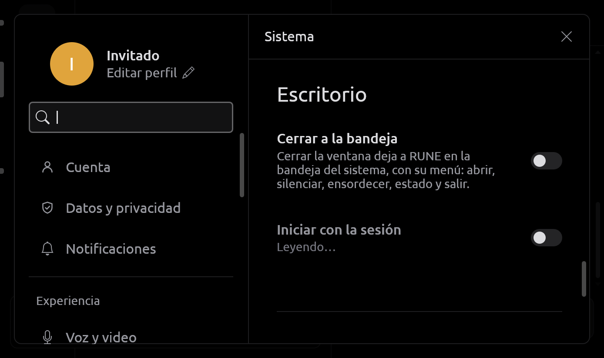

## Instancia única y enlaces

`rune_platform::single_instance`: la primera ejecución interactiva escucha
en `$XDG_RUNTIME_DIR/rune-instance.sock` (0600; cada conexión se verifica
con `SO_PEERCRED`; sin carpeta de runtime privada no hay instancia única,
nunca `/tmp`). Una segunda ejecución manda `RUNE1`, `show` y sus enlaces
`https://`/`http://` de la línea de comandos (hasta ocho, 2048 bytes cada
uno) y sale; la primera se trae al frente y abre cada enlace como uno
cliqueado en un mensaje (`rune_ui::desktop::open_link`): un
`…/channels/{servidor|@me}/{canal}[/{mensaje}]` de un dominio del
proveedor abre la conversación, una invitación pasa por la revisión de
invitaciones y el resto pregunta antes de ir al navegador. Un socket de una
ejecución caída se reemplaza.

## Iniciar con la sesión

`rune_platform::autostart` escribe `~/.config/autostart/rune.desktop` con
el ejecutable actual citado como pide la especificación, por escritura
aparte y renombrado; apagarlo lo borra. En una copia instalada el
ejecutable es `~/.local/share/rune/app/current/rune`, que sobrevive a las
actualizaciones ([UPDATES.md](UPDATES.md#linux)); `set_menu_entry` escribe
con la misma cita la entrada del menú de `rune --install`. Con
`Hidden=true` o `X-GNOME-Autostart-enabled=false` cuenta como apagado. El
portal `Background` pediría un ID de aplicación instalado que RUNE todavía
no tiene.

## Tema del sistema

`rune_platform::appearance` lee `org.freedesktop.appearance color-scheme`
del portal `Settings` (`ReadOne`, o `Read` en portales viejos) y sigue sus
`SettingChanged`, sólo del dueño del portal. «Sistema» es el cuarto tema en
Apariencia: oscuro o sin preferencia es Ónix, claro es Claro; elegir otro
deja de seguirlo (`theme = system`).

Si el portal se reinicia, RUNE lo sigue: escucha `NameOwnerChanged` de
`org.freedesktop.portal.Desktop` y con un dueño nuevo vuelve a leer y a
suscribirse; sin portal queda el último esquema. Como nadie reinicia un
portal que se cayó, cada vez que no tiene dueño RUNE le pide al bus que lo
arranque (`StartServiceByName`), tres veces como mucho.

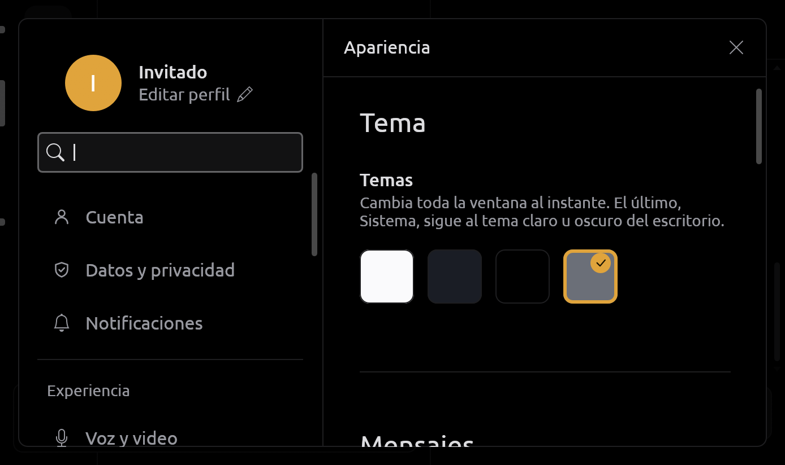

## Temas propios, color principal y transparencia

Paridad con los temas de Serein, sin extensiones, Wasm, imágenes ni
catálogo remoto. Todo en Apariencia › Tema:

- **Temas propios.** «Crear tema» abre el editor sobre una base (Ónix,
  Oscuro o Claro, o una copia del tema propio en uso): nombre, base, una
  vista previa que se repinta con cada cambio
  (`rune_components::theme::preview`, una ventana en miniatura sin
  controles) y los colores de `Look` agrupados (Superficies, Texto,
  Acciones y estados, Presencia), cada uno con el `ColorPicker` de limn y
  «Restablecer». La ventana cambia al guardar, no antes: un color ilegible
  no deja la página sin leer. Hasta ocho, en este equipo (`custom_themes`,
  una lista JSON, y `custom_theme`, el que está en uso), con «Editar»,
  «Exportar…» y «Borrar». Elegir otro tema deja de usarlo sin borrarlo.
- **Importar y exportar.** Un tema es un archivo de datos
  (`*.rune-theme.json`): `{"rune_theme": 1, "name": …, "base": …,
  "colors": {"accent": "#rrggbb", "hover": "#rrggbbaa", …}}`. Se rechaza
  cualquier otro campo, otra versión, un nombre vacío o de más de 48
  caracteres, una base o un color desconocido y todo archivo de más de
  64 KB; nunca se ejecuta nada de él. «Importar…» usa el selector del
  portal (`rune-core::theme_files`, fuera del hilo de la UI); «Exportar…»,
  «Guardar como», sin pisar un archivo existente. Un nombre repetido
  recibe un número. Riel, columnas y conversación de un tema son siempre
  opacos: la transparencia es del equipo. Un archivo sin `card` toma el
  de su base.
- **Color principal.** El del tema, uno de los veinte preajustes de los
  selectores de color de RUNE o cualquiera. Tiñe botones, menciones e
  indicadores sobre cualquier tema; el texto encima es blanco o negro según
  cuál contraste más (WCAG). Se guarda como `accent_color`.
- **Transparencia de la ventana**, de 0 a 90 % en pasos de 5, leída de
  `~/.config/rune/transparency` antes de abrir la ventana: sólo si es mayor
  que 0 la ventana se abre transparente; si se abrió opaca, el cambio se
  aplica al volver a abrir RUNE y la página lo dice. Con transparencia, el
  riel, las columnas y la conversación no pintan su fondo
  (`Look::see_through`) y la raíz pinta una sola vez el color de la
  conversación con el alfa elegido (`Look::backdrop`); menús, diálogos y
  ajustes siguen opacos.

**El desenfoque lo pone el compositor**, no RUNE: Wayland no tiene un
protocolo estándar. En KDE, el efecto «Desenfoque» de KWin (con una regla
de ventana sobre la clase `rune` para forzarlo); en Hyprland,
`decoration { blur { enabled = true } }`. Sin compositor (X11) la ventana
se ve con fondo negro. RUNE todavía no habla `org_kde_kwin_blur`.

Límites: con transparencia, el riel y las columnas toman el color de la
conversación (se separan por sus líneas), y los anillos de estado sobre
las caras no recortan.

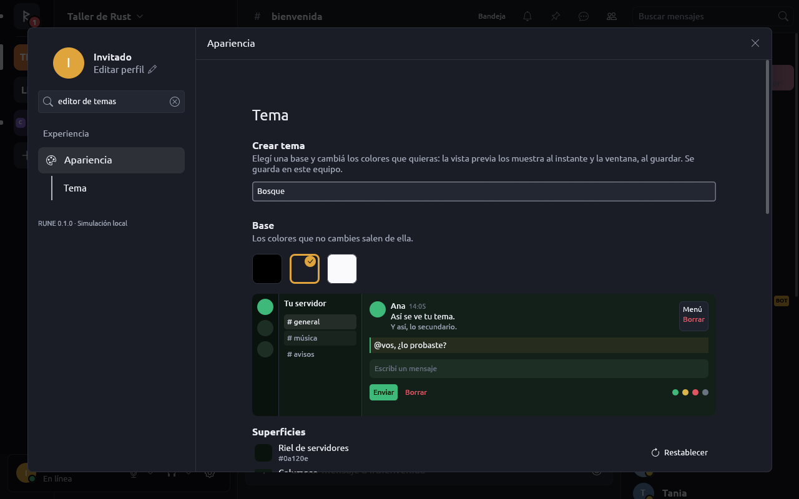
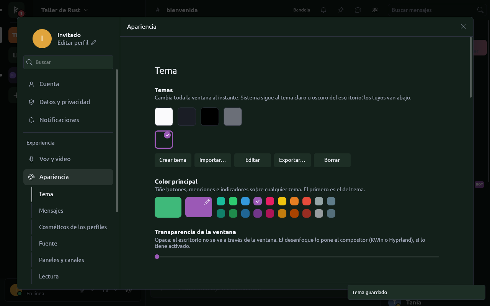

## Ventana y gráficos

En Ajustes › Sistema:

- **Ventana › Barra de título**: Automática, la de RUNE o la del sistema,
  en vivo (`ViewportCommand::Decorations`) y al abrir. Automática es la de
  RUNE en Windows y X11 y la del sistema en Wayland. La de RUNE quita el
  marco y pone los `WindowControls` de limn al final de la cabecera;
  arrastrar su franja libre la mueve (`StartDrag`), doble clic maximiza o
  restaura y el borde de 5 px cambia el tamaño (`BeginResize`). Con ella la
  ventana no baja de 868 × 490 y la cabecera pliega sus herramientas en
  «más» antes de tocar los botones. Se guarda en
  `~/.config/rune/decorations` (`hidden`: la de RUNE; `shown`: la del
  sistema; sin archivo: automática). `--title-bar auto|rune|system` la
  elige para una ejecución sin guardarla.
- **Ícono de la aplicación**: la R de tres bloques en blanco sobre la placa
  roja (`assets/icons/rune.png` y `assets/icons/hicolor`, desde
  `icons/rune.svg`; 16, 24 y 32 px desde `rune-small.svg`, con la marca en
  píxeles enteros). La ventana lo fija a 256 px; X11 y
  Windows lo muestran en la barra de tareas. Wayland lo busca por el
  `app_id` (`rune`) en la entrada del menú, y `rune --install` instala cada
  tamaño en `~/.local/share/icons/hicolor`. La marca
  (`assets/rune-mark.svg`) es un glifo de la interfaz.
- **Gráficos › Dibujar con**: Automático (en una laptop con dos GPU, la que
  maneja la pantalla) o cada fabricante que sysfs muestra (dos del mismo
  fabricante son una sola opción: el filtro del cargador de Vulkan no las
  distingue). La página dice con qué GPU dibuja wgpu ahora y que el cambio
  se aplica al reabrir. Si una variable del entorno decide
  (`VK_LOADER_DRIVERS_SELECT`, `VK_DRIVER_FILES`, `VK_ICD_FILENAMES`,
  `RUNE_GPU`) la elección no se usa y la página lo dice; si la GPU elegida
  no abre la ventana, RUNE arranca otra vez con cualquiera y lo dice.
  Detalle en [PERFORMANCE.md](PERFORMANCE.md).

Barra de título y GPU se leen antes de abrir la ventana (la base local se
abre después): son archivos de una línea, `~/.config/rune/decorations` y
`~/.config/rune/gpu` (`amd`, `intel` o `nvidia`), como
`~/.config/rune/provider`. Nunca una credencial. Un solo hilo los escribe,
en orden y enteros (temporal renombrado). Cerrar sesión no los olvida.
Capturas, benchmark y pruebas no los escriben.

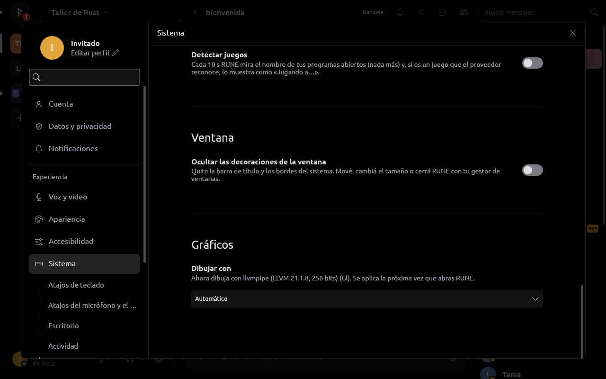

Los diálogos del portal se abren sobre la ventana: ver
[FILES.md](FILES.md).

## Fuente de la interfaz

Apariencia › Fuente lista las familias del sistema (`fc-list`, en un hilo
aparte). Elegida una, `rune_platform::fonts::load` pide a `fc-match` sus
pesos regular, medio y negrita (colecciones `.ttc` por índice y fuentes
variables incluidas) y lee los archivos (hasta 32 MiB cada uno) fuera del
hilo de UI; el host la instala con `limn_egui::font_definitions_with` y
vuelve a medir el árbol. Sólo se guarda el nombre (`ui_font`): si la
familia desaparece, RUNE vuelve a Ubuntu y lo dice. En Windows la lista,
los pesos y los respaldos salen de DirectWrite.

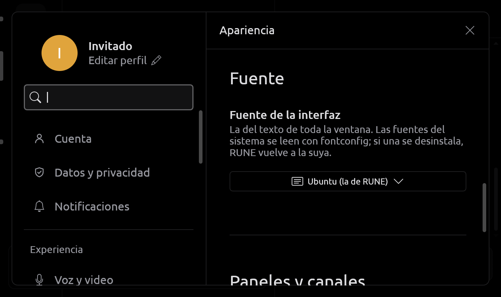

## Paneles, favoritos, fijados y canales ocultos

- Los bordes de la lista de canales (220–440 px) y de la de miembros
  (220–400 px) se arrastran con el `ResizeHandle` de limn; Esc o un
  arrastre cancelado vuelve al ancho anterior, soltar lo guarda
  (`sidebar_width`, `members_width`) y «Restablecer» en Apariencia vuelve a
  los de siempre.
- «Favorito» en el menú de un canal lo sube a «Favoritos», arriba de su
  servidor; «Fijar en la lista» en un privado o grupo lo pone bajo
  «Fijados». Hasta 64 de cada uno, sólo en este equipo
  (`favorite_channels`, `pinned_directs`).
- «Mostrar los canales ocultos» lista los canales que la cuenta no puede
  ver (sin `VIEW`), atenuados, con un ojo tachado, sin abrirse ni marcas de
  no leído. La simulación tiene «moderación» en el primer servidor.

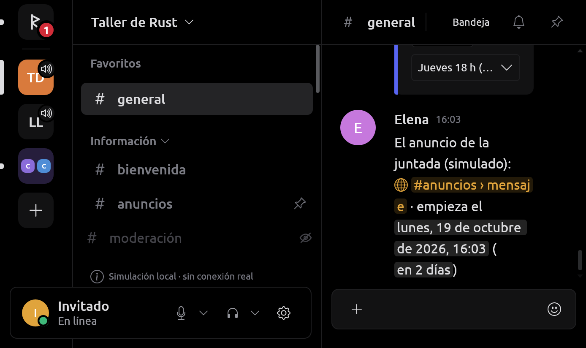
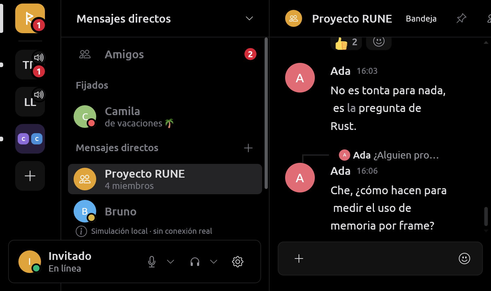

## Atajos del micrófono y el sonido

Ajustes › Sistema › Atajos de teclado › Voz, dentro de la tabla común de
atajos con su aviso de conflictos: silenciar, ensordecer y «pulsar para
silenciar» se graban como «pulsar para hablar» y se piden al portal
`GlobalShortcuts` **en la misma sesión** (un solo diálogo del escritorio),
sólo combinaciones con Ctrl/Alt/Shift o teclas F. Silenciar y ensordecer
actúan una vez por pulsación; con la ventana enfocada actúan también si el
escritorio no los asignó. Mientras se mantiene «pulsar para silenciar» el
micrófono no pasa (`audio.muted_held`). Ver [MEDIA.md](MEDIA.md).

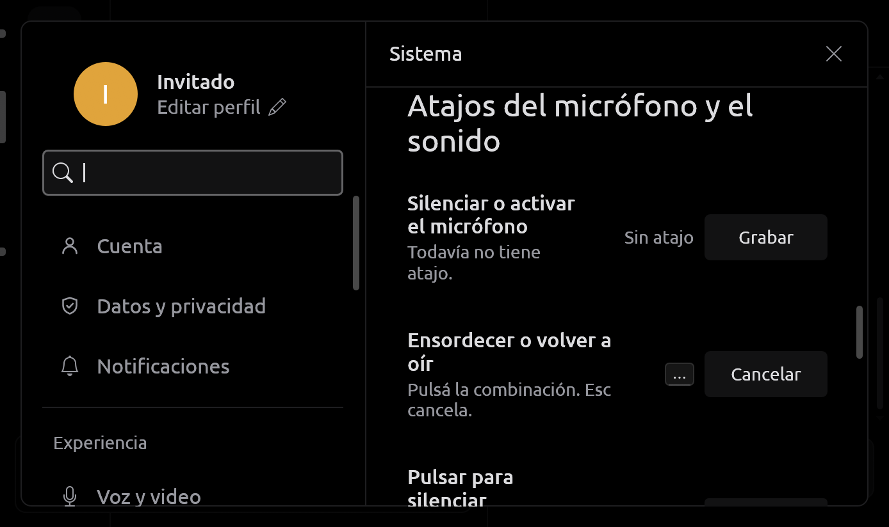

## Actividad de este equipo

Dos fuentes, cada una **apagada por defecto** con su interruptor en
Ajustes › Sistema › Actividad (decisión del dueño del 2026-10-17; límites
en [SECURITY.md](SECURITY.md#actividad-local-rich-presence-y-juegos)):

- **Programas** (`rune_platform::rich_presence`): el socket local
  `discord-ipc-N`, como el cliente oficial y Serein. Saludo, `READY` con la
  cuenta, `SET_ACTIVITY` (tipo, detalles, estado, tiempos, imágenes),
  `INVITE_BROWSER` (abre la invitación en el diálogo de RUNE, donde aceptar
  es un clic de la persona) y ping; el resto se rechaza con el código 4000.
  Hasta 8 programas; al irse se borra su actividad.
- **Juegos** (`rune_platform::games`): cada 10 s se miran los procesos del
  usuario (sólo `/proc/N/exe` y los primeros 512 bytes del primer argumento
  de `cmdline`, que es donde Wine y Proton dicen el nombre del `.exe`)
  contra la lista del proveedor (`Command::LoadDetectableGames`), por la
  cola más larga de la ruta; el juego reconocido se mantiene mientras siga
  abierto.

Gana la actividad más nueva de un programa; si no hay, el juego. RUNE la
muestra como la actividad propia y la publica con
`Command::SetLocalActivity` si el proveedor declara `local_activity`
([DISCORD_SESSION.md](DISCORD_SESSION.md)).

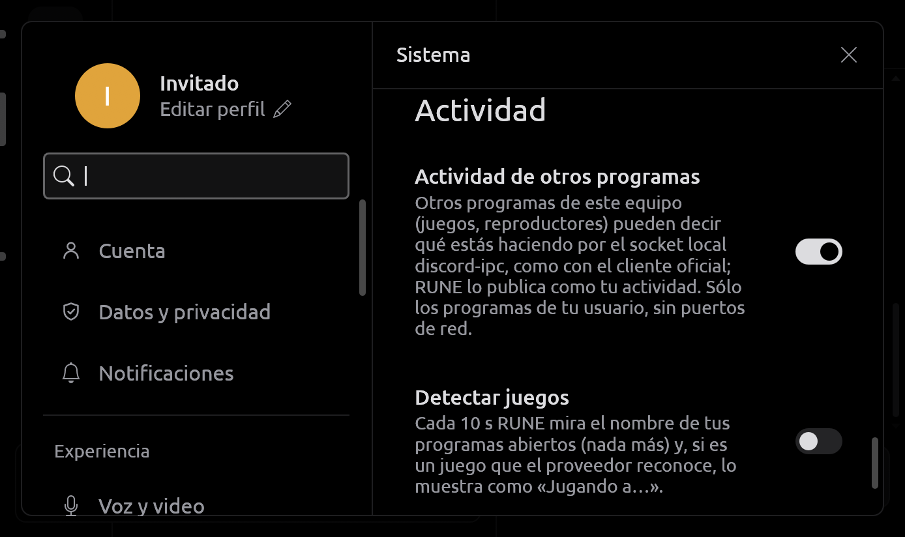

## Código de privacidad de la llamada

Con `voice_privacy_code`, Detalles de voz tiene una pestaña «Privacidad»
(y Ajustes › Voz y video, durante una llamada): el código de privacidad de
la llamada (30 dígitos en grupos de cinco, con Copiar), que cambia con cada
grupo DAVE, y por persona «Ver código»: los 45 dígitos que la cuenta y esa
persona comparan por otro medio. La simulación inventa códigos fijos y lo
dice. Cálculo en [MEDIA.md](MEDIA.md).

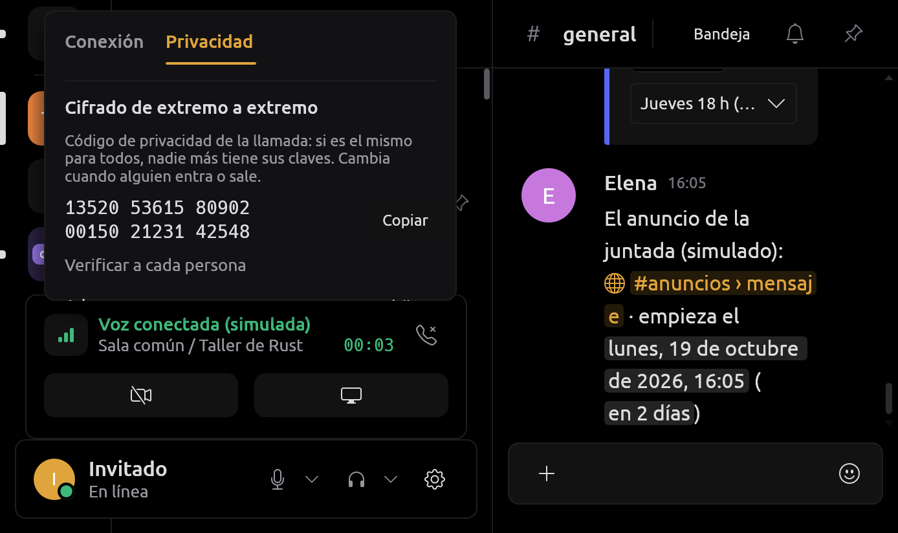

## Registro a archivo

Lo que RUNE escribe en stderr (`rune: voice …`, `rune: gateway: …`,
errores y pánicos) queda también en `$XDG_STATE_HOME/rune/rune.log` (o
`~/.local/state/rune/rune.log`), para mandar el diagnóstico de una llamada
fallida aunque la terminal ya no esté. En `apps/desktop/src/log.rs`, al
arrancar el descriptor 2 pasa a una tubería y un hilo copia lo que llega al
stderr original y al archivo, sin tocar los crates (sólo `dup2` e `ioctl`).
Rota a 5 MB con tres archivos; carpeta `0700`, archivos `0600`. Cada
arranque empieza con `--- rune start <segundos UNIX> pid <pid>`, sólo en el
archivo. Sólo en ejecuciones interactivas en Unix: `--screenshot`,
`--bench`, la segunda ejecución que reenvía enlaces y los errores de la
línea de órdenes van sólo a stderr. Qué puede llevar una línea:
[SECURITY.md](SECURITY.md#datos-locales).

Un pánico espera hasta 200 ms a que el hilo copie lo pendiente, así llega
también el que termina en un abort. Un abort o una señal del código de C
(un `assert` de un driver o de GStreamer, un `SIGSEGV`) no pasan por ahí:
lo último antes de esa caída puede perderse.

## Windows

Pedido por el dueño («esto lo quiero para Windows, no sólo Linux»). RUNE
compila para Windows x86_64 y sus servicios tienen su versión de Windows
detrás de la misma API de `rune-platform` y `rune-media`, así que nada por
encima cambió salvo lo que la interfaz dice distinto. **Nada se probó
todavía en un Windows real**; con Wine pasan las pruebas, pero Wine no es
Windows. Serein corre en Windows; se miró cómo resuelve cada servicio, sin
copiar código.

### Compilar y probar desde Linux

Las versiones se compilan con el target MSVC (`x86_64-pc-windows-msvc`) en
el job `windows` de [CI](../.github/workflows/ci.yml) (clippy
`-D warnings`, `cargo test` y las pruebas de servicios reales con
`--ignored`). Desde NixOS se comprueba con el target GNU, que comparte casi
todo el código:

```sh
nix-shell --arg withWindows true
cargo clippy --target x86_64-pc-windows-gnu --workspace --all-targets --all-features -- -D warnings
cargo build  --target x86_64-pc-windows-gnu -p rune-desktop        # target/x86_64-pc-windows-gnu/debug/rune.exe
cargo test   --target x86_64-pc-windows-gnu --workspace            # bajo Wine
cargo test   --target x86_64-pc-windows-gnu -p rune-platform -- --ignored
```

`withWindows` suma el GCC cruzado de MinGW-w64 (compila el C de SQLite,
libopus y ring) con su winpthreads, y Wine, que corre las pruebas en un
prefijo dentro de `target/wine`. El target MSVC desde Linux (`cargo-xwin`)
no se usa: descarga el SDK de Microsoft aceptando su licencia, y eso lo
decide el dueño. El shell aplica el `rpath` de Linux sólo al target de este
equipo, así no llega a un `.exe`. Con el target GNU, `rune.exe` con
`session-login` importa `WebView2Loader.dll`, que hay que poner al lado
(`target/x86_64-pc-windows-gnu/debug/build/webview2-com-sys-*/out/x64/`);
con MSVC el cargador va enlazado.

Una medición de tiempo de `rune-components`
(`a_long_run_costs_its_length_not_more`) puede fallar con Wine por la
carga. Con `--ignored`, Wine no guarda los atributos del Administrador de
credenciales y deja crear una segunda «primera instancia» de la tubería,
que Windows rechaza.

### Servicios

| Servicio | Linux | Windows |
| --- | --- | --- |
| Carpetas (`rune_platform::folders`) | XDG: `~/.local/share/rune`, `~/.config/rune`, `~/.cache/rune`, `~/.local/state/rune` | `%LOCALAPPDATA%\RUNE` (base local), `%APPDATA%\RUNE` (archivos de antes de la ventana), `%LOCALAPPDATA%\RUNE\cache`, `%LOCALAPPDATA%\RUNE\logs`; carpetas conocidas del shell, también Descargas donde la persona la haya movido |
| Abrir enlaces y carpetas (`rune_platform::open`) | `xdg-open` | `ShellExecuteW` en un hilo propio; sólo `http(s)` de una línea, o una carpeta que existe |
| Elegir archivos, «Guardar como», carpeta (`file_dialogs::FileChooser`) | portal `FileChooser` | `IFileOpenDialog`/`IFileSaveDialog` modales a la ventana, en un hilo con COM; mismas validaciones y mismo worker. Si el archivo existe pregunta RUNE, como en Linux. Arrastrar y pegar abre sólo rutas de disco o de red, nunca un dispositivo |
| Llavero (`secrets::system`) | Secret Service | Administrador de credenciales: `RUNE/{servicio}/{cuenta}` por entrada, del usuario (DPAPI), sólo de este equipo |
| Notificaciones | `org.freedesktop.Notifications` | toasts (WinRT) con el ID `RUNE.Desktop`, registrado en `HKCU\Software\Classes\AppUserModelId\RUNE.Desktop`; el acceso directo del instalador y el proceso llevan el mismo ID; una llamada entrante usa el escenario `incomingCall` |
| Tema claro/oscuro y acento | portal `Settings` | `AppsUseLightTheme` y `DWM\AccentColor` del registro, seguidos con `RegNotifyChangeKeyValue`. Con el tema «Sistema» y sin color principal propio, el acento de Windows tiñe la ventana (Linux todavía no lo informa) |
| Iniciar con la sesión (`autostart`) | `~/.config/autostart/rune.desktop` | valor `RUNE` de `HKCU\…\CurrentVersion\Run`, con `--start-minimized` si va a la bandeja; si el Administrador de tareas lo deshabilitó (`StartupApproved\Run`) cuenta como apagado, y activarlo en RUNE lo rehabilita |
| Instancia única | socket en `$XDG_RUNTIME_DIR` | tubería `\\.\pipe\rune-instance-{sesión}` creada con `FILE_FLAG_FIRST_PIPE_INSTANCE`, escribible sólo por el usuario (y administradores y sistema), sin clientes remotos; la segunda ejecución comprueba que el servidor sea de su sesión, le permite traer la ventana (`AllowSetForegroundWindow`) y le pasa sus enlaces |
| Bandeja | StatusNotifierItem | `Shell_NotifyIconW` de una ventana oculta en su hilo, con el mismo menú; vuelve si Explorer se reinicia (`TaskbarCreated`) |
| Atajos globales | portal `GlobalShortcuts` | `RegisterHotKey` por atajo, sin ganchos de teclado; Windows no avisa al soltar, así que el hilo mira la tecla cada 15 ms. Un atajo que tiene otro programa no se asigna; mientras RUNE lo tiene, los demás no lo reciben |
| Portapapeles de archivos e imágenes | `arboard` (X11) | `arboard`: archivos (`CF_HDROP`) e imágenes; lo copiado espera en `%LOCALAPPDATA%\RUNE\copied` |
| Registro a archivo | tubería en el descriptor 2 | tubería en `STD_ERROR_HANDLE`; `rune.exe` no tiene consola, así que el archivo es el único lugar de sus líneas |
| Audio | cpal sobre PipeWire (filtra los monitores de salida) | cpal sobre WASAPI |
| Login y hCaptcha | WebKitGTK | WebView2 (`rune-login/src/windows.rs`, `webview2-com`): un proceso auxiliar por ventana, perfil InPrivate propio que se borra al cerrar, tubería privada y un único reintento del hCaptcha. Sin WebView2 Runtime el inicio de sesión falla con «Falta WebView2 Runtime de Microsoft…» y el enlace <https://go.microsoft.com/fwlink/p/?LinkId=2124703>. Identidad y carpetas en [SECURITY.md](SECURITY.md#datos-locales) y [rune-login](../crates/rune-login/README.md) |
| Elegir pantalla o ventana | el diálogo del portal | el selector de RUNE en el menú de calidad: «Pantallas» (la principal primero) y «Ventanas» (las de la barra de tareas con título, hasta 32, nunca las de RUNE); sin elegir, la principal |
| Pantalla compartida | PipeWire | Windows.Graphics.Capture (Windows 10 1903+), con un dispositivo Direct3D 11 propio (o WARP): cada cuadro se copia a memoria y entra a las mismas colas; el codificador es el mismo OpenH264. Windows dibuja su borde amarillo. Una ventana que se cierra o una pantalla que se desconecta terminan la transmisión con el motivo |
| Sonido de la pantalla | un flujo de PipeWire por aplicación, sin RUNE ni otras llamadas | el loopback por proceso de WASAPI (Windows 10 2004+): todo lo que suena menos RUNE. No distingue aplicaciones: la llamada de otro cliente de voz abierto se oiría. Sin él, se comparte sin sonido y lo dice |
| Cámara | PipeWire (YUY2, NV12, RGB, MJPEG) | Media Foundation: elige primero el ritmo, después el tamaño más chico que cubre lo que se manda, crudo antes que MJPEG; NV12, YUY2, I420 y MJPEG se convierten acá. Una cámara trabada se nota a los 5 s. Sin permiso, ocupada o sin Media Foundation (ediciones N): lo dice |
| Codificar y decodificar video | VA-API, NVENC/NVDEC u OpenH264 | OpenH264 (sin aceleración por hardware todavía; el interruptor está deshabilitado y lo dice) |
| Detectar juegos | `/proc` | `CreateToolhelp32Snapshot` de esta sesión, por la ruta del programa (`QueryFullProcessImageNameW` con el mínimo acceso) o su nombre |
| Actividad de otros programas | `$XDG_RUNTIME_DIR/discord-ipc-N` | `\\?\pipe\discord-ipc-N` (la primera libre de 0 a 9, como el cliente oficial), sin clientes remotos, sólo esta sesión; el protocolo es el mismo código |
| Fuentes del sistema | fontconfig | DirectWrite: familias por su nombre en inglés, pesos sin negritas simuladas y respaldos para caracteres que las de RUNE no tienen |

Pantalla, cámara y loopback van directo sobre `windows` 0.62, el mismo que
ya compilaba cpal (más `windows-core`, que pide su macro `#[implement]`).

### Apagado en Windows (y la interfaz lo dice)

- **Video en mensajes**: un video adjunto suena sin imagen (Linux lo
  decodifica con OpenH264 y GStreamer).
- **Aceleración por hardware de H.264**: sin motor de GPU todavía.
- **Dibujar con**: sin `sysfs`, sólo «Automático» (Windows elige la GPU por
  aplicación en Configuración › Pantalla › Gráficos).

El instalador por usuario (Inno Setup) y el ícono y la versión de
`rune.exe` están en [UPDATES.md](UPDATES.md#windows).

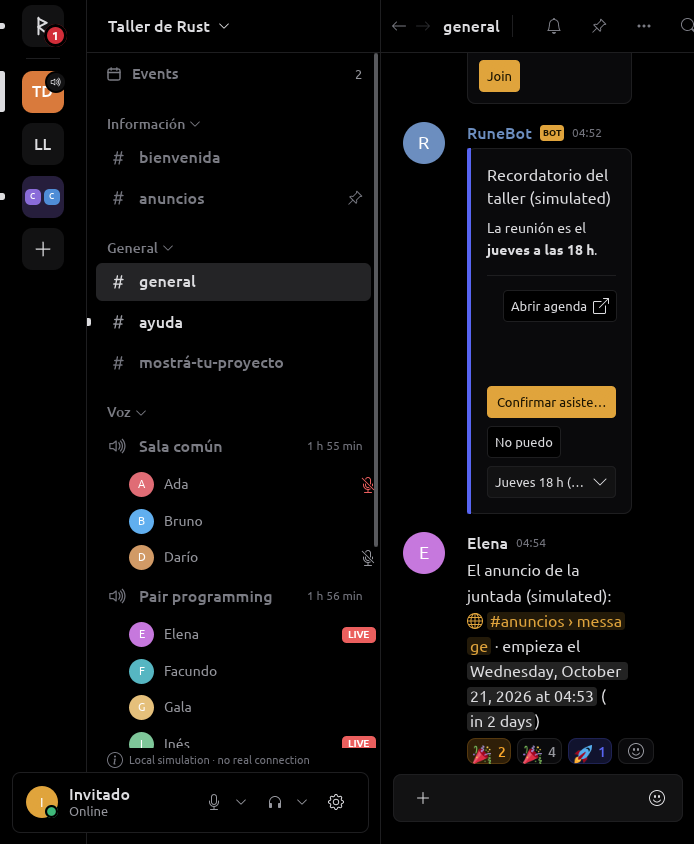
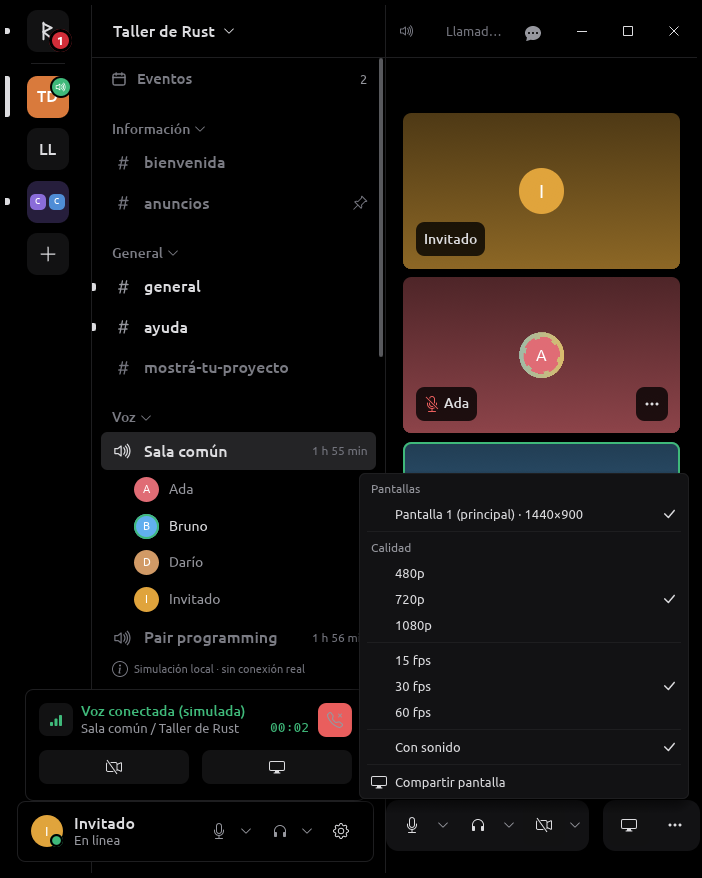
