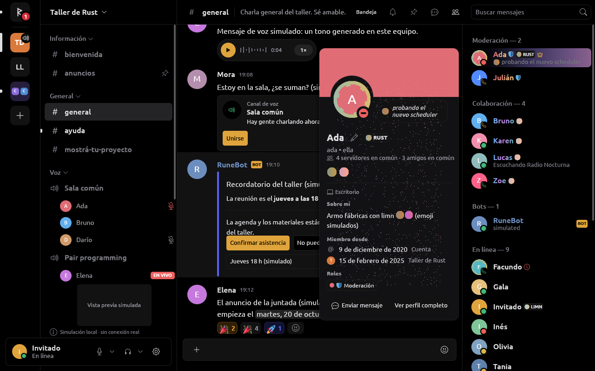
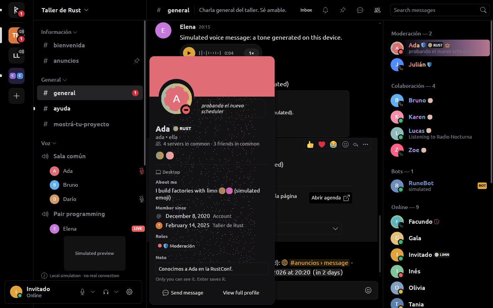
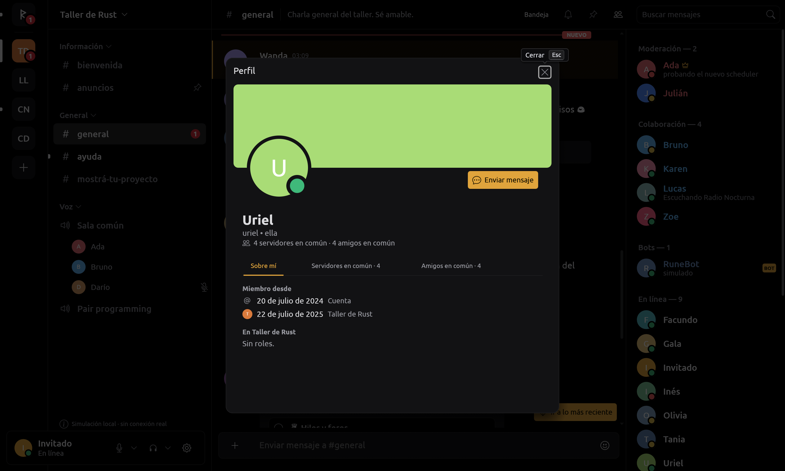
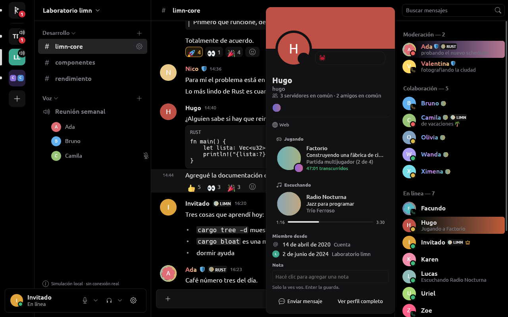
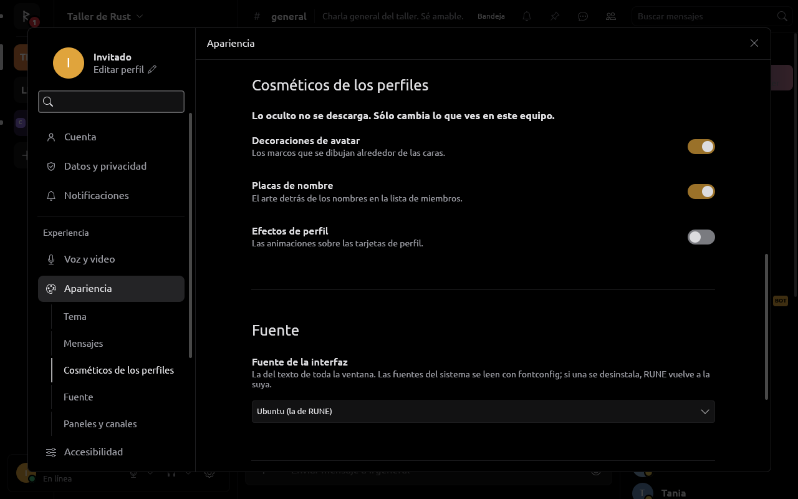
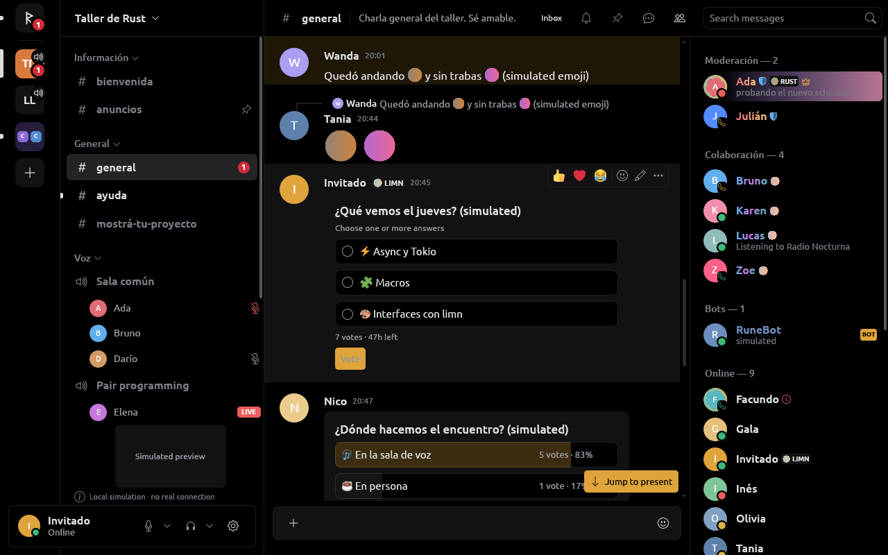
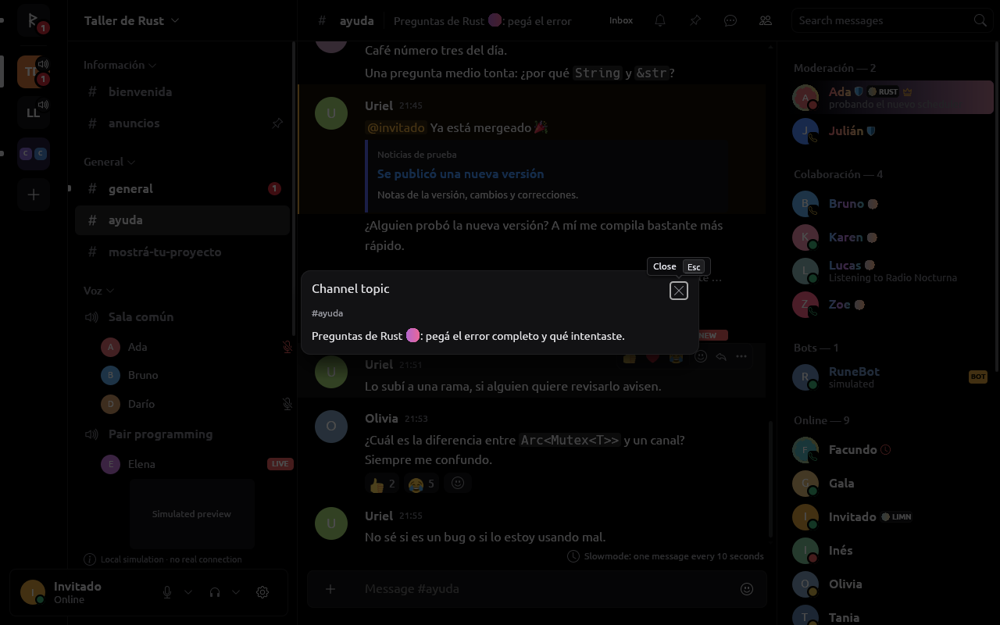
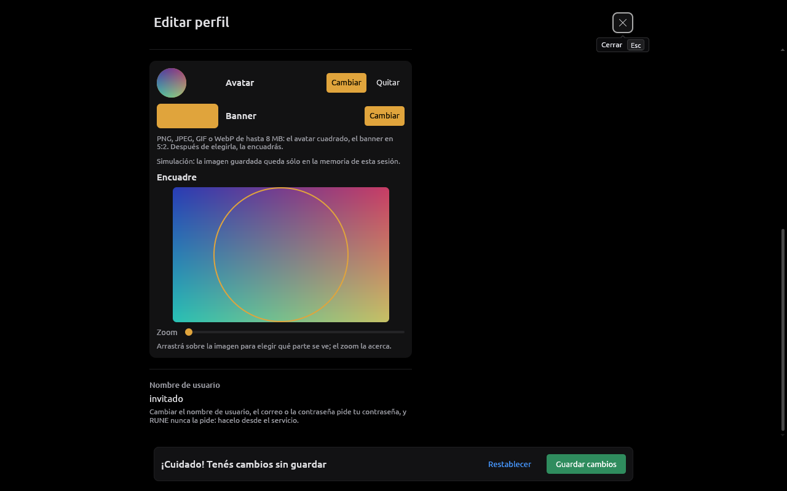
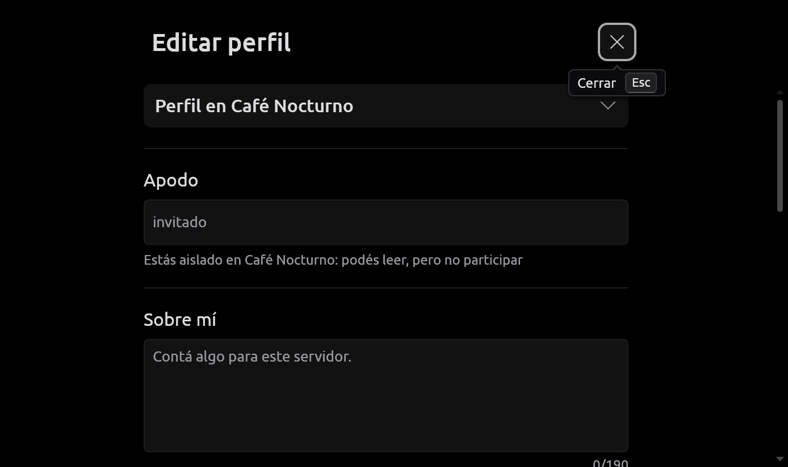

# Perfiles

RUNE muestra los perfiles que da el proveedor (tarjeta, perfil completo,
lista de miembros) y permite editarlos cuando el proveedor lo declara. Todo
con limn; abrir una pantalla no envía cambios. `rune-components::profile`
recibe datos e imágenes decodificadas: no conoce URLs del servicio ni
credenciales. El proveedor no oficial lee y edita por las rutas que usa
Serein y el cliente oficial (REA); detalle de rutas y ritmo en
[DISCORD_SESSION.md](DISCORD_SESSION.md). **Sólo fixtures y simulación:
nada se probó contra Discord.**

## Datos

- `rune-model::User`: ID, usuario, nombre para mostrar, avatar, banner,
  color, pronombres, descripción e `Identity` (marcas, abajo). Presencia,
  estado, actividades y roles vienen del estado ya cargado.
- `User.banner` distingue `ProfileBanner::{Unknown, Absent, Image}`: un
  objeto que omite el campo no acredita su ausencia; un `null` explícito
  sí. Las actualizaciones parciales se combinan con lo conocido; las filas
  viejas de SQLite leen `Unknown` (`#[serde(default)]`).
- `Command::LoadProfile { request, user, server }` pide lo que un perfil
  agrega (`UserProfile`): creación de la cuenta, servidores y amigos en
  común, biografía, pronombres, banner y color de la cuenta, y para el
  servidor pedido apodo, biografía, pronombres, banner y fecha de ingreso;
  además insignias, conexiones y efecto. Todo opcional: `None` es «no
  informado» («No disponible»); una lista vacía, «Ninguno en común». El
  `Store` sólo acepta la respuesta de la lectura en curso, para esa persona
  y ese alcance (`UserProfile::answers`). Hasta 32 perfiles en memoria; uno
  vale un minuto (`PROFILE_FRESH`, como el cliente oficial): al reabrir se
  muestra al instante y se vuelve a pedir.
- La tarjeta prefiere lo del servidor, luego el perfil, luego lo que vino
  con la cuenta. Un perfil que no cargó no rompe la tarjeta.
- **Banner**: se pide sólo al abrir un perfil o una tarjeta, nunca por ver
  mensajes o miembros; si no llegó con la identidad, se toma del perfil
  completo. `ImageKind::Banner` tiene su presupuesto: 1 MiB de entrada,
  2048 px por lado, 2 Mpx, normalizado fuera del hilo de UI a un PNG de
  hasta 512×256; un GIF usa su primer cuadro (sin banners animados).
- **Avatar por servidor**: `Member.avatar`; `Store::avatar_in(servidor,
  persona)` lo prefiere en mensajes, lista, tarjeta y perfil completo.

## Restricciones

`Member` lleva `restrictions` (aislamiento hasta, verificación pendiente,
cuarentena automática, cuarentena por etiqueta de servidor) y `joined`, con
`#[serde(default)]`. Mientras duran, `Store::abilities` y
`Store::server_abilities` niegan escribir, reaccionar, votar, editar,
adjuntar, stickers, voz y moderación, con motivo; leer y borrar un mensaje
propio siguen. Al vencer se levantan solas (`restriction_expires` agenda el
repintado). Tarjeta y lista muestran la restricción del servidor donde se
ve a la persona; el compositor dice hasta cuándo. Un campo ausente
conserva el valor y un `null` lo levanta (`communication_disabled_until`).

## Tarjeta

- 300 px (`profile::WIDTH`), como el popout oficial; a 16 px de la fila en
  la lista de miembros, 8 px del nombre de un autor. Nunca más alta que la
  ventana: el cuerpo se desplaza entre la cabecera y los botones.
- Tras el primer layout toma el lugar de su fila y flota ahí
  (`Profiles::member_at`, `author_at`), aunque una lista muy activa mueva
  o quite la fila. La rueda de la persona sobre la lista o la conversación,
  fuera de la tarjeta, la cierra; los reordenamientos solos no.
- Nombre, `usuario • pronombres`, lo que se comparte («4 servidores en
  común · 4 amigos en común»), la nota como ícono junto al nombre (abre el
  perfil completo, donde está el campo; la propia conserva el campo),
  «Miembro desde» por alcance, roles como chips con el punto en su color
  (`Element::wrap`), biografía en tres líneas con «Ver biografía completa».
  Una nota que no cargó dice «No se pudo cargar la nota.» y se pide otra
  vez al reabrir.
- La tarjeta que se ve suscribe a su persona (`Command::WatchPeople`, op 37
  `members`, como el popout oficial), así tiene presencia también en un
  servidor grande. Desde la columna de voz, pide perfil (en el servidor del
  canal), nota e imágenes.

## Perfil completo

600 px de ancho, banner de 150 px, avatar de 104 px con anillo de estado,
«Enviar mensaje» junto al avatar y pestañas «Sobre mí / Servidores en común
/ Amigos en común» (con la cantidad cuando se conoce). Las imágenes se
piden sólo para la pestaña visible. Distingue «No disponible en esta
conexión.», «Cargando…» y «Ninguno en común.». Abrir otro perfil vuelve a
«Sobre mí».

## Lista de miembros

Con el proveedor no oficial, la lista del panel derecho usa el orden y las
cuentas del proveedor (`MemberList`: roles separados, «En línea»,
«Desconectados»), por suscripción del Gateway, con filas de espera para
quien no llegó todavía; la UI pide las filas visibles tras cada layout y
deja de pedirlas al ocultar el panel. Sin lista del proveedor (simulación)
se agrupa con lo conocido. Hasta 50 000 filas: la lista medida de limn
calcula claves de todas las filas en cada layout.

## Presencia rica e identidad visual

Paridad con Serein, con interfaz propia; contrato en
`rune-model/src/identity.rs`.

- **Actividades.** `Presence.activities` (hasta 4; `Presence::activity()`
  es la de las listas) con segunda línea, imagen grande y chica, inicio y
  fin, y `Presence.platforms`. Una tarjeta por actividad («Jugando»,
  «Escuchando», «Viendo», «Transmitiendo», «Compitiendo»), con tiempo
  transcurrido o restante y, en un tema, una barra; el host repinta cada
  segundo mientras se ve (`rune_ui::activity_tick`). Las imágenes `mp:` se
  piden a 160 px (como el oficial); sin imagen grande, la chica pasa a
  grande; sin imágenes, el ícono de la aplicación
  (`/applications/{id}/public`). Las portadas `spotify:`, `twitch:` y
  `youtube:` vienen de sus hosts exactos
  ([SECURITY.md](SECURITY.md#portadas-de-spotify-twitch-y-youtube)).
  Debajo del nombre, desde dónde está conectada la persona; en la lista,
  quien sólo está en el teléfono lleva un teléfono en lugar del punto.
- **Marcas** (`Identity`, en `User` y en `Member`; las del miembro pisan,
  `Store::identity_in`): la decoración sobre el avatar (la cara se achica
  un sexto para que nada se mueva), la etiqueta de servidor tras el nombre
  y el nameplate detrás de la fila de la lista (se lee por su sku).
- **Roles** (`RoleStyle`): el rol más alto con ícono o emoji
  (`Store::role_mark`) junto al nombre; con «colores de rol», el nombre en
  el degradé del rol más alto (`Element::foreground_gradient` de limn).
- **Insignias y conexiones** (hasta 16): insignias bajo el nombre con su
  significado como ayuda; «Conexiones» en el perfil completo con un glifo
  propio de RUNE por servicio (nunca recursos copiados), marca de
  verificada y botón para abrir su página.
- **Efectos** (`UserProfile.effect`): capas sobre la tarjeta y el perfil
  completo, cada una al ancho de la tarjeta con su forma y en su tiempo
  (`start`, `duration`, `loop`, `loopDelay`), nada hasta que llegaron
  todas; bajan al 35 % mientras el puntero está sobre la tarjeta
  (`Element::dim_on_hover`).
- **Animación.** Decoraciones y nameplates animados se muestran bajo el
  puntero (fila de la lista, fila de un mensaje, mosaico de voz) o con la
  tarjeta de esa persona abierta; la fila bajo el puntero la dice limn
  (`msg:{id}:row`, `UiTree::hovered_region`). Con movimiento reducido nada
  se mueve (efectos con su imagen quieta, `reducedMotionSrc`).
- **Cosméticos ocultos**: Ajustes › Apariencia › «Cosméticos de los
  perfiles» (decoraciones, nameplates, efectos). Lo oculto no se pide al
  CDN, y con los efectos ocultos tampoco a la API
  (`LoadProfile { effect: false }`, como Serein).

## Emoji en línea

Los emoji de servidor se dibujan donde el texto los nombra, con
`TextSpan::image` de limn (medida de 1,375 veces la letra, sin partirse, con
`:nombre:` como lo que se copia y se lee). Tamaños del cliente oficial
(REA):

| Dónde | Cómo se ve |
| --- | --- |
| Mensajes y texto de tarjetas | 1,375 veces la letra (22 px a 16 px), animado si se mueve, `:nombre:` mientras carga o si falla |
| Mensaje que es sólo emoji (hasta 30) | 48 px; en modo compacto, el tamaño de la línea |
| Respuesta citada | 1,25 veces los 14 px de su línea; el extracto no corta un token |
| «Sobre mí» | Markdown con sus saltos de línea y los emoji animados (`UserProfile.pictures`) |
| Estado personalizado | el emoji del servidor antes del texto, 16 px (32 px solo) |
| Tema del canal | en el encabezado, en su línea; en «Tema del canal», con Markdown (`Channel.topic_pictures`) |

No se dibujan en nombres de canales (Discord tampoco), extractos de
búsqueda y bandeja (texto plano), fijados, la línea de estado de la lista
ni el texto de un reenvío. Los caracteres que ninguna fuente de RUNE tiene
(hangul, kana, «ㅤ») salen de una fuente del sistema
([FONTS.md](FONTS.md)).

## Edición

Con `edit_profile`, el editor mantiene borrador, vista previa (la misma
tarjeta), validación de longitudes, restablecimiento y confirmación por
eventos del proveedor; cerrar con cambios pendientes insiste. Sin la
capacidad, la página dice «Tu perfil» y muestra los valores sin controles
deshabilitados. Con 560 px o más usa la barra de cambios sin guardar de los
ajustes. Acciones tardías se ignoran si la capacidad ya no existe.

- **Qué se edita**: nombre para mostrar, pronombres, descripción, color,
  **avatar** y **banner** (`profile_images`) y el **perfil de cada
  servidor** (`server_profiles`: apodo, avatar, banner y «Sobre mí»), con
  `Command::EditProfile` y `Command::EditServerProfile { server, edit }`.
  La respuesta (`MemberChanged`, `Event::ProfileChanged`) reemplaza lo
  cargado de ese alcance. El selector «Perfil principal» / «Perfil en
  <servidor>» cambia de alcance si no hay cambios sin guardar. Sin
  `server_profiles`, abre el diálogo de apodo del servidor.
- **Qué se puede**: `Store::profile_abilities(servidor)` da un `Permit` para
  texto, imágenes, banner, animación, apodo y credenciales, con el motivo:
  sin capacidad, servidor que ya no está, restricción vigente, falta de
  `CHANGE_NICKNAME` o plan. **Usuario, correo y contraseña** nunca: el
  servicio pide la contraseña y RUNE no la pide; el editor lo dice.
- **Plan**: `Perks` suma `animated_avatar`, `profile_banner` y
  `server_profiles`, que la sesión no oficial saca de `premium_type` como
  el catálogo del cliente oficial (Nitro Classic: avatar animado; Nitro:
  los tres; Basic: ninguno). Lo que el plan niega se dice («Necesitás Nitro
  para…») y no se manda; si el plan no se conoce, responde el servicio.
- **Imágenes**: «Cambiar» abre el selector de archivos del sistema;
  `rune-core::profile_images` lee hasta 8 MB, decodifica con los límites de
  los íconos (8192 px, 128 MiB) y recorta a 512×512 (avatar) o 960×384
  (banner 5:2) en PNG, o GIF si se mueve; si pasa de 1 MiB prueba tamaños
  menores. Nada sale hasta «Guardar»; cerrar el editor cancela la elección.
- **Encuadre**: el editor muestra la imagen entera chica (480 px,
  `PictureSource`) con el recuadro de lo que queda (redondo en el avatar);
  se mueve arrastrando o con las flechas (`area_slider` de limn) y «Zoom»
  acerca hasta 4×. Al soltar, `Intent::FrameProfileImage` hace recortar de
  nuevo el archivo en un hilo de servicio (`ProfileImages::frame`); la
  geometría es una sola, `Crop::frame`. Un encuadre más nuevo descarta el
  que está en camino; guardar espera a que llegue. El archivo elegido queda
  en memoria hasta la próxima elección, para poder encuadrarlo otra vez.
- **Animadas**: un GIF o WebP de al menos dos cuadros (lienzo de hasta
  4 MP) se sube como GIF con el mismo encuadre en cada cuadro (hasta 1000
  cuadros, 20 s por tamaño y 8 MiB). El GIF se hace siempre de nuevo: del
  archivo no sale nada más que sus cuadros (ni comentarios ni extensiones).
  La sesión manda `data:image/gif;base64,…`, como el cliente oficial. Si el
  plan o los límites no dejan, se usa el primer cuadro y el editor dice
  por qué. La vista previa muestra el primer cuadro.
- **Simulación**: acepta todo con las mismas validaciones, guarda las
  imágenes en memoria y las sirve por `Provider::hosted_image` (sin red,
  tope de 8 MiB), y lo dice en el editor. No tiene avatar animado en el
  perfil principal, para que se vea el aviso de plan.

## Interfaces públicas de Discord

El objeto User documentado trae `global_name`, `avatar`, `banner`,
`accent_color` e indicadores, no biografía ni pronombres; `identify` sólo
lee. `Modify Current User` no es una concesión OAuth2 para editar una
cuenta personal, así que el proveedor OAuth2 no declara `edit_profile`.
El banner se pide en PNG de 512 desde `banners/{user_id}/{hash}`
([Image Formatting](https://docs.discord.com/developers/reference#image-formatting)).

## Límites

- Marcos de perfil (collectibles de tipo 3): su composición desborda la
  tarjeta y necesita medidas por capa y fixtures reales. Tampoco hay
  estilos de nombre (fuente, efecto) ni banners animados.
- La tarjeta de voz sigue a su fila.
- La vista previa del editor no anima un GIF elegido; una animación de más
  de 4 MP de lienzo se encuadra quieta.
