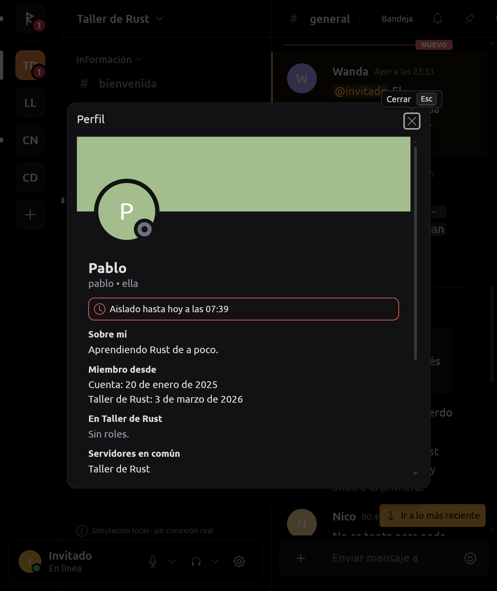
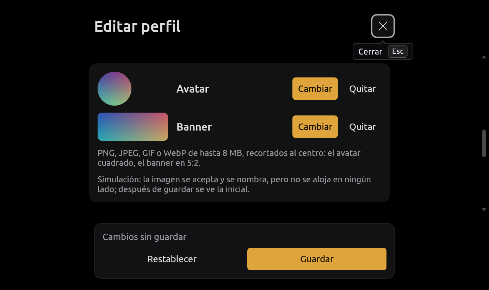
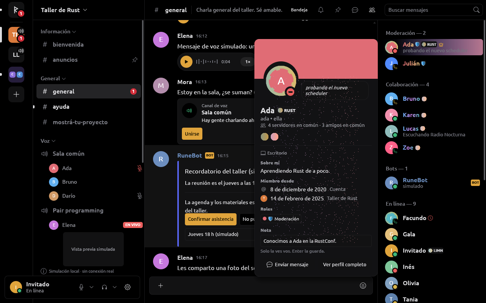
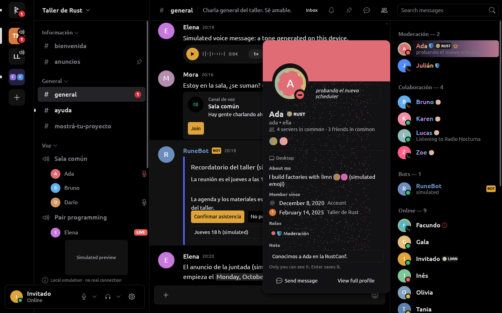
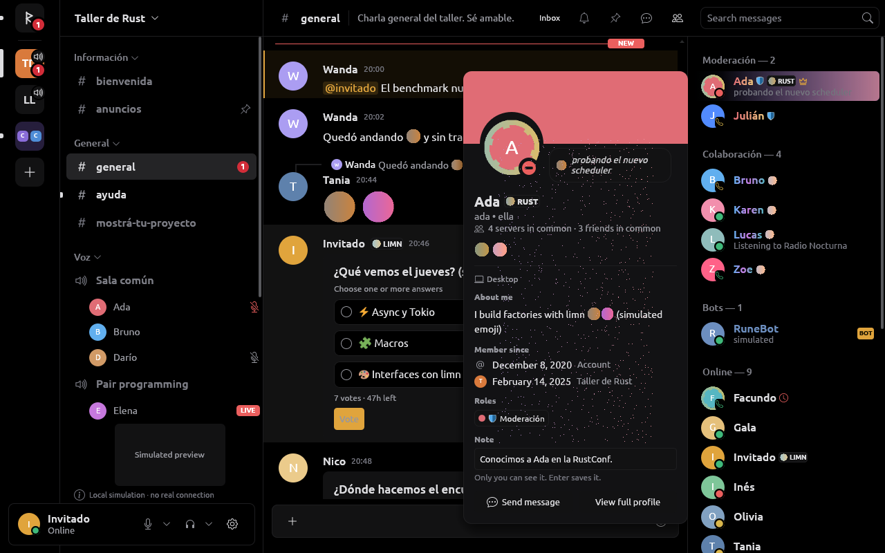

# Perfiles

RUNE muestra los datos de perfil recibidos por el proveedor y permite editarlos
cuando `Capabilities::edit_profile` está habilitada. Esta pantalla está construida
con limn; abrirla no consulta endpoints de perfil ni envía cambios por sí mismo.

## Estado actual

El contrato de `rune-model::User` contiene ID, nombre de usuario, nombre para
mostrar, avatar, banner, color, pronombres y descripción. Presencia, estado personalizado,
actividad y roles se obtienen del estado ya cargado, cuando están disponibles.
`rune-components::profile::Profile` recibe esos datos y las imágenes decodificadas;
no conoce URLs de servicio ni credenciales.

- El avatar de la sección de cuenta y el de la tarjeta usan la misma imagen.
  Antes, la sección de cuenta dibujaba siempre la inicial aunque la tarjeta ya
  tuviera el avatar remoto.
- La página distribuye formulario y tarjeta en dos columnas cuando hay espacio;
  en ventanas pequeñas los apila. Todo el contenido comparte un scroll. El cierre
  y las acciones de guardado ocupan espacio propio fuera de ese scroll.
- Si el proveedor no admite edición, la página dice «Tu perfil», presenta los
  valores disponibles y omite campos, contadores y selectores deshabilitados.
  Los campos opcionales ausentes dicen «No disponible»: la ausencia local no
  demuestra que el usuario haya dejado ese dato vacío en el servicio.
- Si admite edición, mantiene borrador, vista previa, validación de longitudes,
  restablecimiento y confirmación de cambios por eventos del proveedor. Cerrar
  con cambios pendientes conserva la protección existente.
- Las acciones de edición tardías se ignoran cuando la capacidad ya no existe.
  Un borrador anterior tampoco se muestra como perfil confirmado en modo de
  sólo lectura ni impide salir de ese modo.

El proveedor simulado admite `Command::EditProfile` para nombre para mostrar,
pronombres, descripción y color. Desde el 2026-10-17 también avatar y banner,
y el perfil de cada servidor; la sesión no oficial declara las tres
capacidades (ver [Edición con imágenes](#edición-con-imágenes-y-perfil-por-servidor-2026-10-17)).
OAuth2 no edita.

## Banners recibidos y datos parciales

`User.banner` distingue `ProfileBanner::{Unknown, Absent, Image}`. Un objeto que
omite el campo no acredita su ausencia; un `null` explícito sí. Los adaptadores
conservan esta diferencia y el estado combina las actualizaciones parciales con
el banner ya conocido. Un borrado explícito o una imagen nueva reemplazan el
valor anterior. La instantánea de arranque aplica el mismo criterio al combinar
fragmentos de una cuenta; cerrar sesión limpia los datos, sin heredarlos en la
cuenta siguiente. Las filas SQLite antiguas usan `Unknown` mediante
`#[serde(default)]`, sin cambiar tablas.

Los adaptadores aprovechan únicamente el hash que venga en el objeto de usuario
ya recibido. Construyen el recurso público PNG de tamaño 512 documentado por
Discord, después de validar el hash. No hay consulta adicional de perfil ni se
supone que una cuenta sin ese campo carezca de banner. El proveedor OAuth2
permite ese origen CDN en su servicio de imágenes sin cabeceras de cuenta.

La UI solicita el banner al abrir el perfil propio, una tarjeta de miembro o
una tarjeta de autor. Ver mensajes o miembros no descarga sus banners. Cerrar
la tarjeta retira la solicitud activa; la caché sigue su límite y política de
cancelación existentes. Si los píxeles aún no llegaron, fallaron o el banner
fue eliminado, se conserva el fondo de color sin mensajes ni controles ficticios.

`ImageKind::Banner` separa el presupuesto de decodificación del avatar cuadrado:
1 MiB de entrada, lados de hasta 2048 px y área de hasta 2 megapíxeles. Se
normaliza fuera del hilo UI a un PNG de como máximo 512×256, conservando aspecto,
sin ampliar imágenes pequeñas ni añadir márgenes. Banner y adjuntos comparten
las dos plazas de descarga/decodificación de imágenes grandes. La presentación
limn usa `cover` dentro del encabezado fijo de 105 px; ese recorte visual no
modifica la imagen almacenada ni desplaza las acciones. GIF usa sólo su primer
cuadro; no se anuncia animación.

## Restricciones y perfil por demanda (2026-10-16)

`Member` lleva `restrictions` (timeout hasta, verificación pendiente,
cuarentena automática) y `joined`, ambos con `#[serde(default)]`. El estado
lee las restricciones con su reloj: mientras duran, `Store::abilities` y
`Store::server_abilities` niegan escribir, escribir-aviso, reaccionar, votar,
editar, adjuntar, stickers, voz y moderación, con motivo; leer y borrar un
mensaje propio siguen. Al vencer se levantan solas; `restriction_expires`
agenda el repintado. Tarjeta y lista de miembros muestran la restricción del
servidor donde se ve a la persona; el compositor dice hasta cuándo y cuánto
falta.

`Command::LoadProfile { request, user, server }` pide lo que un perfil agrega
(`UserProfile`: creación de la cuenta, servidores y amigos en común). El
`Store` sólo acepta la respuesta de la lectura en curso, para esa persona y
ese alcance (`UserProfile::answers`); una respuesta vieja o de otro alcance no
cambia nada. `None` significa «no informado» y se muestra «No disponible»;
una lista vacía, «Ninguno en común». Se guardan hasta 32 perfiles en memoria.
La simulación responde con datos simulados. El adaptador no oficial consulta
desde el 2026-10-16 el perfil completo (ver abajo).

Ideas tomadas de `references/serein-current` (sólo lectura, sin copiar):
`discord-protocol/src/permissions.rs` distingue campo ausente, `null` y valor
para `communication_disabled_until` (aquí: ausente conserva, `null` levanta);
`discord-protocol/src/profile.rs` acota listas en común; `client-core/src/profile.rs`
valida que la respuesta sea de la persona y servidor pedidos y guarda pocos
perfiles recientes en RAM. Serein consulta un endpoint de perfil no
documentado; RUNE no lo agrega.

## Perfil completo y lista del servidor (2026-10-16)

`UserProfile` suma biografía, pronombres, banner y color de la cuenta, y,
para el servidor pedido, apodo, biografía, pronombres, banner y fecha de
ingreso. Todos son opcionales: `None`/`ProfileBanner::Unknown` es «no
informado». La tarjeta prefiere lo del servidor, luego el perfil, luego lo
que vino con la cuenta; pide el banner que vaya a mostrar. Un perfil que no
cargó no rompe la tarjeta: muestra lo conocido y «No disponible», sin toast.

El adaptador no oficial lee el perfil por la ruta no documentada que usa
Serein y la lista de miembros por suscripción de Gateway; detalles, límites
y ritmo en [DISCORD_SESSION.md](DISCORD_SESSION.md#perfil-completo-y-lista-de-miembros-2026-10-16).
La lista del panel derecho usa entonces el orden y las cuentas del
proveedor (`MemberList`: roles separados, «En línea», «Desconectados»), con
filas de espera para quien todavía no llegó; la UI pide las filas visibles
tras cada layout y deja de pedirlas al ocultar el panel. Sin lista del
proveedor (simulación), se agrupa como antes con lo conocido. Se muestran
hasta 50 000 filas: la lista medida de limn calcula claves de todas las
filas en cada layout.

Todo esto está probado con fixtures locales; nada se probó contra Discord.

Tomado de `references/serein-current` (lectura, sin copiar código):
parámetros de la ruta y no pedir datos en común del propio perfil;
precedencia `user_profile` sobre `user` y del perfil de servidor sobre el
del miembro; validación de persona y servidor de la respuesta; límite de
256 KiB; op 37 con su secuencia abrir/rangos/salir; páginas de 100 y dos
páginas adyacentes; nombre de lista `everyone`/MurmurHash3 y adopción del
nombre del primer `SYNC`; operaciones sobre copia, huecos para elementos
ilegibles y presencia sólo para filas cargadas; desde el 2026-10-17, el
reintento por silencio (15, 30, 60 y 120 s sin `SYNC`, ver
[DISCORD_SESSION.md](DISCORD_SESSION.md#perfil-completo-y-lista-de-miembros-2026-10-16)).
No se tomaron entonces: caché con TTL ni precarga al pasar el mouse;
insignias, conexiones y decoraciones llegaron con P5 (ver
[Presencia rica e identidad visual](#presencia-rica-e-identidad-visual-2026-10-17-p5)).

## Presentación v2 (2026-10-16)

Tarjeta, perfil completo y editor se acercan a Discord sin datos nuevos:

- Tarjeta: nombre, `usuario • pronombres` y, debajo, lo que se comparte
  («4 servidores en común · 4 amigos en común»). Una línea separa la
  identidad de las secciones, con títulos chicos en gris. «Miembro desde»
  muestra una fila por alcance: marca (`@` para la cuenta, el ícono o la
  inicial del servidor), fecha y alcance. Los roles son chips neutros con
  el punto en el color del rol, en tantas líneas como hagan falta
  (`Element::wrap` de limn; antes se estimaba el ancho).
- Perfil completo: 600 px de ancho y alto fijo, encabezado más grande
  (banner de 150 px, avatar de 104 px con anillo de estado), «Enviar
  mensaje» junto al avatar, y pestañas subrayadas «Sobre mí / Servidores en
  común / Amigos en común». Las de listas suman la cantidad cuando se
  conoce («· 4»). Cada fila de servidor o amigo lleva su ícono, avatar o
  inicial; las imágenes se piden sólo para la pestaña visible. Se conserva
  la diferencia «No disponible en esta conexión.» (no informado),
  «Cargando…» y «Ninguno en común.» (lista vacía). Abrir otro perfil vuelve
  a «Sobre mí».
- Editor: líneas entre campos y, cuando el contenido mide 560 px o más, la
  barra de cambios sin guardar de una fila de los ajustes («¡Cuidado!…»,
  «Restablecer», «Guardar cambios»); más angosto conserva la barra apilada.
  La vista previa es la misma tarjeta. Sin cambios de capacidades: el
  proveedor simulado sigue siendo el único que edita.

Entonces no había insignias (llegaron con P5). Captura con la simulación:

## Edición con imágenes y perfil por servidor (2026-10-17)

El editor cambia, además del texto y el color, el **avatar** y el **banner**,
y edita el **perfil de cada servidor**: apodo, avatar, banner y «Sobre mí» de
ese servidor. Paridad con Serein (nombre global, biografía, pronombres, color
y avatar) más lo que el cliente oficial permite por sus rutas.

- **Imágenes.** «Cambiar» abre el selector de archivos del sistema (el mismo
  servicio de `rune-platform` que los adjuntos y el ícono de grupo, por el
  actor de `rune-core`); «Quitar» la saca. `rune-core::profile_images` lee
  hasta 8 MB, decodifica con los límites de los íconos de grupo (8192 px,
  128 MiB), la recorta a 512×512 (avatar) o 960×384 (banner 5:2) donde la
  persona la encuadra (al centro hasta que la mueve; desde el 2026-10-18,
  ver [Encuadre, animadas y plan](#encuadre-imágenes-animadas-y-plan-2026-10-18-rama-edicion-de-perfil))
  y la hace PNG, o GIF si se mueve; si pasa de 1 MiB prueba tamaños menores. Devuelve el PNG
  (`ProfileImage`, sin bytes en `Debug`) y su vista previa; la UI la muestra
  en la fila y en la tarjeta de vista previa, y la desplaza a la vista. Nada
  sale hasta «Guardar». Una imagen que no sirve se avisa; cancelar el
  selector no cambia nada; cerrar el editor cancela la elección en curso.
- **Perfil por servidor.** El selector de arriba («Perfil principal» /
  «Perfil en <servidor>») cambia de alcance si no hay cambios sin guardar
  (si los hay, insiste como al salir). Al entrar a un servidor se lee su
  perfil (`LoadProfile` con ese servidor) para mostrar su «Sobre mí» y su
  banner. Guarda con `Command::EditServerProfile { server, edit }`; la
  respuesta es `MemberChanged` (apodo y avatar) y `Event::ProfileChanged`, que
  reemplaza lo cargado de ese alcance en el `Store` (`Applied::ProfileSaved`).
  Sin `server_profiles`, el selector sigue abriendo el diálogo de apodo del
  menú del servidor, como antes.
- **Qué se puede.** `Store::profile_abilities(servidor)` devuelve un
  `Permit` para texto, imágenes, apodo y credenciales, con el motivo:
  proveedor sin la capacidad (`edit_profile`, `profile_images`,
  `server_profiles`), servidor que ya no está, restricción vigente (aislado,
  verificación pendiente, cuarentena) o falta de `CHANGE_NICKNAME`. Los
  controles se deshabilitan con ese motivo. **Usuario, correo y contraseña**
  nunca: el servicio pide la contraseña y RUNE no la pide; el editor lo dice
  junto al nombre de usuario.
- **Simulación.** Acepta imágenes y perfil por servidor con las mismas
  validaciones (largos, restricción, permiso de apodo) y responde con
  `ProfileChanged`; nombra la imagen con una URL `simulacion.invalid` y,
  desde el 2026-10-18, la guarda en memoria y la sirve (ver
  [Encuadre, animadas y plan](#encuadre-imágenes-animadas-y-plan-2026-10-18-rama-edicion-de-perfil)),
  así que después de guardar se ve. Las capturas eligen una imagen generada
  en el proceso, sin abrir el selector.

**Avatar por servidor.** `Member.avatar` (`#[serde(default)]`) es la imagen
que alguien muestra en un servidor; `Store::avatar_in(servidor, persona)` la
prefiere a la de la cuenta. La usan los mensajes (autor y respuesta citada),
la lista de miembros, la tarjeta y el perfil completo, y las imágenes
pedidas tras cada layout.

**Cuarentena por etiqueta de servidor.** `MemberRestrictions.tag_quarantined`
(`#[serde(default)]`) y `Restriction::TagQuarantined`: restringe como la otra
cuarentena, con su propio motivo («La moderación automática de X bloqueó la
etiqueta de servidor que mostrás: cambiala o dejá de mostrarla para
participar»); la tarjeta dice «Retenido por la moderación automática por su
etiqueta de servidor». La simulación retiene así a una persona de Taller de
Rust.

Pruebas: `rune-provider` (imagen acotada, simulación de imágenes y perfil
por servidor), `rune-state` (`tests/profile_edit.rs`: habilidades, perfil
guardado por alcance, avatar por servidor, cuarentena por etiqueta),
`rune-core` (recorte y tamaño), `rune-ui` (`tests/profile.rs`: elegir,
previsualizar, guardar, quitar, cancelar, alcance de servidor y restricción)
y la sesión no oficial (rutas en loopback). Nada se probó contra Discord.

## Presencia rica e identidad visual (2026-10-17, P5)

Paridad con Serein ([P5](../tasks/serein-parity.md)): lo que hace Serein,
con interfaz propia. Contrato en `rune-model/src/identity.rs`; detalle de
la sesión no oficial en
[DISCORD_SESSION.md](DISCORD_SESSION.md#presencia-rica-identidad-visual-y-expresiones-2026-10-17-rama-presencia-e-identidad).

- **Actividades.** `Presence.activities` (hasta 4, `#[serde(default)]`;
  `Presence::activity()` es la primera, la de las listas) con segunda
  línea, imagen grande y chica, inicio y fin, y `Presence.platforms`. La
  tarjeta y el perfil completo muestran una tarjeta por actividad
  («Jugando», «Escuchando», «Viendo», «Transmitiendo», «Compitiendo» con
  su glifo), «48:40 transcurridos» o «2:15 restantes», y en un tema
  («Escuchando» con inicio y fin) una barra con el tiempo y la duración;
  el host repinta cada segundo mientras se ve (`rune_ui::activity_tick`).
  Debajo del nombre, desde dónde está conectada la persona (escritorio,
  móvil, web). En la lista, quien sólo está en el teléfono lleva un
  teléfono en lugar del punto.
- **Marcas** (`Identity`, en `User` y en `Member`, ambos
  `#[serde(default)]`; las del miembro pisan las de la cuenta,
  `Store::identity_in`). La decoración se dibuja sobre el avatar en
  mensajes, lista, tarjeta y perfil completo; la cara se achica un sexto
  dentro del mismo lugar para que nada se mueva. La etiqueta de servidor
  (insignia y letras) sigue al nombre en mensajes, lista y tarjeta. El
  nameplate (sus colores y su imagen) va detrás de la fila de la lista.
- **Roles** (`RoleStyle`, `#[serde(default)]`). El rol más alto con ícono
  o emoji (`Store::role_mark`) lo muestra junto al nombre en mensajes y
  lista; las fichas de roles de la tarjeta, el de cada uno. Con «colores de
  rol» encendidos, el nombre se pinta en el degradé del rol más alto con
  color (`Element::foreground_gradient`, agregado a limn en la PR #75).
  Editar íconos y degradés de rol queda para la administración (P7).
- **Insignias y conexiones** (`UserProfile.badges` y `connections`, hasta
  16). Las insignias van bajo el nombre con lo que significan como ayuda;
  las que tienen enlace se abren con un clic. El perfil completo suma
  «Conexiones»: el servicio con un glifo propio de RUNE (GitHub, un globo
  para un dominio, una nota para Spotify, el mando de Bootstrap Icons
  (`Icon::Gamepad` de limn) para juegos, el de enlace para el resto, nunca
  recursos copiados), el nombre, una
  marca si está verificada y el botón para abrir su página.
- **Efectos** (`UserProfile.effect`). Capas sobre la tarjeta y el perfil
  completo, cada una al ancho de la tarjeta con su forma y en su tiempo,
  sin ocupar lugar ni tomar clics; con movimiento reducido
  (`Ui::reduced_motion`), su imagen quieta (corregido el 2026-10-17, ver
  [la prueba con una cuenta real](#primera-prueba-con-una-cuenta-real-2026-10-17-rama-perfil-real)).
- **Animación.** La decoración y el efecto del perfil que se ve se animan
  con el presupuesto existente (`playable_images`; ahora también APNG) y
  nunca con movimiento reducido. Las decoraciones de la lista y de los
  mensajes quedan quietas.
- **Simulación.** Ada lleva decoración, nameplate, etiqueta, dos
  insignias, GitHub y un dominio, y un efecto de chispas; Hugo juega a
  Factorio y escucha un tema; Camila e Invitado muestran la etiqueta de
  Laboratorio limn; «Moderación» tiene 🛡️ y un degradé, «Colaboración» una
  imagen y tres colores. Las imágenes son de `simulacion.invalid` (nadie
  las aloja) y las capturas las dibujan ellas mismas.

**Falta:** los **marcos de perfil** (collectibles de tipo 3): su
composición (grapas, rieles y bordes que desbordan la tarjeta) necesita
las medidas de cada capa y fixtures reales; los estilos de nombre
(fuente, efecto) que ni Serein tiene; animar decoraciones al pasar el
puntero. (La imagen de la aplicación cuando una actividad no trae la suya
se hizo el 2026-10-17, como el cliente oficial: ver
[Emoji en línea](#emoji-en-línea-2026-10-17-rama-emoji-en-linea).)

## Primera prueba con una cuenta real (2026-10-17, rama `perfil-real`)

El dueño probó la tarjeta con su cuenta de Discord (proveedor no oficial)
y encontró seis problemas. Cada uno se reprodujo con la simulación o con
fixtures y se arregló en su causa; nada de esto se probó contra Discord.
Medidas y comportamiento del cliente oficial: REA estática de su popout
([REA.md](REA.md#cliente-web-oficial-popout-de-perfil-2026-10-17)).

| Problema | Causa | Arreglo |
| --- | --- | --- |
| La tarjeta de la lista de miembros parpadea (servidor de 60 000 en línea) | Colgaba de su fila: en un servidor así la lista recibe operaciones todo el tiempo (gente que entra y sale arriba, filas que vuelven a llegar o faltan un momento) y la tarjeta seguía a la fila o desaparecía con ella. El popout oficial recalcula su lugar con cada cambio de tamaño, pero no depende de que la fila siga ahí. | Tras el primer layout se toma el lugar de la fila (`Profiles::member_at`) y la tarjeta flota sobre la lista ahí (`popover_at`), aunque la fila se mueva o falte; lo mismo la del autor de un mensaje (`author_at`), que seguía al nombre mientras llegaban mensajes. Tests que fallaban antes: `a_members_card_holds_its_place_while_a_busy_list_moves_under_it`, `an_authors_card_holds_its_place_while_new_messages_push_the_conversation_up`. |
| En la columna, la gente en voz con avatar de letra; su tarjeta sin avatar, banner, estado, «Miembro desde», y «Cargando la nota…» para siempre | `Participant` no tenía imagen; abrir la tarjeta de voz no pedía ni el perfil ni la nota, ni sus imágenes; en un servidor grande la presencia sólo llega para filas suscritas de la lista; un `VOICE_STATE_UPDATE` con `member` no daba a conocer a la persona. | Filas y mosaicos con su avatar (pedido tras cada layout); la tarjeta pide perfil (en el servidor del canal) y nota, y sus imágenes; la tarjeta que se ve suscribe a su persona (`Command::WatchPeople`, op 37 `members`, como el popout oficial); el `member` de un estado de voz se guarda antes que el estado. Una nota que no se pudo leer dice «No se pudo cargar la nota.» y se pide otra vez al reabrir. |
| La biografía muestra `<a:Nombre:id>` | El texto se mostraba tal cual. | El proveedor resuelve los emoji del texto (`UserProfile.pictures`, `emojis/{id}.webp?size=48&animated=true`) y la tarjeta los dibuja en su lugar, animados, con `:nombre:` mientras cargan. limn no tiene imágenes dentro de un texto: la línea que nombra uno fluye como palabras e imágenes (`limn-gap`, ver abajo). La tarjeta muestra tres líneas y «Ver biografía completa» abre el perfil completo, como el popout oficial. El estado personalizado conserva su emoji Unicode; los pronombres son texto plano también allá. |
| La imagen grande de la actividad no carga | `mp:` rechazaba rutas con codificación por ciento y pedía el tamaño original (más de 512 px o de 1 MiB no pasan el presupuesto de ilustraciones). | `mp:` acepta `%` y pide 160 px (`format=png`, un GIF como WebP animado), como el cliente oficial; sin imagen grande, la chica pasa a grande. Tamaños oficiales: 60 px y 24 px sobre la esquina, recortada del fondo. El «solapamiento» de la captura eran los trazos del recuadro rojo: un test comprueba que nada se pisa. |
| El efecto (hojas) más angosto que la tarjeta, cortado abajo y oscureciendo | Cada capa se encajaba (contain) en un lienzo de 450×880 con medidas que la configuración real no trae, y todas las capas se mostraban juntas y para siempre (también la intro). | Cada capa ocupa el ancho de la tarjeta con su propia forma, sobre todo, sin oscurecer; cada una en su tiempo (`start`, `duration`, `loop`, `loopDelay`; la animación vuelve a empezar al reaparecer) y nada hasta que llegaron todas. Con movimiento reducido, `reducedMotionSrc`. |
| Cuadraditos en etiquetas de servidor y nombres | Ninguna fuente de RUNE tiene esos caracteres (hangul, kana, el relleno «ㅤ» de muchos nombres). | Una fuente del sistema, buscada con fontconfig cuando el carácter aparece en pantalla ([FONTS.md](FONTS.md#fuentes-del-sistema-como-respaldo-2026-10-17)). |

Más cerca del popout oficial (REA): la biografía en tres líneas; la
actividad con sus tamaños; el efecto sobre toda la tarjeta. Se conservaban
a propósito el campo de nota, «Miembro desde» en la tarjeta (allá sólo en
el perfil completo) y el ancho de 325 px; desde el 2026-10-18 la nota es un
ícono y el ancho es 300 px, como allá ([abajo](#tarjeta-como-la-oficial-y-cosméticos-2026-10-18-rama-perfil-tarjeta-y-cosmeticos));
«Miembro desde» sigue en la tarjeta.

**Para limn** (hecho el 2026-10-17, rama `emoji-en-linea`): `TextSpan`
con una imagen en línea (`TextSpan::image` y `TextSpan::surface`), medida
como un cuadrado de 1,375 veces su tamaño de letra, sin partirse, con su
texto (`:nombre:`) como lo que se copia y se lee; el caché de texto
formateado la distingue. La biografía volvió a ser un solo texto con
Markdown (con sus saltos de línea) y sus emoji se animan; los mensajes, las
respuestas citadas y el estado personalizado muestran los emoji del
servidor como imagen. Ver [Emoji en línea](#emoji-en-línea-2026-10-17-rama-emoji-en-linea).

Falta: la tarjeta de voz sigue a su fila (cambia poco). Hechos el
2026-10-18: las portadas de Spotify, Twitch y YouTube y cerrar la tarjeta
al desplazar la lista (sólo la rueda de la persona; los ajustes de la
lista medida no son eventos).

## Tarjeta como la oficial y cosméticos (2026-10-18, rama `perfil-tarjeta-y-cosmeticos`)

Decisiones del dueño del 2026-10-18: el popout de 300 px como Discord y
las portadas de Spotify, Twitch y YouTube desde sus hosts. Sólo fixtures y
simulación; nada probado contra Discord. REA en
[REA.md](REA.md#cliente-web-oficial-portadas-nameplates-y-decoraciones-2026-10-18)
y rutas en [DISCORD_SESSION.md](DISCORD_SESSION.md#portadas-nameplates-por-sku-y-cosméticos-2026-10-18-rama-perfil-tarjeta-y-cosmeticos).

| Qué | Cómo queda |
| --- | --- |
| Ancho y lugar | 300 px (`profile::WIDTH`); a 16 px de la fila en la lista de miembros (`LIST_GAP`), 8 px del nombre de un autor |
| Alto | Nunca más que la ventana (limn acota el popover a ella menos 16 px): el cuerpo se desplaza entre la cabecera (banner, cara) y los botones, que quedan a la vista |
| Nota | Un ícono junto al nombre (con la nota como pista) que abre el perfil completo, donde está el campo; la tarjeta propia, sin perfil completo, conserva el campo |
| Efecto | Baja al 35 % con un fundido mientras el puntero está sobre la tarjeta, como el oficial (`Element::dim_on_hover` de limn, rama `rune/hover-dim`) |
| Cerrar al desplazar | La rueda o el touchpad de la persona sobre la lista de miembros (o sobre la conversación, para la tarjeta de un autor), fuera de la tarjeta, la cierra; la lista que se reordena o corrige sola no. Con la tarjeta abierta no hay otra forma de desplazarla: un clic en la barra cae en el fondo de la tarjeta, que la cierra, y el teclado queda dentro de ella |
| Decoraciones | Se animan bajo el puntero: fila de la lista, cualquier parte de la fila de un mensaje (cara, nombre, texto; una mención dentro anima al autor, no a quien nombra; una fila de sistema, nada), mosaico de voz (que ahora la dibuja); y en la tarjeta o el perfil abiertos, como antes |
| Nameplates | La animada se pide y se muestra bajo el puntero o con la tarjeta de esa fila abierta (la quieta da lugar con un fundido); se lee por su sku |
| Movimiento reducido | Nada se mueve: ni decoraciones, ni nameplates (no se usa la animada), ni efectos (la imagen quieta) |
| Cosméticos ocultos | Ajustes › Apariencia › «Cosméticos de los perfiles»: decoraciones, nameplates y efectos; lo oculto no se pide al CDN, y con los efectos ocultos tampoco el producto del efecto a la API (`LoadProfile { effect: false }`, como Serein). Un perfil leído con los efectos ocultos no tiene el suyo hasta que se vuelve a pedir, al minuto. Los marcos de perfil no tienen interruptor porque RUNE no los dibuja |
| Caché que vence | Un perfil guardado vale un minuto (`PROFILE_FRESH` en `rune-state/src/profiles.rs`, como el oficial): al reabrir la tarjeta se muestra al instante y se vuelve a pedir |
| Banner | Siempre el del perfil completo si la identidad no lo trajo; el popout propio ahora pide su perfil completo para tenerlo |
| Portadas | `spotify:`, `twitch:`, `youtube:` desde sus hosts exactos ([SECURITY.md](SECURITY.md#portadas-de-spotify-twitch-y-youtube-2026-10-18)) |

Capturas con la simulación en un Xvfb privado de 1280×800
(`--language es --channel general --action jump:latest --action member:10`;
y `--action me:settings --action click:us:page=appearance --action
click:us:jump=cosmetics --action us:cosmetic:effects`).

Quién está bajo el puntero en la conversación lo dice limn: cada fila de
mensaje es una región de hover con nombre (`msg:{id}:row`,
`Element::hover_region_id`) y `UiTree::hovered_region` informa la de más
adentro bajo el puntero, ninguna si un popover, el fondo de un diálogo o un
menú contextual la tapa (rama `rune/hover-dim` de limn, 2026-10-18; antes
RUNE lo deducía de las anclas de las filas). Una fila de la lista de
miembros cuenta sólo dentro de la lista: una mención con el mismo ID, en
otra parte, no.

## Emoji en línea (2026-10-17, rama `emoji-en-linea`)

Con las imágenes en línea de limn (PR a `Niiihuel/limn`, rama
`feat/inline-text-images`), los emoji de un servidor se dibujan donde el
texto los nombra. Tamaños del cliente oficial por REA estática
([REA.md](REA.md#cliente-web-oficial-emoji-en-línea-y-el-ícono-de-la-aplicación-2026-10-17)).
Sólo fixtures y simulación; nada probado contra Discord.

| Dónde | Cómo se ve |
| --- | --- |
| Mensajes y texto de tarjetas | 1,375 veces la letra (22 px a 16 px), animado si se mueve, `:nombre:` mientras carga o si falla |
| Mensaje que es sólo emoji (hasta 30, de servidor o Unicode) | 48 px; en modo compacto, el tamaño de la línea |
| Respuesta citada | 1,25 veces los 14 px de su línea; el extracto no corta un token |
| «Sobre mí» | un texto con Markdown y sus saltos de línea, con los emoji en su lugar, animados |
| Estado personalizado | el emoji del servidor antes del texto, 16 px (32 px solo), en la tarjeta, el perfil completo y el popout propio |
| Actividad sin imágenes | el ícono de su aplicación (`/applications/{id}/public`, caché por sesión) |
| Tema del canal | en el encabezado, en su línea (lo que no entra termina en «…», 2026-10-18); en «Tema del canal», con Markdown (`Channel.topic_pictures`) |

No se tocaron: nombres de canales (Discord no dibuja emoji de servidor en
ellos; su tema sí: `TOPIC_RULES` conserva `customEmoji`), los extractos de
búsqueda y de la bandeja (texto plano, sin Markdown), los fijados (Markdown
sin las referencias del mensaje), la línea de estado de la lista de
miembros (una línea recortada de texto) y el texto de un reenvío (no trae
sus referencias).

## Encuadre, imágenes animadas y plan (2026-10-18, rama `edicion-de-perfil`)

- **Encuadre.** Al elegir el avatar o el banner, `rune-core` guarda el
  archivo elegido y devuelve, además del recorte al centro, la imagen
  entera chica (480 px, `PictureSource`). El editor la muestra con el
  recuadro de lo que queda (redondo en el avatar): arrastrar sobre ella
  mueve el recuadro (el `area_slider` de limn, también con las flechas) y el
  `Slider` «Zoom» lo acerca hasta 4×. Mientras se arrastra sólo se mueve el
  recuadro; al soltar, `Intent::FrameProfileImage` pide a `rune-core`
  (`ProfileImages::frame`) recortar de nuevo el archivo en un hilo de
  servicio y el borrador cambia. La geometría es una sola, `Crop::frame` en
  `rune-provider`, para la vista y para los píxeles. Un encuadre más nuevo
  descarta el que está en camino (en la UI y en el core); guardar espera a
  que llegue. Se usó `area_slider` en vez de un asa `draggable_in_place`:
  hace lo mismo con lo que limn ya trae, sin cuentas de arrastre, y se
  maneja con el teclado.
- **Imágenes animadas.** Un GIF o WebP animado (al menos dos cuadros, lienzo
  de hasta 4 MP) se sube como GIF con el mismo encuadre en cada cuadro
  (velocidad de cuantización 10, hasta 1000 cuadros contados antes de hacer
  ninguno, 20 s por tamaño y 8 MiB, probando los tamaños menores si no
  entra). El GIF se hace siempre de nuevo, aunque no se recorte: del archivo
  elegido no sale nada más que sus cuadros (ni comentarios ni extensiones
  con autor, rutas o programa). `ProfileImage` acepta GIF y dice su
  `mime()`; la sesión no oficial manda `data:image/gif;base64,…`, como el
  cliente oficial manda un avatar animado. Si la cuenta no puede, se usa el
  primer cuadro y el editor dice por qué («Necesitás Nitro para usar un
  avatar animado. Se usa sólo el primer cuadro.»); si la animación pasa de
  esos límites, también, con «La animación es demasiado larga o pesada para
  un perfil.», y desde ahí se encuadra quieta. Si el plan llega después de
  elegirla, el próximo encuadre lo sigue; mientras tanto el editor avisa
  («… Mové el encuadre para usar sólo el primer cuadro.») y «Guardar» dice
  por qué no manda lo que el plan niega. Un encuadre que falla vuelve al
  recuadro de la imagen del borrador. La vista previa del editor muestra el
  primer cuadro. El ícono del servidor (orden 28) usa la misma elección con
  `animated: false` hasta que pida las mejoras.
- **Plan.** `Perks` suma `animated_avatar`, `profile_banner` y
  `server_profiles`. La sesión no oficial los saca de `premium_type` como el
  catálogo de productos del cliente oficial (REA del bundle público
  `web.c5b338cc7e610833.js`, 2026-10-18: `ANIMATED_AVATAR` en Nitro Classic
  y Nitro; `PROFILE_PREMIUM_FEATURES`, «custom banner», y
  `PREMIUM_GUILD_MEMBER_PROFILE` sólo en Nitro; Nitro Basic, ninguno; el
  editor oficial manda a la oferta si se elige un GIF sin
  `canUseAnimatedAvatar` o un banner sin `canUsePremiumProfileCustomization`).
  `Store::profile_abilities` suma `banner` y `animated` y, en un servidor,
  niega texto, imágenes y banner (no el apodo) con «Necesitás Nitro para
  usar un perfil propio en cada servidor». El botón «Cambiar» del banner
  queda apagado con el motivo debajo (quitar uno sigue); guardar no manda lo
  que el plan niega. Si el plan no se conoce, el servicio responde, como
  antes. La simulación tiene banner y perfil por servidor, pero no avatar
  animado en el perfil principal, para que el aviso se vea («Necesitás Plus
  (simulado) para usar un avatar animado…»); en un servidor, sí se mueve.
- **Simulación.** El proveedor simulado guarda en memoria las imágenes que
  la cuenta guarda (una por lugar: avatar, banner, y los de cada servidor) y
  `rune-core` las lee por `Provider::hosted_image` como si las bajara, sin
  red ni orígenes y con el tope de 8 MiB de una imagen de perfil; el mapa
  tiene su propio candado, así que leerlo desde el hilo de la interfaz no
  espera a la simulación. Después de guardar se ven en vez de la inicial. El editor
  lo aclara («Simulación: la imagen guardada queda sólo en la memoria de esta
  sesión.»).

Pruebas: `rune-provider` (GIF acotado, geometría del encuadre), `rune-core`
(lo encuadrado es lo que queda, GIF recortado igual en cada cuadro, hecho de
nuevo sin el comentario del archivo, quieta si no se puede o si pasa de 1000
cuadros, el encuadre más nuevo descarta al que está en camino, sin archivo
pide elegirla otra vez, imagen de la simulación servida sin red),
`rune-state` (el plan niega con su motivo, desconocido permite),
`rune-components` (recuadro sobre la parte que queda, banner apagado con
motivo), `rune-ui` (arrastrar y soltar, zoom, el encuadre más nuevo gana,
guardar espera, quitar deja de encuadrar, sin plan, plan que llega después
y se dice al guardar, demasiado pesada, encuadre fallido que vuelve, elección
sin imagen entera) y la sesión (GIF como
data URI, mapa de `premium_type`). Sólo fixtures: nada se probó contra
Discord.

## Referencia de Serein

Lectura del checkout independiente `references/serein`, commit
`d1af883c9d7dda90d1261a2d15fc852a5445204d`; no se copió código, recursos ni se
ejecutó el cliente con una cuenta.

| Archivo y ubicación | Patrón comprobado en código | Aplicación o límite en RUNE |
| --- | --- | --- |
| `crates/model/src/profile.rs:14` | `ProfileEdit` sólo representa campos modificados; distingue dejar intacto y borrar datos opcionales. | RUNE ya usa una diferencia mediante `ProfileEdit`; se conserva. |
| `crates/model/src/profile.rs:119` | `UserProfile` es distinto de `User` y agrupa banner, biografía, pronombres, insignias, conexiones, perfiles de servidor y datos opcionales adicionales. | RUNE aún no tiene ese contrato ampliado; no se inventan valores para rellenarlo. |
| `crates/ui/src/profile_edit.rs:7` | Un borrador y una base permiten comparar cambios; `rebase` conserva campos modificados localmente al refrescar otros. | RUNE conserva su borrador existente y espera la confirmación del proveedor; no se agregó una consulta de refresco. |
| `crates/ui/src/profile_edit.rs:55` | Distingue imagen remota, elegida, guardada y pendiente de eliminación. | La imagen remota de RUNE se reutiliza en ambas presentaciones; selección y subida siguen pendientes. |
| `crates/ui/src/profile_edit.rs:220` | Formulario y tarjeta pasan de columnas a disposición vertical según el ancho disponible. | Se implementó una disposición propia con las primitivas de limn y medidas compactas. |
| `crates/ui/src/profile_edit.rs:274` | Guardar depende de diferencias válidas y del estado que permita confirmar la operación. | RUNE mantiene su capacidad de proveedor y la validación existente; no interpreta una vista previa como un cambio guardado. |

Fuente pública: [modelo de perfiles de Serein](https://github.com/ViceVerse-cz/Serein/blob/d1af883c9d7dda90d1261a2d15fc852a5445204d/crates/model/src/profile.rs)
y [editor de Serein](https://github.com/ViceVerse-cz/Serein/blob/d1af883c9d7dda90d1261a2d15fc852a5445204d/crates/ui/src/profile_edit.rs).
Estos hallazgos son evidencia estática del código, no resultados de pruebas de
sus flujos en vivo. Que Serein implemente una función no acredita autorización
del servicio para usarla.

## Interfaces públicas de Discord

La documentación del objeto User enumera `global_name`, `avatar`, `banner`,
`accent_color`, indicadores y determinadas decoraciones. `Get Current User`
documenta OAuth2 `identify` para leer la identidad; correo requiere otro scope.
No enumera biografía ni pronombres en ese objeto público.
[User Resource](https://docs.discord.com/developers/resources/user#user-object)

`Modify Current User` documenta parámetros de nombre de usuario, avatar y banner.
Eso no establece una concesión OAuth2 genérica para modificar todos los campos
de una cuenta personal. No se presenta la lectura con `identify` como permiso
de escritura ni se habilita `edit_profile` por esa suposición.
[Modify Current User](https://docs.discord.com/developers/resources/user#modify-current-user)

Las rutas de banner provienen de `banners/{user_id}/{user_banner}` y usan el
formato PNG estático. La documentación admite el parámetro `size` por potencias
de dos; RUNE selecciona 512 y sigue aplicando su validación local antes de pedir
píxeles. [Image Formatting](https://docs.discord.com/developers/reference#image-formatting)

## Pendientes

- Probar el perfil completo y la lista por suscripción contra Discord con
  la cuenta del dueño; hoy sólo hay fixtures.
- ~~Caché de perfiles con vencimiento~~: un minuto desde el 2026-10-18.
- Marcos de perfil y estilos de nombre (ver P5). ~~El banner sólo se
  muestra si su hash ya llegó en la identidad~~ (se toma del perfil
  completo, también en el popout propio, 2026-10-18); no se implementan
  banners animados.
- Probar contra Discord la edición (cuenta y servidor), con y sin Nitro, y
  un hCaptcha en estas rutas; también un avatar y un banner animados (GIF
  encuadrado y tal cual) y el aviso de plan con Classic y Basic.
- La vista previa del editor no anima un GIF elegido (muestra el primer
  cuadro); una animación de más de 4 MP de lienzo se encuadra quieta.
- El archivo elegido queda en memoria (hasta 8 MB) hasta la próxima
  elección, para poder encuadrarlo otra vez.
- Probar contra Discord actividades, marcas, insignias, conexiones y
  efectos (P5); hoy sólo hay fixtures.
- Volver a probar con la cuenta real lo de la
  [primera prueba](#primera-prueba-con-una-cuenta-real-2026-10-17-rama-perfil-real).

## Validación

Se agregaron regresiones de UI sin red para comprobar el avatar compartido, la
vista de sólo lectura, acciones tardías rechazadas, cierre tras perder capacidad,
campos desconocidos y límites del scroll en 320×640, 720×480 y 1280×800. Los tests
existentes siguen cubriendo guardar, fallos, restablecer, límites y protección de
borradores. `cargo test -p rune-ui profile -- --nocapture` pasó las 15 pruebas
seleccionadas el 2026-10-14. La ejecución no consulta cuentas ni demuestra
edición remota. Las capturas nativas y la validación global se registran por
separado al completar la iteración.

En la ampliación de banners, los paquetes de modelo, estado y ambos adaptadores
pasaron 151 pruebas (`cargo test -p rune-model -p rune-state -p rune-discord -p
rune-discord-session`). Las 6 pruebas seleccionadas de componentes de perfil y
las 14 del servicio de imágenes también pasaron. `cargo test -p rune-ui profile`
pasó las 17 pruebas de perfiles y sus solicitudes visibles. Cubren el guardado de los tres
estados de banner, objeto parcial frente a `null`, sustitución y borrado,
combinación durante arranque, cierre de cuenta, formato/aspecto, límites de
memoria y concurrencia compartida con vistas previas.

REA ejecutó el test sintético
`profile::tests::profile_banner_covers_the_card_without_changing_its_height`
sobre `rune_components-976904815e2bc6b8`; observó 1 prueba pasada y salida 0.
Evidencia `ev_77d2c3da06a98cf82edc20d4d6498e08727a0a693f5553357fcc937c89ed3c56`;
SHA-256 previo al arranque
`e10450ed6540403cde6d08dac288d1b0f7efebb6a9a330eab8d0dcbae0594661`.
Es una reproducción controlada de la geometría de limn, no una captura de un
perfil real ni una verificación del CDN. REA no observa tráfico de red en esta
operación; el muestreo de procesos puede omitir descendientes breves, el entorno
heredado no queda registrado y el hash previo al arranque no demuestra unión
atómica al ejecutable. No se seleccionaron rutas para observar cambios de
archivos. La presencia de un banner en una cuenta real sigue dependiendo de
que llegue su campo y de que el recurso pueda descargarse.
