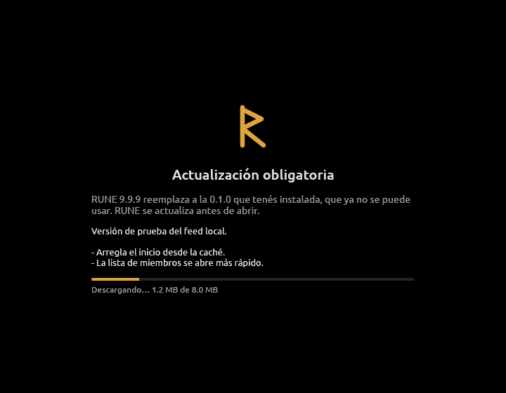
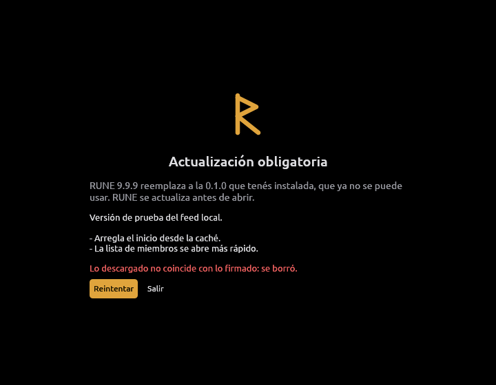
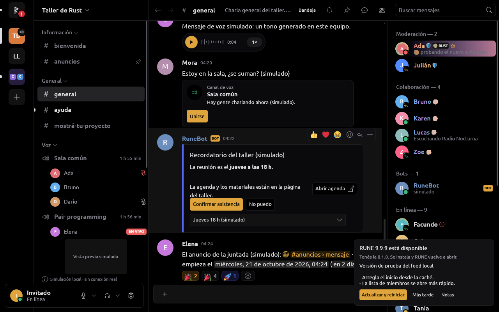
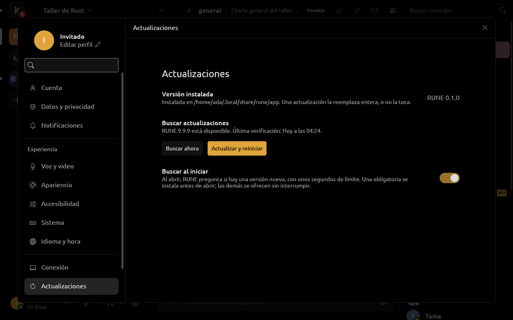

# Actualizaciones

RUNE se actualiza solo desde las GitHub Releases de `Niiihuel/rune`
(decisión del dueño del 2026-10-19). Cada tag `v*`
publica una release con un manifiesto firmado; una versión es
**obligatoria** si el mensaje de su tag anotado tiene la palabra
«obligatoria», y entonces RUNE se actualiza antes de abrir. Si no, la
actualización es **opcional** y se ofrece sin bloquear.

Código: `crates/rune-update` (manifiesto, firma, descarga, instalación),
`apps/desktop/src/update.rs` (búsqueda al iniciar, ventana de la
obligatoria, instalación desde la ventana principal, `rune --install`),
`rune-components::updates` y `rune-ui::updates` (interfaz),
`tools/rune-release` (las herramientas del dueño: `rune-release` firma
las releases y `rune-test-feed` es el feed local; no van en la app),
`.github/workflows/release.yml` (CI) y `scripts/update-key.sh` (la clave).

## Cómo funciona

Cada release publica, además de sus artefactos:

- `rune-update.json`: versión, fecha, notas (el mensaje del tag),
  `minimum_version` y, por plataforma (`linux-x86_64`, `windows-x86_64`),
  la URL, el tamaño y el SHA-256 del artefacto.
- `rune-update.json.sig`: la firma Ed25519 de esos bytes exactos, en
  base64. Formato propio: un archivo de una línea, verificable con 32
  bytes de clave pública. No es minisign porque minisign agrega un
  formato de clave y de firma (y una dependencia) sin agregar nada que
  haga falta acá; Ed25519 ya estaba en el árbol (`ed25519-dalek`, por
  DAVE).

`minimum_version` es la versión obligatoria más nueva que sea menor o igual
a la publicada: el CI la calcula leyendo los mensajes de **todos** los tags
anotados (un tag liviano no cuenta). Una copia instalada es obligada a
actualizarse si su versión es menor que `minimum_version` de la última
release; así una obligatoria vieja sigue mandando aunque después haya
salido una opcional.

Al abrir, una copia instalada (ver [Linux](#linux)) busca la última release
con hasta **4 segundos** de espera, antes de cualquier login o ventana:

1. Baja `rune-update.json` y su firma (con tope de tamaño), **verifica la
   firma antes de leer el JSON** con la clave compilada y compara versiones
   con SemVer.
2. Si hay una obligatoria, abre su propia ventana (limn): versión, notas y
   progreso. Descarga el artefacto, verifica tamaño y SHA-256, lo instala
   ([todo o nada](#linux)) y reemplaza el proceso por la versión nueva con
   los mismos argumentos. Si algo falla muestra el motivo con
   **Reintentar** y **Salir**: nunca abre la versión vieja.
3. Si hay una opcional, la ventana principal abre como siempre y la ofrece
   en la esquina: **Actualizar y reiniciar**, **Más tarde**, **Notas**.
   Al instalarse, RUNE se cierra como cualquier cierre (guarda borradores y
   ajustes antes) y arranca la nueva.
4. Si no hay red, el servidor no contesta en 4 s o la firma no verifica,
   RUNE abre como está. Una opcional que falla se vuelve a ofrecer en el
   próximo inicio o con **Buscar ahora**. Una obligatoria que aparece con
   RUNE ya abierto (por **Buscar ahora**) se ofrece como las demás y se
   impone en el próximo inicio.

**Ajustes › Actualizaciones** muestra la versión instalada y dónde,
**Buscar ahora** con la última verificación, e **Buscar al iniciar**
(encendido por defecto; se guarda en `~/.config/rune/updates` porque se lee
antes de abrir la base). Apagado, no hay pedido de red al abrir y una
obligatoria se descubre recién con **Buscar ahora**.









Capturas en un Xvfb privado de 1280×800 con el feed local
(`rune-test-feed --mandatory --slow`, `--mandatory --corrupt` y sin opciones) y
la simulación (`--language es --channel general --action jump:latest
--action update:notes`; `--action me:settings --action
click:us:page=updates`).

Una copia compilada desde el código (`cargo run`) no busca al iniciar ni se
instala sola: **Buscar ahora** le avisa si hay una versión nueva, nada más.

## Publicar una release

1. Subir la versión del workspace en `Cargo.toml` (`[workspace.package]
   version`), `cargo build` para que cambie `Cargo.lock`, commit y push a
   `main`.
2. Crear el tag **anotado** con las notas como mensaje, y subirlo:

   ```sh
   git tag -a v0.2.0 -m "Arregla el arranque desde la caché y suma …"
   git push origin v0.2.0
   ```

3. El workflow **Release** (`.github/workflows/release.yml`):
   - verifica que el tag sea anotado y que nombre la versión del workspace
     (`rune-release tag`), y que `THIRD_PARTY_NOTICES.md` esté al día: lo
     regenera con cargo-about 0.9.0 desde el lock y corta si difiere del
     commiteado ([avisos de terceros](#avisos-de-terceros));
   - crea una release borrador con el mensaje del tag como notas (un tag
     con `-`, como `v0.2.0-rc.1`, queda como pre-release y las copias
     instaladas no la ven: `releases/latest` la saltea);
   - compila el artefacto de Linux en Ubuntu 24.04 y lo sube al borrador;
     el de Windows también cuando esté encendido ([Windows](#windows));
   - arma el manifiesto (`rune-release manifest`, con `minimum_version`), lo
     firma con el secreto (`rune-release sign`, con el programa ya compilado
     para que ningún build script vea el secreto), lo **verifica con la
     clave compilada en RUNE** (`rune-release verify`: un secreto que no
     coincide con `release-key.pub` corta acá), sube también
     `THIRD_PARTY_NOTICES.md` y `rune-licenses.tar.gz` (ese archivo,
     `LICENSE-*` y `assets/licenses`) y recién entonces publica la release.

### Avisos de terceros

`THIRD_PARTY_NOTICES.md`, en la raíz, reúne los avisos de todo lo que un
binario de RUNE trae de terceros, en Linux y en Windows: cada dependencia
Rust con el texto de su licencia (todas las funciones, sin las que sólo usan
los tests) y, escrito a mano en la plantilla, lo que no viene de Cargo
(fuentes de egui y de limn, Twemoji, la marca de GIPHY, `vendor/hpke-rs`).
Lo genera [cargo-about](https://github.com/EmbarkStudios/cargo-about) con
`about.toml` (licencias aceptadas, en orden de preferencia, y targets) y
`about.hbs` (la plantilla); no se edita a mano:

```sh
nix-shell -p cargo-about --run \
  "cargo about generate --locked --offline --all-features about.hbs | cat -s > THIRD_PARTY_NOTICES.md"
```

`cat -s` junta las líneas en blanco repetidas: algunos crates traen la
misma licencia en dos archivos que sólo difieren en una línea en blanco
(`miniz_oxide`: `LICENSE` y `LICENSE-MIT.md`), y cargo-about toma el que
lea primero según el sistema de archivos. Hay que regenerarlo con cada
cambio de `Cargo.lock` y commitearlo; el
workflow Release lo regenera igual y no sigue si difiere. Cada artefacto lo
lleva: el programa lo tiene adentro (`include_str!`) y lo imprime con
`rune --licenses` (el workflow compara esa salida con el archivo en Linux y
en Windows); el instalador de Windows lo deja además junto a `rune.exe`, y la
release lo publica aparte y dentro de `rune-licenses.tar.gz`.

Hasta el último paso ninguna copia instalada ve la release. Si un paso
falla, el borrador queda en GitHub para borrarlo o volver a correr el
workflow.

### Marcar una versión obligatoria

Poner la palabra «obligatoria» (en cualquier mayúscula, como palabra
suelta) en el mensaje del tag anotado:

```sh
git tag -a v0.3.0 -m "obligatoria: el servicio cambió el formato de los mensajes"
```

«obligatorias» u «obligatoriamente» no cuentan. Desde esa release, toda
copia con una versión menor que `0.3.0` se actualiza antes de abrir, aunque
después salgan `0.3.1`, `0.4.0`… opcionales. Un tag publicado no se cambia:
para corregir una obligatoria por error, publicar otra versión (la marca
ya quedó en `minimum_version`; borrar y rehacer el tag sólo afecta a las
releases siguientes).

## La clave

La firma usa una clave Ed25519 sólo para esto. La mitad pública va
compilada en RUNE (`crates/rune-update/release-key.pub`, una línea en
base64); la privada **nunca** entra al repositorio. Hasta que exista,
`release-key.pub` está vacío: RUNE no confía en ninguna actualización y el
paso de verificación del CI falla, así que no sale ninguna release.

Una sola vez, en la máquina del dueño:

```sh
nix-shell --run scripts/update-key.sh          # o: scripts/update-key.sh <archivo>
git add crates/rune-update/release-key.pub
git commit -m "Actualizaciones: clave pública de las releases"
```

El script genera la clave con `cargo run -p rune-release -- keygen` (el
sistema da la entropía), deja la privada en
`~/.config/rune-release/update-signing.key` (0600, carpeta 0700; nunca la
imprime), escribe la pública en `release-key.pub` y la carga como secreto
`RUNE_UPDATE_SIGNING_KEY` de `Niiihuel/rune` con `gh secret set … < archivo`
(sin `gh`, dice la orden). Se niega si la privada quedaría dentro del
repositorio o si `release-key.pub` ya tiene una clave.

**Guardar una copia de la privada** fuera de la máquina. Las copias
instaladas sólo confían en la clave con la que se compilaron: perderla
obliga a reinstalar a mano con una clave nueva. Para cambiarla a propósito:
vaciar `release-key.pub`, correr el script, commitear y publicar; las
copias viejas no aceptarán esa release y hay que reinstalarlas.

## Probar con el feed local

El updater se prueba sin GitHub, contra un feed local. Todo se puede
apuntar a otro lado con variables de entorno:

| Variable | Qué hace | Dónde vale |
| --- | --- | --- |
| `RUNE_UPDATE_FEED` | URL base con `rune-update.json` y `.sig` (en vez de `…/releases/latest/download`); también hace que una copia sin instalar busque al iniciar y se instale en `RUNE_UPDATE_ROOT` | siempre (igual se verifica con la clave compilada) |
| `RUNE_UPDATE_KEY` | clave pública en base64 en lugar de la compilada | sólo compilaciones de depuración |
| `RUNE_UPDATE_ROOT` | carpeta de la instalación en vez de `~/.local/share/rune/app` | siempre |

El feed de prueba firma una release inventada con una clave descartable y
la sirve en `127.0.0.1`:

```sh
nix-shell --arg withLogin true --arg withDocs true
cargo run -p rune-release --bin rune-test-feed -- --mandatory --slow
# imprime RUNE_UPDATE_FEED=… y RUNE_UPDATE_KEY=…; en otra terminal:
RUNE_UPDATE_FEED=http://127.0.0.1:8765 RUNE_UPDATE_KEY=… RUNE_UPDATE_ROOT=/tmp/rune-app \
  cargo run -p rune-desktop
```

Opciones: `--version 9.9.9`, `--mandatory`, `--slow` (descarga lenta, para
ver el progreso), `--corrupt` (SHA-256 que no coincide), `--port`,
`--program <archivo>` (lo que se instala; sin él es un relleno de 8 MiB que
no es un programa y la instalación lo rechaza), `--platform
windows-x86_64` (sirve `--program` como el instalador de Windows, sin
comprimir: [Windows](#windows)). Para probar el ciclo
entero: `rune --install` con un `HOME` de prueba, y un `--program` que sea
un RUNE compilado con una versión mayor (si es la misma versión, después de
reiniciar vuelve a encontrar la de prueba y se actualiza otra vez).

Los tests (`cargo test -p rune-update`) hacen lo mismo sin ventana: firma
válida e inválida, manifiesto alterado, otra clave, clave débil,
obligatoria contra opcional, `minimum_version`, descarga con SHA o tamaño
que no coinciden, reanudación después de un corte (con y sin `Range`),
instalación atómica en una carpeta temporal y el recorrido feed → descarga
→ instalación en loopback. Nada sale a la red.

## Linux

**Artefacto**: `rune-x86_64-linux.gz`, el programa `rune` comprimido con
gzip (un solo archivo: los recursos van dentro del binario). Se compila en
Ubuntu 24.04 con las bibliotecas de la distribución (no de Nix: el
`RUSTFLAGS` de `shell.nix` graba rutas de `/nix/store` que en otra
máquina no existen) y con `--features session-login`.

**Instalación por usuario**, sin permisos de administrador:

```text
~/.local/share/rune/app/
  versions/0.1.0/rune      una carpeta por versión
  versions/0.2.0/rune
  current -> versions/0.2.0
~/.local/bin/rune -> ~/.local/share/rune/app/current/rune
~/.local/share/applications/rune.desktop     Exec="…/app/current/rune"
~/.local/share/icons/hicolor/{16x16…512x512}/apps/rune.png   el ícono, por tamaño
```

La primera vez:

```sh
gunzip -c rune-x86_64-linux.gz > rune && chmod +x rune && ./rune --install
```

`rune --install` copia el programa como la versión que es, crea el
lanzador (si no hay otro), la entrada del menú y el ícono. Después cada
actualización:

1. descomprime en `versions/.{versión}.{pid}`, comprueba que sea un
   programa ELF y lo sincroniza al disco;
2. lo renombra a `versions/{versión}`;
3. crea un enlace `current.new` y lo renombra sobre `current`: un inicio
   encuentra la versión vieja o la nueva, nunca ninguna;
4. borra las versiones que no son la actual ni la anterior (la anterior es
   la que todavía corre).

Un fallo en cualquier paso deja `current` como estaba. El inicio con la
sesión (Ajustes › Sistema) apunta a `current/rune`, que no cambia entre
versiones. La descarga espera en `app/downloads/` con el digest en el
nombre y se borra al instalar.

**Qué necesita en tiempo de ejecución.** El binario usa las bibliotecas del
sistema: glibc ≥ 2.39, PipeWire (`libpipewire-0.3`), ALSA, GStreamer 1.x con
`gst-plugins-base`, Wayland y libxkbcommon (o las de X11), el cargador de
Vulkan y, para la sesión no oficial, GTK 4 y WebKitGTK 6.0 con
`glib-networking`. El paso `ldd` del workflow deja la lista exacta en el
log de cada release. Diferencias con la compilación de `nix-shell`:

- **Visor de PDF**: está apagado en las releases: sus herramientas sólo se
  aceptan desde `/nix/store` (`rune-core/src/documents/render.rs`).
- **Video por GPU**: GStreamer busca sus plugins donde la distribución los
  instala (`RUNE_GST_PLUGINS` no va compilado); sin `gst-plugins-bad`, el
  H264 vuelve a OpenH264.

**Distribuciones comunes** (Ubuntu 24.04+, Fedora 40+, Arch): instalar los
paquetes de arriba (en Ubuntu: `libpipewire-0.3-0t64`,
`libgstreamer-plugins-base1.0-0`, `libgtk-4-1`, `libwebkitgtk-6.0-4`,
`glib-networking`, `mesa-vulkan-drivers`), descargar el artefacto y correr
`./rune --install`.

**NixOS**: un binario genérico no arranca solo (no hay
`/lib64/ld-linux-x86-64.so.2` real ni bibliotecas en rutas estándar). Lo
más simple que sirve para los dos casos es el mismo artefacto con
[`nix-ld`](https://github.com/nix-community/nix-ld), que en la máquina del
dueño ya está activado, sumándole las bibliotecas de RUNE:

```nix
programs.nix-ld.enable = true;
programs.nix-ld.libraries = with pkgs; [
  wayland libxkbcommon vulkan-loader libGL alsa-lib pipewire stdenv.cc.cc.lib
  gst_all_1.gstreamer gst_all_1.gst-plugins-base
  gtk4 webkitgtk_6_0 glib cairo pango gdk-pixbuf graphene libsoup_3
  libx11 libxcursor libxi libxrandr  # xorg.* en nixpkgs anteriores
];
environment.sessionVariables = {
  # TLS de la ventana de login (WebKit) y plugins de GStreamer.
  # Una lista, para sumarse a la de dconf (con un texto, NixOS no los junta).
  GIO_EXTRA_MODULES = [ "${pkgs.glib-networking}/lib/gio/modules" ];
  GST_PLUGIN_SYSTEM_PATH_1_0 = lib.makeSearchPathOutput "lib" "lib/gstreamer-1.0"
    (with pkgs.gst_all_1; [ gst-plugins-base gst-plugins-good gst-plugins-bad ]);
};
```

La alternativa de siempre sigue: compilar desde el código en `nix-shell`;
esa copia no se actualiza sola.

Probado en NixOS con el feed local (`rune --install` en un `HOME` de
prueba, la obligatoria de punta a punta y la opcional). Falta probar el
binario genérico en una distribución común y en NixOS con `nix-ld`.

## Windows

**Artefacto**: `rune-x86_64-windows-setup.exe`, en el manifiesto como
`windows-x86_64`: un instalador de [Inno Setup](https://jrsoftware.org/isinfo.php)
6 armado con [`packaging/windows/rune.iss`](../packaging/windows/rune.iss).
Inno Setup ya hace solo lo que hace falta: instalación por usuario, acceso directo con `AppUserModelID`,
cerrar la aplicación con el Restart Manager, modo silencioso,
desinstalador, español e inglés, sin código propio dentro del instalador.
NSIS, el de Serein, necesita llamadas a la API de Windows escritas a mano
para lo mismo. Su licencia permite cualquier uso; sus autores piden a los
usuarios comerciales que compren una licencia, y RUNE no lo es.

**Instalación por usuario**, sin permisos de administrador (Windows 10 u
11, x86_64):

```text
%LOCALAPPDATA%\Programs\RUNE\
  rune.exe              el programa, con su ícono y su versión
  THIRD_PARTY_NOTICES.md, LICENSE-MIT, LICENSE-APACHE
  licenses\             assets/licenses
  unins000.exe, .dat    el desinstalador
…\Start Menu\Programs\RUNE.lnk            AppUserModelID RUNE.Desktop
HKCU\…\Uninstall\{9A354FE5-8128-4442-8261-E11202381361}_is1   «Aplicaciones instaladas»
```

- La carpeta es fija (el asistente no la pregunta): RUNE se considera
  instalado sólo si corre desde ahí (`rune_update::install::Install`).
- Los avisos van junto a `rune.exe`
  ([avisos de terceros](#avisos-de-terceros)); el workflow comprueba antes
  que `rune.exe --licenses` imprima el mismo `THIRD_PARTY_NOTICES.md`.
- El acceso directo lleva `RUNE.Desktop`, el ID de los toasts de RUNE
  (Windows puede no mostrarlos sin un acceso directo en Inicio con ese ID).
  RUNE se pone el mismo ID al arrancar
  (`rune_platform::notifications::claim_application_id`), así sus ventanas
  se agrupan con un RUNE anclado a la barra de tareas aunque lo haya
  abierto el inicio con la sesión o una actualización.
- `rune.exe` se compila con MSVC, `--features session-login` (el login
  con WebView2, cuyo cargador va enlazado estático) y el runtime de C
  adentro (`-C target-feature=+crt-static`): no hace falta el Visual C++
  Redistributable. El instalador no instala el WebView2 Runtime (viene con
  Windows 11 y con las actualizaciones de Windows 10; sin él, el login da
  el enlace de Microsoft). El paso `DLLs` del workflow deja en el log las
  bibliotecas que carga (tendrían que ser sólo las de Windows). El ícono
  (`assets/icons/rune.ico`, [ARTWORK.md](ARTWORK.md)) y la versión van
  dentro del `.exe`
  (`apps/desktop/build.rs` con `winresource`, sólo para Windows).
- Los datos de la persona están en otro lado (`%LOCALAPPDATA%\RUNE`,
  `%APPDATA%\RUNE` y el Administrador de credenciales): actualizar no los
  toca, desinstalar tampoco. Desinstalar (Configuración › Aplicaciones)
  borra el programa, el acceso directo, el nombre de las notificaciones
  (`HKCU\Software\Classes\AppUserModelId\RUNE.Desktop`) y el inicio con la
  sesión (valor `RUNE` de `…\CurrentVersion\Run`). Para no dejar nada:
  cerrar sesión y olvidar las cuentas en RUNE antes (borra sus datos y las
  claves de la caché cifrada), y después borrar esas dos carpetas.
- Abierto a mano con RUNE abierto, el asistente avisa que RUNE está en uso
  y ofrece cerrarlo. Al final, «Abrir RUNE».

**Cada actualización**:

1. RUNE baja el instalador a `%TEMP%\rune-updates\rune-{sha256}` y lo
   acepta sólo si tamaño y SHA-256 coinciden con el manifiesto firmado.
2. Recién cuando su ventana cerró (con borradores y ajustes guardados), lo
   ejecuta con `/VERYSILENT /SUPPRESSMSGBOXES /NORESTART /CLOSEAPPLICATIONS`
   (`rune_update::install::INSTALLER_ARGUMENTS`) y sale enseguida.
3. El instalador, sin ventanas, pregunta al Restart Manager quién usa
   `rune.exe`; si RUNE todavía no terminó de salir, lo cierra
   (`CloseApplications=force`: a la fuerza, por si RUNE no sale con el
   pedido de cierre). Reemplaza los archivos (siempre, aunque la versión
   del `.exe` sea la misma), actualiza la versión en «Aplicaciones
   instaladas» y arranca `rune.exe` (entrada `[Run]` sin `skipifsilent`).
4. Lo que hizo queda en `%TEMP%\Setup Log <fecha> #<n>.txt`
   (`SetupLogging=yes`): ahí se mira si una actualización no volvió a
   abrir RUNE.
5. La siguiente búsqueda que no encuentra nada más nuevo borra
   `%TEMP%\rune-updates` (el instalador no puede borrarse a sí mismo).

**Sin firma de código (Authenticode).** El instalador y `rune.exe` no
están firmados. Qué pasa:

- Bajado con un navegador y abierto, SmartScreen dice «Windows protegió
  tu PC» (editor desconocido): «Más información» › «Ejecutar de todos
  modos». El navegador también puede avisar que el archivo no se descarga
  a menudo. Pasa en la primera instalación.
- Las actualizaciones no pasan por ahí: RUNE baja el instalador con su
  propio cliente, sin la marca «descargado de Internet» que mira
  SmartScreen. Que sea el de la release lo garantizan la firma Ed25519 del
  manifiesto y el SHA-256, no Authenticode.
- Con el **Control inteligente de aplicaciones** de Windows 11 encendido
  (sólo en instalaciones nuevas que lo activaron), Windows bloquea
  programas sin firma conocida y RUNE no abre: hay que apagarlo
  (Seguridad de Windows › Control de aplicaciones y navegador) o firmar.
- Un antivirus puede demorar la primera ejecución de un instalador nuevo
  sin firma, o marcarlo por heurística; se reporta como falso positivo.

Opciones para firmar, cuando el dueño decida (precios y requisitos a
revisar en ese momento):

1. **Azure Artifact Signing** (antes *Trusted Signing*): servicio de
   Microsoft, del orden de USD 10 por mes, firma desde el workflow con su
   action. Pide validar la identidad; para personas físicas sólo estaba
   abierto en algunos países (Estados Unidos, Canadá): ver si Argentina ya
   está.
2. **Certificado de una CA** (OV): pago anual; la clave tiene que vivir en
   hardware (token o HSM en la nube de la CA), así que el CI firma contra
   ese HSM. Un certificado nuevo no saca la advertencia de SmartScreen
   enseguida: la reputación se gana con descargas (desde 2024, también con
   uno EV).
3. **SignPath Foundation**: firma gratis a proyectos de código abierto que
   cumplan sus condiciones (repositorio público, licencia OSI, build
   verificable en CI); el certificado sale a nombre de la fundación.
4. No firmar: queda la advertencia de la primera instalación; las
   actualizaciones funcionan igual.

Con firma, el job firmaría `rune.exe` antes de armar el instalador, y el
instalador y su desinstalador con la directiva `SignTool` de Inno Setup.

**En el workflow**, el job `windows` (`windows-latest`) compila con MSVC
(`--target x86_64-pc-windows-msvc --features session-login`), comprueba
que `rune.exe --licenses` sea `THIRD_PARTY_NOTICES.md`, instala Inno Setup 6.7.3 verificando su
SHA-256, arma el instalador (`ISCC /DVersion=…`), deja su tamaño y su
SHA-256 en el log y en las salidas del job, y lo sube al borrador. El
paso del manifiesto comprueba que el instalador que bajó del borrador sea
ése antes de firmar. El job está apagado hasta que la variable del
repositorio `RUNE_WINDOWS_RELEASES` sea `true`; encendido, si falla, la
release no se publica.

**Armarlo y probarlo desde NixOS**, con Wine (Wine no es Windows). ISCC y
el instalador son de 32 bits: hace falta el Wine WoW64, no el `wine64` de
`withWindows`.

```sh
nix-shell --arg withWindows true --run \
  'cargo build --target x86_64-pc-windows-gnu -p rune-desktop --features session-login'
nix-shell -p wineWow64Packages.stable xvfb-run
export WINEPREFIX=$PWD/target/wine-inno
# Inno Setup 6.7.3 (SHA-256 en el workflow), una vez:
wine innosetup-6.7.3.exe /VERYSILENT /SUPPRESSMSGBOXES /CURRENTUSER '/DIR=C:\InnoSetup6'
# con MinGW, rune.exe carga WebView2Loader.dll de su carpeta (MSVC lo enlaza):
loader=$(ls target/x86_64-pc-windows-gnu/debug/build/webview2-com-sys-*/out/x64/WebView2Loader.dll | head -n 1)
wine 'C:\InnoSetup6\ISCC.exe' /Q /DVersion=0.1.0 \
  "/DProgram=$(winepath -w target/x86_64-pc-windows-gnu/debug/rune.exe)" \
  "/DLoader=$(winepath -w "$loader")" \
  "$(winepath -w packaging/windows/rune.iss)"        # target/rune-x86_64-windows-setup.exe
WGPU_BACKEND=gl xvfb-run -a wine target/rune-x86_64-windows-setup.exe \
  /VERYSILENT /SUPPRESSMSGBOXES /NORESTART /CLOSEAPPLICATIONS
```

Para el ciclo del updater, el feed local sirve el instalador como lo
publica el workflow con `--platform windows-x86_64 --program <setup.exe>`,
y RUNE (de depuración, el instalado) se abre con `RUNE_UPDATE_FEED` y
`RUNE_UPDATE_KEY`; bajo Wine, con `WGPU_BACKEND=gl`.

Con Wine se probó el ciclo entero (armar, instalar en silencio encima de
otra, actualizar desde el feed local, volver a abrir, borrar
`rune-updates`, desinstalar sin tocar los datos). Wine no guarda el
`AppUserModelID` del acceso directo ni encuentra procesos con el Restart
Manager: eso, el asistente con ventanas, el build MSVC, SmartScreen y todo
en un Windows real quedan por probar.

## Seguridad

- La firma se verifica antes de interpretar el JSON, con
  `verify_strict` y rechazando claves débiles; el artefacto se instala sólo
  si tamaño y SHA-256 coinciden con lo firmado. Un artefacto sin HTTPS
  (salvo `http://127.0.0.1` de los feeds de prueba), sin digest válido o de
  más de 1 GiB no se ofrece.
- Nunca baja de versión: una release se ofrece sólo si es más nueva que la
  instalada, así que repetir un manifiesto viejo firmado no sirve.
- Lo que no cubre: quien tenga la clave privada puede publicar una versión
  (por eso nunca entra al repositorio ni a un log, y el CI la usa sólo en
  el paso de firma); quien controle la red puede ocultar una versión nueva
  (la copia sigue como está, y una obligatoria se descubre al volver la
  red).
- `RUNE_UPDATE_KEY` sólo existe en compilaciones de depuración.

## Lo que queda del dueño

Encender el job de Windows (variable del repositorio
`RUNE_WINDOWS_RELEASES` en `true`; para probarlo sin que lo vea ninguna
copia instalada, una pre-release como `v0.1.0-rc.1`), decidir la
[firma de código](#windows) y probar en un Windows real: lista en
[tasks/todo.md](../tasks/todo.md).
