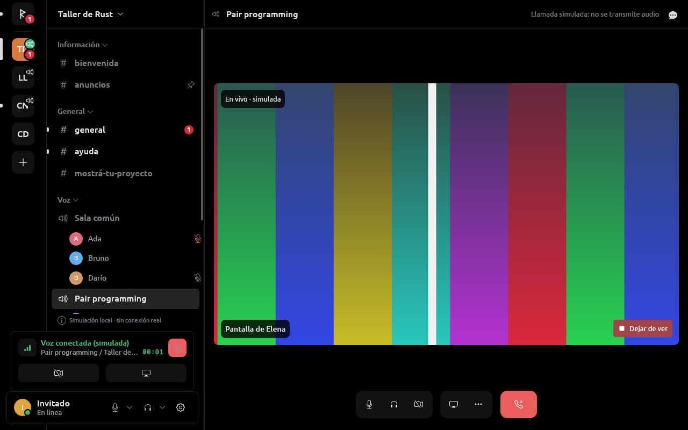
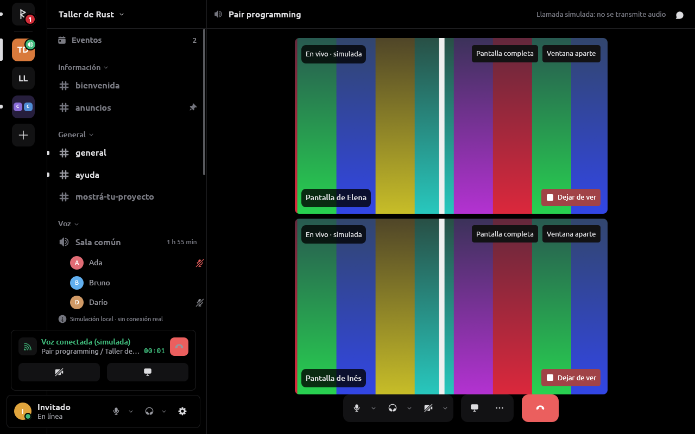
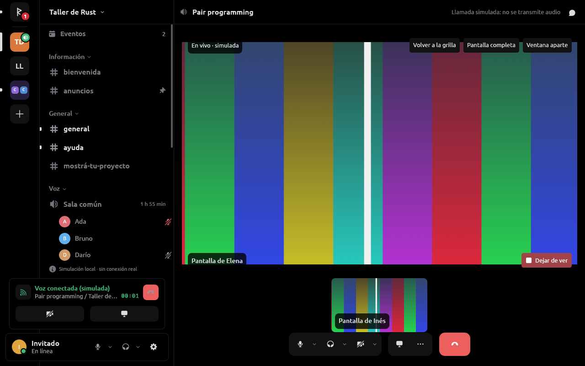
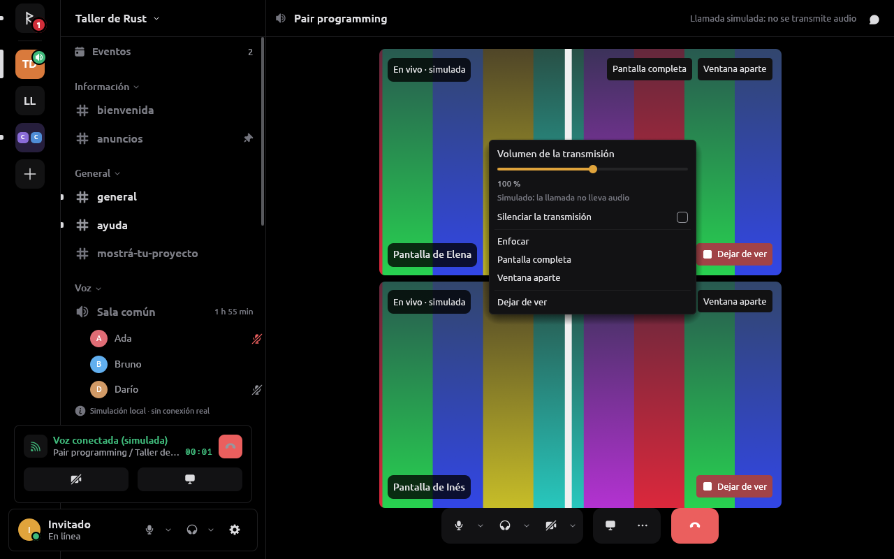
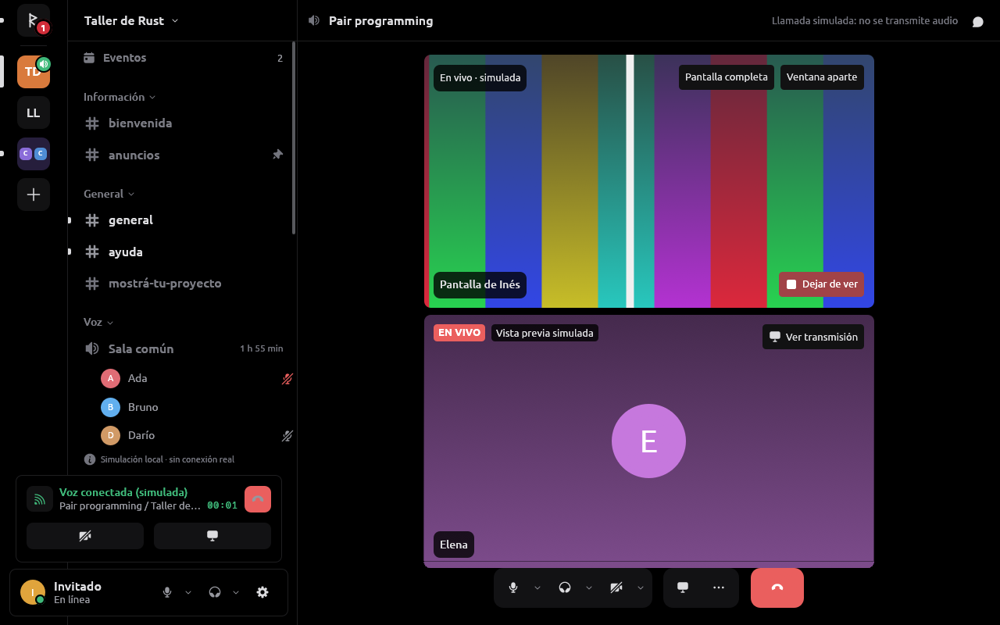
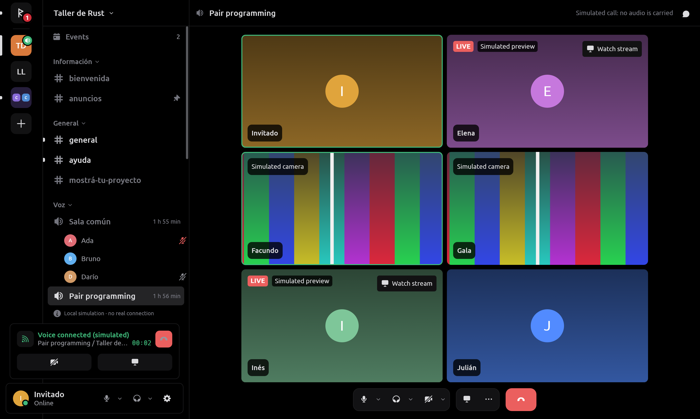
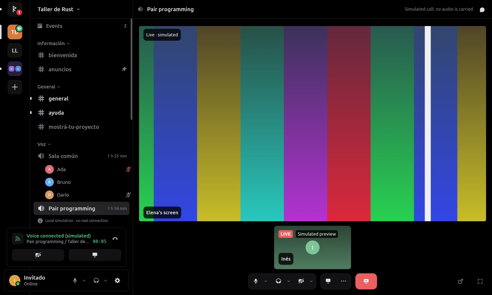
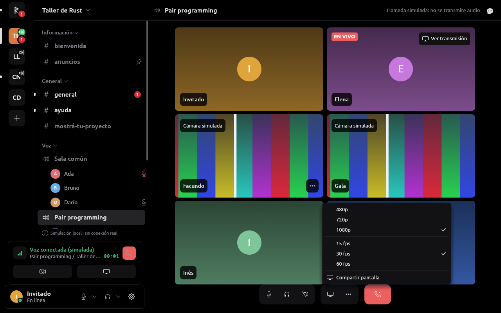

# Video en llamadas: mirar y transmitir pantalla y cámara

RUNE mira la pantalla que comparte otra persona (Go Live, con su sonido) y
las cámaras de la llamada, comparte la pantalla propia (con el sonido de
las aplicaciones) y envía la cámara, en canales de servidor y en llamadas
privadas. Sólo lo hace el proveedor de sesión no oficial; la simulación lo
imita y lo dice, y el proveedor OAuth2 no lleva video.

**Estado.** Probado con fixtures locales y con la GPU de esta máquina. El
dueño transmitió en una llamada real, pero no hay una prueba registrada de
cada caso contra Discord. El protocolo sale de la REA estática del cliente
oficial ([REA.md](DISCORD.md)) y de Serein; la parte de red está en
[DISCORD_SESSION.md](DISCORD.md) y la captura en
[MEDIA.md](MEDIA.md#pantalla-y-cámara).

## Decisiones del dueño

- **REA (2026-10-16):** se usa lo encontrado en el cliente oficial
  (paquete instalado y bundles públicos) en el proveedor no oficial. Se
  reimplementa; no se copia código ni recursos ([SECURITY.md](SECURITY.md)).
- **Calidad sin tope por Nitro (2026-10-16):** RUNE ofrece 480p, 720p y
  1080p a 15, 30 o 60 fps, como Serein, sin mirar la suscripción ni el
  nivel de mejoras del servidor. El cliente oficial reserva 720p60/480p60
  al nivel 1 y 1080p al nivel 2 o a Nitro; no está confirmado si el
  servidor lo hace cumplir. Sin 1440p ni «fuente». Si Discord rechaza o
  recorta, la interfaz lo dice; nunca se reintenta a escondidas con menos.
- **OpenH264 compilado desde la fuente (2026-10-16),** feature `source` de
  `openh264 =0.9.8`. El código es BSD-2, pero H264 está cubierto por
  patentes y **la licencia de patentes que paga Cisco sólo cubre los
  binarios que Cisco compila y distribuye**: no cubre esta compilación, ni
  a RUNE ni a quien lo use. Para el experimento personal lo asume el
  dueño; distribuir binarios de RUNE con H264 exige revisar las patentes.
  La alternativa sería la feature `libloading` con el binario oficial de
  Cisco. Con la GPU el códec lo corre el driver (Mesa, NVIDIA); algunas
  distribuciones apagan H264 en Mesa por patentes. Esto no es una opinión
  legal.

## Principios

1. **Capas.** Opcodes, claves de stream, SSRC, RTP, RTCP y DAVE viven sólo
   en `rune-discord-session`. Por encima se habla de «stream de pantalla de
   tal persona» y de unidades de acceso H264 ya descifradas.
2. **Permisos** por `Capabilities` y `Store::abilities`: `watch_streams` y
   `watch_cameras` (`VIEW`, `CONNECT` y estar en la llamada),
   `share_screen` (`CONNECT | STREAM`) y `video` para la cámara.
3. **Hilos.** Red en el runtime del proveedor; codificar y decodificar en
   hilos de `rune-media`, uno por fuente; la UI sólo presenta el último
   cuadro listo.
4. **Colas acotadas que descartan**; una cola llena tira lo viejo y pide un
   cuadro clave.
5. **DAVE siempre**: nada sale sin grupo listo ni se muestra sin descifrar.

## Contrato agnóstico

- `rune-model`: `VideoKind { Screen, Camera }`, `StreamPhase { Connecting,
  Live, Paused, Reconnecting, Ended(motivo) }`, `StreamQuality { height,
  fps }` y `VoiceState.streaming`/`camera`.
- `rune-provider::video`: el host toma una vez el `VideoLink`
  (`Provider::take_video_link`). Entrante: `VideoUnit { user, kind,
  keyframe, at, data }` en Annex B. Del host: `VideoRequest::KeyFrame` y
  `Wants { user, kind, on }` (qué cámaras están a la vista; `MAX_CAMERAS` =
  4). Saliente: `outgoing` (cola de 2) y `feedback` (`KeyFrame`, `Bitrate`)
  para la pantalla, `camera_outgoing` y `camera_feedback` para la cámara, y
  `sound` para el sonido de la pantalla. El audio de un stream llega como
  `VoicePacket` con `stream: true`.
- `Command`: `WatchStream`, `StopWatching`, `StartStream { channel,
  quality }`, `StopStream`, `PauseStream`, `SetCamera { channel, on }`.
  `Event::StreamPhase` (la fase propia vive en `Store::sharing`; las
  miradas, en la lista `Store::watching`). `Failure::Stream`, `Share`,
  `Camera`.

## Calidades

| Preajuste | Tamaño | fps | Tasa máxima |
| --- | --- | --- | --- |
| 480p | 854×480 | 15 / 30 / 60 | 3,5 Mbit/s |
| 720p (por defecto 30) | 1280×720 | 15 / 30 / 60 | 3,5 Mbit/s a ≤ 30 fps; 9 a 60 |
| 1080p | 1920×1080 | 15 / 30 / 60 | 9 Mbit/s |
| Cámara (`video::CAMERA`) | 1280×720 máx. | 30 máx. | 2,5 Mbit/s (piso 0,15) |

Las tasas son las del cliente oficial (Go Live 0,5–3,5 Mbit/s, 9 por
encima de 720p o 30 fps; cámara 0,15–2,5). 480p queda en 3,5 también a
60 fps. La tasa empieza en el máximo de la calidad y baja con REMB y la
pérdida informada ([PERFORMANCE.md](PERFORMANCE.md)). La fuente se escala
conservando la forma, nunca se agranda.

## Códec

Sólo **H264** (`packetization-mode=1`), payload 101 y RTX 102, como Serein
y como el primer códec del cliente oficial; DAVE lo cubre. VP8, AV1 y H265
quedan afuera. RUNE envía Constrained Baseline sin cuadros B y decodifica
lo que llegue (los clientes de escritorio mandan Main).

- **SPS propio normalizado** antes de cifrar, como el reescritor de
  libwebrtc: si el SPS no declara cero reordenamiento, el receptor oficial
  lo reescribe antes de descifrar y DAVE rechaza el cuadro (hallazgo de
  Serein). OpenH264 ya escribe `max_num_reorder_frames = 0`; la
  normalización cubre los codificadores de GPU.
- **SPS que se da a la GPU** (`video::sps::roomy`): los decodificadores de
  GStreamer 1.26 sólo sacan una imagen apenas la decodifican si su búfer
  tiene un lugar libre; se le suma uno a `max_dec_frame_buffering` para que
  una pantalla quieta no espere al cuadro siguiente.

## Cotas de memoria y latencia

| Pieza | Cota |
| --- | --- |
| Depaquetizador por SSRC | 1 unidad en armado + 1 completa; ≤ 2048 paquetes y ≤ 2 MiB por unidad; un hueco o 500 ms sin marcador la descarta y pide clave |
| Orden al recibir | tras un hueco, ≤ 512 paquetes retenidos por SSRC y 200 ms de espera; NACK a lo sumo 3 veces por paquete, cada 60 ms, ≤ 64 números por NACK |
| Cola de decodificación | 4 unidades por fuente; una unidad esperando > 150 ms se tira y se pide clave |
| Cuadros decodificados | 2 por fuente, RGBA a ≤ 1920×1080; más de 3840×2160 no se muestra |
| Fuentes a la vez | hasta 3 streams mirados (`MAX_STREAMS`), 4 cámaras a la vista, una capa por cámara |
| Pedido de clave (PLI) | uno por fuente cada 500 ms como mucho |
| `media sink wants` (op 15) | al cambiar lo visible, y cada 5 s (cada 1 s si una fuente lleva 1 s sin imagen), como Serein |
| Codificador | 1 cuadro crudo pendiente y 1 unidad codificada; paquetes de ≤ 1200 bytes en lotes cada 2 ms |
| Historial RTX al enviar | la ventana de reparación del cliente oficial: ≤ 1 s, ≤ 2048 paquetes, ≤ 2 MiB; cada paquete a lo sumo 2 reenvíos, 50 ms entre ellos |
| Sonido de la pantalla | ≤ 32 aplicaciones, ≤ 200 ms en búfer cada una; cola de 8 cuadros de 20 ms |
| Vistas previas | ≤ 32 guardadas; ≤ 4 pedidas por vez, cada 120 s por transmisión |
| Latencia | objetivo ≤ 300 ms de pantalla a pantalla en LAN; se descarta antes que acumular |

Un SPS o un cuadro fuera de estas cotas se rechaza con un motivo visible,
sin tumbar la llamada.

## Mirar la pantalla de otra persona

- El Gateway principal pide el stream (op 20) recién cuando se conoce la
  sesión de voz; `STREAM_CREATE`/`STREAM_SERVER_UPDATE` abren una conexión
  de voz aparte (`server_id = rtc_server_id`, endpoint sólo
  `*.discord.media`). `STREAM_DELETE` termina con el motivo en la interfaz;
  `unavailable` pasa a «Reconectando…» y manda op 21; la pausa llega por
  `STREAM_UPDATE`.
- Quien mira se identifica con `streams: []` (como Serein) y manda op 15
  `{any: 100}`. El depaquetizador (`voice::h264`: unidad simple, STAP-A,
  FU-A, RTX) arma Annex B; DAVE descifra con `MediaType::VIDEO` sólo de
  quien está anunciado; el RTCP que no autentica se descarta.
- Decodificación en `rune-video-decode`, uno por stream: empieza en una
  clave; una unidad que esperó > 150 ms o un error hace esperar la próxima
  y pedirla.
- **Interfaz**: «EN VIVO» en la fila y el recuadro de quien transmite;
  «Ver transmisión» (`vz:watch:{persona}`) ocupa el escenario con la fase y
  «Dejar de ver» (`vz:stop-watching:{persona}`); la superficie es
  `video:stream:{persona}`. Con varias transmisiones (hasta 3, una más
  suelta la más vieja) van en grilla.
- **Pantalla completa y ventana aparte**: la transmisión sola llena la
  ventana en pantalla completa (Escape vuelve); la ventana aparte es un
  viewport de eframe con su propio árbol de limn y su superficie
  (`video:window:{persona}`).
- **Vistas previas** de quienes transmiten en el servidor abierto y no se
  miran: `GET /streams/{clave}/preview?version=<ms>` como el oficial (REA),
  sólo una URL del CDN bajo esa clave. Se pide otra vez a los 120 s de una
  imagen; sin imagen, a los 10 s por cada respuesta seguida sin ella; con
  429, cuando diga su `retry_after` (viaja en `Event::StreamPreview`). El
  429 de esa ruta retiene sólo las vistas previas, como el de escribir, no
  los mensajes. Se muestra de 160×90 bajo la fila y, atenuada, en el
  mosaico del escenario con «EN VIVO», el nombre y «Ver transmisión»
  encima; un clic la mira. En la simulación, «Vista previa simulada». El
  puntero sobre alguien en vivo muestra una tarjeta con la vista previa de
  288×162 y «Ver transmisión», y la pide aunque ya se mire
  ([MEDIA.md](MEDIA.md#personas-bajo-un-canal-de-voz)).
- **Subir la propia** (pedido del dueño, 2026-10-19), como el oficial:
  a los 500 ms de que se ve la pantalla compartida y cada 300 s (60 s en
  pausa o si no se pudo sacar), el host saca el último cuadro en otro hilo,
  lo achica para que entre en 512×288 y lo manda como JPEG de calidad 92
  (`Command::UploadStreamPreview`, capacidad `upload_stream_previews`); un
  cuadro negro no sale. El proveedor no oficial hace
  `POST /streams/{clave}/preview {thumbnail: "data:image/jpeg;base64,…"}`
  sólo mientras esa clave es la transmisión propia; la simulación la toma y
  la descarta. Sólo fixtures.
- **Enfocar**: un clic en una transmisión mirada
  (`vz:stream:{persona}`) la deja sola en el escenario y las demás, con
  quienes transmiten y no se miran, en una tira de 72–124 px debajo (18 %
  del alto), como el oficial y Serein. Otro clic, «Volver a la grilla»
  (`vz:spotlight:{persona}`) o Escape vuelven a la grilla; un clic en la
  tira enfoca esa.
- **Como el oficial** (REA en [REA.md](DISCORD.md)):
  doble clic en una transmisión mirada la enfoca y la muestra en pantalla
  completa; otro doble clic ahí vuelve al escenario con la grilla, como el
  oficial (Escape sale de la pantalla completa y la deja enfocada). El
  doble clic lo da el host como `PointerDownEditor { click_count: 2 }` y
  `rune_ui::double_click` lo toma antes que el árbol; va a la transmisión
  del primer clic aunque ese clic haya movido los mosaicos. Al pasar el
  puntero, arriba a la derecha, su sonido (`vz:mute:{clave}`, la de la
  transmisión) y «⋯» (`vz:stream-more:{persona}`, su menú anclado ahí).
  Con una enfocada, el final de la barra tiene «Ventana aparte» y
  «Pantalla completa», y el botón rojo pasa a «Dejar de ver». Si es la única de otros en el canal, se enfoca al
  mirarla; con dos o más queda la grilla.
- **Barra de la llamada**: la medida de la bandeja oficial: botones de 36
  (ícono 20) a 8 en secciones de 46 con 4 de relleno, borde de 1 y radio
  12; flecha de 20 pegada a 1 px; secciones y colgar (62 de ancho) a 12;
  16 sobre el borde de abajo y 12 bajo los mosaicos.
- **Menú de la transmisión**: clic derecho en ella o su «⋯». Volumen y silencio de
  la transmisión (su sonido entra al mezclador con su propia clave,
  `mixer::STREAM_SOUND`, aparte de la voz de la persona; ensordecer los
  calla a los dos, como el oficial), Enfocar o Volver a la grilla, Pantalla
  completa, Ventana aparte y Dejar de ver.

| Grilla | Enfocada |
| --- | --- |
|  |  |
|  |  |
|  |  |

## Mirar cámaras

- La conexión de la llamada se identifica con video y ofrece H264 en op 1.
  `VoiceState.camera` sale de `self_video`; op 12 da la SSRC de cada uno.
- El host dice qué cámaras se ven (`Wants`, sólo con la llamada conectada)
  y la llamada manda op 15 sólo con las SSRC de cámara conocidas: 100 las
  visibles, 0 el resto. Una cámara fuera de pantalla no se arma.
- Las unidades se reparten por fuente en colas de 4; la cuarta cámara es
  la última que se decodifica, el resto sigue con su avatar.
- **Simulcast** al recibir: si alguien manda capas (rid «100» y «50») se
  pide una, la mejor con hasta dos cámaras a la vista y la liviana pasado
  eso. Mandar la propia en dos capas no se hace (Serein no lo hace y
  anunciar una capa obliga a mandarla siempre).
- El mosaico muestra la cámara en lugar del avatar, con bandas negras si no
  es 16:9 (`video:camera:{persona}`).

## Compartir la pantalla propia

- El botón de pantalla abre primero el selector de calidad en la barra
  (`vz:quality:{alto}`, `vz:fps:{fps}`, «Con sonido», y en Windows la lista
  de pantallas y ventanas); «Compartir pantalla» (`vz:share`) abre el
  diálogo del sistema y manda `StartStream`. «Elegir otra pantalla» olvida
  el `restore_token` del portal.
- Op 18 (`type: "guild"`, o `call` con `guild_id` nulo en un privado), el
  `STREAM_CREATE` propio y la conexión de stream como emisor; op 0 y op 12
  con `type: "screen"` como el cliente oficial; RTX = SSRC + 1.
- **Codificador** (`rune-video-encode`): cuadro clave al empezar, al
  pedirlo (PLI/FIR), tras cualquier descarte y cuando se forma el grupo
  DAVE; sin claves periódicas. Una pantalla quieta se vuelve a codificar
  cada segundo. **Contrapresión en vez de descarte**: no codifica sin lugar
  en la cola del proveedor, así con red lenta bajan los fps (la interfaz
  lo muestra) en vez de tirar unidades y pedir claves en cadena. Una tasa
  nueva rehace OpenH264 sólo con −15 %/+25 % acumulado, como Serein.
- **Empaquetado**: STAP-A junta SPS, PPS y SEI; carga ≤ 1168 bytes para que
  el datagrama sellado no pase de 1200. REMB, la pérdida de SR/RR, PLI, FIR
  y NACK se leen.
- **Pausa** (op 22, `PauseStream`): la conexión deja de tomar unidades y no
  manda el sonido; al reanudar empieza por una clave. Serein no la usa; su
  forma sale de la REA.
- **Interfaz**: la vista previa «Tu pantalla» dice la fase, los fps, la
  tasa y quién codifica («En vivo · 60 fps · 9000 kbit/s · VA-API»), con
  «Pausar» y «Dejar de compartir». En la simulación se marca la cuenta
  transmitiendo y nada se codifica.

## Enviar la cámara

La conexión de la llamada siempre anuncia una cámara en op 0 (`type:
"video"`, como el cliente oficial), así encenderla a mitad de llamada no
pide otra conexión. Encender manda op 4 con `self_video: true` y op 12 con
la SSRC; apagar, `self_video: false` y `video_ssrc: 0`. Codifica igual que
la pantalla con `CameraVideoRealTime` y el preajuste de cámara. Si Ready no
le da lugar o el servidor elige otro códec, la llamada sigue sin cámara.
Sólo se enciende dentro de la llamada.

## Retransmisiones (RTX y NACK)

- **Al enviar** (`voice::nack::History`, `voice::send::Pacer`): lo enviado
  se guarda en la ventana de reparación del cliente oficial (ver la tabla);
  un NACK genérico sobre la SSRC propia reenvía por la SSRC de RTX
  (payload 102, la secuencia original primero, el mismo cifrado DAVE con un
  sellado de transporte nuevo), adelante de la unidad en camino. Lo que ya
  no está pide un cuadro clave. Serein lo hace igual.
- **Al recibir** (`voice::nack::Reorder`): un hueco retiene lo que sigue,
  pide lo que falta con un NACK sellado como el PLI y suelta en orden
  cuando llega la retransmisión; a los 200 ms se da por perdido y se pide
  clave. Serein no manda NACK; el cliente oficial sí (REA). El relleno de
  sondeo por RTX se descarta.

## Sonido de la pantalla

En Linux (`rune-media::video::sound`), un hilo con su propio bucle de
PipeWire abre un flujo de captura por cada `Stream/Output/Audio` que no
queda excluido, apuntado a su `object.serial` con `node.dont-fallback` y
`node.dont-reconnect` (nunca cae en un micrófono). Cada 20 ms suma las
aplicaciones, codifica Opus estéreo a 128 kbit/s y lo manda por la SSRC de
audio de la conexión que comparte con op 5 SOUNDSHARE y la extensión RTP
con que Serein lo marca; el silencio no se manda, y silenciar el micrófono
no lo toca. Si no se puede leer, se comparte sin sonido y se dice por qué.

**Qué queda afuera.** El registro de PipeWire no trae el pid de un nodo:
está en la información de su **cliente**, que RUNE ata para leer
`application.process.id` (o `pipewire.sec.pid`), el binario y el nombre;
un stream espera sin oírse hasta saberlo. Se excluyen lo de RUNE, los
streams con rol de llamada (`media.role` `Communication` o `Phone`) y los
de otros clientes de voz por nombre, binario o `node.name` (`VOICE_CLIENTS`:
Discord y sus variantes, Vesktop, Serein, Zoom, Teams, Mumble y otros).
Sin esto, las voces de la llamada volvían a la llamada. El cliente oficial
graba sólo el árbol de procesos de la ventana elegida; RUNE no puede,
porque el portal ScreenCast no dice de qué proceso es una ventana. Cada
5 s el log dice qué aplicaciones mezcla y cuáles dejó afuera (nombre y rol,
nunca títulos ni rutas).

En Windows: loopback de WASAPI sin el árbol de procesos de RUNE
([MEDIA.md](MEDIA.md#pantalla-y-cámara)).

## Video por GPU

En Linux se codifica y decodifica con la GPU por **GStreamer**, como
Serein, con OpenH264 de respaldo. Se eligió sobre libva directo (habría que
escribir a mano los encabezados de H264 y sólo cubre VA-API, no NVENC; es
lo que hace el cliente oficial con `cros-codecs`) y sobre FFmpeg (ata la
versión de las bibliotecas): GStreamer ya estaba en el entorno por el
login y un mismo pipeline sirve para las dos GPU.

- **Codificar**: VA-API (`vapostproc` a NV12 → `vah264enc` en VBR con la
  tasa como techo, sin B, GOP máximo; elige la GPU que no es de NVIDIA
  aunque esté `nvidia-vaapi-driver`), después NVENC (`nvh264enc` en CBR,
  latencia cero), después OpenH264. Las salidas pasan por `h264parse
  config-interval=-1` con `constrained-baseline`. La clave a pedido es un
  `GstForceKeyUnit`. NVENC cambia la tasa en marcha; VA-API rehace la
  secuencia, así que espera −15 %/+25 % como OpenH264. Si un motor falla con
  la transmisión andando, pasa al siguiente con una clave, sin cortar.
- **Decodificar**: `vah264dec` → `vapostproc` a RGBA, o `nvh264dec` →
  `videoconvert` (en la CPU: los conversores de CUDA piden NVRTC, así que
  NVDEC sirve de respaldo, no para ahorrar CPU), u OpenH264.
- **Ajuste**: Ajustes › Voz y video › Video › «Aceleración por hardware de
  H.264» (`video_hardware`, prendido). Se aplica en el momento a lo que se
  manda y se mira, desde una clave.
- El log dice una vez qué motor usa (`encoder VA-API`, `encoder OpenH264
  after VA-API failed`, `video decoder VA-API`…).
- El registro de GStreamer es de toda la cuenta: si otro programa lo
  escaneó sin GPU, RUNE vuelve a cargar `va` y `nvcodec` al arrancar. Si
  igual no aparece NVENC, borrar `~/.cache/gstreamer-1.0/registry.*.bin`.

### La captura y DMA-BUF

La captura pide memoria compartida: el compositor copia la pantalla a la
CPU, RUNE la escala y la GPU la vuelve a subir. No se pasó a DMA-BUF
porque la vista previa y el respaldo a OpenH264 necesitan los píxeles en
la CPU, el ahorro sólo existe si compositor y codificador están en la misma
GPU (en esta máquina pueden no estarlo), y medido no es el cuello de
botella: escalar a 1080p cuesta 2,65 ms por cuadro y VA-API codifica
1080p60 con 30 % de CPU ([PERFORMANCE.md](PERFORMANCE.md)). Por software,
1080p60 no alcanza en esta máquina (35–40 fps con un núcleo saturado).
La cámara sí acepta el DMA-BUF que exporta V4L2: es lineal y se mapea a
la CPU igual que la memoria compartida ([MEDIA.md](MEDIA.md#pantalla-y-cámara)).

## Pruebas

Todo con fixtures locales y deterministas, sin red real: claves de stream y
despachos `STREAM_*` válidos e inválidos; depaquetizador con orden,
pérdida, duplicados, STAP-A, FU-A y RTX; PLI y NACK sellados y RTCP
falsificado descartado; DAVE de video con el emisor MLS de los fixtures (un
byte cambiado en el SPS en claro hace fallar la autenticación); un
servidor de voz de prueba cuyo participante sintético manda una unidad
codificada en la prueba y cifrada en las dos capas, hasta el cuadro
decodificado; el lector de SPS con el SPS real de NVENC; propiedades de
nodos y clientes de PipeWire simuladas para el sonido.

## Riesgos y límites

- La licencia de H264 (arriba).
- Que el receptor oficial acepte el SPS normalizado y lo que sale de
  VA-API y NVENC, y que RUNE vea por la GPU lo que manda el oficial: sin
  confirmar.
- Las calidades sin Nitro: el servidor podría rechazar o recortar; se
  informa.
- El Gateway de voz v8 con video no está confirmado (Serein lo usa).
- Es un cliente no oficial; el video amplía lo que Discord puede notar.
- Sin DMA-BUF de la pantalla, sin capas propias de simulcast; AV1 y H265
  afuera. La lectura de PipeWire del sonido de la
  pantalla no se probó en vivo.
