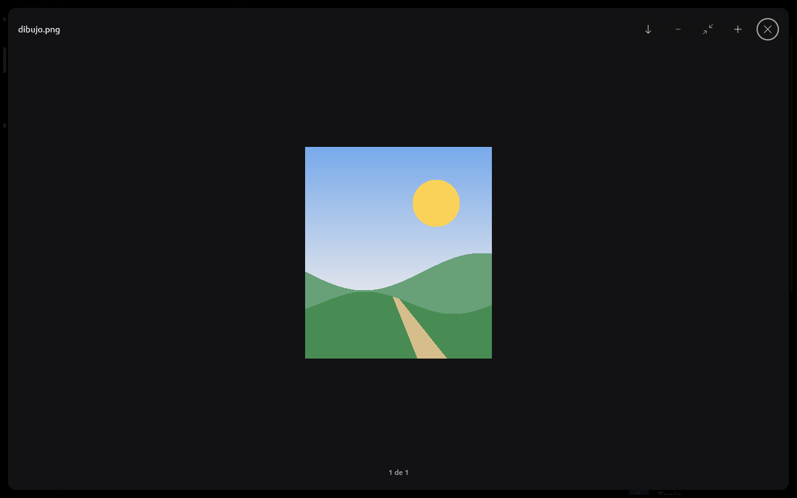
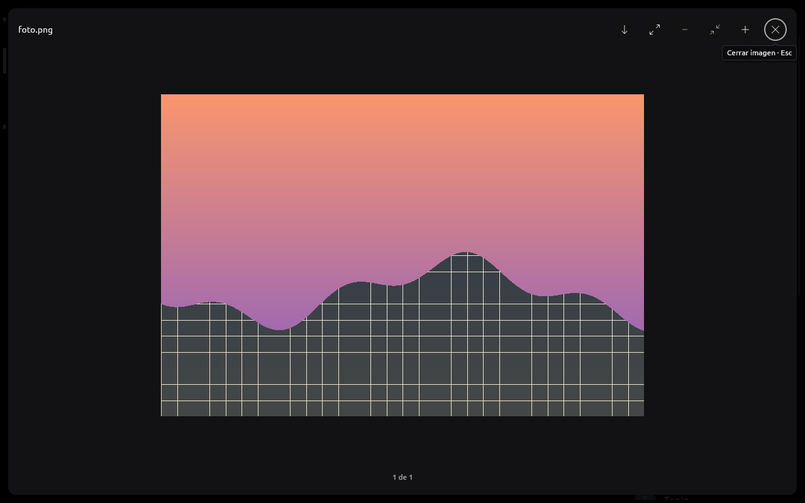
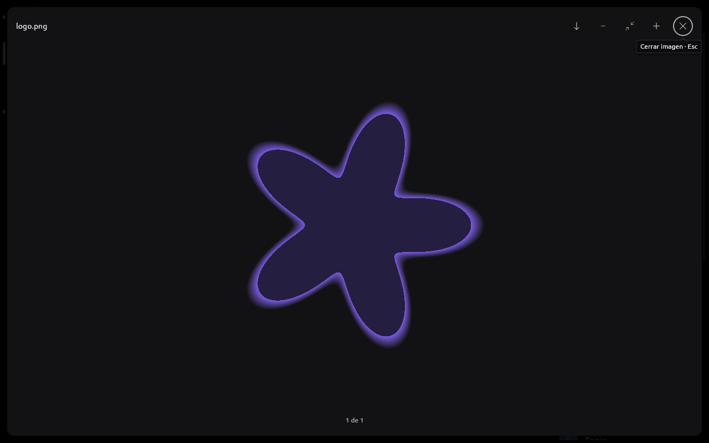
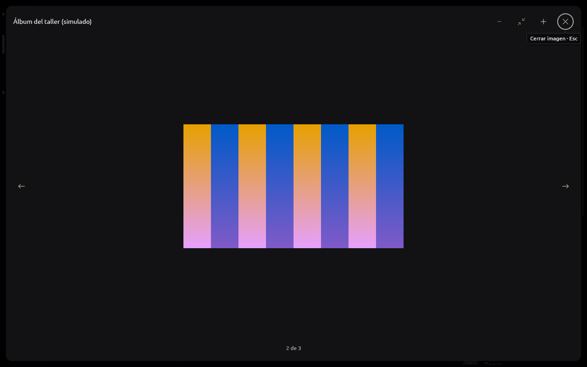
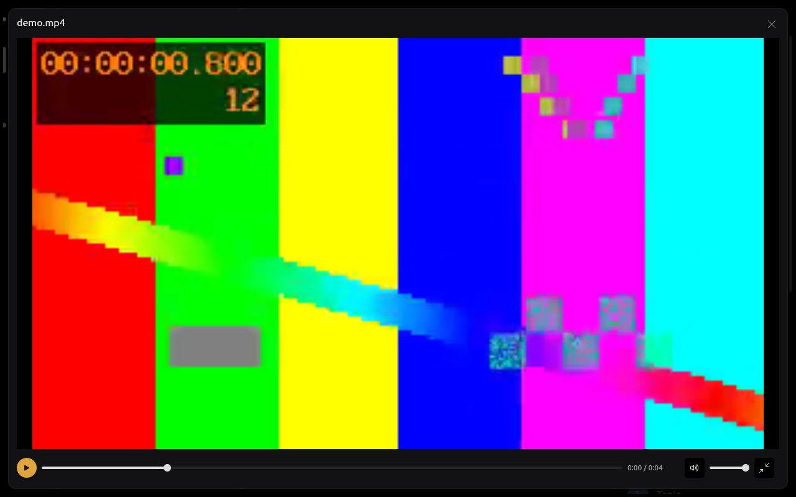
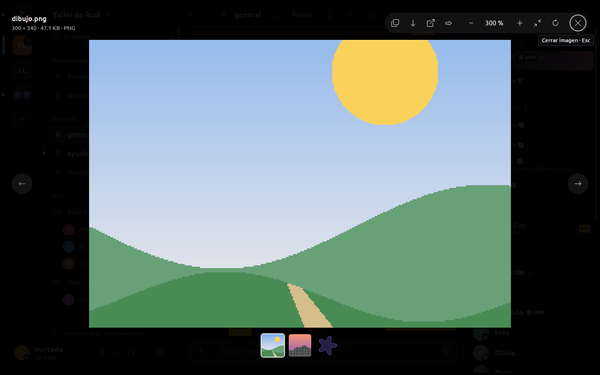

# Visor de imágenes y videos (2026-10-19)

El visor a pantalla completa de adjuntos, tarjetas, páginas de PDF y videos.
Lo genérico vive en limn (`Element::zoom_view` e `ImageViewer`, rama
`rune/visor-de-medios`); lo de RUNE (galería de un mensaje, acciones del
proveedor, original al hacer zoom, video) en `rune-ui` (`attachments.rs`,
`documents.rs`, `voice_messages.rs`).

## El problema

Con la cuenta real, un PNG de unos 300 × 340 se veía **diminuto en el
centro** de un panel negro que tapaba toda la ventana, con «1 de 1» abajo.
Además el zoom estaba roto para imágenes chicas: agrandaba una caja en la que
el backend nunca agrandaba la imagen (se dibujaba a lo sumo a su tamaño), así
que acercar una imagen chica mostraba una caja vacía con una barra de
desplazamiento ([antes, con zoom](img/visor-chica-zoom-antes-2026-10-19.png)).

| Antes | Después |
| --- | --- |
|  |  |
|  |  |
|  |  |
|  |  |
|  |  |

En la primera captura de la galería, las tres miniaturas mostraban el
mismo paisaje y la imagen grande, franjas: era la simulación, no la tira.
Las tres tarjetas del álbum de `--capture-media` usaban la imagen de la
tarjeta de GIF, que la captura anima con franjas; la tira mostraba su cuadro
fijo y el visor la animación. Desde el 2026-10-19 (rama
`visor-miniaturas`) el álbum tiene tres imágenes propias (las mismas
colinas al alba, al mediodía y al atardecer) y un test compara, eligiendo
cada lugar de la tira, la miniatura de cada lugar con la imagen que se ve
(`strip_shows_what_it_opens`, para una galería de tarjetas y para los
archivos de un mensaje).

La grande al 100 % (tecla `1`): el zoom pasó de lo que tiene su vista
previa, así que RUNE pidió el original, que reemplazó a la vista previa sin
mover nada; la barra muestra «100 %».


Y la chica al 300 % (tecla `3`), con los píxeles nítidos (vecino más
cercano desde 2 píxeles de pantalla por píxel):


## Investigación

Hecha el 2026-10-19 leyendo el código fuente actual de cada proyecto (o, en
el caso de Discord, sus bundles JavaScript públicos, como permite
AGENTS.md). Lo que hace cada uno y qué tomamos:

### iced, `widget::image::Viewer`

[viewer.rs@08eb93a](https://github.com/iced-rs/iced/blob/08eb93ad4765/widget/src/image/viewer.rs):
`min_scale 0.25`, `max_scale 10`, `scale_step 0.10`; cada evento de rueda
multiplica por 1,1 sin importar el delta, anclado al puntero sólo en el eje
donde la imagen es más grande que la vista; arrastrar desplaza; el
desplazamiento se limita a ±(imagen − vista/2), así que media imagen puede
salir de la pantalla. Sin inercia, animación, doble clic, teclado ni
pellizco. `ContentFit::Contain` por defecto **agranda** las imágenes chicas;
`FilterMethod` lineal o vecino, fijo.

**Tomamos** la matemática del zoom anclado y el centrado por eje. **No**
tomamos el paso fijo por evento (un touchpad zoomea demasiado rápido) ni el
agrandado por defecto.

### gpui / Zed, `image_viewer`

[image_viewer.rs@1f32ec0](https://github.com/zed-industries/zed/blob/1f32ec0ceafd/crates/image_viewer/src/image_viewer.rs):
`MIN_ZOOM 0.1`, `MAX_ZOOM 20`, paso 1,1; el primer encaje es
`min(…, 1.0)`: **nunca agranda**. Ctrl+rueda zoomea anclado al cursor, la
rueda sola desplaza, el pellizco zoomea. Sin límites de desplazamiento ni
animación. Damero detrás de la imagen (cuadros de 32 × zoom) y borde de 1 px;
barra con − / porcentaje editable / + / Encajar; atajos `ctrl-=`, `ctrl--`,
`ctrl-0`, `ctrl-1`
([keymap](https://github.com/zed-industries/zed/blob/1f32ec0ceafd/assets/keymaps/default-linux.json#L1612-L1621));
información «W×H • tamaño • formato»
([image_info.rs](https://github.com/zed-industries/zed/blob/1f32ec0ceafd/crates/image_viewer/src/image_info.rs)).

**Tomamos** el máximo de 20× (2000 %), el porcentaje entre − y + y la línea
de información bajo el título. El damero, sí, pero fijo a la pantalla (ver
Telegram).

### egui (`Scene`, `Image`) y visores hechos con egui

- [`Scene`](https://github.com/emilk/egui/blob/db63b6d17655/crates/egui/src/containers/scene.rs):
  zoom anclado con T(p)·S(z)·T(−p); `zoom_delta` viene del pellizco o de
  Cmd+scroll (`scroll_zoom_speed = 1/200`); la rueda sola desplaza; sin
  límites de desplazamiento.
- [`Image`](https://github.com/emilk/egui/blob/db63b6d17655/crates/egui/src/widgets/image.rs)
  y [`TextureOptions`](https://github.com/emilk/egui/blob/db63b6d17655/crates/epaint/src/textures.rs#L162-L193):
  filtro lineal o vecino por textura, con `mipmap_mode` (que egui-wgpu no
  genera: lo verificamos en egui-wgpu 0.36).
- [Oculante](https://github.com/woelper/oculante/blob/29fcfcf9/src/main.rs#L576-L611):
  rueda +10 % por muesca al cursor, 0,01–40×, teclas 1–5 para 100–500 %,
  encaja sin agrandar salvo un ajuste; agranda con **vecino más cercano**
  por defecto ([settings.rs](https://github.com/woelper/oculante/blob/29fcfcf9/src/settings.rs#L104-L116)).
- [simp](https://github.com/Kl4rry/simp/blob/b6e5f05c/src/app.rs#L1361-L1404):
  `best_fit` hasta 1,0; muestreo vecino al agrandar y lineal con mipmaps al
  achicar ([texture.rs](https://github.com/Kl4rry/simp/blob/b6e5f05c/src/app/image_view/texture.rs#L94)).

**Tomamos** el pellizco como evento de zoom (egui ya entrega `Event::Zoom`),
las teclas 1/2/3 para 100/200/300 % y el par «vecino al agrandar, suavizado
al achicar». Como egui-wgpu no hace mipmaps, al achicar más de la mitad
dibujamos una copia decodificada al tamaño en pantalla.

### GNOME Loupe (la referencia principal)

[`src/widgets`@e2d22d19](https://gitlab.gnome.org/GNOME/loupe/-/tree/e2d22d19ce3e66519def2865feb7bcb08b5385f9/src/widgets),
[image.rs](https://gitlab.gnome.org/GNOME/loupe/-/blob/e2d22d19/src/widgets/image.rs#L86-L135),
[zoom.rs](https://gitlab.gnome.org/GNOME/loupe/-/blob/e2d22d19/src/widgets/image/zoom.rs#L50-L55),
[input_handling.rs](https://gitlab.gnome.org/GNOME/loupe/-/blob/e2d22d19/src/widgets/image/input_handling.rs),
[rendering.rs](https://gitlab.gnome.org/GNOME/loupe/-/blob/e2d22d19/src/widgets/image/rendering.rs#L76-L85),
[actions.rs](https://gitlab.gnome.org/GNOME/loupe/-/blob/e2d22d19/src/widgets/image_window/actions.rs#L298-L373):

- Animaciones de zoom de 200 ms; botones ×1,5; rueda ×1,3 por muesca;
  scroll de píxel ×1,005 por píxel; doble toque 2,5 × el encaje; máximo
  20×; un zoom a menos de ¼ de paso del encaje queda en el encaje.
- **Imágenes chicas: el encaje no pasa de 1,0, nunca las agranda**; les da
  presencia dimensionando la ventana.
- Rueda del mouse: zoom; touchpad: desplaza con inercia, pellizco zoomea; el
  punto bajo el cursor queda fijo durante la animación.
- Inercia de GTK: velocidad ∝ e^(−4t)
  ([gtkscrolledwindow.c](https://gitlab.gnome.org/GNOME/gtk/-/blob/main/gtk/gtkscrolledwindow.c#L181-L186)).
- Filtro **vecino desde el 100 %** de píxeles de pantalla; trilineal debajo.
- Sin damero: fondo liso que cambia de tono según el contraste.
- Teclas `+ = -` con o sin Ctrl, `0` encajar, `1/2/3` 100/200/300 %,
  Ctrl+R girar, Ctrl+flechas desplazar, flechas navegar, Ctrl+C copiar.
- Controles superpuestos que se ocultan tras 3 s quieto.

**Tomamos** casi todos los números (200 ms, ×1,5, ×1,3, ×1,005, 2,5×, 20×,
el encaje que no agranda, el ajuste al encaje a ¼ de paso, la inercia e^(−t/0,25 s),
las teclas) y el reparto rueda = zoom / touchpad = desplazar.

### Discord (visor de medios, rediseño 2024)

Leído de sus chunks públicos de hoy. Encabezado con autor, Zoom, Reenviar,
Descargar, Abrir en el navegador, Más (copiar imagen y enlace, detalles con
nombre y «W×H tamaño»), Cerrar. El encaje **nunca agranda**. Zoom
encendido/apagado: un clic va a **2,5×** en el punto del clic con un resorte;
arrastrar y la rueda desplazan; los bordes no entran en la vista. Abre con
escala 0,9 → 1 (inmediato con movimiento reducido). Varios elementos:
flechas y una tira de **miniaturas de 40 × 40** abajo. Clic en el fondo
cierra. Video con su reproductor.

**Tomamos** las acciones (copiar, guardar, abrir en el navegador, reenviar),
el 2,5×, la tira de miniaturas, cerrar con clic afuera y el respeto al
movimiento reducido.

### Telegram Desktop

[media_view_overlay_widget.cpp@0a11537](https://github.com/telegramdesktop/tdesktop/blob/0a11537c220d/Telegram/SourceFiles/media/view/media_view_overlay_widget.cpp):
zoom por niveles enteros, Ctrl+rueda al cursor, la rueda sola cambia de
elemento; las imágenes chicas abren al 100 % y sólo se achican si no entran;
animación de 200 ms; `snapXY` mantiene los bordes en los de la ventana y
centra lo que es más chico; carga progresiva (miniatura borrosa → grande);
**damero en pantalla, sólo si la imagen tiene transparencias**
([opengl.cpp](https://github.com/telegramdesktop/tdesktop/blob/0a11537c220d/Telegram/SourceFiles/media/view/media_view_overlay_opengl.cpp#L68-L80));
Esc, Ctrl+C, Ctrl+S, ←/→, girar, tira del álbum de 80 px.

**Tomamos** el damero fijo a la pantalla sólo detrás de píxeles
transparentes, el límite de bordes, la carga progresiva (la vista previa ya
cacheada a tamaño final mientras llega el original) y Ctrl+C / Ctrl+S.

### Fotos de Windows y macOS

Tira de miniaturas (desde 2023 apagada por defecto, con F); la rueda puede
zoomear o pasar de foto, Ctrl+rueda siempre zoomea; para imágenes chicas
«ver a tamaño real (por defecto)» o «ajustar a la ventana»
([elevenforum](https://www.elevenforum.com/t/change-zoom-preference-for-photos-app-in-windows-11.18690/)).
macOS Preview: Tamaño real / Ajustar. Sin verificar: barra de zoom de Fotos.

## Qué quedó implementado

| Comportamiento | Cómo | Referencia |
| --- | --- | --- |
| Zoom con la rueda anclado al puntero | ×1,3 por muesca, 120 ms; el píxel bajo el puntero no se mueve durante la animación | Loupe, iced |
| Pellizco y Ctrl+touchpad | `UiEvent::Zoom` (egui `Event::Zoom`: macOS y táctil); Ctrl+scroll ×1,005/px; en Windows el pellizco llega como Ctrl+rueda | Loupe, egui |
| Desplazar | arrastrar o scroll de touchpad; al soltar, inercia e^(−t/0,25 s) | Loupe/GTK |
| Doble clic | encaje ↔ 2,5 × encaje en el punto | Loupe, Discord |
| Límites | de encaje (o tamaño real si es menor) a 20×; un lado más chico centrado, uno más grande siempre cubre: la imagen no se pierde | Loupe, Zed, Telegram |
| Animaciones | 200 ms; ninguna con movimiento reducido | Loupe, Telegram |
| Porcentaje | insignia unos instantes tras cada cambio y botón «NNN %» en la barra (encaja o acerca) | Zed, Loupe |
| Imágenes chicas | a su tamaño, centradas, sobre un fondo oscuro que deja ver la ventana; el primer doble clic las lleva a 250 % | Loupe, Discord, Telegram |
| Filtro | vecino desde 2 píxeles de pantalla por píxel; copia al tamaño en pantalla al achicar a menos de la mitad | Loupe, Oculante, simp |
| Transparencias | damero de 8 px fijo a la pantalla, sólo si la imagen tiene píxeles transparentes | Telegram |
| Desde la miniatura | la imagen crece desde el lugar de su miniatura al abrir (sin movimiento reducido) | Discord (0,9 → 1) |
| Varias imágenes | flechas, ←/→, Inicio/Fin, tira de miniaturas; ahora también entre los archivos de un mismo mensaje, no sólo tarjetas | Discord, Telegram, Fotos |
| Video | el mismo visor, con sus controles abajo, Espacio, ←/→ ±5 s, llena la ventana | Discord, Telegram |
| Cerrar | Esc, botón, clic al costado de la imagen | Discord, Telegram |
| Acciones | copiar imagen (Ctrl+C), guardar como (Ctrl+S), abrir en el navegador, reenviar, resolución original, girar (Ctrl+R) | Discord, Telegram, Loupe |
| Información | «300 × 340 · 47.1 KB · PNG» bajo el título | Zed, Discord |
| Carga progresiva | ThumbHash mientras llega la vista previa; la vista previa al tamaño final mientras llega el original; el original se pide solo al hacer zoom más allá de lo que tiene la vista previa | Telegram |
| Teclado | `+ = - 0 1 2 3`, Ctrl+flechas, Ctrl+R; foco inicial en cerrar; cada control con nombre y atajo en su ayuda | Loupe, Zed |

### En limn (rama `rune/visor-de-medios`)

- `Element::zoom_view`: el zoom lo guarda el árbol por ID, como el
  desplazamiento de un scroll; la geometría (encaje, límites, zoom anclado,
  inercia, animación) está en `zoom_view.rs` con sus tests sin ventana.
  `UiAction::Zoomed { id, scale, fitted }` informa la escala;
  `UiTree::zoom_scale(id)` la lee; `zoom_control`, `zoom_dismiss`,
  `zoom_opened_from` y la sombra de la imagen.
- `ImageViewer` rediseñado alrededor del zoom view: fondo oscuro a
  pantalla completa, barra de herramientas, `subtitle`, `picture_size`,
  `placeholder`, `thumbnail`, `footer`, `initial_focus`, `zoom_level`.
  `ImageViewer::zoom` y `MAX_ZOOM` quedan deprecados (el árbol guarda el
  zoom).
- limn-egui: imagen de resolución completa agrandada hasta llenar su
  rectángulo; copia con vecino más cercano y copia reducida; damero; giro por
  cuartos; `Event::Zoom` → `UiEvent::Zoom`. `Icon::Forward` (Bootstrap Icons).

### En RUNE

- `attachments.rs`: galería de los archivos de un mensaje (los que tienen
  vista previa y no están tapados), tira de miniaturas, Inicio/Fin, Ctrl+C,
  Ctrl+S, reenviar (cierra el visor y abre el diálogo, sólo con permiso),
  original al hacer zoom más allá de la vista previa (768 × 512), ThumbHash
  como suplente, línea de información. Las teclas del zoom pasan al árbol.
- `documents.rs`: las páginas usan el zoom del árbol; el nivel se muestra.
- `voice_messages.rs`: el video a pantalla completa usa el mismo visor (antes
  un modal aparte), con sus controles abajo y ←/→ ±5 s.
- `--capture-viewer` (escritorio): un mensaje simulado con una imagen chica
  (300 × 340), una grande (2400 × 1600, con vista previa de 768 × 512) y una
  transparente (512 × 512); `--action after:key:{tecla}` aprieta una tecla
  con el visor ya dibujado.

## Qué no se hizo y por qué

- **Ocultar los controles tras unos segundos quieto** (Loupe, Telegram):
  limn no tiene una noción de inactividad del puntero; los controles quedan
  fijos y compactos. Pendiente para una próxima vuelta en limn.
- **Rebote elástico en los límites** (Loupe): los bordes frenan en seco.
- **Deslizar para cerrar**: ninguna referencia lo hace en escritorio.
- **Pellizco en Linux**: winit 0.30 no entrega gestos de touchpad en X11 ni
  Wayland; en macOS sí (y en Windows como Ctrl+rueda).
- **Giro animado**: el giro es inmediato y vuelve a encajar.
- **Damero detrás de GIF y videos**: sólo detrás de imágenes fijas (las
  superficies del host no informan transparencia).
- **Menú de porcentajes y valor escrito** (Zed, Loupe): el porcentaje es un
  botón que encaja o acerca 2,5×; las teclas 1/2/3 dan 100/200/300 %.
- **Imágenes chicas agrandadas para llenar**: ninguna referencia madura lo
  hace por defecto. limn lo permite (`Element::zoom_upscale`) si el dueño lo
  prefiere.

## Cómo verlo

```sh
cargo run -p rune-desktop -- --provider mock --screenshot /tmp/visor.png --channel general --capture-viewer --action attachment:9000000000000086:86:preview
cargo run -p rune-desktop -- --provider mock --screenshot /tmp/visor.png --channel general --capture-viewer --action attachment:9000000000000086:87:preview --action after:key:1
cargo run -p rune-desktop -- --provider mock --screenshot /tmp/visor.png --channel general --capture-media --action msg:9000000000000204:card:0:0:1
cargo run -p rune-desktop -- --provider mock --screenshot /tmp/visor.png --channel general --capture-player --action attachment:9000000000000205:205:play --action attachment:9000000000000205:205:fullscreen
```

Las capturas de esta página se tomaron en un Xvfb privado de 1280 × 800.
Probado con fixtures y la simulación; falta que el dueño lo pruebe con la
cuenta real (imágenes de Discord, el original de una foto grande, un GIF y
un video).
