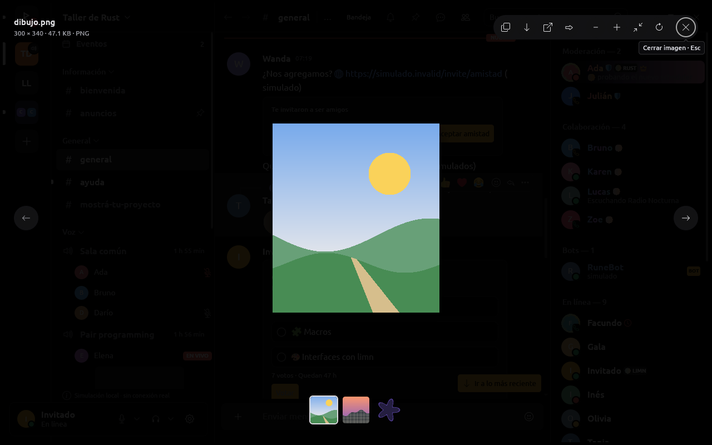
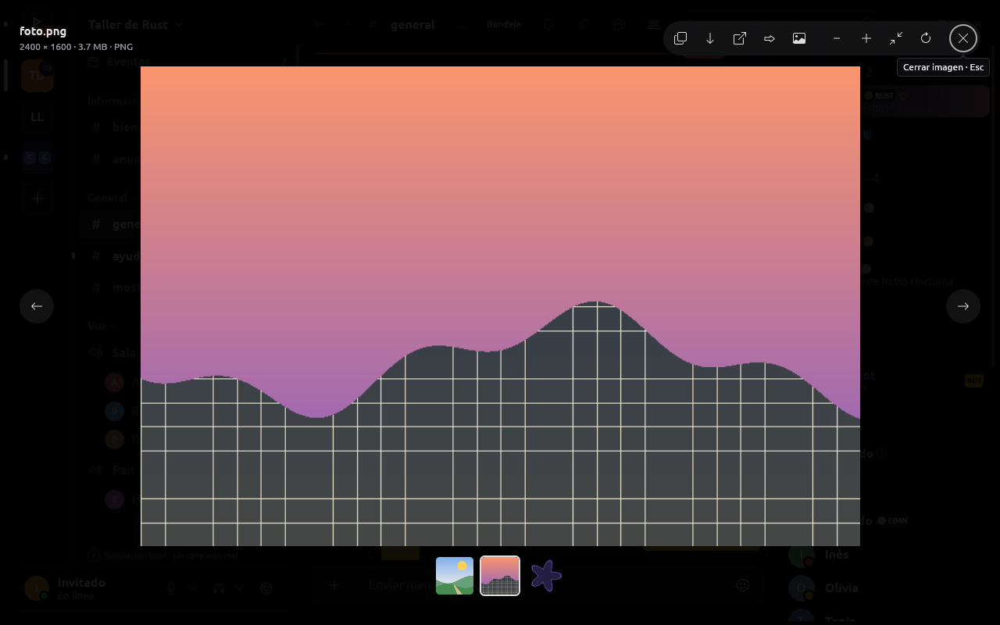
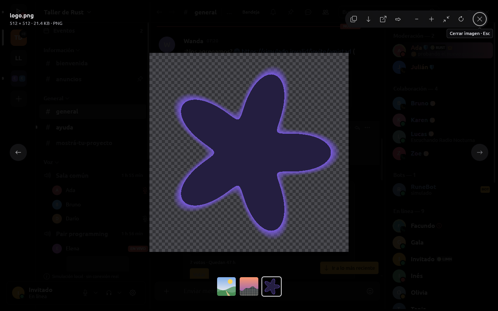
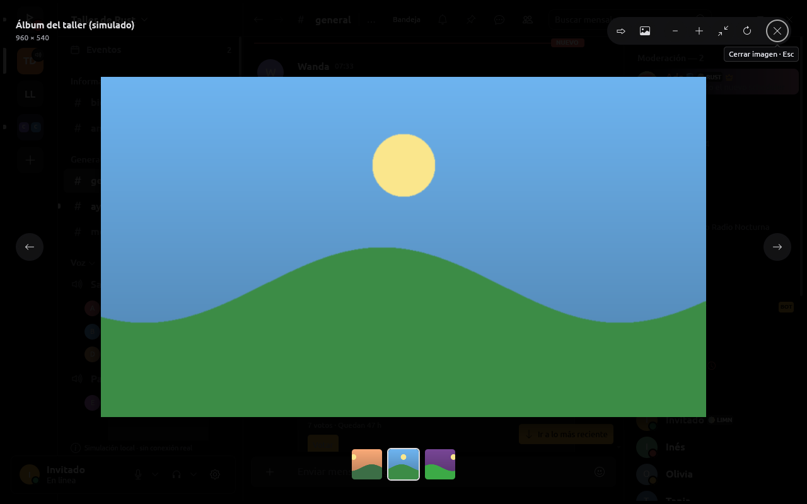
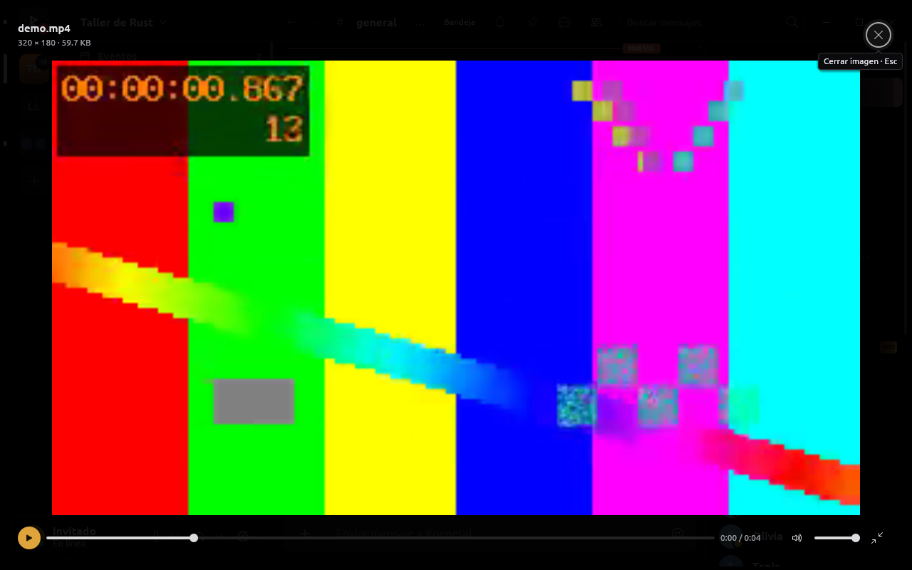
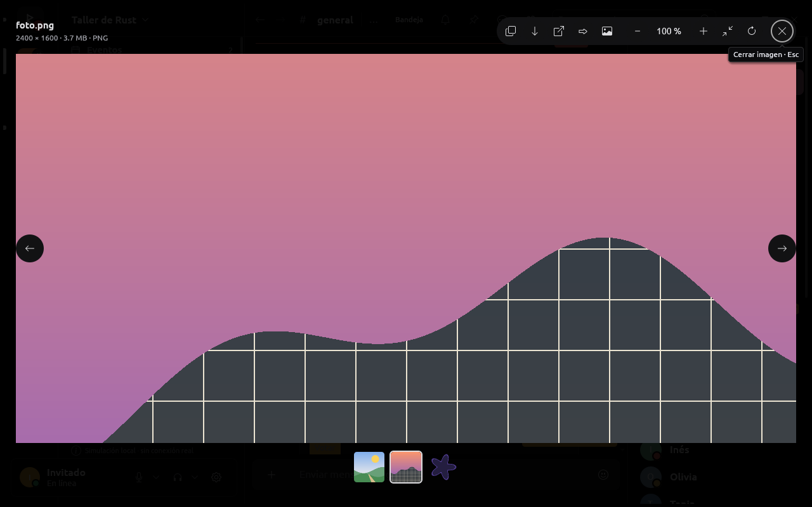

# Visor de imágenes y videos

El visor a pantalla completa de adjuntos, tarjetas, páginas de PDF y videos.
Lo genérico vive en limn (`Element::zoom_view` e `ImageViewer`); lo de RUNE
(galería de un mensaje, acciones del proveedor, original al hacer zoom,
video) en `rune-ui` (`attachments.rs`, `documents.rs`, `voice_messages.rs`).

El comportamiento sale de estudiar visores maduros:
GNOME Loupe (la referencia principal: casi todos los números), Zed/gpui,
iced, egui y visores hechos con él (Oculante, simp), Telegram Desktop, el
visor de medios de Discord (leído de sus bundles públicos) y Fotos de
Windows/macOS. La columna «Referencia» de la tabla dice de dónde sale cada
decisión.

| Imagen chica | Grande, encajada | Transparente |
| --- | --- | --- |
|  |  |  |

| Galería | Video |
| --- | --- |
|  |  |

Con la tecla `1` (100 %) la imagen grande pasa de lo que tiene su vista
previa y RUNE pide el original, que la reemplaza sin mover nada:


## Comportamiento

| Comportamiento | Cómo | Referencia |
| --- | --- | --- |
| Zoom con la rueda anclado al puntero | ×1,3 por muesca, 120 ms; el píxel bajo el puntero no se mueve durante la animación | Loupe, iced |
| Pellizco y Ctrl+touchpad | `UiEvent::Zoom` (egui `Event::Zoom`: macOS y táctil); Ctrl+scroll ×1,005/px; en Windows el pellizco llega como Ctrl+rueda | Loupe, egui |
| Desplazar | arrastrar o scroll de touchpad; al soltar, inercia e^(−t/0,25 s) | Loupe/GTK |
| Doble clic | encaje ↔ 2,5 × encaje en el punto | Loupe, Discord |
| Límites | de encaje (o tamaño real si es menor) a 20×; un lado más chico centrado, uno más grande siempre cubre: la imagen no se pierde | Loupe, Zed, Telegram |
| Animaciones | 200 ms; ninguna con movimiento reducido | Loupe, Telegram |
| Porcentaje | insignia unos instantes tras cada cambio y botón «NNN %» en la barra (encaja o acerca) | Zed, Loupe |
| Imágenes chicas | a su tamaño, centradas, sobre un fondo oscuro que deja ver la ventana; el primer doble clic las lleva a 250 % | Loupe, Discord, Telegram |
| Filtro | vecino desde 2 píxeles de pantalla por píxel; copia al tamaño en pantalla al achicar a menos de la mitad | Loupe, Oculante, simp |
| Transparencias | damero de 8 px fijo a la pantalla, sólo si la imagen tiene píxeles transparentes | Telegram |
| Desde la miniatura | la imagen crece desde el lugar de su miniatura al abrir (sin movimiento reducido) | Discord (0,9 → 1) |
| Varias imágenes | flechas, ←/→, Inicio/Fin, tira de miniaturas; entre los archivos de un mismo mensaje y entre las imágenes de una tarjeta | Discord, Telegram, Fotos |
| Video | el mismo visor, con sus controles abajo, Espacio, ←/→ ±5 s, llena la ventana | Discord, Telegram |
| Cerrar | Esc, botón, clic al costado de la imagen | Discord, Telegram |
| Acciones | copiar imagen (Ctrl+C), guardar como (Ctrl+S), abrir en el navegador, reenviar, resolución original, girar (Ctrl+R) | Discord, Telegram, Loupe |
| Información | «300 × 340 · 47.1 KB · PNG» bajo el título | Zed, Discord |
| Carga progresiva | ThumbHash mientras llega la vista previa; la vista previa al tamaño final mientras llega el original; el original se pide solo al hacer zoom más allá de lo que tiene la vista previa | Telegram |
| Teclado | `+ = - 0 1 2 3`, Ctrl+flechas, Ctrl+R; foco inicial en cerrar; cada control con nombre y atajo en su ayuda | Loupe, Zed |

### En limn

- `Element::zoom_view`: el zoom lo guarda el árbol por ID, como el
  desplazamiento de un scroll; la geometría (encaje, límites, zoom anclado,
  inercia, animación) está en `zoom_view.rs` con sus tests sin ventana.
  `UiAction::Zoomed { id, scale, fitted }` informa la escala;
  `UiTree::zoom_scale(id)` la lee; `zoom_control`, `zoom_dismiss`,
  `zoom_opened_from` y la sombra de la imagen.
- `ImageViewer` alrededor del zoom view: fondo oscuro a
  pantalla completa, barra de herramientas, `subtitle`, `picture_size`,
  `placeholder`, `thumbnail`, `footer`, `initial_focus`, `zoom_level`.
  `ImageViewer::zoom` y `MAX_ZOOM` quedan deprecados (el árbol guarda el
  zoom).
- limn-egui: imagen de resolución completa agrandada hasta llenar su
  rectángulo; copia con vecino más cercano y copia reducida; damero; giro por
  cuartos; `Event::Zoom` → `UiEvent::Zoom`. `Icon::Forward` (set de RUNE).

### En RUNE

- `attachments.rs`: galería de los archivos de un mensaje (los que tienen
  vista previa y no están tapados), tira de miniaturas, Inicio/Fin, Ctrl+C,
  Ctrl+S, reenviar (cierra el visor y abre el diálogo, sólo con permiso),
  original al hacer zoom más allá de la vista previa (768 × 512 por la
  densidad) o al abrir, si el ajuste a la ventana ya muestra más
  (`follow_viewer`, después del layout), ThumbHash
  como suplente, línea de información. Las teclas del zoom pasan al árbol.
- `documents.rs`: las páginas usan el zoom del árbol; el nivel se muestra.
- `voice_messages.rs`: el video a pantalla completa usa el mismo visor, con
  sus controles abajo y ←/→ ±5 s.
- `--capture-viewer` (escritorio): un mensaje simulado con una imagen chica
  (300 × 340), una grande (2400 × 1600, con vista previa de 768 × 512) y una
  transparente (512 × 512); `--action after:key:{tecla}` aprieta una tecla
  con el visor ya dibujado.

## Límites

- **Ocultar los controles tras unos segundos quieto** (Loupe, Telegram):
  limn no tiene una noción de inactividad del puntero; los controles quedan
  fijos y compactos.
- **Rebote elástico en los límites** (Loupe): los bordes frenan en seco.
- **Deslizar para cerrar**: ninguna referencia lo hace en escritorio.
- **Pellizco en Linux**: winit 0.30 no entrega gestos de touchpad en X11 ni
  Wayland; en macOS sí (y en Windows como Ctrl+rueda).
- **Giro animado**: el giro es inmediato y vuelve a encajar.
- **Damero detrás de GIF y videos**: sólo detrás de imágenes fijas (las
  superficies del host no informan transparencia).
- **Menú de porcentajes y valor escrito** (Zed, Loupe): el porcentaje es un
  botón que encaja o acerca 2,5×; las teclas 1/2/3 dan 100/200/300 %.
- **Imágenes chicas agrandadas para llenar**: ninguna referencia madura lo
  hace por defecto. limn lo permite (`Element::zoom_upscale`) si el dueño lo
  prefiere.

## Cómo verlo

```sh
cargo run -p rune-desktop -- --provider mock --screenshot /tmp/visor.png --channel general --capture-viewer --action attachment:9000000000000086:86:preview
cargo run -p rune-desktop -- --provider mock --screenshot /tmp/visor.png --channel general --capture-viewer --action attachment:9000000000000086:87:preview --action after:key:1
cargo run -p rune-desktop -- --provider mock --screenshot /tmp/visor.png --channel general --capture-media --action msg:9000000000000204:card:0:0:1
cargo run -p rune-desktop -- --provider mock --screenshot /tmp/visor.png --channel general --capture-player --action attachment:9000000000000205:205:play --action attachment:9000000000000205:205:fullscreen
```

Las capturas se tomaron en un Xvfb privado de 1280 × 800. Probado con
fixtures y la simulación; no contra el servicio real. El álbum simulado de
`--capture-media` tiene tres imágenes propias, y `strip_shows_what_it_opens`
comprueba que cada miniatura de la tira es la imagen que abre.
